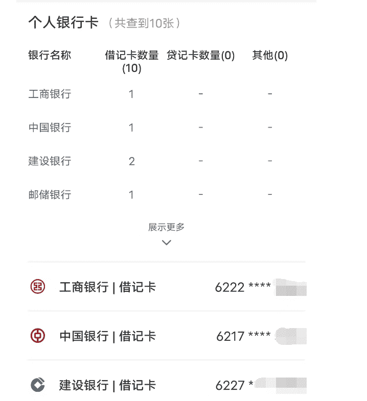

# 2023-07-23找回丢了的钱，仅用1个app

> 来源：[https://xuqiwei1986.feishu.cn/docx/PpBzdVNASofGn2xYma0chaXwnid](https://xuqiwei1986.feishu.cn/docx/PpBzdVNASofGn2xYma0chaXwnid)

> 🔗 原文链接： h[ttps://mp.weixin.q](https://mp.weixin.qq.com/s?__biz=MzAwNzM3NzU4OQ==&mid=2650724013&idx=1&sn=1c2ecab73dc4a159d3d1f10328ba15f2&chksm=83757177b402f86131d8ea300bfee3f1e00fa938302580bf2f9e17e3941d8fc57c4090248785&scene=21#wechat_redirect)q.com/s?__biz=Mz...

>

原创 是夏夏啊 越女事务所

2023-07-23 22:35:33

精确发文时间由壹伴提供

2023-07-23 22:35 发表于 北京

手机阅读

图：ayahundred

[🎧 点击收听音频](https://y.qq.com/n/ryqq/songDetail/1028501)

当前浏览器不支持播放音乐或语音，请在微信或其他浏览器中播放 Cap Diamant 音乐： Cœur de pirate - Blonde

我妈妈前些天，丢出3张她在老家办的银行卡。

让我帮查查——

里头还有多少钱。

顺便把 钱 转到一张 卡上。统一 集中管理， 帮她买 买 理财。

我妈心疼地说：

“大热天的， 估计你要跑好几家银行吧？

有一个是老家农村信用社，在北京没有网点网点。 你也别费力了， 干脆出点手续费，在别家银行ATM取吧！”

我说：

嘿嘿，不用。

然后仅花了几分钟，线上帮她搞定了！

**二**

老人一辈子都有多张银行卡。

精力不济后，想让子女帮把钱转回1张卡， 方便 集中管 理 。  当然， 年轻人也不乏这种需要。

但问题是——

很多小银行app并不好用，完全没法操作。

这事挺好解决。

不用大热天的跑银行网点。

我帮妈下载了一个云闪付APP，注册、登录、人脸识别...

一大堆操作之后。

把她这3张卡，都绑定在了云闪付AP**P上。 绑定之后**， 每张卡 上有 多少 余额，一清二楚。

然后可以在云闪付APP上，直接操作转账。

能转到自己同名卡，也可以转给别人。

我就用这个方法，把我妈卡上休眠已久的五六万块钱，都汇集到一起了。

只用了几分钟时间。

0手续费。

路径： 云闪付APP的首页-卡管理- 添加银行卡。

可以绑近2000家银行的卡。

包括一些 很冷门的银行卡也能找到 。 比如 村镇银行卡；比如我妈的退 休金 卡...

我妈震惊于我的操作效率。

“你日常写理财，原来写的是这些啊。”

**三**

当然了，很多老人会忘记自己开过啥卡，卡号是多少。

（年轻人也会忘）

我怕有遗漏。

又帮我妈查了一下 **她名下一共还有多少张银行卡。**

她名下一共有10张银行卡。

既包括线下办理的 **一类卡 ****；也包括**在线上买存款时，开通的 二类卡。

一网打尽。

查询路径：云闪付首页—— 一键查卡

有一张卡，她怎么也想不起来，是因为啥、在哪儿办的了。 卡号也想不起来。

**怎么知道里面还有没有钱？**

我妈突然焦虑了，害怕漏了什么钱在里头。

好办！

我再次打开云闪付APP首页-卡管理-添加银行卡。 选择“免输卡号，一键绑卡”，然后绑定她忘了卡号的银行的所有卡片。

之后直接查余额就行了。

当然。

其中的一键查卡、一键绑卡功能，还不太完善。

目前只能查到200多家银行的卡。

但 覆盖一些主流的银行，还是没问题的。

**四**

这是查银行账户。

怎样查询自己名下的各类金融账户，金融资产？

比如，买过的保险？

名下所有的股票账户？

基金呢？

个税呢？

公积金、社保...等等呢？

其实以上这些，我之前也都详细的介绍过，但问起的人还是很多。

今天就借我这个例子，再提一嘴。

详细的， [**点击这里重温**](http://mp.weixin.qq.com/s?__biz=MzAwNzM3NzU4OQ==&mid=2650722314&idx=1&sn=a90941631279d6fcf507e94cb2f9032a&chksm=837577d0b402fec6bed671e49e7f61110870807ef816425cd69e7cb15aad38d2ceb8d3e60d57&scene=21#wechat_redirect)

**就，再拿保险来说说：**

同样有一个功能强大的APP，叫「 金事通 」。

可以查到自己名下所有的人身险、投资型保险、车险保单。

基本也算是一网打尽了吧。

今天这篇内容，有需要的朋友收藏下。

**ps.**

提前说明下。

明天带小朋友去医院做检查，要花费比较长的时间，可能会比较仓促。

没有特别重大的事件，就不更新啦〜

