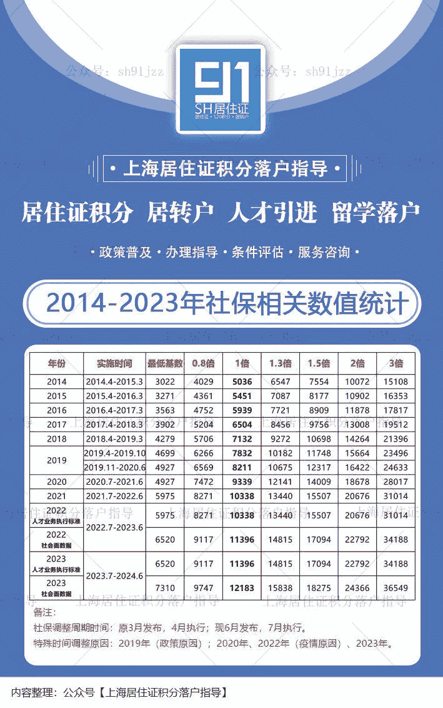

# 2023-07-05不同方式落户上海，工资要达到什么水平？（附最新社保基数表）

> 来源：[https://xuqiwei1986.feishu.cn/docx/IKC7dXc9foHze8xM9PRcTgp9nwg](https://xuqiwei1986.feishu.cn/docx/IKC7dXc9foHze8xM9PRcTgp9nwg)

> 🔗 原文链接： h[ttps://mp.weixin.q](https://mp.weixin.qq.com/s/6PqGebz21w0Fjm5YcK683A)q.com/s/6PqGebz2...

>

上海居住证积分落户指导

2023-07-05 12:04:34

精确发文时间由壹伴提供

2023-07-05 12:04 发表于 上海

**导语**

**本平台**

1、领域：上海居住证、120积分、居转户、人才引进、留学落户

2、服务：政策普及、办理指导咨询

**可联系值班老师进行 ****政策 咨询与协助**

**公众号首页——点击“人工咨询”**

咨询：王老师 19821031225（手机、微信）

#

# **——王老师**

微信号： 19821031225

**政策普及、办**理指导，问题解答， 可咨询 【专职老师】

**常规居转户**

**（1）7年+中级职称**

**持证者后4年累计36个月社保基**数满足1.3倍 （目前工资满足14815元） ，且社保与个税要相匹配。

**（2）7年+2倍社保**

**持证者后4年累计36个月社保基**数满足2倍 （目前工资满足22792元） ，且社保与个税要相匹配（其余时间也要满足1倍以上）

（3）5年+3倍社保（科创科技企业）

**最近4年内累计36个月达到社保**3倍 （目前工资满足34188元） ，其余2年时间社保至少1倍以上，且社保与个税要相匹配。

**（4）临港新片区（5年3年）**

**最近4年内累计36个月社保1倍** （目前工资满足11396元） ，且社保与个税要相匹配。

**留学生落户**

+   境外博士毕业、国内211本科境外硕士；

+   国内非211本科境外世界排名前500名的硕士；

+   境外世界排名前500名的本科学士及以上；

+   国内硕士或副高职称境外访问学者一年以上。

符合以上四种学历要求的，社保要求为最近6个月连续在同一单位缴纳1倍以上社保。

+   国内本科非211毕业且境外硕士非世界前500名；

+   境外非世界前500名的本科学士及以上学历。

要求累计在境外学习时间需满1年以上。社保要求为最近连续12个月在同一单位缴纳1.5倍以上社保。

**人才引进落户**

一般符合人才引进政策的，2年2倍社保以上，同时需公司有人才引进资质；

高级职称或高级技师， 最近1年社保2倍及以上，且社保与个税要相匹配。

**应届生落户**

应届生落户对社保基数和时间没有过多的要求，符合应届生72分就可以申请，申请期间社保正常缴纳即可。

**投靠落户**

投靠落户上海只需要满足年限即可，对社保缴纳没有过多要求。

*社保缴纳以当时申请为执行标准，以上仅供参考

大家可以对照自己的历年工资是否满足落户要求

（王老师微信）

**扫码免费咨询**

可扫二维码添加政策老师微信

老师将提供一对一的免费咨询

相关阅读

**不知道自己条件的用户，可以点**击下方，使用 “居转户条件模拟评定工具” 测试下自己的条件是否满足

普 及丨指 导

---

居住证|积分|居转户|人才引进|子女入学

上海居住证积分落户指导

