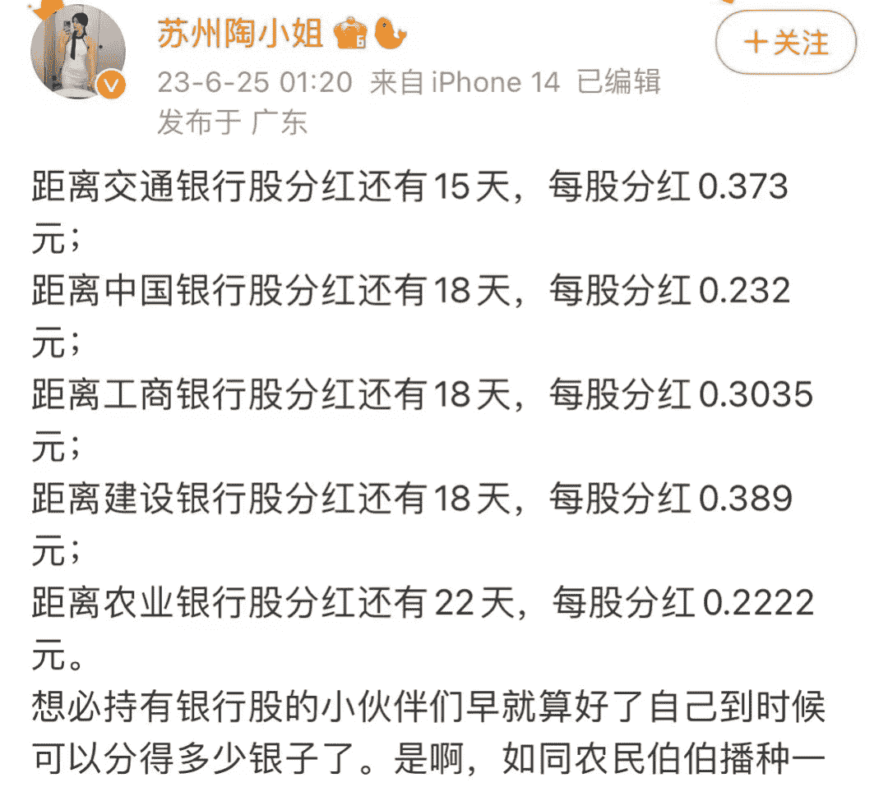
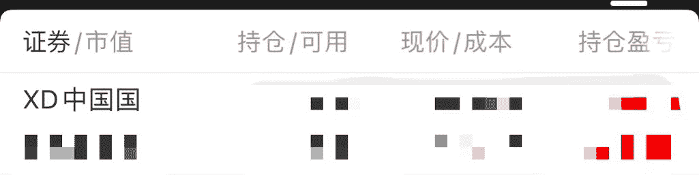
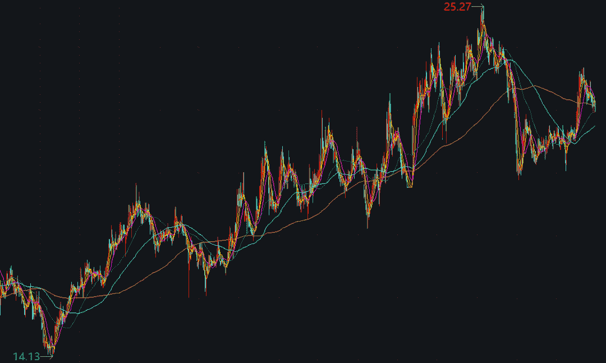
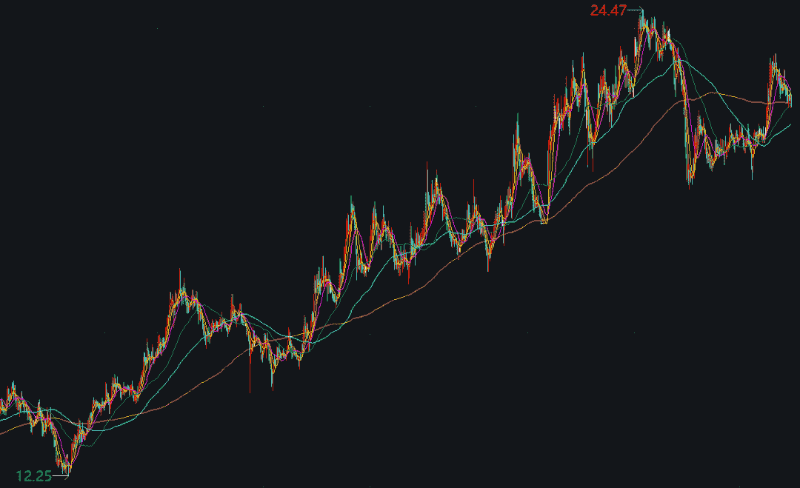
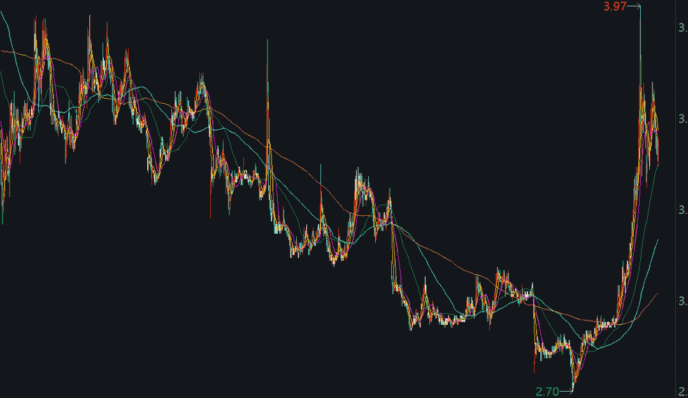
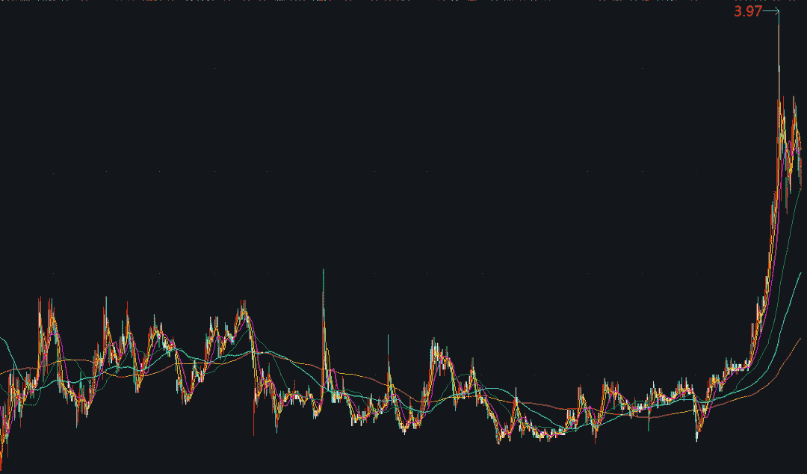

# 2023-06-27胡锡底

> 来源：[https://xuqiwei1986.feishu.cn/docx/CYaXdrAtAoEGalxa2AKc9SKsnLf](https://xuqiwei1986.feishu.cn/docx/CYaXdrAtAoEGalxa2AKc9SKsnLf)

> 🔗 原文链接： h[ttps://mp.weixin.q](https://mp.weixin.qq.com/s/QNkhtTsnIskh1PcrzRsONQ)q.com/s/QNkhtTsn...

>

原创 是夏夏啊 越女事务所

2023-06-27 23:17:46

精确发文时间由壹伴提供

2023-06-27 23:17 发表于 北京

手机阅读

收录于合集 #收息股探讨 24个

图： Malika Favre

胡锡进入市的第1天，a股反弹了一波。

看了他写的炒股体验，被逗乐了。

他说：

“我（今天）在一个讲座上授课...学员们都知道我买股票了，纷纷好奇地问我情况怎么样。我在台上当场打开手机， 一看账户，哇塞，盈利奇迹般变成104.7元。 我高兴地告诉了大家，台下的上百学员送给我热烈的掌声。”

老胡的退休金，肯定是拔尖的那一拨人。

他首次入市 的本金是10万。

10万对他来说不算多。 换言之，这种本金对应的浮盈浮亏，影响不了他的心情。

更多是逗乐吧。

老胡说，“我相信自己一开始会交些学费，但我买的都是从高点上跌了一半的个股和基金， 我朴素地觉得：它们不该再跌一半吧？ ”

emmmm.

这新鲜的韭菜气息，让人感动。

跌一半之后，再跌一半，在股市太常见了。

老胡说，“我为自己也为股民们祈祷，昨天我开户时的A股股指就差不多是中国股市从今往后的最低点了。”

那今天就是“胡锡底”了。

祝他好运，也祝我们好运

**二**

最近一直是分红的季节。

茅台分红日期定了，是6月30号。

分红钱下发的当天，就可取现。

而且可以免税（只须持有满一年）

我看微博上有专门买银行股的人，还专程用“倒数xx天”，来记录银行股的分红日。

有一种，很迫切的领饭吃的心情。

对了。

**一个小细节**：分红的当天，股票前面一般会标记 “XD” 这两个字母。

钱会在这天，直接发到股票账户余额。

分红的钱用起来很爽。

消费起来， 毫无罪 恶感 。

拿了这笔钱买买买，买个包，买块表，买个手机，给娃买个玩具。

因为 我手里的股票数量没减少。

只要公司靠谱，明年还可以继续分。

就像老母鸡孵蛋。

只要 我还留着鸡没杀（没卖股），鸡还可以继续生蛋。

就不太有心理压力。

**三 **

很多人会吐槽：

一分红就除息，股价就跌，分红有什么意义？

确实。

分红当天，股票价格通常也会往下调调。

这个就叫： **除息**

前几天就有人冷冷地和我说：

“哼，我买了XX股票，一股花了10多块，然后今天分红了，开盘变9块。

你说这钱谁拿的，呵呵”

我是觉得，从长远来看——

除息的负面影响，被很多人夸大了。

一个生意挣钱了，把一部分钱分红给我们。

但它还是有一部分利润，没有分配掉，会 继续沉淀在公司 里 ， 每股净 资 产越来越 多。

关键是，公司还有持续赚钱的能力呀。

只要它的盈利上升，每股净资产在变多，公司股价也会涨的。

举几个例子吧：

**比如长电，经典收息股。**

把分红剔掉——看看除息后的股价走势。

专业词汇叫 “不复权”

那过去5年，股价表现是这样的。

也是一路向上的。

不计入分红的情况下，五年涨了36%。

如果把分红计入在内。

即选择“复权”

它近五年来的走势是这样的—— 计入了分红后，它的股价涨得更好，五年涨了57%

。 。 。

所以你看：

**如果是一个好股票。**

即便 除息，不计入分红， 它股价长期也是涨的。

**四 **

长电可能太白月光了哈。

前面那位微博网友，她买银行股收息。

以农行为例。

如果除息，不计入分红的情况下，农业银行近五年的走势如下：

确实一路向下，一路亏钱。

直到 去年底的“中特估”行情，才开始暴拉 ， 回到了当初的起点。

不赚不亏。

但，把分红也计入进去的话：

它的股价形态好看了很多。

前几年的时间里， 因为分红的存在，把股价熨平了不少。

让人起码拿着没那么难受。

所以，从一个“分红吹”的角度来说， 分红不但不是骗人。

**反而意义很大！**

有的股票，股价趴在地上好几年； 但 因 为有分红， 起码每年有钱回来 。

心态就会好很多。

才更有机会，熬下去。迎来“尾部的胜利”。

好比老胡的退休金——

定期都有一笔钱进账。

10万本金的浮浮沉沉，也就没啥压力了嘛。