# 2023-06-12为什么我建议你搞个香港身份

> 来源：[https://xuqiwei1986.feishu.cn/docx/IQNndZ8vVonAewx3B9lcEvoOnpa](https://xuqiwei1986.feishu.cn/docx/IQNndZ8vVonAewx3B9lcEvoOnpa)

> 🔗 原文链接： h[ttps://mp.weixin.q](https://mp.weixin.qq.com/s/dq1B-5nLE3U2qjSMjoUehw)q.com/s/dq1B-5nL...

>

小众消息

2023-06-12 12:30:56

精确发文时间由壹伴提供

2023-06-12 12:30 发表于 浙江

手机阅读

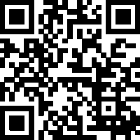

香港过去一直有「互联网荒漠」之称，疫情这三年，开始大力扶持互联网科技工程和 IT 产业，公布了《香港智慧城市蓝图 2.0》。目前规划已经覆盖到交通、医疗、经济、教育、环境等多个方面。

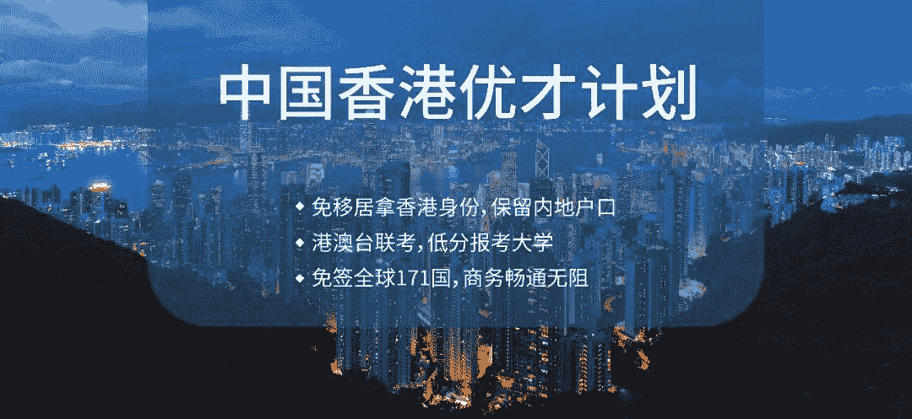

目前在 **智能制造 **， **5G 网络 **、 **智慧城市 **等领域人才，通过香港优才计划入境都极具优势。

## **什么是香港优才计划**

优才计划，全称 **优秀人才入境计划 ****，香港政府于 2006 **年 2 月公布，是一项 设有配额的移民吸纳计划 ，旨在吸引高技术人才和行业优秀人才来港定居，藉以提升香港的竞争力。

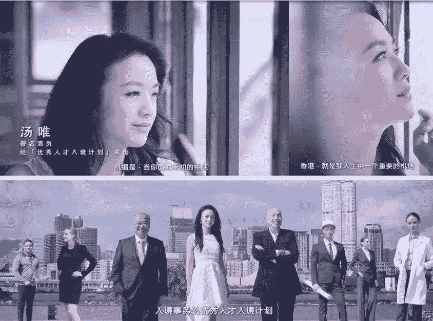

**汤唯代言香港优才计划**

而就在前段时间，香港入境处批准了史无前例的 707 名申请者获得名额。并且配额也在逐年不断翻倍，从最初的每年 1000 个名额增至 2022 年的 4000 个。但面对大量的申请人，4000 个配额仍然是杯水车薪。然而就在去年 10 月 19 日香港特首最新的《施政报告》中提出， 取消优才计划配额，进入两年「无限」申请时代。

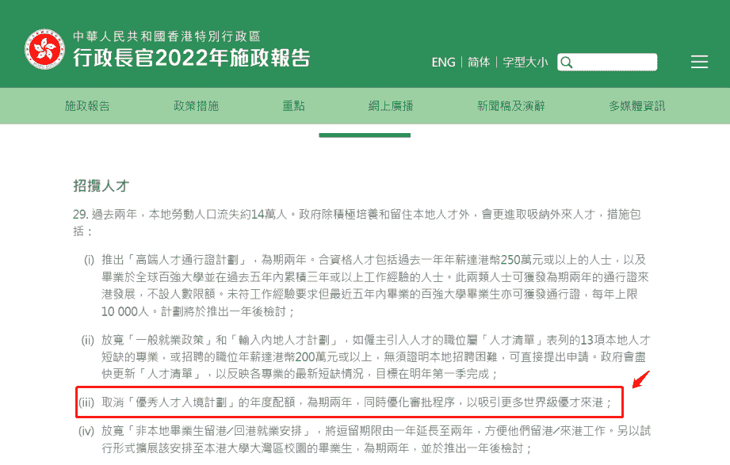

也**就是说，只要符合优才计划申请资格，是香港想要的优秀人才，**都有更大的机会通过优才计划获得香港身份。可见， 香港优才申请的窗口期已经到来，港府招揽内地人才的坚定决心不言而喻，现在正是抓住香港身份的红利期。

## **申请方式及资格评测**

80 分及以上可联系申请香港身份：

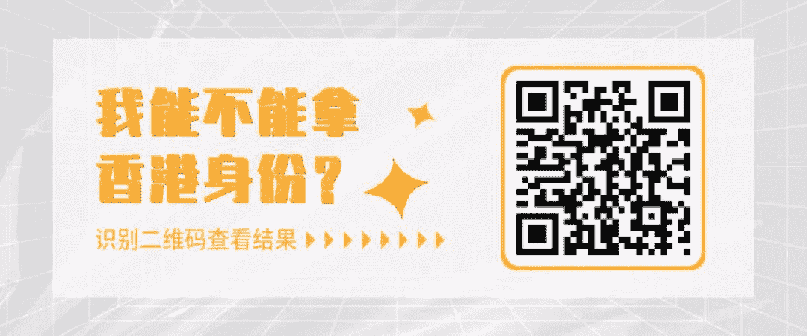

## **香港优才计划优势**

一、采用计分制，同拿内地户口+香港身份

香港优才计划采用计分制， 根据申请人的年龄、学历、工作经验等综合计分 ，最高 245 分，80 分可申请；

香港看重人才、培养人才，一人申请，配偶及未成年子女可同步拿香港身份，享受香港福利；

通过香港优才拿香港身份并不是意味着放弃内地户口 。香港由于其制度优势，可同时拥有内地户口 + 香港居民两种身份，尽享两地工作生活、商机、教育、机遇等资源。

**二、事业发展空间广阔，拒绝内卷**

香港不仅在金融领域处于全球领先，其科研影响力也处于全球第一梯队， 一个城市就有 5 所大学排名进入全球前 100 ，拥有 16 个国家重点实验室和 6 个国家工程技术研究中心。

香港薪资水平高。据港府统计处公布的数**据，2022 年第**二季度的工资中位数为 20000 港元 ，薪酬福利放眼全球仍具有很强竞争优势。科技、金融、医疗、环保、贸易等行业发达，不止薪酬福利有前景，同时有助于个人未来发展。

三、子女享国家化教育，升学途径多样

拥有香港身份，孩子不仅可以享受香港优质的国际化教育资源，还可以获得多样化的升学途径，为子女留下一个内地、香港、出国都能便利升学的路 。

## **申请方式及资格评测**

80 分及以上可联系申请香港身份：

## **香港身份优势**

**★ 教育优势**

在香港，不管是永久居民还是非永久性居民，均可享有同等的教育权利。

**香**港实行 15 年免费教育，它的 国际化教育、两文三语、灵活的小班教学、雄厚的师资力量等等特色，是吸引内地家长送孩子来香港读书的重要原因。

而且，现在针对孩子无法回香港读书的情况，在内地就读，港府也有学券补贴（相当学费免费）。

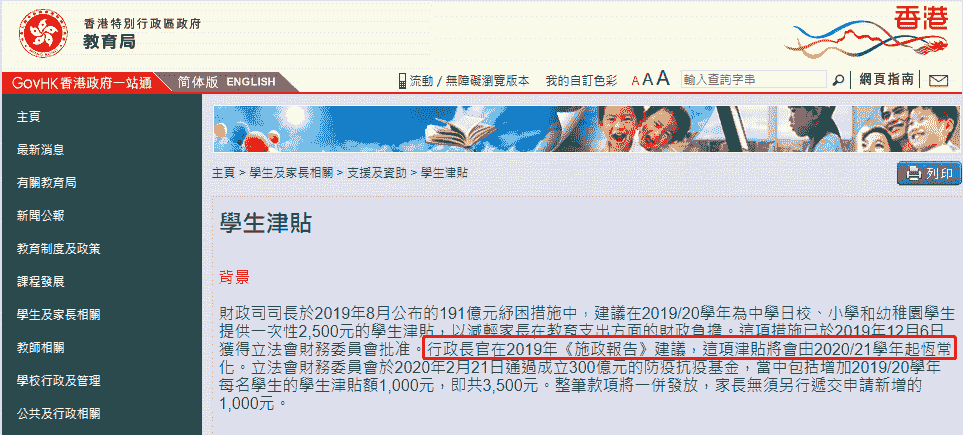

来源：香港教育局

另外，除了选择香港公立学校，也可以选择私立和国际学校。

**★ 升学优势（无需参加高考）**

**▶ 参加「DSE 考试」 **（简称：香港高考）低分就读内地大学

**拥有香港永居身份，凭 DSE 成绩，通**过 「 免试招生计划」直接升读内地 132 所高校（含清华北大复旦上交等名校） 。

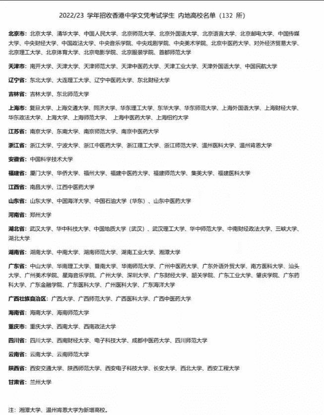

图源：广东教育考试院

而且 DSE 成绩还被海外多所大学认可，可凭 DSE 成绩直接申请海外大学。

**▶ 参加「华侨生联考」 ****： ****除此之外，香港永**居学生还可以通过 「华侨生联考」 ， 报读内地高校。华侨生总分 750 分（考试内容与内地考生相似），录取分数线： 一本 400 分，二本 300 分，艺考生 200 分。

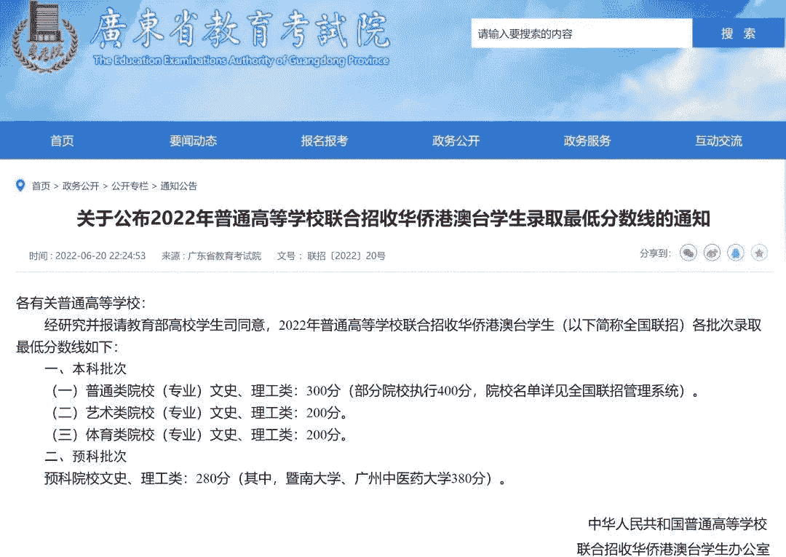

通过香港 DSE 考试和华侨生联考，很多原本考不上大学的孩子，都圆了名校梦。

**想要香港身份？**

** 长按二维码识别添加老师微信**

**离香港身份更近一步 **

👇👇

**★ 买房优势**

**▶ 内地买房： **香港居民可以在大湾区 9 市自由购买一套自用房， 且无需内地工作、学习时间证明等限购条件。

以深圳为例，非深户的建设者需要交够 5 年的社保才可买一套房，香港居民则无需缴纳社保，即可在深圳购置房屋。

**▶ 香港买房： **拿到永久香港身份，还能在香港买房哦。香港买房如果房屋总价在 800 万以内，首付只需 1 成。

**★ 香港高薪工作**

大家都知道香港工资高，但想要去香港打工，是有条件的，拿到香港身份就可以。

根**据香港政府公布 2021 年**最新港人收入及工时统计调查结果，发现 2021 年 5 月至 6 月香港雇员每月工资 中位数为 18,700 元 。

这还只是公共职业，如果是金融行业，技术行业，医生，律师，那么薪资就更高了。

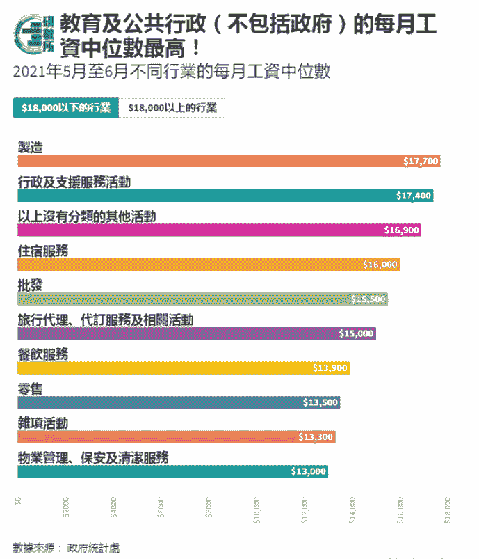

数据来源：港府统计处

**想要香港身份？**

** 长按二维码识别添加老师微信**

**离香港身份更近一步 **

👇👇

★ 护照免签 171 个国家和地区

香港特区护照可以 **免签 ****171 ****个国家和地区 **，还能在第三国中转，而且申请移居国外的排期更短，条件更宽松。

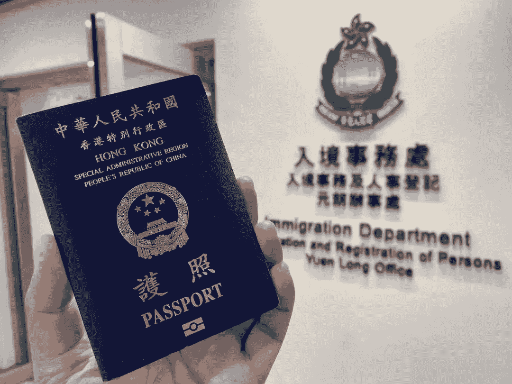

**★ 税收优势**

有了香港身份，在香港创业就业：

**▶ 进口商品关税 ： **一般商品进口至香港并不需要缴纳进口关税（特殊商品除外）

**▶ 公司营业税： **香港对企业主要是征收利得税和物业税。世界银行分析，内地企业综合税率为 67.3%，而香港只有 22.9%。

**▶ 个人税： **香港政府规定，薪俸税率最高为 15%，而且，每年每人居然有 13.2 万港元的免税额，这就使得全港有一半以上的在职人士无须交薪俸税，另外 20% 的人全年交税也不到 1000 元。

**★ 更好的营商环境**

**香港开放自由的营**商环境下，注册香港公司可享受 少税种，低税率 ，更易打造企业国际品牌效应，开拓国际市场，增强竞争优势，且无外汇管制。

**★ 超强的医疗水平**

香港患乳腺癌的患者五年存活率是 89.8%，为全世界第二。

香港治愈胃癌率是世界第一，比西方国家高 13%。

香港治愈肺癌率是世界第一，高于美国 6%。

香港治愈肝癌率是世界第二，仅次于美国。

香港治愈直肠癌率是世界第二，比欧洲更高。

**★ 粤港澳大湾区机遇/优势**

首先对在 **粤港澳大湾区 **工作的境外高端人才和紧缺人才，其在珠三角九市缴纳的个**人所得税**已缴税额超过其按应纳税所得额的 15% 计算的税额部分，由珠三角九市人民政府给予财政补贴。

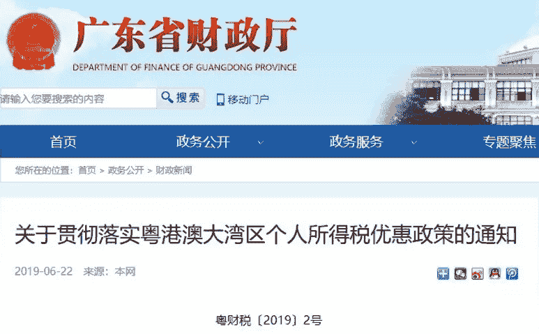

图源：广东省财政厅

其次，凭香港永居身份可以让随迁子女在 大湾区 9 市入读义务教育学校 。

如果是港澳高层次人才子女入读幼稚园、各级各类学校均能享受与当地户籍人口子女同等的待遇，包括就近免试入读公办学校、参加学业水平考试并录取、享受免费义务教育、免择校费等重大福利。

总的来说，有香港身份无论在内地还是香港亦或是海外，都有**很**多便利性，对于 孩子教育升学，自己创业就业，家庭未来规划发展 等都具备很大优势 。

**想要香港身份？**

** 长按二维码识别添加老师微信**

**离香港身份更近一步 **

👇👇

---

题图：高品图像 GaopinImages

说明：本文含有广告内容。