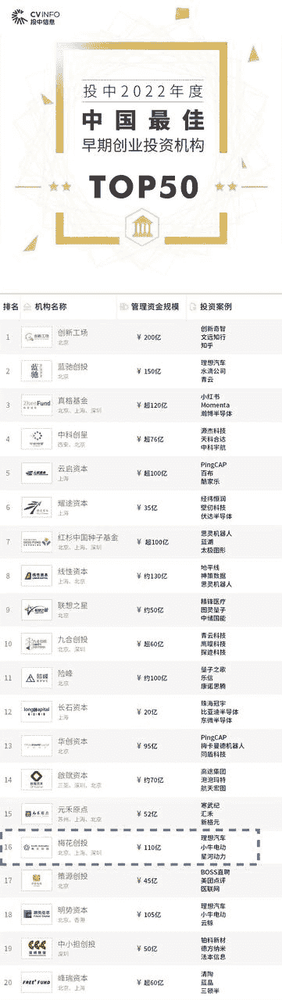
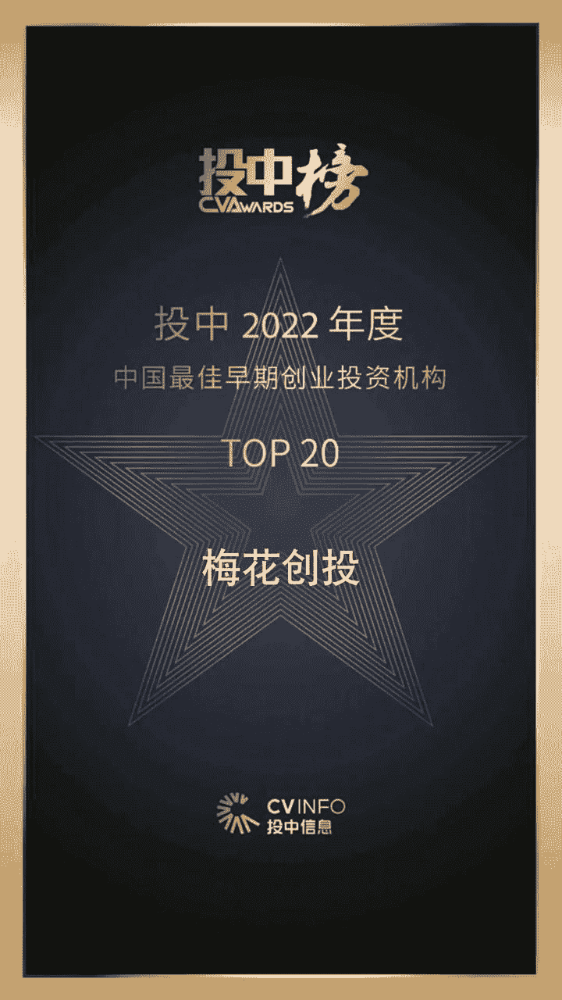
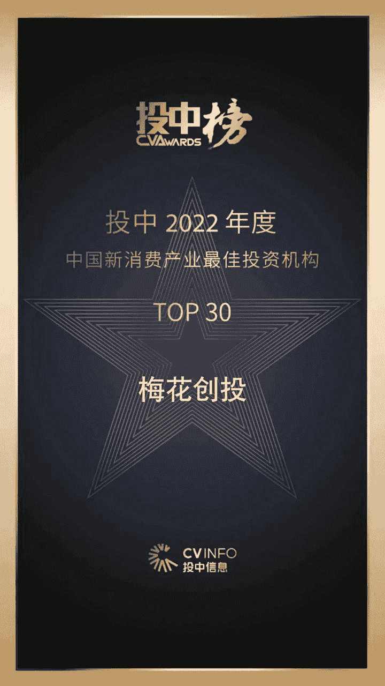

# 2023-05-22梅花创投获2022投中榜「最佳早期投资机构」、「最佳新消费投资机构」等大奖

> 来源：[https://xuqiwei1986.feishu.cn/docx/JPVDde8hno24OHxTGrLc9funnPb](https://xuqiwei1986.feishu.cn/docx/JPVDde8hno24OHxTGrLc9funnPb)

> 🔗 原文链接： h[ttps://mp.weixin.q](https://mp.weixin.qq.com/s/1-QztykkK03_xqgAReWCEQ)q.com/s/1-Qztykk...

>

梅花快讯 梅花创投

2023-05-22 09:01:53

精确发文时间由壹伴提供

2023-05-22 09:01 发表于 北京

手机阅读

收录于合集 #梅花荣誉 56个

点击关注👆｜有梅花·无寒冬

2**023年5月19日，投中信息2022年度中国创业投资机**构暨私募股权投资系列榜单-- “投中榜”正式揭晓。 梅花创投获「年度中国最佳早期创业投资机构TOP 20」、「中国新消费产业最佳投资机构」等大奖。

“ 进化，是创业的第一性原理 ”。 近年来，梅花创投不断进化， 科技行业成为了主要投资赛道。 重点布局领域总结为六个字，新半军、数智航-- 新能源、半导体、军工、数字化、智能制造、商业航天。 所投的600多 家公司里，近300家公司是科技类企业。 被投企业理想汽车（NASDAQ： LI）、小牛电动（NASDAQ： NIU）、悦安新材（688786）等优秀企业陆续上市，未来还将有50+独角兽企业完成上市。

梅花始终坚持长期主义，坚信 科技改变世界，重仓小镇青年，投资中国的高科技与新消费，在新时代的逻辑转变中穿越周期。

以下为榜单详情：

投中信息连续17年作为独立的第三方机构发布“投中榜”。该榜单依托CVSource投中数据，通过投中研究院对数据进行标准化处理，按照总体积分排名评选，覆盖超千家私募股权领域活跃投资机构。

— 梅花创投 　—

梅花创**投成立**于2014年5月，是国内最活跃、最懂互联网的投资机构之一，宗旨是帮助聪明的年轻人成为伟大的企业家，目前管理约100亿人民币基金和1亿美元基金。梅花创投专注在智能制造、人工智能、新消费、新内容、企业服务、移动出海等新经济领域的投资，投资项目600余家，涌现出代表案例： 大掌门、趣店（NYSE：QD）、小牛电动（NASDAQ：NIU）、赤子城（HK：09911）、理想汽车（NASDAQ：LI）、优客工场（NASDAQ：UK）、悦安新材（688786）、58同城、转转&找靓机、听云、福佑卡车、科比特无人机、珞石机器人、星河动力等大批知名案例， 未来两年将有30家企业上市。

**有梅花·无寒冬**

视频号

梅花创投

