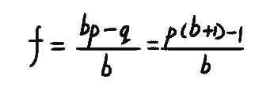
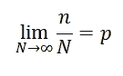
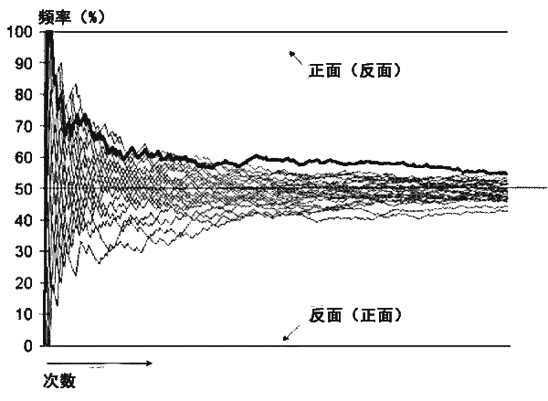
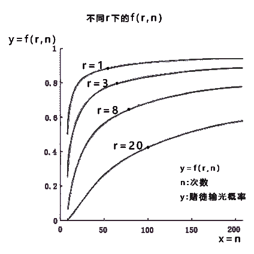
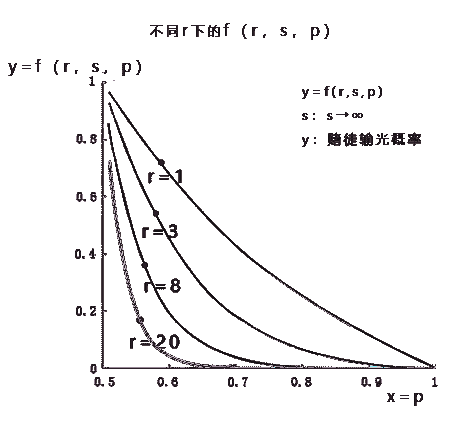
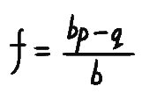
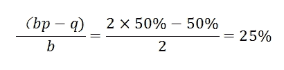
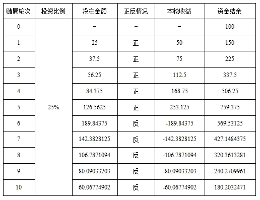
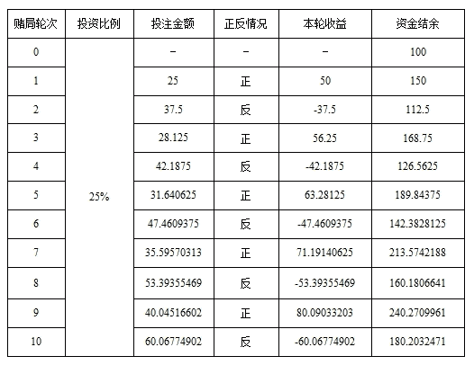
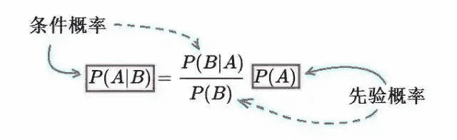

# 2021-12-30年终别去赌：你永远赢不了“凯利公式”

> 来源：[https://xuqiwei1986.feishu.cn/docx/FNcAdy3vko4xGFxWvU3c2lQRnid](https://xuqiwei1986.feishu.cn/docx/FNcAdy3vko4xGFxWvU3c2lQRnid)

> 🔗 原文链接：https://baijiahao.baidu.com/s?id=1720577562900098488&wfr=spider&for=pc ...

年终别去赌：你永远赢不了“凯利公式”

赌徒迷信的是运气，赌场相信的是数学。

### 引

2021年，又到年终，再提示一下：别去赌，你不是赌王。

赌王何鸿燊接手葡京赌场时，生意蒸蒸日上，但理性的赌王仍然忐忑，请教“赌圣”叶汉：

“如果这些赌客总是输，长此以往，他们不来了怎么办？”

叶汉笑道：

“一次赌徒，一世赌徒，他们担心的是赌场不在怎么办。”

叶汉说的只是心理层面，现代赌场程序方面的设计比叶汉当年要缜密得多，赌场集中了概率学、统计学的数学知识。一个普通赌徒，只要长久赌下去，最终一定会血本无归。所谓的各种致胜绝技，除了《赌圣》电影里的周星星，现实世界里的周星驰都不信。

一个痴迷于发财梦的赌徒永远不明白，与自己对赌的不是运气，也不是庄家，而是狄利克雷、伯努利、高斯、纳什、凯利这样的数学大师，赢的概率能有多大？

## 01 看得到的是概率 看不见的是陷阱

先说一个最简单的赌博游戏：抛硬币。

规则是这样的，正面赢反面输，如果你赢了可以拿走和本金一样多的奖金，如果输了则会赔掉本金。

你一听可能觉得这游戏还不错，公平！

于是你拿出了身上的100元来玩这个游戏，每次下注5元，这样你至少有20次的下注机会。

不过，你运气不太好，第一把就是反面，输了5块钱。

生性乐观的你觉得没什么，反正不管怎么说，赢面都有50%，下一把就可以赢回来。

结果，很快你就把身上的钱都输光了。

你百思不得其解，明明是公平的50%赢面，在50%概率下至少不会亏本的，可为什么最后会输光？

事实上，你以为自己看到了50%的概率，把游戏看得透彻明白，殊不知，你看到了概率，却没有看到背后的陷阱，一脚踏进了一个叫做“赌徒谬论”的坑里。

你觉得游戏是公平的，一正一反，均为50%概率，按照大数定律来说，这是必然规律。然而，你有没有想过，正是这种你以为的“公平”，让你误解了大数定律，才陷入了“赌徒谬论”里呢？

先来看看这种让你觉得“公平”的大数定律究竟是什么。

它是数学家雅各布·伯努利提出的：

假设`n`是`N`次独立重复试验中事件A发生的次数，`p`是每一次试验中A发生的概率，那么，当`N`趋于无穷时，有

式中`n`表示发生次数，`N`表示试验总次数。

也就是说，大量重复的随机现象里其实藏着某种必然规律。

还是以抛硬币为例，当投掷次数足够大时，出现正（反）面的频率将逐渐接近于1/2，且随着投掷次数的增加，偏差会越来越小，如下图。这是最早发现的大数定律之一。

掷硬币频率分布图

从表面概率看，这确实是场公平的游戏。但这种公平是有一定条件的。

大数定律讲究“大量重复的随机现象”，只有足够多次试验才能使得硬币正反面出现次数与总次数之比几乎等于1/2。可具体多少次才算“足够多”？才能够把它用在个人对赌上？

没有人知道。因为，概率论给出的答案是——无穷大。

谁也不知道无穷大有多大，只知道这是一个令人仰望的数量。可投掷硬币次数越少，大数定律的身影就越模糊，可能10次中5正5反，也可能9正1反，也可能10正0反或0正10反……

现实往往是，在远未达到“足够多”次试验时，你就已经输了个精光了。

你身上有100元结果如此，你身上有10000元结果也是如此，就算你身上有100万元也是如此，因为你永远不可能有“足够多”的钱。

“输赢概率为50%”，这本身就具有很大的误导性。

在硬币抛出之前，50%的概率代表的是可能性；

在硬币抛出之后，50%的概率代表的是结果的统计平均值，却并不是实际分布值。

这是你对大数定律的误解之一。

把“大数定律”当“小数定律”，觉得游戏是无条件“公平”的，正面和反面出现的频率都为1/2。这种在潜意识里被奉为圭臬的“公平”，紧接着让你踏入了第二个误解——“赌徒谬论”。

大数定律有一个明显的潜台词：

当随机事件发生的次数足够多时，发生的频率便趋近于预期的概率。

但人们常常错误地理解为：随机意味着均匀。

如果过去一段时间内发生的事件不均匀，大家就会“人工”地从心理上把未来的事情“抹平”。也就是，如果输了第一把，那下一把的赢面就会更大。

这种你下一把就可以赢回来的强烈错觉，就是“赌徒谬论”。

当你玩游戏连输时，你的心底突然冒出一个神秘的声音，它激动地朝你呐喊：稳住，风水轮流转，下一把你很有可能就要赢了！

而其实，上一把和下一把之间并没有任何联系。

就好比一个笑话：

在乘坐飞机时带着一枚炸弹就不会遇上恐怖分子了，因为同一架飞机上有两枚炸弹的可能性是极小的。

两者如出一辙，都把“相互独立事件”误认为是互相关联的事件。要知道，大数定律的工作机制，可不是为了刻意平衡前后的数据。在这场游戏中，任意两次事件之间并不会相互产生影响。

赌局是没有记忆的，哪怕你曾经输了多次，它也不会因此给你更多胜出的机会。

## 02 只要进了赌场 你就是一个穷鬼

再来说一个简单的赌博游戏，还是抛硬币。

这一次你运气很不错，第一把你就赢了100元！可把你高兴坏了！

但是和前面的个人对赌相比，这次多了一个庄家。

庄家跟你说：

“你看你也赢了这么多，我呢，辛辛苦苦搭个场子，最后什么都没捞着。要不这样，你赢了，就给我留下2%当流水，就算是救济救济老哥，给捧捧场！”

你想了下，2%也不多，拿去吧！好了，这事就这么定下来了。

然而你做梦都想不到的是：就是这小小的2%，又一次让你输得倾家荡产！

你同样百思不得其解，不过是小小的2%抽水，毫不起眼，可为什么在最后，它就成为了庄家赚钱的利器，自己又输光了？

天真的你，肯定不知道在赌场有一个逃不开的魔咒：赌徒破产困境。

第1把，赢；第2把，赢；第3把……你觉得自己被幸运女神眷顾，一身富贵命。

可早在18世纪初，那群热爱赌博的概率论数学家们，就提出了那个让赌徒闻风丧胆的破产噩梦：

在“公平”的赌博中，任何一个拥有有限赌本的赌徒，只要长期赌下去，必然有一天会输个精光。

我们来看看，为什么那么多长期赌徒都输成了穷光蛋？钱都到哪去了？

假如你的小金库是`r`，你带着小金库和庄家开始了一场追逐多巴胺刺激的赌博游戏，打算赢得`s`后就离开，每一局你赢得筹码的概率为`p`，那你输光小金库的概率有多大呢？

我们可以在马尔科夫链、二项分布、递推公式等的助攻下，列出一组组粗暴的、令人头皮发麻的函数，但也许它们都不如一张二维模拟图来得直白，如下图所示。

赌徒破产定理模拟图-1

赌徒破产定理模拟图-2

把不同`r`对应的`f(r,n)`和`f(r,s,p)`放到同一个图中进行比较，它形象地揭示了赌徒输光定理的含义：所谓的“公平”赌博，其实并不公平。

在`f(r,n)`中，随着次数`n`的增加，赌徒输光的概率会逐渐增加并趋近于1，并且`r`越小，这种趋势越明显。这说明在公平赌博的情况下，拥有筹码更少的赌徒会更容易破产。

而在`f(r,s,p)`中，图-2则冷峻而无情的话语告诉我们：

如果希望输光的概率比较小，那么需要每次的赢面`p`足够大或者是手里的筹码`r`足够多。

可面前有一位存在感极强的庄家，你真能从他虎口夺食、在赢面和筹码中赌一把吗？

答案，显然是难乎其难的。

第一，没有一个赌场会让你的赢面超过50%。

想要每一次的赢面足够大，除非庄家为你作弊，不随机，故意让你赢。

第二，庄家不是赌徒。

庄家的背后是赌场，也就意味着庄家相比于你，拥有“无限财富”。

你的小金库永远比不过庄家的赌场钱庄，这也意味着，你比庄家更容易山穷水尽。

当然，也许你可以一掷千金，但赌场却设置了最大投注额，这并不是他们好心，想保护你免遭破产，他们只是为了自保才设计了一道安全屏障，来抵抗“无限财富”带来的破产威胁。毕竟万一哪天比尔盖茨去赌场找乐子，一次性砸个几百亿进去，万一赢了，那赌场老板恐怕真的要哭了。

第三，庄家是“抽水”收入。

忘了抛币游戏中那毫不起眼的2%了吗？赌徒赢钱后，庄家会从赌徒手中抽取一定比例的流水佣金。

这样一来，即使你有一个小金库足以和庄家慢慢磨，打一场持久战，但赢得越多，为庄家送去的“抽水”越多。长此以往，你还是输了，钱都进了庄家的口袋。

最终，庄家赚的钱只跟赌徒下注大小有关。

这世上，天才终究是少数，而“赌神”、“赌王”之所以成为普通赌徒难以望其项背的存在，不仅因为他们深谙赌徒心理，也不仅因为他们懂赌场规则，更因为他们懂得该下注多少。

## 03 凯利公式

### 先告诉你怎么下注

在赌场老板的眼里，世界上或许只有两种人：一种现在是穷鬼，一种未来是穷鬼。

不过赌场老板也会有所忌惮，特别是遇到善用数学博弈的高手时。

凯利公式在高级赌徒的世界里大名鼎鼎，是顶级高手常用的数学利器。那什么是凯利公式？我们先看一个例子。

一个1赔2（不包括本金）的简单赌局，扔硬币下注，假设赌注为1元，硬币如果为正面则净赢2元，如果为反面则输掉1元。现在你的总资产为100元，每一次的押注都可投入任意金额。

你会怎么赌呢？已知掷硬币后正反面的概率都为50%，赔率是1赔2（不包括本金），那么这个赌局你只要不断地下注，再抛开不公平因素的干扰，几乎就能赚。

因为掷硬币次数越多，其正反面出现概率就越会稳定在50%，收益2倍，损失却只是1倍，从数学上讲那是稳赚不赔的赌局。

但实际情况却可能会有偏差。

如果你是冒险主义者，你可能会想，要玩就玩大的，一次性把100元全押上，幸运的话，一次正面就可以获得200元，又是一段值得炫耀的赌史。可是，如果输了，得把100元资产拱手献给对方，你就一无所有。好不容易来趟拉斯维加斯，这肯定不是明策。

如果你是保守主义者，你可能会想，谨慎一些，慢慢来。你每次只下注1元，正面赢2元，反面输1元。玩了20把突然觉得，对方下注10元一次就赢得20元，自己一次才赢2元、10次才能赢得20元，感觉自己已经错过几个亿而开始后悔！

那到底该以多少比例下注才能获得最大收益呢？普通赌徒一般一脸茫然，但凯利公式却能够告诉我们答案：

每次下注比例为当时总资金的25%，这样就能获得最大收益。

让我们来看看凯利公式的庐山真面目：

式中，各参数意义为：

`f`为应投注的资本比例；

`p`为获胜的概率（抛到硬币正面的概率）；

`q`为失败的概率，即（抛到硬币反面的概率）；

`b`为赔率，等于期望盈利÷可能亏损（盈亏比）；

公式上面的分子`bp-q`代表“赢面”，数学中叫“期望值”。

什么才是不多不少的赌注呢？凯利告诉我们要通过选择最佳投注比例，才能长期获得最高盈利。

回到前面提到的例子中，硬币抛出正、反面的概率都是50%，所以`p`、`q`（获胜、失败的概率）都为0.5，而赔率＝期望盈利÷可能亏损＝2元÷1元，赔率就是2，也就是说这个赌局次数越多，我们收益就越高。

那么如何利用手中的资金来获得最高收益呢，我们要求的答案是`f`，也就是

由此，我们根据凯利公式的计算而得投注比例，每次都拿出当前手中资金的25%来进行下注。设初始资金为100，硬币为正面时，收益为投注的2倍，为反面则失去投注金额。在下表中，我们模拟计算了10次赌局的收益情况。

25%投注下10次收益表-1

25%投注下10次收益表-2

图-1中从先正后反的情况计算了收益，而图-2则计算了正反分布交错情况下的收益结果。

比较两表，我们最终可以发现其收益是相等的，硬币出现正反面的先后顺序对于最终收益的计算结果并无影响。

而按25%的投注比例进行投注，收益基本呈现稳步增长的大趋势。

但假设投注比例为100%时，10次当中只要出现任意一次的反面，就会彻底输光身上的所有钱，直接出局，且每轮反面概率还为50%；

而每次投注1元，即投注比例为1%的时候，10次数学上的收益为，这风险很小，但收益太低。由此可见，凯利公式才是最大的赢家。

赌场操盘者每一次下注的时候，都会谨记数学原则；而作为普通赌徒，除了心中默念“菩萨保佑”外，哪里知道这后面的数学知识？

所以，就算你赢得了“财神爷”的支持，也永远赢不了“凯利公式”。

## 04 除非100%赢 否则任何时候都不应下注

所有的赌场游戏，几乎都是对赌徒不公平的游戏。

但这种不公平并非是庄家出老千，而是光明正大地依靠数学规则赚取利润，从某种意义上来讲，赌场是最透明公开的场所。

凯利公式不是凭空设想出来的，这个数学模型已经在华尔街得到了验证，除了在赌场被奉为“胜利理论”，同时也被称为资金管理神器，它是比尔格罗斯等投资大佬的心头之爱，巴菲特依靠这个公式也获取了很多收益。

回归到赌场讨论这个公式，根据公式结论，期望值为负时，赌徒不具备任何优势，也不应下任何赌注。赌博这种游戏，要下负赌注，你不如自己开个赌场当庄家。

的确，世界上有为数不多的“赌神”，他们当中有信息论的发明者香农，数学家爱德华·索普等，他们通过一系列复杂的计算和艰深的数学理论，把某些赌戏的赢率扳回到50%以上，如21点，靠强大的心算能力可以把概率拉上去。

但就凭你读书时上课打瞌睡、输了只知道倍投翻本的可怜知识，以及九九乘法表的那点算力，还是先老实读完以下3条准则。

（1）期望值为0时，赌局为公平游戏，这时不应下任何赌注。

（2）期望值为负时，赌徒处于劣势，更不应下任何赌注。

（3）期望值为正时，这时按照凯利公式投注赚钱最快，风险最小。

其实最终结论只有一个：

除非100%赢，否则任何时候都别赌上全部身家，即使赢率相对较高也要谨慎。

## 结

赢得胜利的唯一法则：不赌

有人可能说，我又不是与赌场对赌，我只要赢了对手就行了。可无论是你还是对方，赢者都是要给赌场“流水”的，赌的时间一长，两者都是在给赌场打工。

现代赌场自己做庄的可能性很小，他们更依赖数学定理来自己获取利益。对于那些小型赌场还有线上赌场，怎么就确定你的对手不是赌场本身呢？

没有谁能说服一个堕落的赌徒，因为这是人格的缺陷。如果你还尚且一个具有理性精神的人，就别再迷恋所谓的运气。

赌徒能够依靠的是菩萨保佑，而赌场后面的大师是高斯、凯利、伯努利这样的数学大神。你怎么可能赢得了庄家？

论理性，没有人能比赌场老板更理性。

论数学，没有人能比赌场老板请的专家更精通数学。

论赌本，没有人能比赌场老板的本钱更多。

如果你想真正赢得这场赌局，法则只有一个：不赌。

年底了，重新再提示一下！

举报/反馈

大家都在搜

# 凯利公式

## [用凯利公式赌能赢吗 ](https://baidu.com/s?word=%E7%94%A8%E5%87%AF%E5%88%A9%E5%85%AC%E5%BC%8F%E8%B5%8C%E8%83%BD%E8%B5%A2%E5%90%97&rsv_dl=feed_landingpage_rs&from=1020853i&rsf=)

## [真实赌博中凯利公式有用吗 ](https://baidu.com/s?word=%E7%9C%9F%E5%AE%9E%E8%B5%8C%E5%8D%9A%E4%B8%AD%E5%87%AF%E5%88%A9%E5%85%AC%E5%BC%8F%E6%9C%89%E7%94%A8%E5%90%97&rsv_dl=feed_landingpage_rs&from=1020853i&rsf=)

## [凯利公式适合赌什么 ](https://baidu.com/s?word=%E5%87%AF%E5%88%A9%E5%85%AC%E5%BC%8F%E9%80%82%E5%90%88%E8%B5%8C%E4%BB%80%E4%B9%88&rsv_dl=feed_landingpage_rs&from=1020853i&rsf=)

## [一个能打赢凯利公式的方法 ](https://baidu.com/s?word=%E4%B8%80%E4%B8%AA%E8%83%BD%E6%89%93%E8%B5%A2%E5%87%AF%E5%88%A9%E5%85%AC%E5%BC%8F%E7%9A%84%E6%96%B9%E6%B3%95&rsv_dl=feed_landingpage_rs&from=1020853i&rsf=)

## [凯利公式赌大小能赢钱吗 ](https://baidu.com/s?word=%E5%87%AF%E5%88%A9%E5%85%AC%E5%BC%8F%E8%B5%8C%E5%A4%A7%E5%B0%8F%E8%83%BD%E8%B5%A2%E9%92%B1%E5%90%97&rsv_dl=feed_landingpage_rs&from=1020853i&rsf=)

## [凯利公式赌博](https://baidu.com/s?word=%E5%87%AF%E5%88%A9%E5%85%AC%E5%BC%8F%E8%B5%8C%E5%8D%9A&rsv_dl=feed_landingpage_rs&from=1020853i&rsf=)
