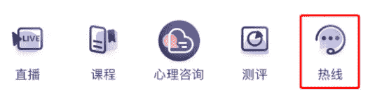
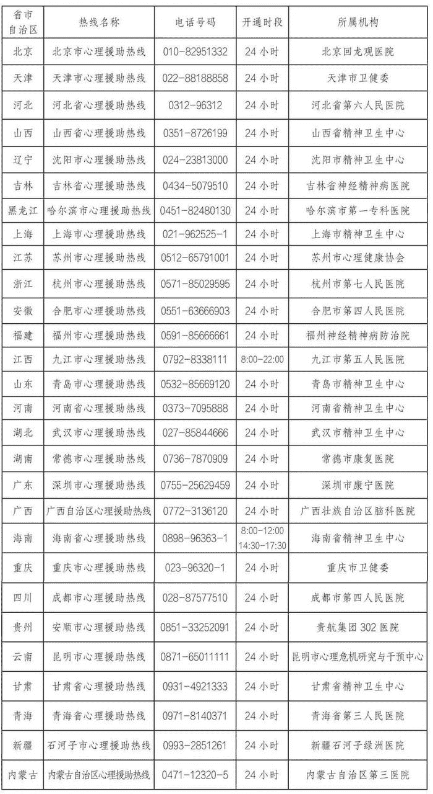

# 2023-07-06万字“抑郁”自救指南，看这一篇就够了

> 来源：[https://xuqiwei1986.feishu.cn/docx/AnYed6JStobnJyxRDjqcWWu6nTf](https://xuqiwei1986.feishu.cn/docx/AnYed6JStobnJyxRDjqcWWu6nTf)

> 🔗 原文链接： h[ttps://m.huxiu.com](https://m.huxiu.com/article/710853.html)/article/710853....

>

本文来自🛰️👸号： 简单心理 （ID：jdxl2000） ，文章首发时间：2022年11月10日，作者：啦啦啦、江湖边，编辑：kuma，头图来自：视觉中国

中科院院士陆林曾在新闻里说：“疫情三年，新增 7000 万抑郁症患者，9000 万焦虑症患者，数亿人出现失眠障碍，这种影响将持续至少 20 年”。

关于抑郁症，我们已写过不下 100 篇文章了。但不少读者反应：搜索起来还是很零散、很麻烦。于是我们汇总了过往科普，更新数据和链接，制作了一篇近万字的“抑郁自助指南”。内容包括 7 个方面：

+   抑郁症，是一种什么样的感受

+   哪些人更容易得抑郁症？

+   抑郁症，应该如何治疗？

+   日常生活中，缓解 & 预防抑郁的小方法

+   无法自行缓解时，你可以怎么办？

+   朋友/家人确诊抑郁，周围人需要注意什么？

+   我们推荐的一些自助资源 （书/影视剧）

抑郁症概述

抑郁症 （Depression） 是一种情绪障碍，它会导致弥漫而持久的情绪低落和兴趣丧失，影响你的感觉、思维和行动。

**它**不是简单的“不开心、支棱不起来”，更不是“性格上的脆弱”，而是创伤性事件、家庭/社会环境、生理遗传易感性等方面的共同结果。

抑郁症会改变你的大脑活动，影响神经细胞的工作方式，你无法简单地“摆脱”它。但是，不要气馁，药物和心理治疗都能够有效改善抑郁症 [1] 。

症状和成因

一、情绪低落就是抑郁症吗？

被诊断为“抑郁症”的人，常常这样描述自己的感觉：

+   “早上很难起床。我只想蒙头大睡，藏起来谁也不见。我不想和任何人讲话。我不想吃东西，也瘦了很多。”

+   “没什么事情能让我提起兴趣。我一直都觉得很疲倦。晚上一直睡不好。但是我得咬牙坚持，因为我得去上班，还要照顾家庭。我觉得很无望，看不到任何好转的希望，也觉得没什么能够好起来。”

+   “我觉得自己很糟糕，像是老了一样，什么都记不住，事情也想不明白。我脑子里面全是消极的东西，我努力地想要积极一些，但是做不到。”

+   “我觉得很绝望。”

我们都可能会陷入这种糟糕的情绪，但不一定就是“得了抑郁症”。

情绪状态的确是抑郁症的一个主要表现，但是否“得了抑郁症”， 一个关键标准是“心情低落”持续至少两周，并严重影响社会功能 （学业、日常工作、社交等） ，而且对事物缺乏兴趣，做什么事情都觉得没意思，感觉很累。 此外，还会在饮食，睡眠，体重等躯体方面也有影响 （比如体重严重降低，失眠易醒等） 。

根据美国精神学会 DSM-5，如果你的情绪和身体出现这些改变中的 5~6 个甚至更多，且持续两周以上，那就可能是抑郁症 [2] ：

+   情绪持续低落，觉得空虚，没有价值

+   对周围一切事物都失去兴趣

+   犹豫不决，难以做出决定

+   较难胜任以往的工作和任务

+   做事提不起劲

+   觉得非常疲倦

+   睡眠出现问题，失眠/嗜睡

+   食欲激增/丧失，体重明显变化

+   行为发生改变 （烦躁/行动缓慢）

+   不明原因的身体问题，如背痛或头痛

+   失去自信，觉得自己无能无用、无望、无价值

+   不与他人接触和交谈

+   失魂落魄

+   经常哭泣

+   滥用/乱用药物和酒精

+   反复出现自杀念头

拓展阅读：

[什么是抑郁症](http://mp.weixin.qq.com/s?__biz=MjM5MzA0MzczMg==&mid=200008329&idx=1&sn=b148483742db62a2437787dfded179d3&chksm=288246f21ff5cfe494e9ccf2099ac3e044fe710a533cee98dd5fcfe77af6c426de4f65bfa22f&scene=21#wechat_redirect)

[抑郁症的10个症状](http://mp.weixin.qq.com/s?__biz=MjM5MzA0MzczMg==&mid=2653733288&idx=1&sn=c3fff6910d8264268994e0bbe31862a1&chksm=bd4565d38a32ecc5c60ee9694b4cd65916f974b16d116e7e1188cdd9780955e598e8de4bc221&scene=21#wechat_redirect)

[最近一直不开心，我是抑郁症吗？](http://mp.weixin.qq.com/s?__biz=MjM5MzA0MzczMg==&mid=2653752954&idx=2&sn=1ea33c8d5dbd1c37aeef77a1520aa9f4&chksm=bd44aa018a332317e5c78476a7142c5c097ab6e91ce18e07659f6a23f4b203823e3a56cb03e3&scene=21#wechat_redirect)

悲伤的人知道自己为何悲伤，但抑郁的人不知道

求生的落崖者：我从未如此渴望被确诊为抑郁症

二、风险因素：什么样的人容易抑郁？

1. 得抑郁症的人多吗？

抑郁症是一种常见的精神障碍，全球约有 3.5 亿人患有抑郁症 [3] 。在我国，抑郁障碍的 12 个月患病率为 3.6%，而终生患病率则达到 6.8% [4] ，也就是说， 有 6.8% 人一生之中至少经历过一次抑郁症发作 。我国约有 9500 万抑郁症患者，以北京常住人口 2189.3 万为参照点，中国的抑郁症患者数量是一个一线城市人口数的 4 倍之多。

2. 什么样的人更容易得抑郁症？

有关抑郁症的研究显示，以下几个都是抑郁症的“风险因素”：

+   **家族遗传。 **如果家族中有人曾出现过抑郁症、自杀、妄想幻觉等精神病性症状或双相情感障碍，那么你患抑郁症的风险会大大增加。相关研究发现，重度抑郁障碍患者的父母、子女和兄弟姐妹患抑郁症的风险是一般家庭的三倍。科学家们正在努力识别导致抑郁障碍的基因 [5] 。

+   经历了一些超出了“应对范围”的创伤事件。 这意味着它给你造成了巨大的心理冲击，即便它在外人看来可能很小，但同一件事对每个人的心理意义不一样。这些事件于你而言是创伤性的，譬如童年时父母的忽视、偏爱、控制，甚至是打骂。它们的影响隐蔽而持久，你可能要在回溯的时候才能意识到。除此之外，当前发生的一些具有压力的应激事件，也有可能让你陷入抑郁之中，例如遭受了性虐待、同伴欺凌、PUA、工作或人际压力、孤独、经历死亡、失恋或离婚等关系丧失。这些事件可能是一过性的，但也会偷偷积累下来，蛀蚀你的内心。另外，经历疫情、地震、战争等灾难，也会让你患抑郁症的风险增大。

+   **神经质和内倾性的人格。 **如果你性格敏感，内向，情绪容易受外界影响而起伏不定，或总是郁郁寡欢，那么更有可能患上抑郁症。尽管如此，不必自责，性格没有好坏，只是不同罢了。

+   **容易陷入负性思维反刍。 **习惯于反复思考犯过的错误和不愉快的经历，夸大几次挫折或不如意的影响，会使你的大脑沉浸在消极情绪中无法自拔。

+   **完美主义者。 **完美主义的人永远不会对自己满足，专注于发现错误、失败和负面评价。而持续的消极关注会让人陷入自我怀疑和无价值感的深渊。

+   **女性。 **抑郁症在女性中的发病率是男性的两倍 [5] 。但也有一些研究发现，男性女性抑郁症的发病率其实相差无几，只是男性更倾向于否认自己的抑郁症状，在治疗时也更难确诊 [6] 。

拓展阅读

social一小时，回家缓半年｜内向者需要变得更外向吗？

“你太敏感了”：14种高敏感人群才懂的痛苦

[我也不想想想想想想太多啊](http://mp.weixin.qq.com/s?__biz=MjM5MzA0MzczMg==&mid=2653733728&idx=1&sn=1b58eb0c240fd085d2464677b1bc2f6c&chksm=bd45671b8a32ee0d281aa9dac8e751771c239330a8cef45516abda7cb7d96872601440209f8b&scene=21#wechat_redirect)

每次想到过去的蠢事，我都觉得人生完蛋了：4招帮你打破“反刍思维”

“看似追求完美，其实只是在避免犯错”｜你是适应不良的完美主义者吗？

预防和治疗

药物和心理治疗，都可以有效缓解抑郁症。对于部分难治型的抑郁症，或对抗抑郁药物没有反应的患者，临床医生则会选用“脑刺激疗法”。如果症状较为严重，还可能需要住院，直到症状缓解再转为门诊治疗。

三、抑郁症的 3 类疗法

1. 抗抑郁药物

抑郁症治疗是一个需要长期努力的过程。临床上通常将抑郁症治疗分为三个阶段 [16] ：

+   **第一个阶段为病发的急性期 **，最初 8周~12 周，你可能会经历一段“试药”的过程。每个人的体质对药物的反应不同，因而医生会谨慎地选择用药，并根据症状的改善程度逐渐调整合适剂量。

+   **第二个阶段是治疗的巩固期 **，通常持续 4个月~12 个月，随着症状逐渐缓解，药物及其剂量会保持稳定，以防止病情反复。

+   **第三个阶段是治疗的维持期 **，一般至少 2年~3 年。长期服药并不容易，尤其是在集体生活的情境下，你可能需要克服吃药的耻感，恶心、嗜睡和肥胖等副反应，以及经济压力和对日常生活的影响。

服药停药请务必遵循医生指导，突然断药可能导致戒断症状，并使病情恶化。与医生一起逐步安全地减少药物剂量会更合适。

如果怀孕或哺乳，一些抗抑郁药可能会有损胎儿和孩子的健康。如果你怀孕或计划怀孕，请咨询医生。

大多数抗抑郁药是安全的。在某些情况下，25 岁以下的儿童、青少年和年轻人在服用抗抑郁药时可能会增加自杀念头或行为，尤其是在服药的最初几周或改变剂量时。因此，应密切关注症状的波动或异常行为。如果在服用抗药时有自杀念头，请立即联系医生或寻求紧急帮助。

请记住，从长远来看，抗抑郁药更有可能通过改善情绪而降低自杀风险。

2. 心理咨询

心理咨询，也被称为谈话治疗。在这个过程里，专业的心理咨询师会与来访一起讨论相关问题，也可能根据不同的情况灵活采用不同的治疗技术。证据显示，认知行为疗法、人际关系疗法和精神动力学疗法对抑郁症有效。心理治疗可以帮助你：

+   宣泄情绪；

+   讨论患病和服药的体验；

+   寻找更好的方法解决当前遇到的问题；

+   探索导致抑郁的个人化原因；

+   识别适应不良的信念和行为，并建立功能良好、健康的思维和行为模式；

+   探索自我和关系，认识自己在关系中的心理角色和位置，改变适应不良的关系模式建立对生活的满足感和控制感；

+   获得重新生活的力量。

3. 脑刺激疗法

+   **MECT（改良电休克疗法）**

MECT 可快速有效治疗抑郁症，明显降低死亡率，疗效可达 86.7% [16] ，副作用是有可能出现“短暂性失忆”。

如果你出现以下情况，医生可能会使用 MECT：

抑郁症状严重，具有高自杀自伤风险，出现明显的自责自罪；拒绝进食，违拗或紧张性木僵；极度兴奋，躁动，冲动伤人对药物无反应，对药物不能耐受，或因健康原因不能服药。

+   **rTMS（重复经颅磁刺激治疗）**

对于那些对抗抑郁药没有反应的人来说，rTMS 也是一种选择，这种疗法具有中度抗抑郁效果，在改善抑郁症状和自杀行为方面均有效；rTMS 最大的不良反应是癫痫发作、头痛，但痛感持续时间短，多可自行缓解 [16] 。

四、缓解抑郁情绪的 10 个日常方法

1. 给自己创造一个情绪的“安身之处”

回忆或想象一个让自己感到舒适、安全、快乐的环境。这个地方可能是你小时候居住的房子、山清水秀的野外，或是年幼时好朋友的家，甚至是你想像出来的，让你舒服和快乐的环境。抑郁来袭时，你可以偷偷跑“回去”休息一下，积攒些能量。也可以匿名吐槽或写日记、找朋友或心理咨询师。总之以你感觉安全的方式，表达自己的真实感受，可以有效缓解消极情绪。

2. 不知道该怎么办的时候，“暂停一下”

停下来一段时间，不纠结于具体的选择，不急于一个答案，让方向和真正的问题慢慢地出现。关键是告诉自己：你可以难过，可以失败，也可以暂时停下来。

3. 关注自己的身体，回到“此时此刻”

当在消极想法里越陷越深、无法逃离的时候，不妨动一动身体，放下手机，深呼吸，摸一下身边的物体，动动脚趾头，去走一走，或者去做件小事情。目的是将注意力放在当下，关注身体的感觉。

4. 制定很细微，但很明确的目标

仅仅是想着“让自己好起来”可能令人更加惶恐，但制定一个具体可触及的目标，会让人更有掌控感，更能真正改变。比如：

❎“我要快乐”“我要摆脱孤独”

✅“洗个热水澡”“见一个喜欢的人”

5. 冥想，你可以这样做

关注你的呼吸，关注脑袋里面浮现出来的念头，想像面前有一个传送带 （或者铁轨） ，当你有念头冒出来，将这个念头打包，放在传送带上，让它走掉；下一个冒出来，打包、放在传送带上，让它走掉。周而复始。

6. 在没那么抑郁时，去运动一下

研究表明，运动有助于缓解抑郁情绪。瑜伽就是一项很好的运动；步行，每周三次，每次 20-40 分钟，持续六周，也可以缓解抑郁症状。与伴侣或团体一起散步的话，效果会更好，因为社交互动可以提升情绪、增加继续运动的动力。当然，抑郁的时候，不想动也没关系。

7. 记住“快乐 333 原则”

每天散步 30 分钟，每天晒太阳 30 分钟，每天 3 顿饭和人一起吃，都可能改善心情。

8. 不要和他人比较痛苦

人和人的痛苦是不能比较的。不必因为别人的状况而苛责自己，放弃“这点小事就感到痛苦啊”“别人能做到，为什么你这么脆弱”“为什么你不能像别人一样努力呢”这些想法，比较是痛苦的源泉，比较而来的幸福也不是真正的幸福。承认每个人都有脆弱之处，以及痛苦是真实的，不要评价自己的伤口。

9. 不要相信别人可以，我也可以

太多的信息在告诉你：我可以，所以你也可以。比如：我可以赚很多的钱，你努力一些你也可以。我可以变得很瘦，你也可以。我可以给我的孩子争取最好的学校资源，你不能是因为你不够好。

然而，很多时候，它不值得你为此感到遗憾 （大家都去争取的不一定就是好东西啊） 。这种“我可以，你也可以”是被制造出来的幻觉，让你误以为你没有拥有他人有的东西，没有获得某种奖赏或者物质，都是由于你不够强、或不够努力。放松去过自己的生活吧。

10. 多做令你感到快乐的事情，见令你感到快乐的人

检查一下，你的生活中和喜欢的人相处的时间有多少，你所做的事情中有多少是你喜欢的？

事实上，快乐不仅是一种情绪，更是一项能力。陷入抑郁情绪的时候，不要被它所裹住，有意识地主动选择一些令你感到快乐的事情和人，去和 ta 聊聊吧。

拓展阅读：

[抑郁怎么办](http://mp.weixin.qq.com/s?__biz=MjM5MzA0MzczMg==&mid=200173135&idx=1&sn=03d98353775745353d952ba228779774&chksm=2887c2341ff04b2227f27128d2d62779fb75f33f3ac48ab650c8e5f609ee6fa01409fec0b9d0&scene=21#wechat_redirect)

[缓解抑郁情绪的7个方法](http://mp.weixin.qq.com/s?__biz=MjM5MzA0MzczMg==&mid=2653728821&idx=1&sn=c3ea04686bc6a90e66fb309addb5edb1&chksm=bd45144e8a329d58cef266eb9aae0f0131d7281785a435bc188c3b4f3f0e28e402b6db246af4&scene=21#wechat_redirect)

[如何调节日常生活中的抑郁情绪？](http://mp.weixin.qq.com/s?__biz=MjM5MzA0MzczMg==&mid=200898815&idx=2&sn=0938c6c4861a84e9b7973e77703baab3&chksm=2890dc841fe7559290832239696a90767b519b50294e47d5c5e2adcf992961cbe642f77be702&scene=21#wechat_redirect)

冬季真的催人抑郁啊！我们给你准备了8条抗抑郁指南

五、无法自行缓解时，该如何求助？

1）请记得，你不必独自面对一切。寻求专业心理咨询师的帮助，可以有效缓解抑郁症状。

2）你也可以拨打线上“免费热线”，心理志愿者将为你提供即时的情绪舒缓和疏导。

下载简单心理 APP，在首页选择“热线”免费使用。热线服务时间：工作日 18:00-23:59，周末 14:00-23:59

3）当你出现危机情况：比如存在自伤 （或自杀） 想法、计划或行动，请让信任的人陪在身边：

+   接通 24 小时免费危机干预热线：010-82951332 ；800-810-1117 （北京回龙观医院心理危机干预与研究中心）

+   联系亲密的朋友、亲人

附各地心理援助热线

图源：《少年抑郁症》

患者/家人自助资源

六、身边有人得了抑郁症，我该如何支持？

1. 克服耻感，了解抑郁症

当亲友得了抑郁症，你可能会产生一定程度的羞耻感，这种耻感会在无意识之中影响你对 ta 的态度。比如和旁人提起 ta 时欲言又止，小心翼翼地过分保护或过分责怪……这些都可能会被抑郁症患者捕捉到。

当你想去支持 ta，首先要厘清自己的感受和看法，克服偏见。 最好的方式，是先看一些抑郁症相关的书籍和影视剧，了解抑郁症到底是什么、患者的身体和内心又会经历什么，然后坦诚地和 ta 聊一聊，会有很大的帮助。

2. 做一个倾听者，保持开放和理解

放下批判的想法，例如“你这就是懒/自私/闲的/想太多”“坚强一些”“你太矫情了”“抗压能力太差了”。

**也不要轻易说“我理解”，除非你真的有过切身体验，真诚地说“我**不明白，但我真的想知道”会让人感觉更好。

你可以做一个温暖的倾听者，不试图“修复”对方，也不期望 ta 按照你想要的方式和速度好起来。提供情绪和心理上的支持，让 ta 有一个安全的空间释放被压抑的情绪。向 ta 传递“无论你怎样，我仍然爱你”“你对我很重要”“无论如何我都在你身边”“这不意味着你脆弱或有缺陷”的信息。

3. 设定支持边界，照顾好自己

不要“过度消耗自己”，保持对自己情绪的觉察。问问自己是否过度焦虑、担心、甚至是生气，导致对 ta 的不耐烦和责怪？或者在陪伴的时候，产生强烈的无助和内疚感，以至于想要远离。

这些表现意味着你可能出现了一定程度的“陪伴者疲劳”。 研究显示，73.7% 的青少年抑郁症照顾者具有轻度到中度的陪伴者疲劳 [14] 。

请记得，在支持 ta 的时候，你首先要照顾好自己的情绪和生活，明白自己的能力和界限，让 ta 知道，你不会一天 24 小时围着他们转，你也有自己的生活。

4. 温柔地督促治疗

可以主动问对方，要不要一起去医院或者去看心理咨询师。但有些抑郁者不想去医院，不想吃药，不想见咨询师。可能是因为生病导致的消沉疲惫，可能是因为病耻感，也可能是因为害怕治不好。向 ta 保证，就像任何其他的医学疾病一样，抑郁症是可以治的。

如果对方拒绝去看精神科医生或者心理咨询师，尝试带 ta 去看全科医生 （可能不那么排斥） 。与医生商量进行身体的全面检查，这可以排除由身体原因导致的抑郁。如果不是身体方面的原因，全科医生会建议转诊。

帮 ta 预约精神科医生或治疗师。找到合适的医生或者心理治疗师可能很困难，而且通常是一个反复试验的过程。但对一个已经能量不足的抑郁者来说，帮忙打电话进行咨询或者预约挂号也是巨大的帮助。

5. 识别危险征兆

如果你发现 ta 有自杀的风险，首先要陪在 ta 身边。然后，尽快告诉对方你的担忧。很多人不愿意谈论死亡这件事，或者认为谈论死亡会增加对方自杀的可能，但事实并不会这样。开诚布公地和对方谈论他自杀的想法和感觉，能够增加拯救对方生命的可能性。

但如果你感到自己很难做到扭转对方的想法，或者情况危急，请立即寻求专业的帮助，在非常紧急的情况下，你可以拨打报警电话让当事人强制住院治疗，这听起来让人害怕，但有时也是不得已为之的保护措施。

对于青少年抑郁症患者，要警惕 ta 是否在偷偷地伤害自己 ，比如用刀划手臂、用香烟或火烫自己和抓破皮肤等。这些行为往往发生在厕所、上锁的房间，或者深夜独自一人的时候。

伤口会被小心地用衣袖遮盖住，很难发现。所以当 ta 身上出现不明原因的划痕，天热仍然穿长袖长裤，故意用东西遮住手腕关节处，常常一个人躲起来，不愿上学，以及情绪反常的时候，很有可能 ta 在暗中伤害自己。

对于非自杀性自伤行为的动机，研究者们认为可能是寻求关注、释放情绪、自我攻击以维系父母的关系 [15] 。因此，在处理好伤口，将 ta 送去治疗之后，也请和 ta 开诚布公地聊一聊，表达你的关心。

拓展阅读

“吃块冰西瓜吧，帮你切好了”｜他们想对抑郁症患者说的话

“得抑郁症后，我被男友提了分手”｜如何与抑郁者相处？

[如何陪伴“抑郁症”的家人或朋友](http://mp.weixin.qq.com/s?__biz=MjM5MzA0MzczMg==&mid=200012151&idx=2&sn=04cdb3867b78d9e550a520da0f968dac&chksm=2882550c1ff5dc1af118719f23109a350acf9adeec1adf71075f0d6ab68d2c2741f449dc8634&scene=21#wechat_redirect)

家人得了抑郁症，我该怎么办？｜重温《丈夫得了抑郁症》

和抑郁症朋友相处，如何才能不心累？丨每日罐头

七、给抑郁人士的自助资源

书、影视剧等文艺作品，能帮助我们从方方面面了解抑郁症，也有助于我们更好地应对自己的处境。所以我们也给你推荐了一些资源。

但是，所有的自助资源都不能代替药物，它不能帮助你进行自我诊断，也无法取代心理咨询师。

一些我们推荐的书、影视剧

1）《我有一只叫抑郁症的黑狗》 [7] 马修·约翰斯通

治愈系绘本。这本书分为两个部分，一部分是抑郁症患者的自述，另一部分讲述的是作为抑郁症患者的恋人，如何陪伴。

**2）《丘吉尔的黑狗：忧郁症及人类**心灵的其他现象》 [8] 安东尼·斯托尔

这本书以一种积极向上的态度来观察心理忧郁现象，对弗洛伊德的理论进行了反思，剖解了许多大人物的忧郁心理与非凡成就之间的关系。

3）《活下去的理由》 [9] 马特·梅洛

这是一次文学对抑郁困境的剖白。马特·梅洛曾也陷入抑郁的深渊，所以他写下了这本《活下去的理由》。在书中，他描绘了自己的抑郁体验，以及如何凭借自身的力量走出来。因为文学性，这本书很易读，也因为作者深刻的感受，它会引发你的强烈共鸣。

4）《正午之魔：抑郁是你我共有的秘密》 [10] 安德鲁·所罗门

这是一位“专业抑郁者”对抑郁的“全貌研究”。安德鲁·所罗门是一位作家，文学硕士，也是心理学博士。他有近三十年的抑郁症经历，在这本书中，他不仅从心理层面叙述了抑郁症的体验、表现和治疗，也从社会和政治的角度分析了抑郁现象。总之是一次全景式的回顾，再加之作者的文学功底，里面没有冷冰冰的术语，而是切身的理解。

5）日剧《丈夫得了抑郁症》 [11] 豆瓣评分8.1。

这部电影由真实事件改编，记录了漫画家小晴 （宫崎葵 饰） 在丈夫 （堺雅人 饰） 患抑郁症之后，陪伴丈夫一同与抑郁症斗争的故事。

6）《抑郁是因为我想太多吗：元认知疗法自助手册》 [12]

这本书可以启发你，为你提供治疗抑郁症的一些新想法，帮助你以一种完全不同的方式摆脱你的消极思想和抑郁症状。

7）《伯恩斯新情绪疗法》 [13]

这本书没有那么多冠冕堂皇的大道理，也没有长篇累牍的复杂理论，只是用一个个灵活生动的案例，教你在 4 周，用 22 个简单有效的原则和技巧，学习如何与负面情绪和谐相处。

给普通人看的科普文章：

[抑郁症的影响](http://mp.weixin.qq.com/s?__biz=MjM5MzA0MzczMg==&mid=200008698&idx=1&sn=624b764125325b1815d8da94c1e135e3&chksm=288247811ff5ce979079019cadcc89460cb85bc4058b116b1175457fc4c00e45e9ffddb0a8b5&scene=21#wechat_redirect)

多数人对“抑郁”的无知，是对抑郁者最残忍的事

“现在的年轻人啊，一点小事就抑郁”｜关于抑郁的5个误解

都说抑郁是“情绪感冒”，那它会传染吗？

[抑郁十二年](http://mp.weixin.qq.com/s?__biz=MjM5MzA0MzczMg==&mid=209717598&idx=1&sn=d0193dd36f57483efe0cc1e347392ba2&chksm=2fe9ad25189e243365106180c69d874561ddd00c3db98220e696a2269164d9a79fb171b9d0d8&scene=21#wechat_redirect)

[抑郁100天，我学会了和它相处](http://mp.weixin.qq.com/s?__biz=MjM5MzA0MzczMg==&mid=2653698482&idx=3&sn=505bfb81e0dc130e15c0fce700a9656d&chksm=bd459dc98a3214df294ccfb4d7881196eb1055758b9b4b3be364bad8874b04584020a5c8408d&scene=21#wechat_redirect)

“不敢告诉别人我抑郁了，他们只喜欢快乐的我”

我的抑郁，是在“弄死自己”的间隙冒出的求生欲

那些“不该有”的情绪，我终于允许自己去感受

[抑郁的人会更敏感吗？](http://mp.weixin.qq.com/s?__biz=MjM5MzA0MzczMg==&mid=2653749141&idx=2&sn=5bd4bed799886c54b6b2b47ce63d70dd&chksm=bd455bee8a32d2f862f52950da37a02a8aba18d30ecc4f5b89ccfbdf411c82bcd5365108c7d3&scene=21#wechat_redirect)

抑郁对我们也有好处？丨《纽约时报》长悦读

[我从抑郁症中学到了什么？](http://mp.weixin.qq.com/s?__biz=MjM5MzA0MzczMg==&mid=203133758&idx=1&sn=3a3aa8bc53419625e05c95cbf969ae65&chksm=2f7237451805be5339f67a8b9e257bb07c5f328abf21f3026fcf207c3d109db2db2dcfa56e95&scene=21#wechat_redirect)

[测抑郁的心理测试到底准不准？](http://mp.weixin.qq.com/s?__biz=MjM5MzA0MzczMg==&mid=2653661612&idx=2&sn=e6b01cb114660006812ab9cc4e93e091&chksm=bd420dd78a3584c1f01cf1810cd1be05bd0c037f6811c80302149088a561b04471eb0892cb30&scene=21#wechat_redirect)

[抑郁，是大脑在告诉我们“快逃”](http://mp.weixin.qq.com/s?__biz=MjM5MzA0MzczMg==&mid=2653769852&idx=1&sn=498d13c33a22b1755b98f68d9445a586&chksm=bd44f4078a337d114d5eef83003d9e5a183430208317deee8bb2b6da3614b97de63091c9368b&scene=21#wechat_redirect)

[需要给抑郁者额外的特权么？](http://mp.weixin.qq.com/s?__biz=MjM5MzA0MzczMg==&mid=2653669193&idx=1&sn=64a0b44901951cb91412733aa2e3c048&chksm=bd4263328a35ea243e46ddc236e00dcf72db9d9c377b1193e5ab4a920dbf8d09a5cad8e283a7&scene=21#wechat_redirect)

“抑郁就像一条黑狗，一有机会就咬住我不放”——丘吉尔的名言如果还有后半句，我们还想说：

纵使黑狗强悍凶猛，仍有服软和共存的可能。

参考文献

[1]Cuijpers P， Noma H， Karyotaki E， et al. A network meta-analysis of the effects of psychotherapies， pharmacotherapies and their combination in the treatment of adult depression[J]. World Psychiatry， 2020，19(1):92-107. DOI: 10.1002/wps.20701.

[2]美国精神医学学会， 张道龙. 精神障碍诊断与统计手册 第5版（DSM-5中文版）[M]. 北京大学出版社， 2015.

[3]WHO. Depression[EB/OL]. [2022-3-2].

[4]Huang Y， Wang Y， Wang H， et al. Prevalence of mental disorders in China: a cross-sectional epidemiological study[J]. Lancet Psychiatry， 2019，6(3):211-224.DOI:10.1016/S2215-0366(18)30511-X.

[5]Malhi G S， Mann J J. Depression[J]. LANCET， 2018，392(10161):2299-2312.DOI:10.1016/S0140-6736(18)31948-2.

[6]简单心理. 中国抑郁症患者近亿，以后体检也要筛查抑郁症了？｜WEEKLY[EB/OL]. [2022-3-2].

[7]Johnstone 澳. 马修 约翰斯通 Matthew， Johnstone 澳. 安斯利 约翰斯通 Ainsley. 我有一只叫抑郁症的黑狗[M]. 康太一， 译. 广西科学技术出版社， 2017: 128.

[8]安东尼·斯托尔 英. 丘吉尔的黑狗: 忧郁症及人类心灵的其他现象[M]. 邓伯宸， 译. 北京大学出版社， 2014: 254.

[9]马特·海格. 活下去的理由[M]. 赵燕飞， 译. 江西人民出版社， 2018: 240.

[10]安德鲁·所罗门. 正午之魔：抑郁是你我共有的秘密: 抑郁是你我共有的秘密[M]. 屠彬， 译. 上海三联书店， 2020: 648.

[11]丈夫得了抑郁症 ツレがうつになりまして。[EB/OL]. [2022-3-3].

[12]Callesen 丹. 皮亚·卡列森 Pia. 抑郁是因为我想太多吗：元认知疗法自助手册[M]. 燕环， 译. 机械工业出版社， 2022: 152.

[13]戴维·伯恩斯. 伯恩斯新情绪疗法: 临床验证完全有效的非药物治愈抑郁症疗法[M]. 李亚萍， 译. 中国城市出版社， 2011: 520.

[14]郭鑫， 杨敏， 朱冬琴. 青少年抑郁症患者照顾者生活质量与照顾者负担的相关性[J]. 中国心理卫生杂志， 2018，32(04):329-334.

[15]张芳， 程文红， 肖泽萍. 青少年非自杀性自伤行为研究现状[J]. 中华精神科杂志， 2014，47(05):308-311.

[16]陆林. 沈渔邨精神病学[M]. 人民卫生出版社， 2018.

本文来自🛰️👸号： 简单心理 （ID：jdxl2000） ，作者：啦啦啦、江湖边，编辑：kuma

本内容为作者独立观点，不代表虎嗅立场。未经允许不得转载，授权事宜请联系 hezuo@huxiu.com

如对本稿件有异议或投诉，请联系tougao@huxiu.com