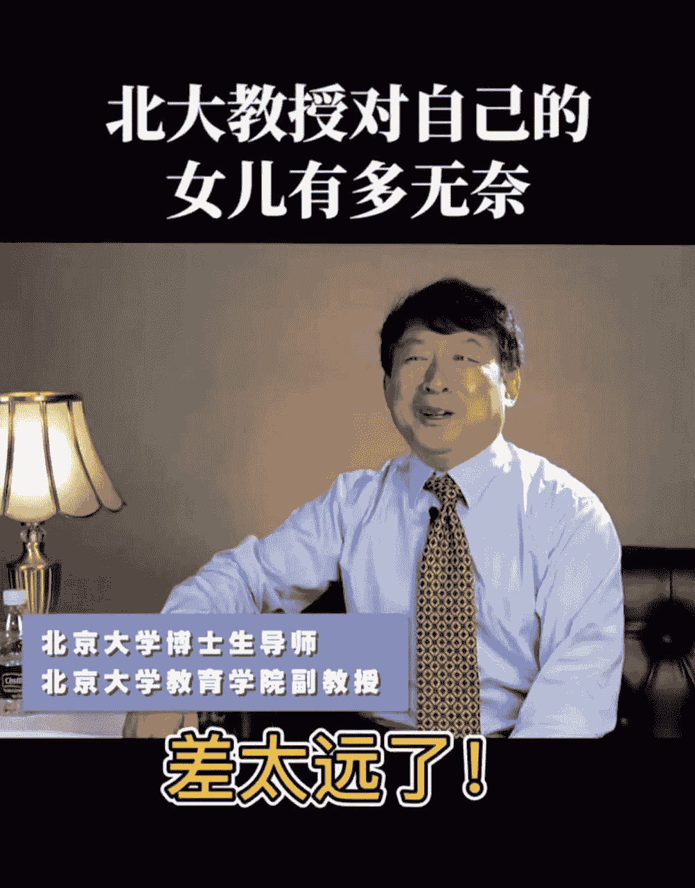
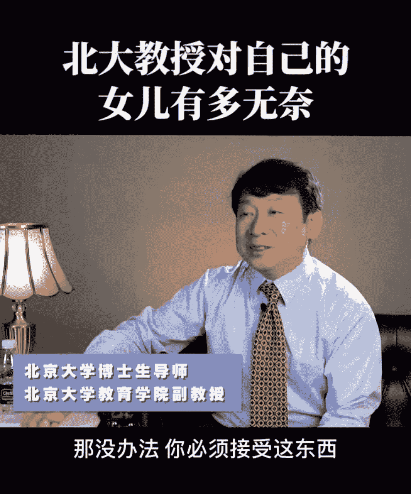
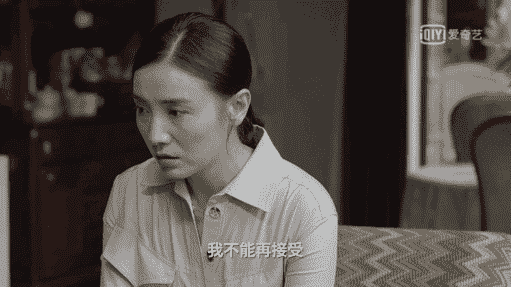
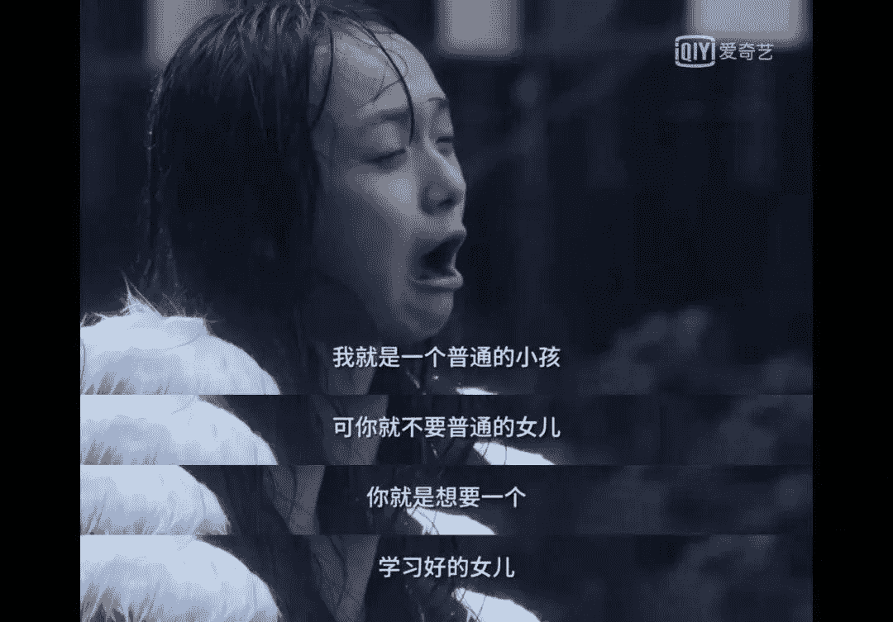
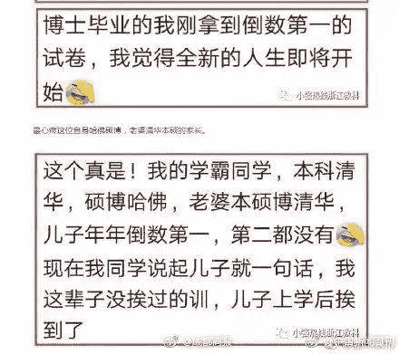
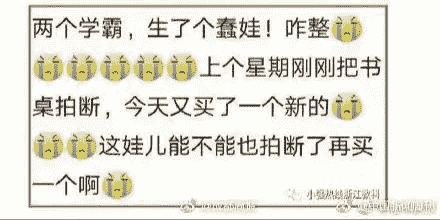
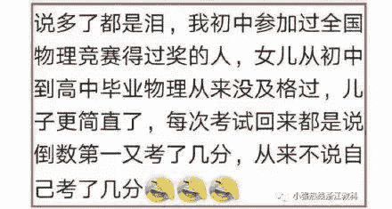
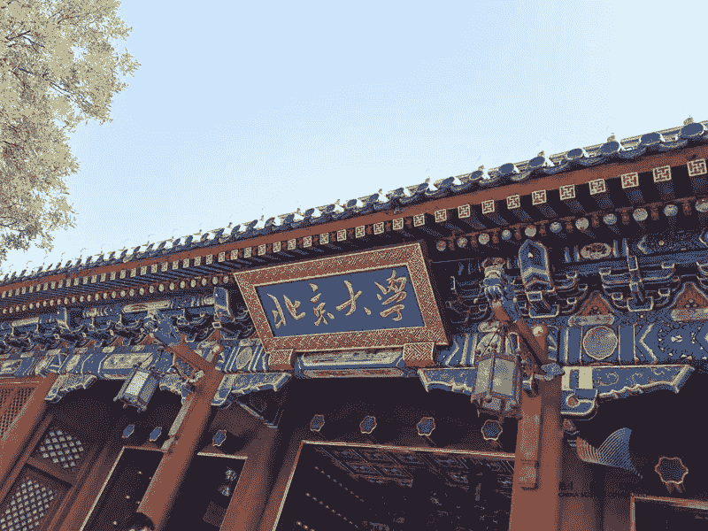

# 2021-05-30夜读丨北大教授吐槽"学渣"女儿火了：我教孩子逆天改命，她却教我学会认命

> 来源：[https://xuqiwei1986.feishu.cn/docx/VYBndoDfToShflxt0vCcpgYXn5d](https://xuqiwei1986.feishu.cn/docx/VYBndoDfToShflxt0vCcpgYXn5d)

> 🔗 原文链接： h[ttps://mp.weixin.q](https://mp.weixin.qq.com/s/mKecZ6Sp0hLAwHJRqFlCBA)q.com/s/mKecZ6Sp...

>

才华水木君 科普中国 2021-05-30 21:50 发表于 北京

**公众科普 科学传播！点击上方 ****蓝字 ****一键关注**

# **01**

最近，北大教授丁延庆的一段吐槽女儿的抖音视频火了。

丁延庆何许人？

退出全屏

切换到横屏模式

[🎦 点击观看视频](http://mpvideo.qpic.cn/0b78l4abqaaakuaido43dzqfax6ddbpqagaa.f10002.mp4?dis_k=11d4723d0c2560fac7b69f366f1cb0b7&dis_t=1691471783&play_scene=10120&auth_info=X4HRh6UFbA9Nx7GLpEB8ZlxJdyAyXj4bRWVHJDxyTFRhNw==&auth_key=1187d32aac1dd8398c11f44c541b3564&vid=wxv_1865923768343150596&format_id=10002&support_redirect=0&mmversion=false)

> 无法获取音频链接

视频详情

小时候被称“神童”， 6岁就能背下整本新华字典，本科就读于北大，后进入哥大深造，获得教育学博士学位，现任北大博导、副教授。

这金光闪闪的履历，谁看了不说一句“厉害”。

他的夫人，也同样是北大毕业的高材生。

**然而，女儿似乎完美避开了他们夫妻俩**的学霸基因，在“学渣”的道路上越跑越偏。

给女儿辅导作业若干次后，丁教授经历了从痛心疾首，到怀疑人生，再到心如止水的转变过程。

“没办法，你必须接受，不接受能怎么样？她就这样。”

这番糅杂着不甘、无奈、释然的感慨，想必也是很多学霸父母的共同心声。

前段时间热播的《小舍得》中，主角南俪就面临着和丁教授同样的困惑：

明明自己和丈夫都是985大学的尖子生，为什么孩子成绩却在班上排倒数？

在职场失利后，一向佛系的南俪无法淡定了，她咬牙切齿地发誓：我不能再接受我的孩子比别人差了！

从此，她开始用之前最反感的方式去拼命“鸡”娃：

给孩子报各种各样的补习班，逼着孩子背单词、做奥数题，让孩子没有片刻喘息的空间……

可最终的结果却是，孩子承受不住超高的压力，情绪崩溃，在一个大雨天离家出走。

南俪急到发疯，好不容易找到女儿，女儿却大哭着推开她，不愿意跟她回家。

女儿在雨中的控诉，深深地刺痛了南俪的心：

“我就是一个普通的小孩，可你就不要普通的女儿，你就是想要一个学习好的女儿！”

直到这时，她才如梦方醒，明白自己之前做的事有多么荒谬。

电视剧结尾，南俪完成了与女儿的和解，坦然接受了女儿终究只是个普通孩子的事实。

听过一句话： **人生有三个关卡——懂得父母是普通**人，接受自己是普通人，允许孩子是普通人。

**更残酷的或许是，代际之间的阶层，并不总是上升的，即使你凭借努力**超越了上一代，也很难保证下一代会超越你。

很扎心，却是不得不承认的现实。

# **02**

微博上有个话题： **父母学霸孩子学渣什么体验？**

家长们的留言都是一把心酸泪。

有人名校博士毕业，孩子的成绩却是回回倒数。

有人夫妻双双学霸，却生了个不省心的娃，气到拍断书桌。

有人初中就获得过全国物理竞赛的奖项，女儿却初高中六年物理从没及格过。

跟着屏幕都能感受到老父亲老母亲们的疑惑、愤怒。

但我要说一句话：

孩子不如父母优秀，真的是大概率事件。

爱因斯坦有三个孩子，其中一个幼年夭折，另一个患有精神分裂，还有一个儿子是伯克利大学水利工程学教授，虽然算功成名就，但比起他父亲还是差远了。

著名作家贾平凹的女儿贾浅浅，文学造诣完全无法与父亲相提并论，她发表的诗歌，在互联网上引来一阵群嘲。

很多“星二代”，从颜值到艺术成就，都被父母“秒杀”……

无数例子告诉我们，父母成就越高，子女超越父母的可能性就越小。

科幻作家郝景芳算过这样一笔账：

清华北大每年本科录取6000人，研究生+博士一共录取13000人，再加点MBA什么的，每年差不多录取20000人。

假设这些人有一半留在北京，也就是10000人，再假设他们全部内部结婚，一年可以生5000个清北二代。

那清华北大每年在北京录取多少本科生呢？500到600个。

也就是说，假设其他大学二代都不参与竞争，只有清华北大二代竞争，你家孩子也得在全部清北二代里考到前10%，才能再次进入清北。

这个概率，用“凤毛麟角”来形容不过分吧。

谁能保证，自己的孩子能稳稳地居于那前10%？

我们这代人，是享受过知识红利的一代人。即便出身贫寒，也能通过埋头苦读，实现在父辈基础上的阶层跃迁。

但不要忘了一个前提，就是我们的父辈大多没有优渥的教育环境，他们甚至连最基础的教育都不能充分享受，所以，根本和我们不在同一个起跑线上。

如果在同等条件下比拼智力，我们还真不一定拼得过自己的父母。

很多人接受不了孩子不如自己，就是被“阶层滑落”给吓到了，但仔细想想就知道，阶层有可能无限上升吗？

显然不可能。

统计学上有个概念，叫 **“均值回归”。**

19世纪的英国科学家高尔顿对1078对夫妇及后代的身高进行研究后发现，父母是高个子，孩子的身高也许高于平均身高，但不见得高于自己的父母；到一定程度后，后代的身高会往平均身高“回归”。

身高如是，智力亦如是，不会一代一代无限地高下去，最终都会向均值“回归”。

接受孩子未来不如自己，或许是为人父母者的宿命。

# **03**

知乎上有个问题： **你能接受孩子大学不如你吗？**

下面有个匿名用户的回答特别暖心。

答主的妈妈非常优秀，毕业于上海医科大学临床医学专业，就是现在的复旦大学医学院，和张文宏是同级的隔壁班同学，六年大学拿了四年的班级第一和奖学金。

毕业后，妈妈放弃了华山医院的工作机会，回到家乡做一名医生。

可女儿和妈妈却完全不在同一水平线上，从小学开始成绩就一直在中下游徘徊，初高中甚至考过班里的倒数，高考连一本线都没过……

但妈妈从来没有埋怨过女儿不如自己，相反，每次在朋友同事面前提到女儿，都是一脸的骄傲。

因为，在妈妈眼里，女儿虽然成绩不够好，却有很多很多闪光点：

比如在班里跑步得了第一、雅思考了7分、自己做攻略和朋友去国外旅游等等等等。

妈妈无条件的爱，给了答主自信一生的底气，也给了她受用不尽的精神财富。

每个孩子，都是一朵独特的花朵，有的是蔷薇，有的是丁香，有的是茉莉。

用种植茉莉的方法去浇灌蔷薇，最终的结果只会是枯萎。

教育的真谛，是顺应每个孩子不同的特质，鼓励他们去挖掘内心的渴望，找到他们愿意一生为之奋斗的事业，并从中获得快乐。

成功的方式有千千万万种，如果只有考好分数、找好工作才算是成功，那这个世界该多无趣啊。

用单一的标准去衡量、塑造孩子，是父母的短视和懒惰。

前几年网上曾有一篇感动无数人的爆文：《“我的学渣儿子，妈妈相信，你是来报恩的！”》

作者凡小西说，她是985硕士，丈夫是985博士，她在最佳生育年龄27岁生下了儿子，一切都按计划进行。

可是，孩子上小学后，局面渐渐脱离了他们的掌控。

纵然他们使尽浑身解数，孩子的成绩就是上不去，永远在班里吊车尾，而且还因为学习压力过大，经常感冒发烧，四年级就戴上了近视眼镜。

这时，她才无奈地承认，儿子确实资质一般。

放下焦虑后，她开始重新审视儿子，发现儿子有太多被她忽视了的优点。

儿子喜欢研究厨艺，10岁就能做好几种像样的饭菜；

儿子心地善良，进楼栋门的时候，看到身后有人，总会用小手撑着门，等着后面的人一起进来；

儿子孝顺父母，懂得体谅父母的辛苦……

这样勤劳懂事善良的孩子，将来踏踏实实地做一份平常的工作，又何愁没饭吃？

将来孩子做完一天的工作，回到自己温暖的家，尽心尽力地扮演好丈夫、父亲的角色，父母生病了，他会耐心地照顾陪伴……就这样长大、变老。

“学渣”孩子，不是父母的仇敌，他们是来报恩的啊。

父母又何必苦苦相逼，亲手将孩子变成仇敌？

幼儿教育家蒙特梭利说，每个生命在形成的初期，就已经具有了属于他自己的精神胚胎。

孩子借我们降生于世，却没有义务顺应我们的期待而活。

他们带着各自的使命而来，会奔赴属于他们的远方。

让孩子如他所是，而非如我所愿，才是父母给孩子最好的托举。

来源:水木君说（ID:shuimujunshuo），书可医愚，我是才华水木君，带你读好书，赏美文。

作者:才华水木君

本文已获授权，转载请联系原作者

本文有科普中国水印的图片均来自版权图库，图片内容不授权转载

支持我们请 分享 评论 点赞 在看☟ ☟ ☟

公众号ID：Science_China

**公众科普 科学传播**

**中国科协官方微信 国家科普平台**

长按识别左侧二维码，关注我们