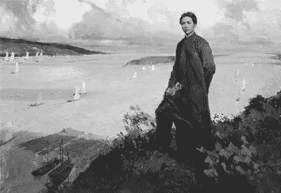
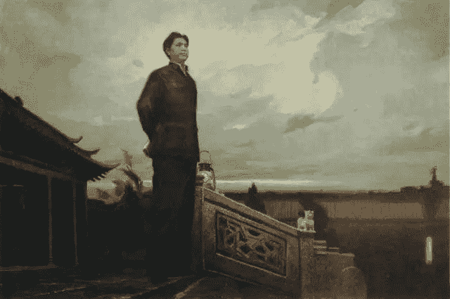
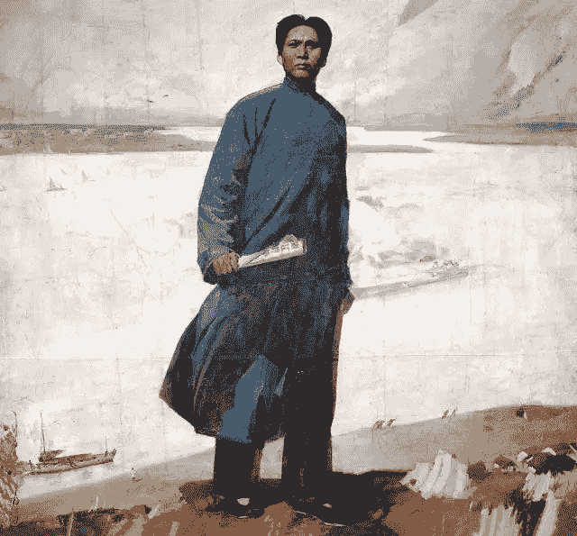

# 2017-09-09“北漂”毛泽东——在逆境中崛起

> 来源：[https://xuqiwei1986.feishu.cn/docx/GKiydRuSMo6cLXx94JdcFcJ5nxf](https://xuqiwei1986.feishu.cn/docx/GKiydRuSMo6cLXx94JdcFcJ5nxf)

> 🔗 原文链接： h[ttps://mp.weixin.q](https://mp.weixin.qq.com/s/k1JaAwOUosHR-MQXnwFaTg)q.com/s/k1JaAwOU...

> ⏰ 剪存时间：2023-08-08 13:04:48 (UTC+8)

> ✂️ 本文档由 [飞书剪存 ](https://www.feishu.cn/hc/zh-CN/articles/606278856233?from=in_ccm_clip_doc)一键生成

李栩然 共青团中央 2017-09-09 06:57 发表于 北京

[🎦 点击观看视频](https://v.qq.com/txp/iframe/player.html?origin=https%3A%2F%2Fmp.weixin.qq.com&containerId=js_tx_video_container_0.07383667019835105&vid=g0177mo035w&width=677&height=380.8125&autoplay=false&allowFullScreen=true&chid=17&full=true&show1080p=false&isDebugIframe=false)

视频来源：独家网

# 壹

看看毛泽东青年时代的历史，我们会发现，毛泽东在很长时间里处境很不好 ，多次陷入过逆境。

虽然1935年的遵义会议基本确定了他的实际领导地位，但事实上，从1920年参加党的一大，直到1945年召开党的七大，整整20多年时间里，他从未在名义上获得过党的最高领导权。

不仅如此，在这段时间里，他还曾遭遇过很多次的打击，受到过党内处分、被错误“开除党籍”、剥夺军事领导权、在红四军民主选举中落选、被排除出党的决策小组，甚至长征都差一点没带他走.......

然而，除了这些，他真正的逆境还在更早的时候。

当他第一次离开老家来到北京，光荣成为一名“北漂”、真正籍籍无名的时候。

为了行文方便，我们就叫他毛同学吧。

# 贰

1919年，毛同学25岁，才刚刚在北京漂了不到一年。和现在很多北漂一样，青春正当时。

一年前，他基本上是抱着“粪土当年万户侯”的心态到的北京。

然后发现，不仅万户侯离他很远，连粪土都离他很远 ——那时候的北京城，大粪很值钱，毛同学根本就接触不到这个垄断行业。

为了谋生，他在老师的推荐下，在一所大学里搞兼职。 一个月工资8元，据他后来自己讲，“这个工资在当时并不低。”

那么，和他的工资相比，当时北京的房价是多少呢？

我查了下资料，就在毛同学待在北京的那一年。 鲁迅和他的弟弟周作人买下了现在西直门附近的一套房子，只用了鲁迅一年的工资。

同一时间，郁达夫在阜成门附近也买了一套房子，很轻松。 后来有人据此推算，说民国时期北京的房价并不高。

这话说得，就像“ 先定一个小目标 ”一样。

高不高，要看对谁而言。

要知道，不管是郁达夫还是鲁迅，那都是民国时期非常著名的人物，如果当年有作家富豪榜，这两人一定名列前茅。

当时还在教育部任职的鲁迅，每个月光是工资就有300元。

是毛同学月工资的37倍。

鲁迅买的那套房子价格为3500元，郁达夫买的房子价格2200元。

对他们而言也就是一年的收入，对毛同学而言，却是不吃不喝几十年的工资。

# 叁

毛同学的家庭是当地的富农，家里有不少土地，还养了长工。

经过毛同学父亲一辈子的苦心经营，各种精打细算，据毛同学自己统计，最后家庭总资产大概两三千元的样子。

用尽一个富农家庭的洪荒之力，也就够买北京一套房。

这样算起来，你就会发现，毛同学当年面临的困境，和现在我们许多漂在北京的年轻人一样。

事实上，那时候的毛同学，不仅买不起北京的房子，连租房都非常困难。 和现在许多年轻北漂一样，毛同学到了北京后，也只能和朋友租住在极其便宜的大杂院里。

这个大杂院据说是清朝停放灵柩的地方，在院子里修了几栋矮房子，是给抬灵柩的脚夫住的。

幸运的是，毛同学并没有住在恐怖的灵柩房里；不幸的是，他也没有住在脚夫住的矮房子里。

他租住在挨着矮房子搭建的几间更破更矮的小房子里，而且还是七八个人睡通铺，晚上翻个身都要先和旁边的人打个招呼。

条件这么差，还住在这儿，原因只有一个，便宜。

很多和他一起来北京的同学，为了省钱不得不住到了河北的保定等地方去。 就像现在很多人住在燕郊、固安一样。

# 肆

但和现在很多人不一样的是。

毛同学那时候几乎没有时间去关注北京的房价，研究自己到底要多久才能在北京买下一套房，或者跟着大V一起骂北京房价太贵，明天就回老家。

他很忙。

在北京待过的短短一年时间里， 毛同学到处认识和结交社会名流，参加各种社团活动，组织到企业调研学习，甚至还和朋友们大冬天地一起跑天津去看海。

其实，一开始这些社会名流并不愿意和北漂的毛同学来往。 毕竟毛同学当年要文凭没文凭，要家世没家世，要名气没名气，很多牛逼人物都不拿正眼瞧他。

民国大V胡适甚至在课堂上拒绝回答毛同学的提问。

即便如此，毛同学仍然无怨无悔地去参加这些名人的各种见面会、演讲，主动去做各种会场服务。

在历史里读到这些“细节”的时候，我总不自觉想起，俞敏洪当年想要认识徐小平时的情景。

那时候的俞敏洪就是一穷学生，和徐小平身份悬殊。

为了接近徐小平的圈子，每次徐小平搞周末沙龙，俞敏洪都默默地跑去端茶倒水。 谁也不会拒绝一个甘于跑腿的小弟，于是俞敏洪得以在旁边听到他们很多真知灼见。

更重要的是，通过这种“不要脸”的方式，俞敏洪在徐小平和他的朋友圈里刷出了存在感。

徐小平最终成为了新东方的三驾马车之一，为新东方的建立发展立下了汗马功劳。

而毛同学也通过他这种求学好问的方式，赢得了诸如陈独秀、胡适、李大钊等人的关注。

比如胡适，在拒绝毛同学提问的一年后，就专门写文章介绍毛同学主编的刊物，对毛同学赞赏有加。

优秀的人生，总会有很多相似的细节。

# 伍

毛同学其实在北京待的时间并不长。 1919年春天，因为母亲病重，毛同学选择离开北京回到老家。

然后在第二年又短暂地到过一次北京。

此后，毛同学再没来过北京。

我后来一直想，就这一年的北漂日子，对毛同学而言，到底有多大的意义？

我看过的一段话曾这样评价：应该说，正是在北京的短暂岁月，真正改变了毛泽东的人生志向。

这句话，一点也没夸张。

来北京前的毛同学没有名气、没有工作、没有收入、没有房子，而且还没有女朋友。

甚至，最夸张的是，作为后来马克思主义中国化的奠基人，没到北京之前的毛同学居然没有听说过马克思！

他后来自己感叹说：到了北京，在马克思诞生整整100 周年之后，他方才第一次知道世界上有马克思这个人、有十月革命这回事。

如果没有来北京， 没有近距离地与李大钊、 陈独秀相处，他很可能就不会走上马克思主义的道路。

就在北京一年多的时间里，他认识了很多大牛，开阔了眼界，吸收了许多新的思想，甚至还搞定了女朋友。

他在一年内做的事情，很多人留在北京十年也未必能做到。

离开北京时，他虽然还是一副北漂的穷困样，连仅有的一双鞋都被人偷走，转道上海时，不得不靠给人洗袜子度日。

但当他回到家乡，就已经不再是一个处在闹市中却默默无闻、不知何去何从的青年了。

他带回了他在北京所有的经历、学习、思考以及他所理解的社会主义革命。

**天下是我们的天下，国家是我们的国家，社会是我们的****社**会。我们不说，谁说？我们不干，谁干？  ——毛泽东《民众的大联合》，1919年7月。

他创办了《湘江评论》，他写下了很多文章，积极地参加各类政治活动，引起了社会各界广泛的关注。

在这之后， 他还到过上海，到过广州，到过武汉，到过井冈山，到过瑞金，到过遵义，到过延安，到过西柏坡。

当三十年后他再一次回到北京时，他已经完成了一项这世上最伟大的事业：创建了一个新的国家。

中华人民共和国。

[🎦 点击观看视频](https://v.qq.com/txp/iframe/player.html?origin=https%3A%2F%2Fmp.weixin.qq.com&containerId=js_tx_video_container_0.8351745019152641&vid=b0327q0njre&width=677&height=380.8125&autoplay=false&allowFullScreen=true&chid=17&full=true&show1080p=false&isDebugIframe=false)

天府事变 《如果你能看到该有多好》

# 陆

小时候我们学到一些主旋律文章的时候，总会提炼出一个高大上的东西，革命乐观主义精神。

那时的我们或者完全不能理解，或者轻蔑发笑，或者压根不相信。

但只有有一天，你经历了人情冷暖，在社会上碰得头破血流，失败到怀疑人生的时候。

你才会明白，那些在任何情况下都能不带着情绪生活的人心理有多强大。

当年的毛同学在北京日子不好过，却从未放弃过对未来的期望，也从未忽视过身边触手可及的美好。

他写道：

**在公园**里，在故宫的庭院里，我却看到了北方的早春。 北海上还结着坚冰的时候，我看到洁白的梅花盛开。我看到杨柳 倒垂在北海上，枝头悬挂着晶莹的冰柱， 因而想起唐朝诗人岑参咏北海冬树挂珠的诗句: “千树万树梨花开”。北京数不尽的树木激起了我的惊叹和赞美。

从毛同学的故事里，我还读到一个非常重要也非常浅显的道理，那就是：

**永远不要带着情绪去生活。**

消极、否定和怀疑，是人生的大敌。

这个世界上已经活过了1800亿人，未来也还会有无数个1800亿人生活。

你觉得比天还大的委屈和难以抑制的愤怒，放在这1800亿人中来看，真的没啥意义。

你再诅咒房价，都对你明天起床后就要的生活没有任何帮助。

与其把你的精力和目光放在这些你已经无力改变的事情上，带着情绪去工作和生活，不如换个心态轻松北漂。

这个心态值得我再说一遍：

你不一定要最终留在北京，但在这里的每一天，都要让它过的有意义、有价值。

**这才是北京的正确打开方式。**

[🎦 点击观看视频](https://v.qq.com/txp/iframe/player.html?origin=https%3A%2F%2Fmp.weixin.qq.com&containerId=js_tx_video_container_0.06368718640923121&vid=p0547wb4qti&width=677&height=380.8125&autoplay=false&allowFullScreen=true&chid=17&full=true&show1080p=false&isDebugIframe=false)

视频来源：团陕西省委

作者：李栩然

来源：微信公众号“ 栩先生 ”（ID：superMr_xu）

**欢迎转发点赞**

## **转载请联系授权**

# ▼点击查看更多文章

# [历史中的敦刻尔克 ](http://mp.weixin.qq.com/s?__biz=MzA3NTE5MzQzMA==&mid=2654977616&idx=1&sn=1b6b726500457787f2e5c64a166033ef&chksm=84bf5369b3c8da7f4114d4a38ed0188cd23e8bf81deb7626049c4c36d4b03db4e01a688e0e45&scene=21#wechat_redirect)**| **[死亡的故事 ](http://mp.weixin.qq.com/s?__biz=MzA3NTE5MzQzMA==&mid=2654977616&idx=2&sn=a4482f4ff7b856e21ed3bfe378a3a103&chksm=84bf5369b3c8da7f2e5c8a9605aa5301a482a95f55e0eb15f171469fad1fe80e1aaa07c26349&scene=21#wechat_redirect)

# [警惕饮料变“毒品” ](http://mp.weixin.qq.com/s?__biz=MzA3NTE5MzQzMA==&mid=2654977696&idx=1&sn=5fdfaad66ff461600f6793d71abfc043&chksm=84bf5399b3c8da8fa585ef418b51836f83d64bcfa7f387762e3f31295a27dded7a18d93a4736&scene=21#wechat_redirect)[**| **](http://mp.weixin.qq.com/s?__biz=MzA3NTE5MzQzMA==&mid=2654977251&idx=1&sn=5448a9f85a45acc2ed7ba86cbdf4ff72&chksm=84bf51dab3c8d8cc4d2dac97836eec782128b408189aa54632826615572daa4f082a8c883c16&scene=21#wechat_redirect)[不咬人？](http://mp.weixin.qq.com/s?__biz=MzA3NTE5MzQzMA==&mid=2654977438&idx=1&sn=eaa43a469821da4e7dabf5bc750a2b26&chksm=84bf50a7b3c8d9b119933e547b754478f0fbb0b21c66c8ef8fe6f05082f93500f38efa26b78e&scene=21#wechat_redirect)

校　审 | 任晓蓉

编　辑 | 龙后荣（团江西省委）

# **　共青团中央**

微信号：gqtzy2014

# **觉得不错，请点赞↓↓↓**