# 2019-05-05小时候常见又叫不上名的植物

> 来源：[https://xuqiwei1986.feishu.cn/docx/EoEXdSK7AophHqxQnpIcyy9anGb](https://xuqiwei1986.feishu.cn/docx/EoEXdSK7AophHqxQnpIcyy9anGb)

> 🔗 原文链接： h[ttps://mp.weixin.q](https://mp.weixin.qq.com/s/JrmoWm8a9Qt1Y9S4WtC45w)q.com/s/JrmoWm8a...

> 临沂在线 2019-05-05 11:14 发表于

这个假期你是畅游山间

还是漫步田野

有没有留意你身边

**形形色色的小花小草，**

**你还能够回忆起他们的名字吗？**

今天，就让我们一起来回忆一下吧。

#

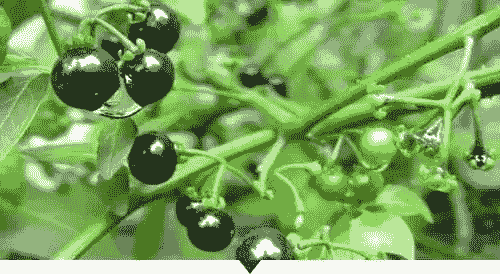

#

# **01、龙葵： **小时候好摘这个东西吃， 浆果和叶子都可以吃，浆果变紫色后可以直接吃，酸酸甜甜的，但叶子含有大量生物碱，必须要煮熟。

#

#

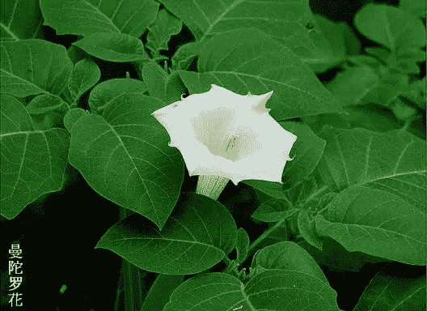

#

#

#

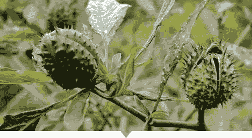

#

# **02、曼陀罗： **野生全白花，成筒状。蒴果直立生，有坚硬针刺。常生于荒地、旱地、宅旁、向阳山坡、林缘、草地。喜温暖、向阳及排水良好的砂质壤土。具有药用或观赏价值。

#

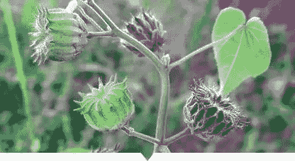

# **03、苘（qǐng）麻： **田间特别常见，籽一爆一堆，成熟后的茎皮是制造绳索和包装用品的原料。

#

#

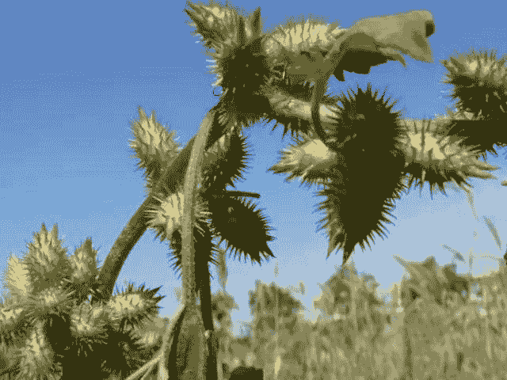

#

#

#

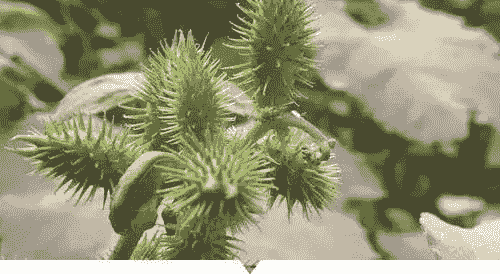

#

# **04、苍耳： **有很多硬刺，小时候男生常把它粘到女生头发上，简直想哭。或许你不知道，它还全株都有其毒（贝壳杉烯毒苷），以果实、特别是种子毒性较大。

#

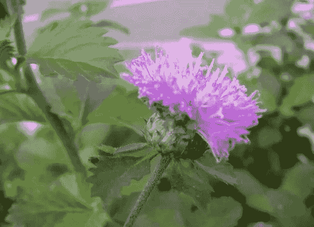

#

#

#

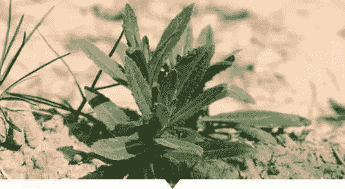

#

# **05、小蓟： **山东俗名萋萋菜，萋字当为蓟字之转音，其根与茎皆可用，而根之性尤良。剖取鲜者捣烂，取其自然汁开水服之。若以入煎剂不可久煎，宜保其新鲜之性，约煎四、五沸即取汤饮之。又其茎中生虫即结成疙瘩，状如小枣，其凉血之力尤胜。若取其鲜者十余枚捣烂，开水冲服，以治吐血、衄血之因热者尤效。用时宜取其生农田间嫩而白者。

#

#

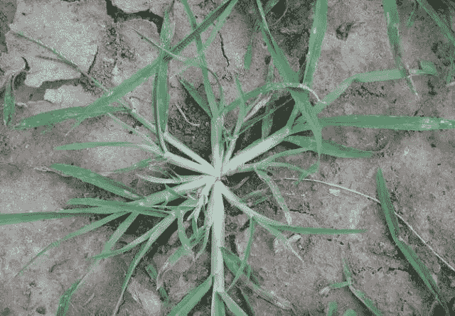

#

#

#

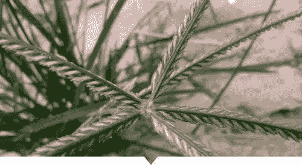

#

# **06、牛筋草： **根系极发达，秆叶强韧，全株可作饲料，又为优良保土植物。全草煎水服，可防治乙型脑炎。

#

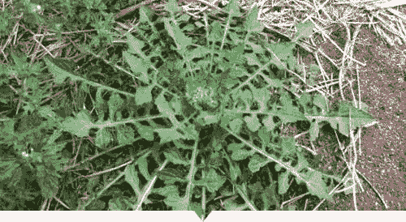

#

# **07、泥胡菜： **一年生草本，高30-100厘米。花果期3-8月。生于山坡、山谷、平原、丘陵，林缘、林下、草地、荒地、田间、河边、路旁等处普遍有之。别名：剪刀草、石灰菜、绒球、苦榔头、糯米菜。花跟小蓟很像，一度分不出来。

#

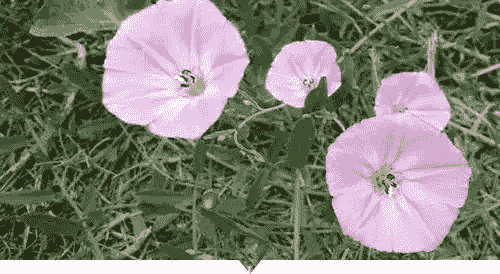

#

# **08、田旋花： **长得特别像喇叭花（牵牛花），但是叶子不同，它是柳叶状，喇叭花是掌状，和喇叭花一样惹人喜爱。

#

#

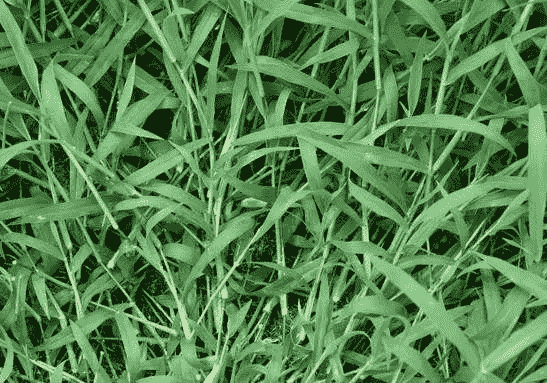

#

#

#

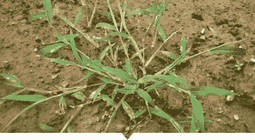

#

# **09、马唐草： **杂草，跟牛筋草差不多，根蔓延成片，一年生草本植物，高可达80厘米，叶鞘短于节间，叶片线状披针形，基部圆形，边缘较厚，微粗糙，茎直立或斜生，下部茎节著地生根，蔓延成片，难以拔出。

#

#

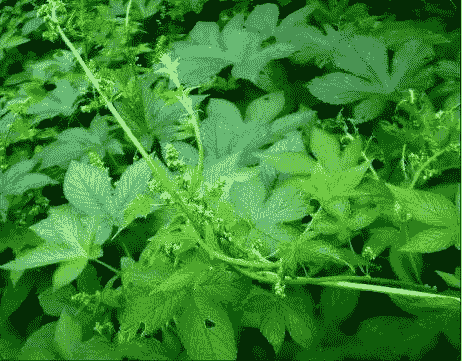

#

#

#

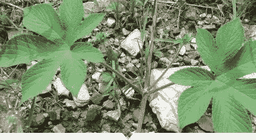

#

# **10、葎草： **又称勒草、黑草、麻葛蔓，株长1～5米，雌雄异株，通常群生，茎和叶柄上有细倒钩，碰一下就容易被划伤。

#

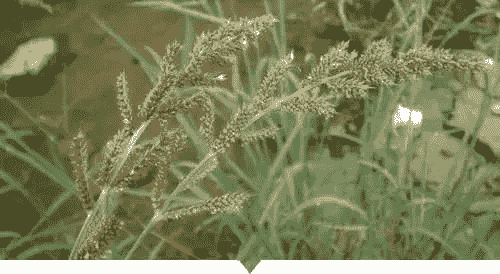

#

# **11、稗（bài）子： **最常见的野草，和稻子外形极为相似，似稻但叶片毛涩，颜色较浅。败家子中的“败”就是稗子演变过来的，因为它跟稻子争养分，但也是马牛羊的好饲料。

#

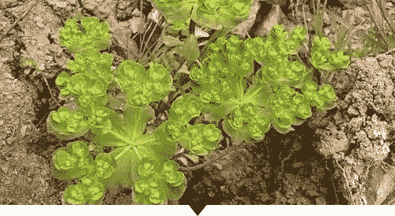

#

# **12、泽漆： **又名五朵云、猫眼草、五凤草，反正挺好看，以全草入药。春夏采集全草，晒干入药。

#

#

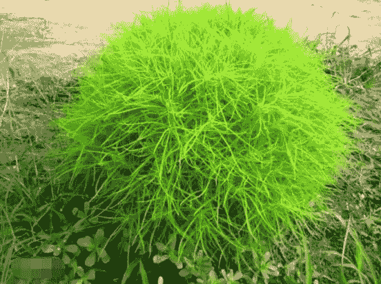

#

#

#

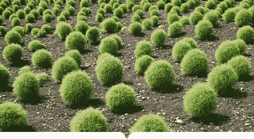

#

# **13、地肤草： **别名扫帚菜、扫帚苗，绒球球的一大团，地肤能适应砂质、砾质粘性多种土壤，在山林、荒地、田边、路旁均能生长。

#

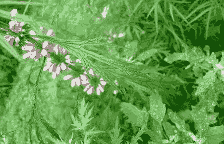

#

#

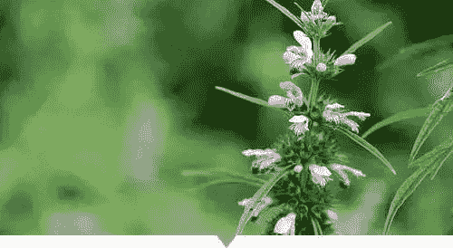

#

# **14、益母草： **野地里常见，但没想到就是著名的妇科病的圣药，夏季生长茂盛花未全开时采摘， 味辛苦、凉，活血、祛淤、调经、消水，治疗妇女月经不调，胎漏难产，胞衣不下，产后血晕，瘀血腹痛，崩中漏下，尿血、泻血，痈肿疮疡。

#

#

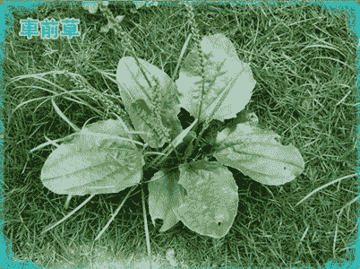

#

#

#

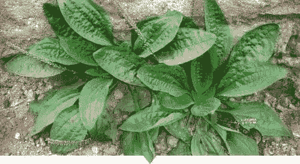

#

# **15、车前草： **耐寒、耐旱，对土壤要求不严，在温暖、潮湿、向阳、沙质沃土上能生长良好。居然也和益母草一样，也是常见的中药。

#

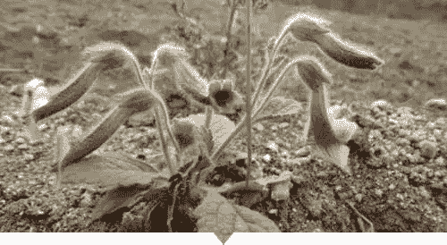

#

# **16、地黄： **也是著名中药，因其地下块根为黄白色而得名地黄，其根部为传统中药之一，最早出典于《神农本草经》。依照炮制方法在药材上分为：鲜地黄、干地黄与熟地黄，同时其药性和功效也有较大的差异，按照《中华本草》功效分类：鲜地黄为清热凉血药；熟地黄则为补益药。此外，地黄初夏开花，花大数朵，淡红紫色，具有较好的观赏性。

#

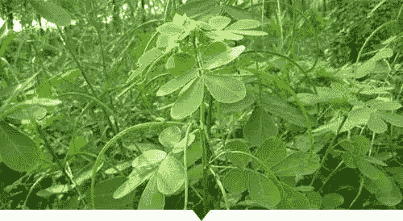

#

# **17、决明草： **还是中药！决明子就是它的种子！

#

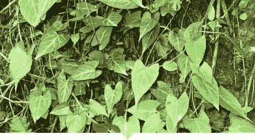

#

# **18、何首乌： **又是中药，而且是被神化最多的植物，差不多和人参齐名了，张果老就是吃了它的块根成仙的。

#

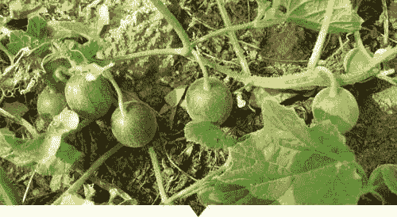

#

# **19、马泡： **一般农村孩子都吃过吧？瓜有大有小，最大的象鹅蛋，最小的像纽扣。瓜味有香有甜，有酸有苦。

#

#

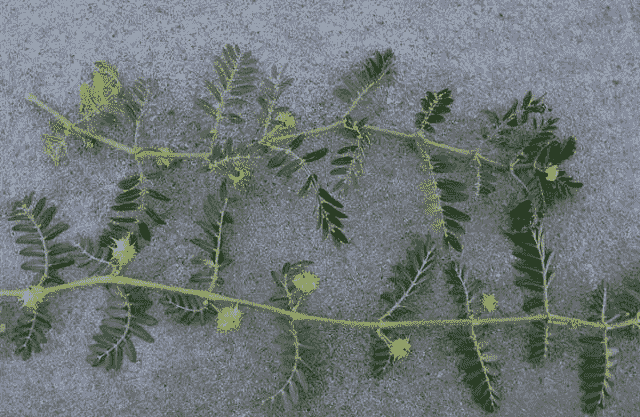

#

#

#

# **20、蒺藜： **小时候的重要“武器”之一，只是不知道人家也是中药材之一，果入药能平肝明目，散风行血。

#

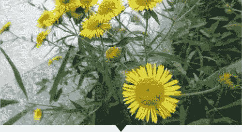

#

# **21、旋复花： **可也是中草药哦，像野菊花，又名驴儿草、百叶草，小时候经常把它扎成一束，很好看。

#

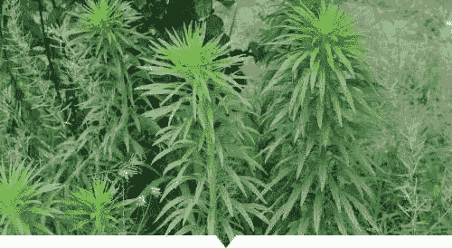

#

# **22、小飞蓬： **不陌生吧？还是中药材！

#

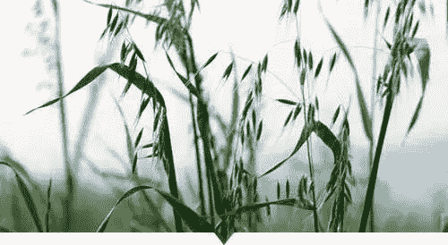

#

# **23、野燕麦： **又称铃铛麦，长得像燕麦，却没啥大用。

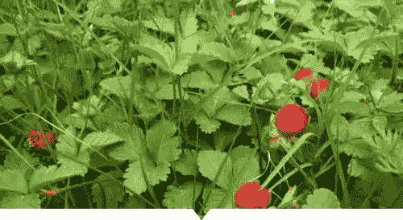

**24、蛇莓： **长得像野草莓，可人家叫蛇莓，是治毒蛇咬伤的中草药。

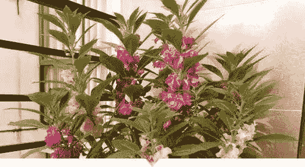

**25、凤仙花： **不知道你小时候是否相信这个传言：把它揉碎敷在指甲上染指甲，反正小编真干过这事。

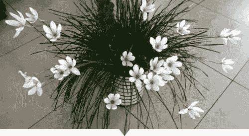

**26、葱兰： **经常见，却一直不知道名字，度娘了才知道叫“葱兰”。

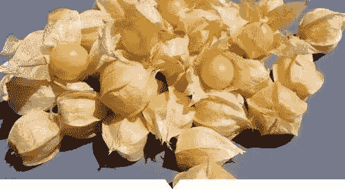

**27、灯笼果： **有的地方叫花姑娘，果实熟了酸甜的，很好吃，现在也有卖的，只是没有了儿时的那种甜美味道，不是它变了，是我们的味觉变了。

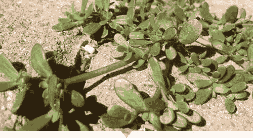

**28、马齿苋： **还是中草药，当然，动物爱吃，人也爱吃。只是不能让动物吃多了，容易拉稀。

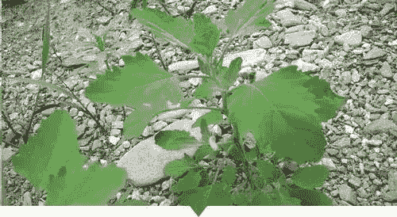

**29、灰灰菜： **著名的可口野菜之一，用面粉一拌，然后用锅蒸，哈吃的不得了。

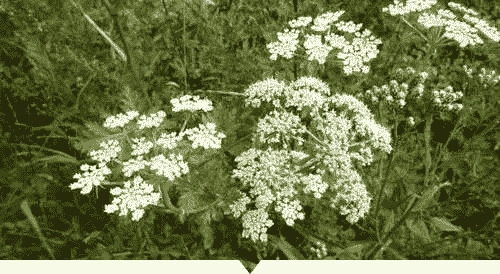

**30、蛇床子： **伞状小白花，也是著名中草药，壮阳佳品。

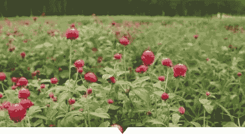

**31、千日红： **又名百日红、火球花， 苋科、千日红属一年生直立草本植物，高20-60厘米；花果期6-9月。花色艳丽有光泽，花干后而不凋，经久不变，所以得名千日红。

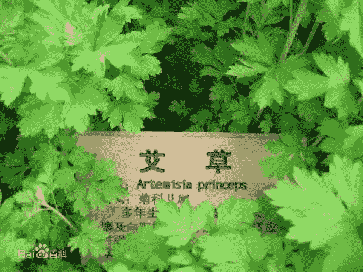

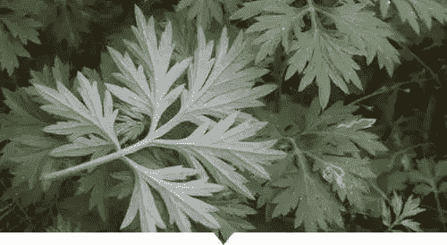

**32、艾蒿： **艾草，全草入药，有温经、去湿、散寒、止血、消炎、平喘、止咳、安胎、抗过敏等作用。

#

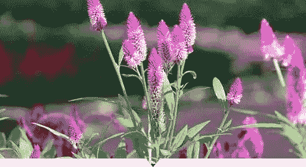

#

# **33、野鸡冠花： **颜色很亮丽，不过没有栽培的好看。

#

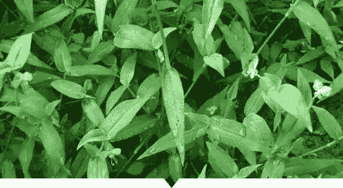

#

# **34、鸭跖草： **开蓝色的小花，很特别。也是常见中草药，味甘、微苦，性寒。能清热，解毒，利尿。为消肿利尿、清热解毒之良药。

#

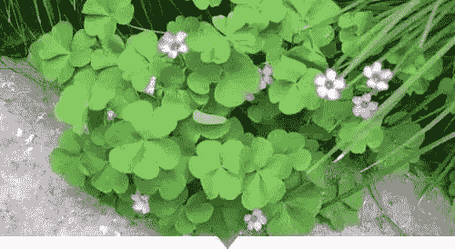

#

# **35、红花酢浆草： **也还中草药，清热解毒，散瘀消肿，调经。外用治毒蛇咬伤，跌打损伤，痈疮，烧烫伤。园林中广泛种植，既可以布置于花 坛、花境，又适于大片栽植作为地被植物和隙地丛植，还是盆栽的良好材料。

#

# **各位小伙伴们**

**你都认识吗？**

**认识的点个 **

**报到一下**

