# 2023-08-17时代的一粒灰落在我头上就是一座山 - AI 算法工程师练成记（附小小白学习路径）

> 来源：[https://xuqiwei1986.feishu.cn/docx/Rf20d9zUnol8RDxe1vpcZmnanvc](https://xuqiwei1986.feishu.cn/docx/Rf20d9zUnol8RDxe1vpcZmnanvc)

> 🔗 原文链接： h[ttps://articles.zs](https://articles.zsxq.com/id_66hmxg0swdmd.html)xq.com/id_66hmxg...

>

## 引言

大家好，我是大金，一名半路转行并成功上岸的 AI 算法工程师。

上周，我参加了洋哥的 AI 破局商业课程。第一节课便深深吸引了我——主题是 IP 定位。尽管课后因为搬家的借口拖延了作业（实则有更深层的原因，后文会详细讲述），但我终于在第二节课开启前交了作业。令我惊讶的是，我的坎坷经历引发了部分小伙伴的热烈关注。

起**初，我对交作业的状态是相当尴尬**的。如果我的分享能够帮助更多的人解决学习 AI 的难题，那么这正符合我的个人愿景—— 让更多人能享受数据智能的乐趣 。于是，我欣然接受了洋哥约稿。

以下内容是我为 [IP 定位课程作业 ](https://t.zsxq.com/11WaqWNdI)所做的进一步拓展，Enjoy~

## 一、复盘几段重要经历

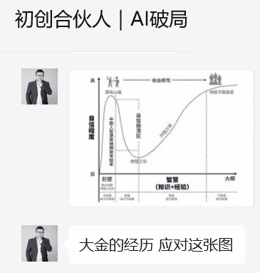

**如洋哥所说**，我的经历**应对了上面**这张图。洋哥的意思应**该是 经过**了 愚昧山峰 ，跌到了 绝望之谷 还没挂，有机会爬上 开悟之坡 。就我现在而言，爬坡的吃力感是肉身能感知的，我不知道我是不是正在爬开悟之坡，但过往经历堪称一部愚昧山峰和绝望之谷来回摇摆史 ，处处都有 No Zuo No Die 的既视感，这部分是真对应了上图的左半部分。

### 一）求学经历：

中考没考上高中，复读差几分上一中，苟在了二中；

高考又没考上，复读又差几分上一本，苟在了二本；

当时还是挺开心的，成了全村的希望，也为小朋友树立了榜样，看得出老实巴交的老父亲眼里简单而深沉的喜悦

### 二）选专业：

那一年大学志愿还是盲选，不自信的我把分数估得比较低，再加上信息闭塞、认知缺位，也不知道怎么选。选来选去选了个轻化工程专业，到学校才知道，它的真名叫制浆造纸；

这个专业毕业以后就是去造纸厂做车间技术工，到技术骨干，到车间主任，稳稳当当一眼就能看到头；

事实证明一眼就能看到头也是幻觉，那时候去了对口方向就业的同学前些年都被裁员了。

### 三）职业历程：

毕业后我没有留在稳定的（车间）厂，那啥也不会的人能去干嘛呢？当时的想法是干销售，事实证明我还是天真了，就我那说话都不利索的底子，销售都不让我干。绝望~

啥销售都不会能去干嘛呢？还有一个“好”去处 - 做保险，这个号称“ 不是人干的，是人才干的 ”工作也被我用几个月时间干废了。几个月下来我除了一个旅游保单和自己给自己买的保险，啥业务都没成。即便和十几个人合租在小两室，我依然连自己都养不活，只能靠刷信用卡度日。绝望~

好在这时候的我已经被毒打得不那么脆弱了，经过几轮面试后顺利进入了智联招聘电销部。剧情要开始发生转变了吗？并没有。外地口音明显、没有销售技巧、不通人情世故、一天百来次的拒绝。还很傻很天真的把信用卡借给室友，结果被刷爆了，绝望的体验一波接一波，酸爽到让人欲罢不能；

三个月后，我来到了新的城市，那儿有智联的分公司，那儿也有曾让我心碎的女孩。两个月后，我开始进入Top sales行列、成为Mentor、成为Team Leader、带更大的团队、拿销售管理CEO奖、销售总监、带更更大的团队，感觉就要迎娶白富美、走上 人生巅峰 （愚昧山峰）了

### 四）中年危机：

“ 时代的一粒灰，落在个人头上，就是一座山 。”

世界在悄悄的发生变化，移动互联网来了，电销的优势不再了，所在的公司也遭遇了市场竞品的多方围剿；

另一方面，智联招聘在我入职之初就开始冲刺上市却多年未成。这让我惊醒过来：不行，方向不对再努力也是收效有限；

接着又一次下探到绝望之谷：离开原有行业找同级别岗位，没戏；转到别的行业/销售，在心态很难调整下多次未果；尝试创业，失败；连续创业，连续失败。继保险之后再次成为负翁，绝望~

** 没有工作没**有收入，要养家糊口，要月供房贷，真是绝望之谷 绝望绝绝子~

### 五）自我重塑

#### 1、痛定思痛

痛定思痛后，我重新进行梳理，也试着从更长期的角度去评估接下来的安排，那时的我有了几个认知：

运气、实力和灰色

普通人的机会在运气、实力和灰色，但同时这些机会又不属于常规操作下的普通人，因为运气不可控**、实力大**家差不多，灰色咱不知道也不能碰。除了内卷死别人后再卷死自己，只剩下一条 拼长期 的路。

难而正确

长期的赛道通常还有几个特点：

难， **难才不容易内卷 ****，难才有**门槛，难才不用太关心和别人卷，卷自己叫 挑战自我

** 有秘密，有秘密才好**长期，不然大家很快就卷平了。秘密通常在 科技领域和灰色地带 发生

培训的功与过

通常来说，当培训行业大规模推广某一热点时，机会已经过了最佳期

但对于 **普通人 **来说，没有培训行业的信息触达很难接触到下一个技能热点，即使提前接触到也意识不到或不敢确定。

我可以，我又不可以

我自己就是个普通人，我将上面几个交叉一下：难的 + 科技相关的 + 培训在较大范围推广的。当时我锁定人工智能，这也是我热爱的方向；

但这个对于没有任何技术背景，渣渣学历背景的中年大叔来讲，简直不要太难了

所幸在多次遭受被按在地上摩擦后，我已经形成了一个天真的观念：我可以做到的，只要不是造火箭这种级别的，我花足够时间学习都是可以做到的；

失败的经历也让我认识到“我又不可以”：浅尝辄止肯定没戏，毕竟你就是个普通人，不花够功夫为啥就你有好运气。

#### 2、AI 之旅

想定以后，我着手把房子卖了（那时候已经欠不少钱，每个月的房贷和生活费也都是靠信用卡来周转，利息实在扛不住了）

教程的坑

为了让自己能够顺利上手，我没有直接开始买正式的内容学。我先在市场搜了一圈比较简单的教程，我发现大部分简单的教程对我来说都不简单，甚至很多本身就以复杂为荣。

最后你猜怎么地，我没有用市场上任何一个教程，我去图书馆找了一本教小孩子学 Python 的书。花了三天学完，神奇的事情发生了：我感觉”我又行了“。

建立信心正反馈后，我开始正式的学习 Python ，同时我也特别留意教程中复杂的内容。我的学习体验是国内很多教程都是以复杂为荣，很多培训机构的内容也是这样，夹杂了技术专家式的傲娇和学员小孩子才做选择我全都要的欲望，内容全面且多坑。 -- 至少对于我这种渣渣而言是这样的

不**纠结于复杂内容后，接下**来的学习就更顺畅了，Numpy、Pandas、可视化、统计机器学习、深度学习一溜下来巴拉巴拉（ 更新，文末附学习路径 ）

学习的坑

一个巨大的挑战源自我们自身。我在学习过程中接触了很多同学，常见的一个误区是：过分追求理论完备，尤其学霸们更容易这样。

但实际上，忽视实践的学习者们常常最终陷入“理论通，实践盲”的困境 -- 即所谓一看都会，一干就废。

实践的坑

AI 算法实践是门手艺活，特别是对于 非 AI 科班的同学，是必须要征服的大山。实践意味着不仅要参与，还要获得实质性的结果。

因为就业环境中为了效率更高或者风险更小，处处都是标签先行。最好是能拿到 AI 竞赛的好名次

就我而言，密集实战时期化身“时间管理大师”一年时间打遍了国际国内多个比赛，在Kaggle、天池 KDD Cup和腾讯算法大赛都拿到了 Top 的结果。这为我后续顺利上岸打下了坚实的基础。

一定要实战、要实战、实战、战；一定要拿到结果、拿到结果、结果、果。

**深坑警告 **：

过度迷恋理论，总觉得掌握得还不够，**迟迟不能开始实践；最**后的结果最多也就是 一看都会，一干就废 ；

没有闭环思维，喜欢一上来就想憋个大招、来个章一鸣惊人。

憋大招会比较痛苦，很多人憋大招憋着憋着就放弃了。如下图所示，往往还没到4就si了， 这是很多AI实战初学者阵亡的真实写照

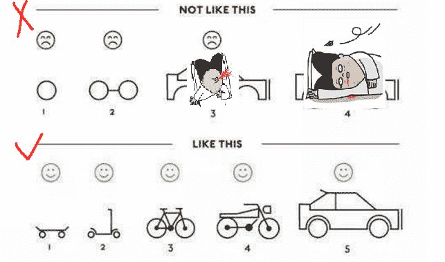

闭环思维会比较爽，因为比较快的就能拿到完整的成果，如上图每一步都是一个完整的产品。

做一个有挑战的项目会面临很多不确定的意外情况，不要想着上来就憋一个大招；快速完成实践的闭环然后持更新续迭代，才是实践中需要努力做到的，特别是对于小白初学者。

对于学习者：每堂课时间都有限，注意力也没法聚焦太长时间。所以每次有个完整、明确的目标很重要。

**学什么很重要，但对于非 AI 科班人员来说，更**重要的是不学什么，更更重要的是实战了什么

> 因为万事万物皆有约束条件，默认约束有时间约束和前置知识/实践约束。具体来说：

> 1. 咱们的时间都是有限的，尤其是非 AI 科班同学，不像科班有整块的学习时间，一个有效的策略就是搞清楚哪些不学、至少是先不学。

> 2. 人教人一辈子也教不会，事教人一次就会了！听起来很刺耳，但很多时候确实这样。跟着别人（教程/视频）学还是人教人，学什么很重要，但对于非 AI 科班人员来说，更重要的是不学什么，更更重要的是实战了什么

### 六）斜杠青年与现状：

斜杆经历另见 《斜杠青年副业多赚了 6 位数》

目前中科系 AI 算法 Leader 在职。我正在探索通过 AI 赋能做出更有趣更友好的内容，让更多人能享受数据智能的乐趣。

**（回首过往，总感觉自己是个 Loser，也不太愿意去正式复盘自己的过往，所以一直在纠结这次的作**业。感谢 AI 破局、感谢洋哥，让我有勇气第一次这么正式的公开分享我的人生复盘）

## 二、我的定位

我致力于创造 AI 算法实战的内容，

解决 AI 学习者面对大量知识而感到困惑、理论学习与实践落地的断桥、以及职业过渡的挑战。

我提供科学的实战指导和长期陪伴服务，以满足不同层次的需求。

## 三、为什么是我

### 一）我的个人使命和愿景

一路过来算是一路坎坷，作为一个普通人真是多次陷入绝望的境地。转身望去，我如果在更早的时候能入局 AI 那或许会是另一番景象。与此同时，我也看到还有很多兄弟姐妹正在 AI 算法学习的苦海里挣扎。

** 回顾和反思自己的经历，我逐渐**形成了“ 让更多人能享受数据智能的乐趣 ”的个人愿景。希望通过我的努力和创新，帮助更多初学 AI 的小伙伴更好的实现 AI 算法自由。这对我来说不仅仅是一门生意，现在我把它作为实现我人生价值的终极使命。

### 二）我行你也行的信念

同样是我的经历：没有任何技术背景，渣渣学历背景，中年危机卖房转型，成功上岸中科系，又买房。对于我的学员来说，这是一个鲜活的案例：“我行，你也行”。

### 三）科学实战少走弯路

我**不会太强，更**不是天生的强者，这个不是劣势是优势。因为这让我更懂得初学者的痛和上岸前的苦，简单说就是“可以让你 更少走弯路 ”。

### 四）非典型辅导

我拥有丰富的教学经历，连续受邀给 211 高校做算法实训，满意度近 100%；

同时，已经为上百位非 AI 科班同学的上岸之路提供支持和帮助；

## 四、终身成长

在这充满挑战的短暂而又漫长的人生旅途中，我的愿景已变得清晰明确： 让更多人能享受到数据智能的乐趣 。我深知算法与AI的力量，它们可以改变生活、优化工作，甚至是翻转我们对这个世界的理解。我想，如果我的经历和知识能为他人点亮一盏指引前行的灯，那将是我人生中最宝贵的财富。因此，我视这为我实现人生价值的终极使命。

无论此刻处于生活和职业的哪一个阶段，都提醒自己：未来并不是预设的，它由我们每一个勇敢而坚定的步伐共同铸造。我曾从未想过自己会步入AI这个领域，更曾经视它为遥不可及。

我希望我的故事能给您带来信念和勇气，让您相信自己完全有能力创造属于自己的精彩人生。

在此，我想留一个问题以供深思： “如果你不受任何限制，你最想追求什么样的生活和职业？”

同时，我倡议大家，从今天起，每天都花一点时间去学习一些新的知识，无论是编程语言、数据分析、人工智能算法，或是其他任何能够拓宽视野和提升自己能力的内容。因为，正是这些日积月累的努力，将最终汇聚成我们实现梦想的力量。

让我们一起，用行动去书写属于我们自己的人生篇章，无悔这段美丽而宝贵的人生旅程。

## 小尾巴 - 附部分学员反馈

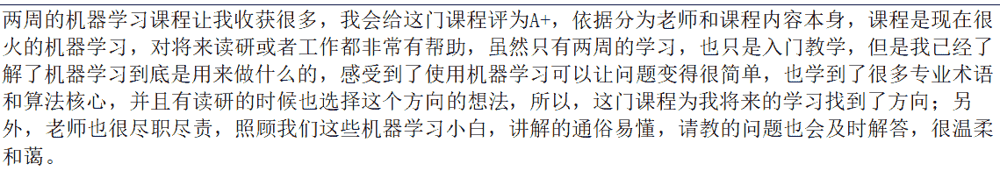

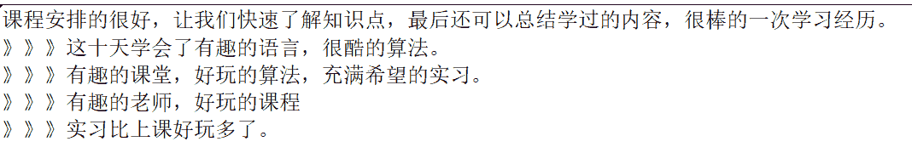

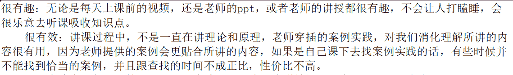

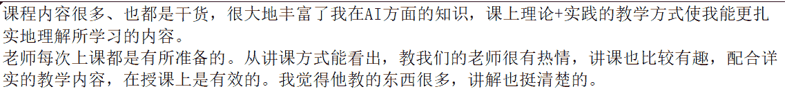

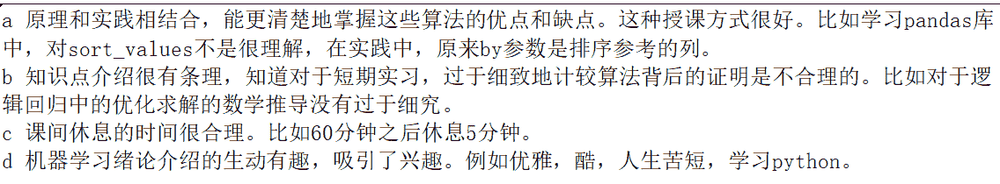

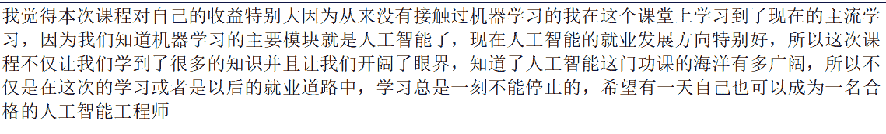

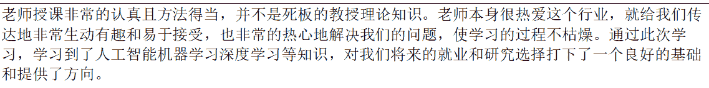

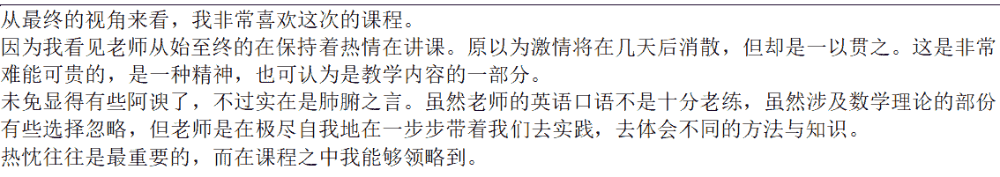

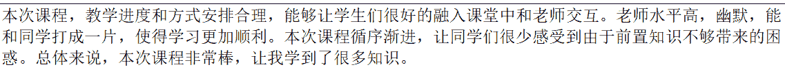

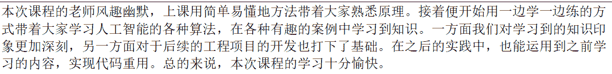

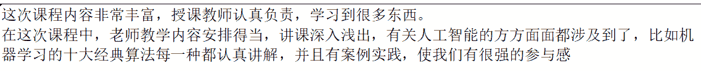

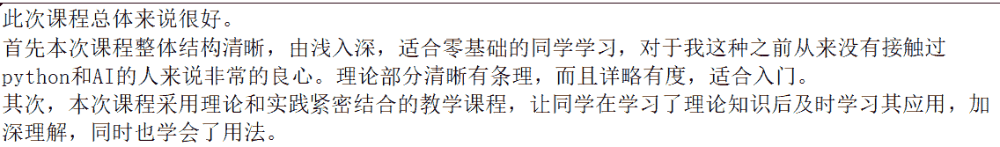

## 更新 - 学习大纲

有**些小伙伴询问成为 **AI 算法工程师具体的 AI 学习路径，学习路径规划是一个比较个性化的问题，我这边先 针对零基础初学者 提供一个通用、精简但系统的学习大纲先。我将其中一些内容标为“必学”，这些是你成为一个合格的数据分析师或机器学习工程师所需要的基础；其他标为“可选”，可以根据你的兴趣和时间进一步学习。

### 第一阶段：编程基础 - Python（必学）

变量和数据类型

控制结构（if-else, 循环）

函数和模块

错误和异常处理

基本的输入输出

### 第二阶段：数据处理和分析（必学）

Numpy

数组和矩阵操作

常用函数（如：sum, mean, std）

数组索引和切片

Pandas

Series和DataFrame

数据清洗（缺失值处理、数据转换）

数据分析（分组、聚合）

数据导入与导出（CSV, Excel等）

数据可视化（必学）

Matplotlib基础

Seaborn（可选，更高级的可视化工具）

### 第三阶段：统计和机器学习基础（必学）

基础统计学

机器学习

了解监督与非监督学习

分类和回归算法（至少学习线性回归、逻辑回归、决策树、随机森林）

模型评估与选择

Scikit-learn库的使用

### 第四阶段：深度学习（可选）

深度学习基础

神经网络基本结构

反向传播与优化

卷积神经网络（CNN）和循环神经网络（RNN）

框架学习 - TensorFlow或PyTorch基本使用

### 第五阶段：项目实践（必学）

实际项目

完整地走一遍数据分析或机器学习项目流程

或者尝试一个深度学习项目（如果你学了深度学习）

可省略或延后学习的部分：

高级编程话题（如装饰器、上下文管理器、元编程等）

高级机器学习话题（如强化学习、生成模型等）

大数据技术（如Hadoop、Spark）

**对于没有任何编程基**础且时间紧张的同学，建议 先专注于前三阶段 ，这将为你打下坚实的基础。根据你的进展和兴趣，再决定是否深入到深度学习和高级话题。

每一步尽量做到理解透彻，形成实际操作的经验，而非仅仅是看过去。尤其是项目实践，通过实际操作，你可以巩固和应用你所学到的知识。

最后，学习编程和数据科学是一个实践性很强的过程，所以尽量保持耐心和持续的努力。祝你学习顺利！

扫码加入星球

查看更多优质内容

https://wx.zsxq.com/mweb/views/joingroup/join_group.html?group_id=15552545485212