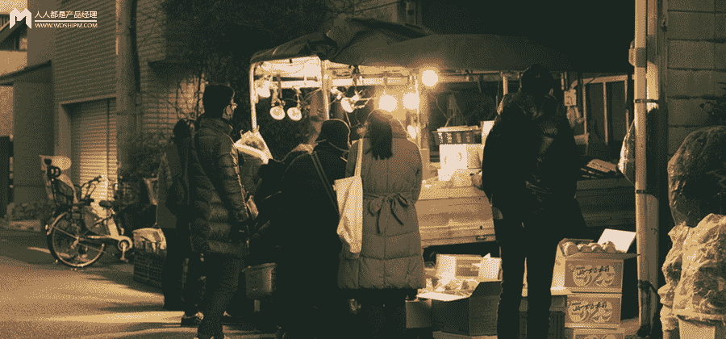
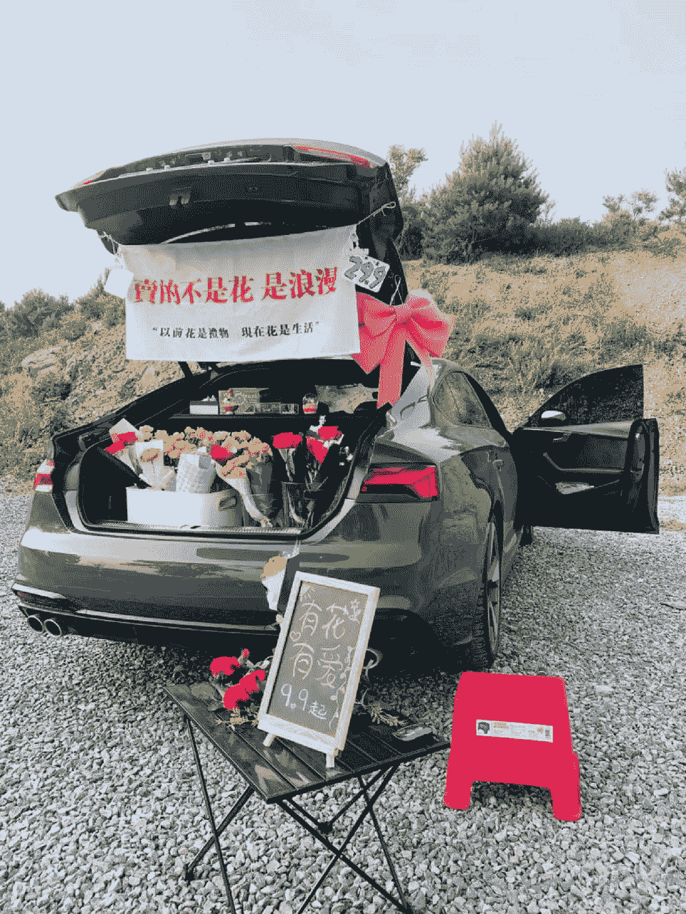
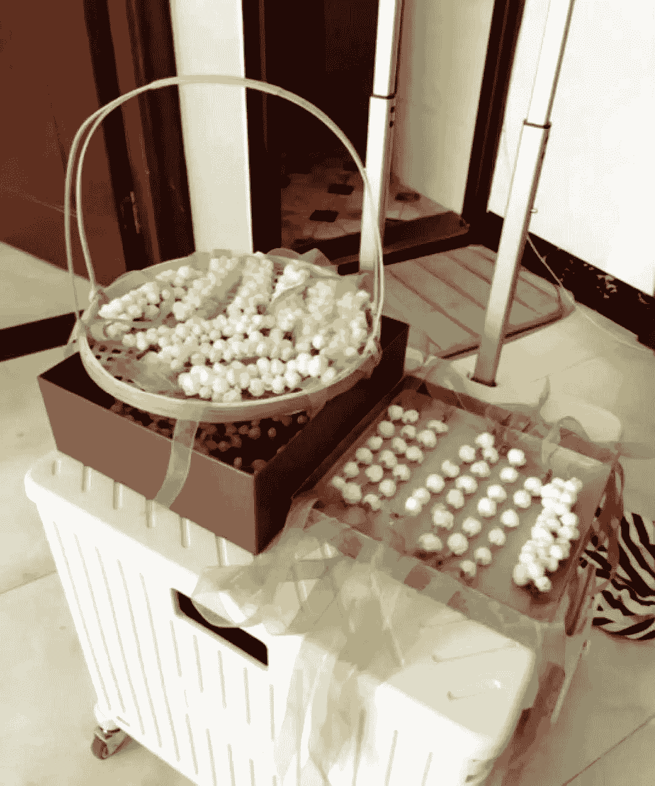
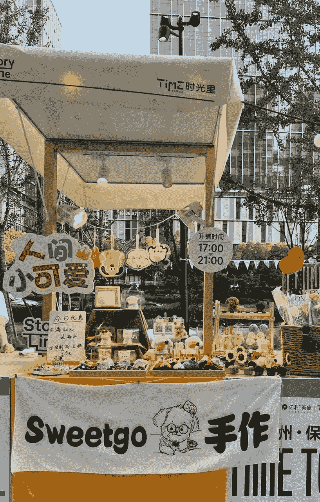
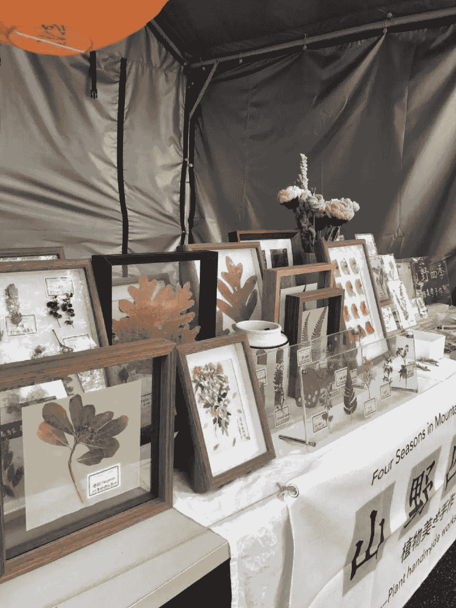

# 2023-08-22年轻人佛系摆摊：边卖边送、不为赚钱、图个开心 – 人人都是产品经理

> 来源：[https://xuqiwei1986.feishu.cn/docx/AhrcdvW91o7ncfxVTf2cYqUFnad](https://xuqiwei1986.feishu.cn/docx/AhrcdvW91o7ncfxVTf2cYqUFnad)

> 🔗 原文链接： h[ttps://www.woshipm](https://www.woshipm.com/it/5890076.html).com/it/5890076....

>

> 现在好多年轻人都开始了摆摊之旅。有的是为了放松，有的是为了创业。本文作者采访了5位摊主，让我们一起来看看吧！

摆摊嘛，最重要的就是开心。

一股“摆摊风”正在年轻人中流行开来。

多地部分区域放开摆摊以来，地摊的数量变多了，特别是90后、00后的年轻摊主，俨然成为一道流动的风景线。

太阳落山，这些年轻摊主带上自制的画框、发卡，包装精致的玩具、鲜花，来到市集或路边，开始搭摊位、摆物件。天再暗一些，这些被装饰和灯光包裹的摊位，让整个街道瞬间亮丽起来，路人甚至有一种就算不买也想拍照的冲动。摆摊的年轻人越来越多，市集也成了时髦的休闲去处。

最有意思的是，他们中的很多人，摆摊很努力，在选品、布置上花了很多心思，甚至复盘反思，但对赚钱比较佛系，很容易被砍价，甚至主动连卖带送。

这届年轻人出来摆摊，不为赚钱？「定焦」跟五位年轻摊主聊了聊。

想靠摆摊赚钱，的确不容易。他们多的一天营收一千块，少的甚至赔钱。不过，比起赚钱，他们都更看重摆摊的过程。有的是为了打发时间，体验一把做生意的感觉；有的担心失业、所以发展摆摊副业；还有人是为了完成摆摊的梦想。

这听起来过于理想化。这些年轻摊主也的确经历了现实的“拷打”，比如，遇到“砍价狠人”，和客户产生纠纷等等。

不过，他们无一例外都提到，做自己喜欢的事情，得到外界的认可和鼓励，是一种颇有成就感的体验。

街边地摊，是个很有意思的地方，这里没有混凝土墙，是他们体验生活、观察世界的一个绝佳窗口。以下是五位年轻人的故事。

## 一、在摆摊中找创业的感觉，每次都会复盘总结

趴趴熊 | 90后 互联网从业者 北京

之前因为刚离职、闲来无事，决定用汽车后备箱摆摊。当时马上就要520，就想凑节日的热闹去卖花。

受访者供图

我们去过首钢园的路边、商场边的路口，还去过妙峰山景区的观景台， 一共摆了四次地摊，每次出摊一两个小时，最后纯利500多元。

我们价格定得不高，520当天也没有涨价，虽说利润低，销量却不错，导致521当天都没花可卖了。

有一次，碰到一个客户刚好过生日、又很喜欢花，一下买了两把，我们就忍不住打了5折，连卖带送的给她了。那天的纯利还不到100元。结果临撤摊前，我们买了点干果吃，由于没看价格，一袋松子仁就200元，把两天的利润都“赔”进去了。

**摆地摊，心态一定要好，还要经过深思熟虑和**各种准备，不能脑子一热想起什么就卖什么。

我们经常看到的摆摊，无非就是几大类：玩具、食品、酒水饮料、花、宠物、水果。食品要注重口味的稳定，玩具小商品要考虑实用性和安全性，卖花要自学包装和保存方法。

比如我们为了做好花的包装和保水，看了很多视频学习。摊位选址也有门道，像我们卖花，不一定要去人流量最大的地区，更需要找对生活情调、文艺类商品购买意愿更强的人群。

我的经验是，虽然为此准备了很久，**依旧也要做好产品卖不出去砸手里的准备**。 不要羡慕其他人一天赚几百上千，也别想着拿个小椅子往边上一座，就有人主动来买 。既然出来摆摊，就不能太过腼腆，至少看到有人从旁边路过时，要吆喝两句。

怕麻烦的人，也不适合尝试摆摊，因为摆摊可能有很多突发状况。像我们最后一次是去网红打卡点妙峰山观景平台摆摊，那里年轻人多，大部分都是来拍照喝咖啡的，夜景也足够漂亮。

受访者供图

但我们开了一小时的上山路，下午4点出发堵到6点半，才到一号观景平台，8点刚过就开始刮风下雨，不但车里进土，风力大到连放花的水桶都吹倒了。我们只好仓促收摊等雨停，一直等到10点，大风都没有减小的意思，最后无奈收摊下山。

只出摊了一个多小时，但生意还是挺不错的，不算门票的话，把那批花的成本刚好收回来。

**我们虽说不太在意收益，**但绝不是佛系摆摊， 每次回来都会复盘总结 ，有问题的地方再改进。我们主要是积累经验， 希望在摆摊这个项目里，找找创业的感觉、给自己打工的状态。

对我个人来说，看到很多人买完花非常开心，我也会很有成就感。

## 二、佛系摆摊，5天营业8小时，赚了800块

林周一（离职状态）| 26岁 广州

“大手串10元、小手串5元、香包5元2个。”

**这些便宜、好看、好闻的小玩意，很受年轻女孩喜欢， 别**看我7月底到现在一共营业5天，每天摆摊时间也不固定，有时晚上有时下午，但已经赚了800块。

之所以摆摊是因为自己离职想找点事情打发时间。刚好在社交平台上刷到一堆关于“摆摊”的内容，加上自己平时也喜欢逛地摊，于是，我在某电商平台上下单了两斤茉莉花，还有一些做手串、香包的材料，打算摆摊卖茉莉花手串和香包。

这些小东西成本很低， **我买一共花了200多块 **。当时想着即便卖不出去，但花钱最多的茉莉花，也能做成饮料，所以怎么着都不会亏。

做茉莉花手串的技术要求不高，我一边追剧一边穿，弄好一个手串大概需要三到五分钟。

受访者供图

因为是带着玩的心态来摆摊的，所以我一直很佛系。

比如我第一天摆摊就很随机。临时和朋友做了几个手串后出门，那时已经是晚上9点，公园附近没有什么人，我们一边卖一边送，待了1个小时就回家了，当天收入也只有50块。在回来的路上，我们还买了两根烤肠和饮料，基本是零入账。

广州的夏天很热，每天都是30多度的高温，所以我一般等到晚上出摊，卖累了就回家，也不会给自己立一天要卖多少单的目标。

但晚出门也意味着会错过一些客流，毕竟早出摊销量会高很多。 像有一次我下午4点出摊，不到两个小时就卖了50个手串 ，当时还有很多顾客想买，所以临时又做了不少。

我最近已经不摆摊了，觉得体验过一次就可以了，现在要把全部时间放在找工作上。而且摆摊的竞争者也越来越多。我7月底摆摊时，还没有看到我所在的景点有卖茉莉花手串的小伙伴，但现在，已经有五六家推着小车在卖。

他们大多是大学生，想摆摊赚点零花钱，而茉莉花手串成本很低，很香很好看、不愁卖，所以很多大学生便看上了这门生意。

比起赚钱，在摆摊的过程中，最让我开心的是看到了很多温暖画面。

一个小女孩走到我的摊位面前，拉着她爸爸的手说，要给妈妈买一串带回家，虽然最后他们没买，但我还是被小女孩可爱到了。

还有70多岁的爷爷奶奶，带着几岁的小孙子遛弯，结果一人买了一串，他们带着茉莉花、手拉着手一起走的背影，特别治愈。

总之，这次摆摊我的体验感很好，算是完成了自己的一个小心愿，因为我观望摆摊这件事情很久了，但一直没有行动，觉得它离自己有点远也有点难，但事实并非如此。所以对于那些想要尝试摆摊的小伙伴，我想鼓励大家勇敢地去做，这样自己那颗躁动的心就不会一直惦记，如果担心会赔本，就从低成本的小生意做起。

## 三、把摆摊当创业：丢过东西、被说“不值钱”，但会坚持

露露 | 90后 互联网运营杭州

因为害怕失业没有收入，我一直想发展副业。今年元宵节，我和家属就在某景区内的集市，尝试了摆摊卖灯笼和玩具。

之后，为了节约成本，我们还尝试在公园摆“野摊”，但刚摆没多久，就“招来”了保安。因为提心吊胆影响做生意的状态，又怕被罚款得不偿失，我们开始转战付费集市。

固定摆摊这几个月来，我的感受是， 摆摊看似简单，其实里面的门道很多，不确定因素也很多。

其中最难的是找到独特的品类。如今，很多好卖且利润高的品类，满大街都是，甚至都打价格战，赚得并不多。 现在一些集市需要摊主有原创产品，如果产品和陈列没有特色，很难报名入选。

为此，我自学手工，先后尝试过滴胶、奶油胶，但因为材料在制作过程中会产生轻微毒性，怕影响健康就放弃了。现在做的是扭扭棒，把原材料扭成小狗小猫小花的形状，然后修毛、做造型、上色、加配饰，也很费时费力。

最**近，集市遍地开花，但报名费一个赛一个的贵，基本都是在50-15**0元/天，有的网红市集已经涨到三四百元/天。 且不说不同集市的客流量、顾客消费能力参差不齐，即使同一个集市，被安排到不同的位置，也会影响当天的收入。

不少摊主都遇到过被偷东西和客户纠纷，我也遇到过。加上原材料成本高、卖货的钱又拿去进货，真正赚到手的并不多。遇到“砍价狠人”，利润还得再压缩。

我之所以还在坚持摆摊，是因为我全家人都在参与这项创业，他们给了我很大的支持。我比较社恐，我家属就会主动介绍产品、揽客，我婆婆也会做钩织，并且帮我卖。

摆摊的另一大快乐是顾客给的。一开始我对自己没有信心， 也有顾客直言觉得我做的手工不值这个价，让我很受挫 。后来发现其实有更多的人会说好可爱，也会夸我手巧，能看到我的付出，我会发自内心地感到开心。

摆摊期间，我还接受了顾客的建议——有位老爷爷给孙女买了一只小狗，提出我的包装太简陋，还有一些摊主会给我陈列上的建议。我逐渐完善自己的包装和售后，成立了品牌“Sweetgo 手作”，并在📕上分享摆摊经验。

受访者供图

现在我相当于打两份工， **上班回去要备货、复盘哪些东西卖得好，周**末边摆摊边现场赶制产品，忙起来手指生疼。

我们已经将摆摊视为自己的一条后路，为此我们一家人也会继续坚持下去。虽然现在销售额还没有很高，但是我相信未来的我，会感谢此刻这么努力的我。

## 四、为了做自媒体账号而摆摊，意外做到了日入千元

柚子 | 90年 大连 自由职业者

我的摊位叫“马里奥的杂货铺”，摆在大连一个旅游景点的市集里。我卖的东西比较杂，定价在15-40元之间，每晚5点到10点出摊。最近两个月是旅游旺季，我的摊位日营业额有1000元左右。

而**就在三四个月前，我还完全摸不到门道。我工作已经**10年了，以前也摆过摊，那时候只是觉得有意思。今年5月份，我正式开始摆摊，是因为我离职后， 打算做自媒体，就选了摆摊作为我的自媒体内容，因为想做账号，肯定是要有人设，有内容可发。

我最早卖包包和饰品，饰品卖的不太好，很容易跟别人撞品，又进了一些发饰、钥匙扣，还有一些小玩意，后来我注意到我们这个市集来旅游的小孩特别多，就又选了一些小孩喜欢的东西，比如项链、手链、戒指，还有捏捏乐、蛋仔、猪猪侠等。

受访者供图

我刚开始主做抖音，现在是📕，会拍视频、发图文，偶尔也做直播，目前效果还不太好，像我这种小白，没有团队，只能一点一点摸索。

但我作为摆摊新手，生意做得还可以。经过不断调整陈列和新**品**，之前的淡季，每天收入500元左右， 七、八月份的旺季，每天的流水大概有1000元左右，流水的20%抽成是摊位费，除去成本和抽成等，大概能剩一半流水算是利润。

摆摊是小本创业，像开一个店一样，要花很多心思。 我觉得摆摊最重要的是选品、选市集，其次是陈列等 。我之前做管理和销售方面的工作，推销产品对我来讲不算难。我摆摊之前忽略的是选品的问题，实际上如果不跟手作、首创等沾边，销量很难上去。现在摊位之间的竞争很激烈，我上一个新品，别的摊位看到了可能很快就跟上，价格可能更便宜。

陈列道具也很重要，小到一个包装袋、小卡纸、盘子，还有摆盘，都影响非常大。另外，如果销量不是很好，可以想些其他办法吸引客流，比如做一些5.9元、9.9元的引流款，或做一些小游戏，赢了免费送礼物，输了买单，先把人流引上来了之后，再想转化的问题。

不图赚大钱的话，我觉得摆摊起码是赔不了的。 时间也自由，还能卖自己喜欢的东西，被别人认可也是一件很开心的事情，还能认识不同的人，结交新朋友。

每年5月到10月份，算是摆摊旺季，今年我大概会做到10月份，之后继续做自媒体，明年5月开始再继续摆摊。我未来摆摊也还是做专业的市集，因为有固定的摊位，规范的管理，市集还会帮助控品，相对正规、省心一点。

## 五、摆摊的时间成本很高，正向的价值反馈更重要

戴叙 | 90后 媒体从业者 北京

一直以来，我都有一个摆摊的梦想。三年前地摊经济火热一时，我就想去地铁口卖电风扇。当时从网上进了两箱货，包装、招牌、收款码全都准备好了，正准备大干一场，被叫停了。 这批货就砸手里，都拿去送人，现在还没送完。

今年我做了很多小手工，各种植物画框、植物发夹、小胸针，都是自己原创。一开始纯粹就是因为兴趣，做着玩，送了一些给朋友。后来就想着，也许可以参加市集去摆摊。

上周末第一次参加市集，在家附近的一个公园里，摆了两个晚上，从下午5点到晚上10点。

第一天下午3点多我就到现场了，第一个到，所有摊位都空着，甚至连摊位号都还没贴。布置摊位我花了快一个小时，张贴招牌、摆放产品、贴价标、挂灯笼……这期间陆陆续续有摊主进场。

受访者供图

一开始人不多。从5点到6点半，没几个人主动询问，但路过的人都夸产品好看，好几个人专门站在我的摊位前自拍，还有人拿着相机拍我的产品。

快7点的时候，人明显多了起来。第一个订单，来自一个七八岁的小女孩， 她一眼就看中了一个植物发夹，拿起来就走了，挥挥手让她父亲付钱 ，20元。她父亲跟我砍价，我一时没反应过来，支支吾吾说没法便宜了，对方就付款了。

很快，一个看起来很精致的女生，买走一个植物摆件，59元。没多久，摊位前挤满了人，里三层外三层，**好多人问，我都顾不过来。**接下来两个多小时，我卖出去几个植物画框，发夹全部售罄， 加起来卖了900多块钱。

两天的摊位费是300元，我一开始的预期是赚回摊位费就行，实际第一天的业绩就远远超出预期。后来我跟相邻的摊主交流发现，他们销售情况都很一般，有的只卖了200多块钱。

**最大的收获，是外界的认可。 **现场大部分路过我摊位的人，都表达了正面评价，“好看”“巧妙”“艺术”是高频词。还有好几个人问我有没有网店，以后能去哪里购买之类。其中有一个顾客，极力鼓励我开店。 这给了我很大的激励，说明我的产品是有市场的。

人间烟火气，摆摊是一个非常好的体验生活、观察世界的方式。

从生意的角度，靠摆摊赚钱相对困难。就我自己的产品而言，因为是纯手工制作，不能用机器流水化生产，无法标准化和规模化，即便有市场，供给也会是问题，所以价格不能太低。

**成本其实很高。除了产品的原材料、包装，以及摊位**费、打车费，我还要投入大量的时间成本。 如果把所有成本算进去，就不赚钱了。更多的是做自己喜欢做的事情，获得一种正向的价值反馈。

* 应受访者要求，文中露露、戴叙为化名。

作者： 星星、布鲁斯、翰墨、温故；编辑：向园

来源👸号：定焦（ID：dingjiaoone），深度影响创新。

本文由人人都是产品经理合作媒体 @定焦One 授权发布，未经许可，禁止转载。

题图来自 Pexels，基于 CC0 协议

该文观点仅代表作者本人，人人都是产品经理平台仅提供信息存储空间服务。