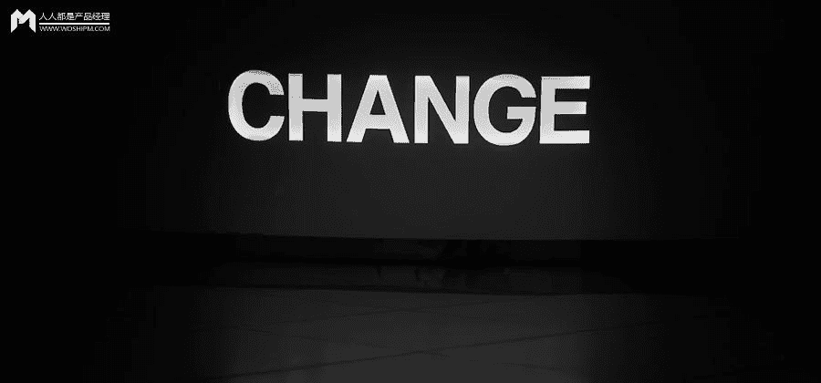
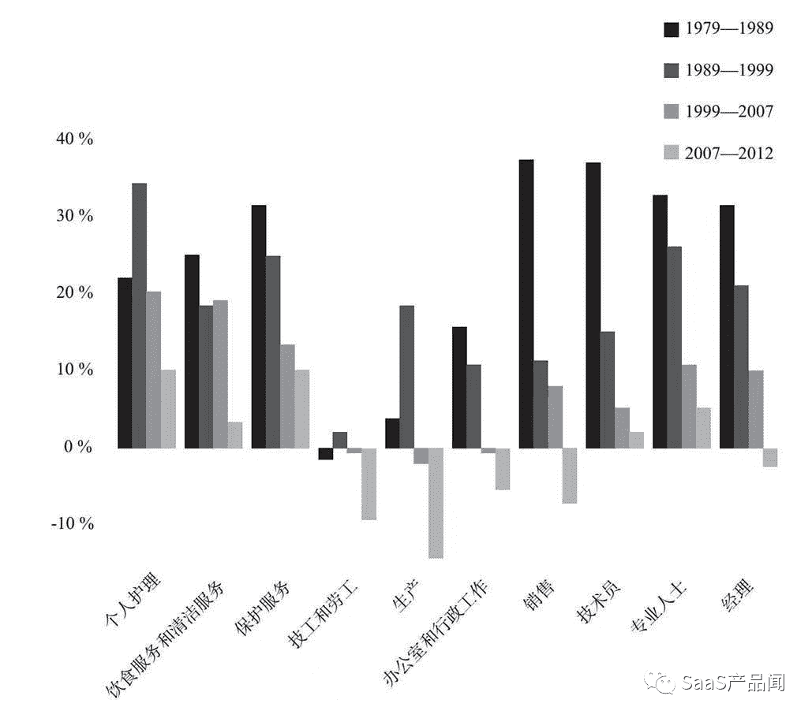
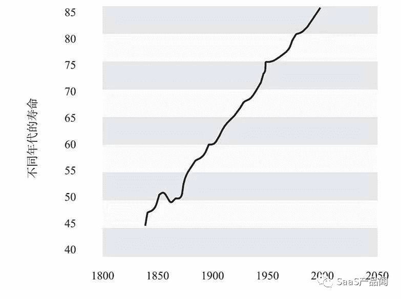
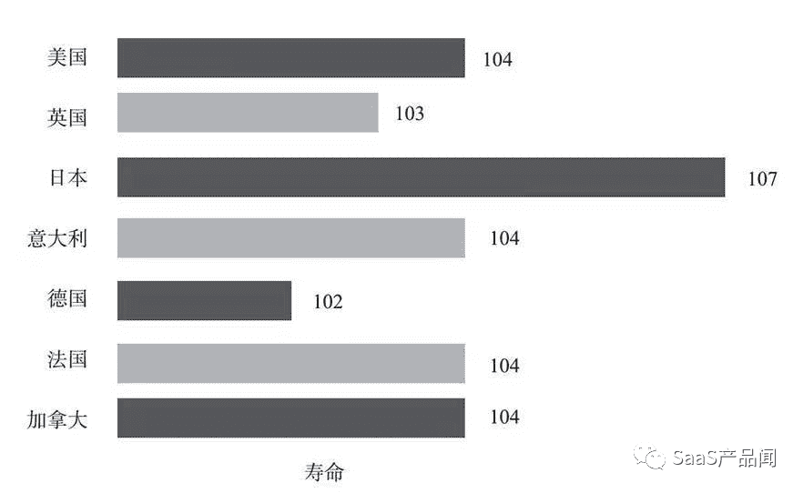

# 2023-08-11产品经理如何应对变化？ – 人人都是产品经理

> 来源：[https://xuqiwei1986.feishu.cn/docx/XdiQdDTSUohheAxahPgcHTldnOb](https://xuqiwei1986.feishu.cn/docx/XdiQdDTSUohheAxahPgcHTldnOb)

> 🔗 原文链接： h[ttps://www.woshipm](https://www.woshipm.com/it/5884115.html).com/it/5884115....

>

> 互联网产品经理自诞生到现在，只有20年时间，是一个比较新的职业。但随着互联网红利的放缓，产品经理岗位也在发生变化。面对不断的变化，产品经理如何应对变化？

## 01 多变的行业

互联网产品经理诞生到现在只有20年左右，是一个相对比较新的职业，过去这些年互联网的高速发展让从业者享受到了行业红利，随着现在互联网行业增速放缓，加上每年越来越多的人进入这个行业，人才不再像过去高歌猛进的年代那样短缺。因此收入不会再像以前那样涨得快，且时代的变化还让白领阶层随时可能面临失业的危机。

变化主要表现在以下两个方面：

### 1、公司生命周期短暂

因为公司的平均寿命很短，经营压力会让企业做出裁员的决定，或者因经营不善而倒闭，这些都会让员工面临失业。

2019年中国人民银行（央行）和中国银行保险监督管理委员会（银保监会）共同发布的《中国小微企业金融服务报告（2018）》显示，国内中小企业的发展周期基本在3年左右，创办3年之后依然可以维持正常经营的企业只占总数的1/3。

国家统计局《中小微企业成为推动经济发展的重要力量——第四次全国经济普查系列报告之十二》显示，截至2018年末，在全部企业中，小微企业吸纳就业占全部企业就业人员的比重为79.4%，占大多数。

也就是说大多数职场人士所任职的公司，都会在几年后就面临经营危机。

再加上行业有它的生命周期，有快速成长期也会有衰退期，即便身在大公司、当下炙手可热的行业，也可能不久后由于大环境的变化走向了衰落，工作岗位变少。

而这些变化往往只有极少数人能预判到且提前做好准备，当变化真正来临时，大多从业者不得不降低收入预期，或者选择转行，这几年的房地产、教培行业就是典型的案例，还有胶片相机、MP3随身听、功能手机等等，包括正在发生巨变的燃油车行业。

所以，稳定的工作对于大多数人来说都不现实，因为时代变化太快了。

### 2、工作的中空化

工作中空化指的是劳动力市场提供的就业机会多为高技能和低技能岗位，而不是中等水平的工作岗位。

下图数据显示的是美国低技能职业到高技能职业的就业百分比变化，从中可以看出，基础服务从业者和高级技能的人员未来就业机会依然在增多，但普通技能水平的人员就业机会不断在减少，出现工作中空化的现象。

美国各类职业就业占比年度变化

来源：麻省理工学院经济学家戴维·奥托，《为何工作仍然如此之多：自主工作场所的历史与未来》，《经济展望期刊》，2015年夏季卷（总第29卷第3期）

原因是技术的进步在大量替代常规工作（指能被程序化描述工作内容的工作），例如收银员、流水线工人、客服职业正在被大量替代，甚至是初中级的设计师也开始在被AI工具替代。

回过头来看产品经理职业，很多普通产品经理的大部分工作内容是绘制流程图、画原型、写文档，这些都可以被AI部分替代，未来可能只需要高级产品经理输入指令，软件就自动生成流程、原型、需求文档，然后进行调优即可，工作效率倍增。因为效率的提升，让原本需要1个人专门完成的事情，现在其他同事抽点时间就可以完成，随之而来的是初级产品经理岗位的减少。

比如原本某公司需要招3名初级产品经理负责文档类的工作，未来可能只需要招1名，这也是一种社会工作中空化的趋势，意味着初级产品经理的岗位机会将会变少。

不知道AI技术的进步在哪一天会开始部分替代产品经理的工作，但目前来看不会太远。

产品经理职业生涯有这几种路径：第一种是一路做到总监，这类产品经理通常抗压能力强、专业能力过硬，但总监的位置毕竟是少数，大多数产品经理在总监以下就遇上了职业发展瓶颈。

第二种是转行，因为总监岗位机会的稀少，有些产品经理会一直没升上去，互联网行业对高龄的低接纳度加上未来工具对工作的部分替代，很大一部分产品经理会主动或最终被迫转行，从事非产品行业的工作。

第三种是创业，与转行的的区别是创业会成为公司的创始成员之一，拥有高额的股份，创业成功后足以实现财富自由，但从创业公司的寿命统计来看，这条路径能成功的人很少。

无论哪种路径，都不容易走，创业大部分人缺少足够的资源，成功率会非常低；转行需要从零开始，通常不得不降低收入换取工作机会，然后再次积累职业经验；即便是总监，也有可能因为前文所述的行业变化而随时失业，如果原行业走向了衰退，工作也会难找。

实际上，现代公司寿命的短暂、行业的变化、工作的中空化这些客观现象综合起来，将使得无论是产品经理还是其他很多职业，只要是在市场化的环境里，大部分人在几年内都不得不面临工作变动。

未来变得越来越不确定，也许这个时代最确定的就是变化本身。

好在，这个时代让人们更容易失业，但同时也给了我们更长寿的人生，拥有了更多探索的时间。

## 02 多阶段的人生

### 1、时代的馈赠——长寿的人生

**有研究发现，在过去200年中，预期**寿命一直稳步上升，每10年增加2岁以上。

不同年代的寿命预期来源：根据加州大学伯克利分校与马克斯·普朗克研究所人口研究中心共建的“人类死亡率数据库”提供的数据计算得出。

参考吉姆·厄彭（Jim Oeppen）与詹姆斯·沃佩尔（James Vaupel）的《突破寿命预期的限制》，《科学》，2002年5月，第296卷

今天，一个出生在西方国家的孩子有至少50%的概率活到105岁以上，东亚国家数据也类似。

2007年出生的孩子有50%概率达到的最长寿命预期来源：加州大学伯克利分校与马克斯·普朗克研究所人口研究中心共建的“人类死亡率数据库”（Human Mortality Database）按每10年增加2岁倒推计算，如果你现在是20岁，那么至少有50%的概率活到100岁以上，预期寿命比80年前出生的爷爷辈要多16岁；如果你现在是40岁，那么至少有50%的概率活到95岁左右。

我们这一代人会迎接百岁人生，寿命将比以往任何一个时代都要长，这是这个时代给予我们最大的礼物，意味着能有更多的时间可以用于发现自己擅长的领域。

### 2、长寿的困扰

然而，寿命变得更长了，这也意味着职业生涯会遇到更多的变动。

我们爷爷辈、父辈（30后-70后）大多遵循三段式的人生，即受养育教育阶段、工作阶段、退休阶段，其中工作阶段比较稳定，几十年都在从事一个行业。但在我们这一代的人生中，时代的多变加上寿命的延长会变为多段式的人生，未来几十年，新技术将出现涨落，一些行业会兴起，另一些则会消失，全新的职业将取代现有的职业，工作阶段不会再像上一辈那样稳定。

所以百岁人生之中将出现多个阶段，即很可能是这样的：受养育教育阶段、探险阶段、上班阶段、转型过渡阶段、上班阶段、转型过渡阶段、投资组合阶段、退休阶段。受养育教育阶段是指从出生到结束全日制教育，通常是0-23岁左右，学历越高这个阶段会越长 。

探险阶段是指从结束全日制教育到找到适合的工作之间，需要通过旅行探险、职业尝试等方式体验社会，探索找到合适自己的职业，通常是23-30岁左右，有的人早有的人30以后才完成这个阶段。

此阶段是青春期的延续，现在很多20-30年龄段的人们从心理到外在行为表现还保留着青春期的特征，老一辈觉得很幼稚，会说“过去像你们这个年龄娃都十来岁了”，但这个阶段的年轻人感觉自己还像个孩子。

这个现象在进化生物学中称为“幼态持续”，能够继续保留青春期的高适应性和可塑性，对于面对多变的时代具有积极意义，所以这是时代发展的正常现象，按这个趋势来看，未来甚至会有很多四五十岁的中年人，心态和行为表现也跟年轻人一样。上班阶段是指有一份合适的工作的阶段；转型过渡阶段是指上份职业出于某些原因不再继续了，需要通过再教育/再探索寻找到一个合适的职业。

上班阶段和转型过渡期可能不止2次，如果职业发展一直都不顺利，则会有更多次的转型过渡期。投资组合阶段是指同时做着资金积累、社会贡献、慈善、探索、学习等不同类型的事情，比如：已经积累了一定的资金但还不足以实现退休，从事着真正感兴趣的职业，兼职着社会公共服务，同时做着慈善活动，可能还会学习感兴趣的新知识/技能，通常是在人生的后半段。

退休阶段是指已经积累了足够维持生活而不用工作的资金，可以把时间用来陪伴朋友、家人，实现曾经没有时间去做的事情。长寿是时代给我们的礼物，但相比过去稳定的三段式人生，未来的人生旅程还有探险阶段和多个转型过渡阶段，更加复杂多变了。

既然在职业生涯中变化是普遍现象，我们无法改变这个客观事实，那么能做的就是调整心态，拥抱变化，去迎接更多的人生可能。

## 03 如何应对

探险阶段、转型过渡阶段都需要通过探索的方式来找到合适的下一阶段的职业，探索到合适的职业之后还需要有相关知识/技能等储备才能胜任新职业。所以应对方法分为3个方面：找到天赋、找到合适的职业、积累转型资产，前两个是向内和向外探索，最后一个是打好基础，三者需要结合在一起使用。

### 1、找到天赋

每个人自身都有天赋和天生劣势，了解到自己的天赋后再去选择合适的职业，并且避免从事天生劣势相关的职业。

过去“木桶理论”告诉我们能盛多少水取决于最短的那块木板，想要获得更大的成就需要补齐自己的短板。

然而这个理论放在人的发展上面不适用，因为每块木板加长的难度都是相同的，但人的每个不同能力维度提升的难度却是迥异的。

比如让一个绘画天才少年去花时间把外语、数学、物理、化学短板都补上，难度肯定会远大于让他专注提升绘画能力，因为每个人大脑擅长的思维模式是不同的，很少有人能够全能，而且他未来的成就也与其他学科是否全能没有必然联系。

就像大象不能为了和猴子比爬树而去学习爬树，老鹰不能为了和猎豹比跑步而去学习跑步。

每个人都有自己擅长的方面，做有天赋的事情会事半功倍，因为相对于没有这个天赋的人来说，在有天赋的方面发展的内在阻力更小，是靠自己的本能自然而然去完成的，提升的速度也会更快。

所以在个人发展上面，有一个更适合的理论叫做「酒提理论」，指的是让长处发展到足够长，就能做别人都做不了的事情，像是酒罐需要用到酒提子取酒一样，只有酒提子有足够长的柄可以轻易进入罐中取酒，其他工具无法这么容易做到。

“天生我材必有用”，每个人都有自己的天赋，找到并去不断练习，才能让自己在人群中脱颖而出，成为独特的存在。

那么如何找到自己的天赋呢？

可以借助一些天赋类测评工具，再回想自己的过往经历，可以确定自己天生不擅长哪方面，大致上擅长哪些方面，然后向这些方向去做尝试。

推荐的天赋类测评有：霍兰德、MBTI十六型人格、多元智能、盖洛普测评，这几个笔者都测过确实对自己有了更全面的了解。

前三个免费或者少量收费，但是最后一个盖洛普官网测评价格需要四百多人民币，而且需要另外付费找专业的教练解读，属于进阶版的探索，一般推荐测前三个，再在网上看下解读，就可以大体上了解自己的天赋了。

但是，即便知道了自己的天赋在哪，也不等于就能获得成就，还需要加上后天的努力去学习知识、磨炼技能。

**优势=天赋*投入时间**

想要在群体中获得优势，天赋和投入都必不可少，缺少天赋即便投入1万个小时可能也只能达到高天赋的人投入500个小时的水平，效率极低；有天赋不去投入也可能不如低天赋的人投入100个小时。

找到自己的天赋，并且投入一定时间磨练后就会开始看到自己的与众不同。

### 2、找到合适的职业

知道了自己的天赋后，会发现这些测评工具会推荐很多领域的职业，但不代表这些职业都适合做，是否真正适合还受教育经历、人脉资源、家庭情况、市场环境、职业价值等等复杂的外在因素影响。

所以还需要结合自己的综合情况选出一个适合的职业。

大概的方法就是先列出所有可能适合的职业，再按照商业价值、意愿度、胜任力3个维度分别打分（各为10分制）。

商业价值是指这个职业能够带来的收入水平；意愿度是指自己感兴趣的程度；胜任力是指对于这个职业来说当前自己的技能和知识水平高低。

每个职业的3个维度分数相加，挑出3个总分最高的职业，然后选出一个在当前的客观因素下，可以去做的一个职业。

不过，意愿度维度的打分存在一个问题，就是我们不确定哪些职业是真正感兴趣的，很多都是陌生的职业，因为陌生，所以靠浅层了解打出的分数并不准确。

在欧美发达国家很多年轻人毕业后会选择Gap Year（原意是高中毕业后空缺一年再读大学，本文泛指大学毕业之后的空缺年），就是先不参加工作，而是去世界各地走一走，中途做做兼职体验不同的职业，随着中国经济水平的提高，国内现在也有一些毕业生开始尝试这种方式。

这也是向外探索的一种方式，能够增长见识、认识社会、掌握技能、广泛建立熟人网络，积累的这些无形资产对未来找到合适的职业具有重要作用。

如果有2-3年甚至有的人有5年Gap Year的经历，那么就会接触和从事过很多不同的职业，会对很多行业和职业都有了基本的了解，等未来择业给各个职业打分时就能确定知道哪些是感兴趣的，哪些不感兴趣。

我们大多数职场人已经过了Gap Year的年龄或者客观因素限制无法这么去做，但还有另外一种方式，就是可以利用兼职、观摩、试验的方式去了解感兴趣的职业，如果适合就继续深度体验，如果不适合就换其他职业体验。

这种方法叫做「原型体验法」，就像产品经理做产品一样，先设计个原型demo找客户体验一下，如果客户认为合适就去开发实现，不合适就调整原型直到客户觉得可以为止，只不过这里的客户变成了我们自己。

知道了「原型体验法」还不够，因为它只告诉了可以用低成本去体验不同职业，而没有告诉需要做些什么才能接触、胜任这些职业，我们很难发现了几个感兴趣的职业就立马能去体验，一般需要通过熟人渠道，或者学习新知识去胜任，而这些都不是短时间内就能拥有的。

前文讲过我们这一代大多数人的职业生涯会面临多次职业转型，等到遇到职业变数时再去选择新的职业就代价很大了。

所以这里就要在前面方法的基础上补充另一个要点——积累转型资产。

### 3、积累转型资产

提到转型资产先解释一下资产的分类，资产按是否有实体分为有形资产和无形资产，有形资产是指资金、房子、生产资料等有实物形态的资产，无形资产是指专利、知识、技能、健康、友谊、爱情、亲情、声誉等没有实体的资产。

转型资产属于无形资产中细分的一种，是指那些有助于提高转型成功率，减少不确定性和降低成本的资产，比如新知识、新技能、社交网络。

转型资产是我们应对职业变化时顺利进入下一职业阶段的基础，最好是未雨绸缪，提前进行转型资产的储备，它能使你更有能力应付转型中的不确定因素，想要顺利进入管理者职业阶段或者转行必须要用到它。

转型资产分为新技能/知识和多元网络，所以可以从这两方面去积累：

**1）学习新技能和知识**

我们的知识和技能可能会过时，所在的业务线也随时可能被关闭，所以不得不学习新的知识或者技能以应对变化。

比如为了升职，可以去参加本职业的技能培训/自学高阶的专业知识/再次进入学校深造提升专业背景。

如果是为创业、转行做准备，可以学习其他领域的技能/知识，提前开展副业，这些都可以积累转型资产。

为了职业发展学习新技能和知识这一点是大众普遍的认知，不用再过多阐述重要性，按照前文的方法选对职业领域后，再去针对性学习就行了。

这里需要重点关注的是接下来阐述的另一种转型资产——多元网络。

**2）建立多元网络**

多元网络是指广泛、多样化地接触新的友谊和人脉而构建成的关系网络。

传统观点认为，人们找到好工作是因为他们拥有知识储备这一无形资产，所以我们大多数人就只学习知识和技能，然后依靠招聘网站找工作。

但社会经济学家马克·格兰诺维特通过研究发现：大多数工作都不是通过诸如投递岗位申请、回应招聘广告等正式渠道获得的，而是凭借各种社会关系提供的非正式信息取得的。

人们通常是从朋友的朋友这样的弱纽带那里获得新机会，所以新的职业机会通常是通过多元网络获得到的，而不是家人、好朋友。

越是大型多元网络，找到好的工作机会的效果会越明显，因为社交网络会有指数效应。

对于产品经理来说，如果想获得更多职业机会，可以多参加高质量的线下沙龙和线上社群，结识优秀的同行，或者去认识公司内部的中高层的同事，建立广泛的职业关系网，比如结识了200名中高级产品同行后，那么等需要找工作时，通过微信好友列表就可以获得到不错的职业机会，即便他们自己公司没有职位空缺，也可能会推荐给他们的熟人圈。

如果是有转行、创业的打算，可以提前去广泛结识相关领域有所成就的从业者，未来需要转行时就有了大量新职业，或创业机会的信息源。

以上就是应对未来变化的一套方法，先找到自己的天赋，再找到合适的职业，然后提前积累转型资产，就能应对多变的未来，当然其中每一方面都还有大量详细的执行方法，本文因篇幅有限仅提供一套方法框架，详细的执行方法读者朋友可以再另外去做单点的深入了解。

## 04 结语

未来越来越充满不确定性，应对变化是我们每个人都需要具备的能力，希望本文能让你在变化来临前就有所准备，等到真的面临转型的那天时，能够从容不迫地面对。

作者：子文，公众号：SaaS产品闻

本文由 @子文 原创发布于人人都是产品经理，未经作者许可，禁止转载

题图来自Unsplash，基于CC0协议

该文观点仅代表作者本人，人人都是产品经理平台仅提供信息存储空间服务。