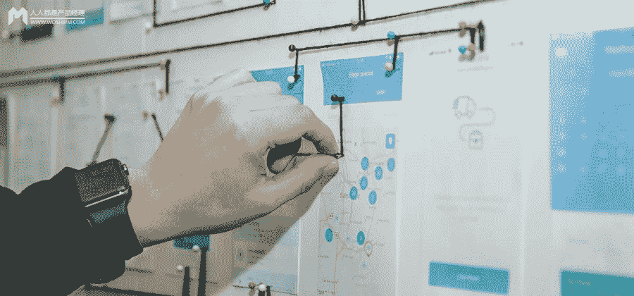
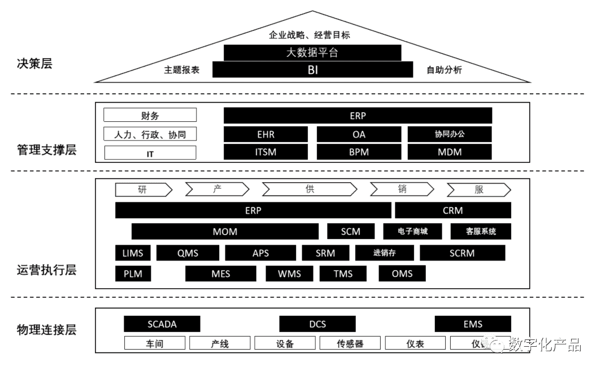
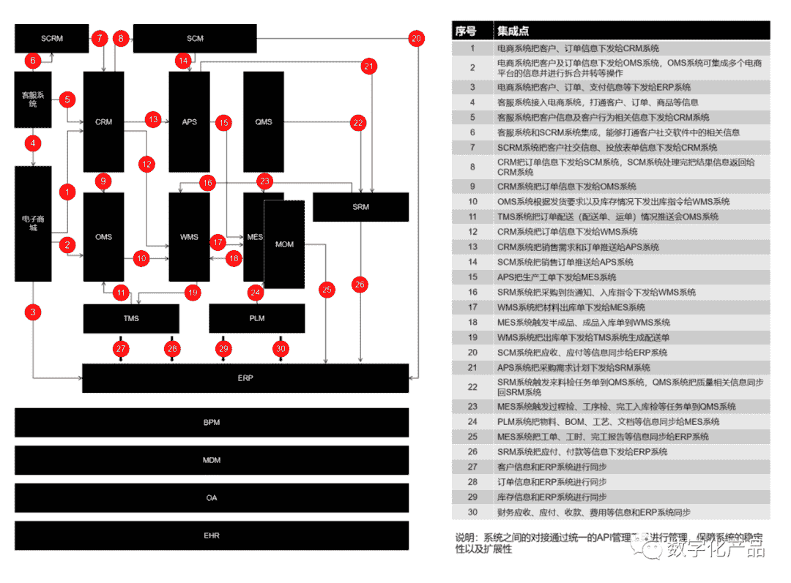

# 2023-08-29史上最全企业数字化系统整理 – 人人都是产品经理

> 来源：[https://xuqiwei1986.feishu.cn/docx/SR7QdMBjsoQl4FxTwqLcx8dZnah](https://xuqiwei1986.feishu.cn/docx/SR7QdMBjsoQl4FxTwqLcx8dZnah)

> 🔗 原文链接： h[ttps://www.woshipm](https://www.woshipm.com/it/5893782.html).com/it/5893782....

>

> 企业在做数字化转型过程中，会遇到很多问题。在不断查找资料过程中，也衍生了一个疑问：企业做数字化到底会接触到多少个系统？本文就该疑问展开分析，一起来看看吧。

“从上帝视角看下企业数字化转型所需要的系统有哪些，帮助我们更好的开展企业数字化转型的工作。”

前段时间在对之前做数字化转型的经验做总结，在不断地总结并查找对应资料的时候不断地有新的概念名称冒出来，于是产生了一个疑问，企业做数字化到底会接触到多少个系统？有了疑问就必须要把这个事搞清楚下，不然心理总悬着点事，于是花了两周时间搜集信息并进行整理，把内容汇总成本部篇文章，希望对各位看官有所帮助。

## 01 整体系统架构

企业进行数字化一定是战略使然，到落地的过程中就是要能够达成经营目标。很多传统企业做决策、定指标都是拍脑袋完成，而数字化企业则是依据数据去支撑战略决策，用数据去驱动业务发展。在战略和经营目标之下，我们要能够有完整的管理支撑能力，能够让组织、人员、机制与之相匹配，而系统则是这种支撑能力落地的有力抓手。

再往下就到了业务运营执行层面了，有别于传统信息化数字化更注重多过程的管理，注重全要素数据化，从研产供销服到人机料法环都要能够做到在线、链接基于以上的企业业务开展的模型，我们把数字化系统也进行了一个分层、分类，如下图：

系统说白了是概念的集合，系统架构其实就是一个“放东西”的过程，哪几个东西需要保存的环境相近要放在一起；哪几个东西使用有先后顺序那摆放也要讲究；哪几个东西放在一起容易发生反应要避开存放等等。系统架构是什么？就是元素集合以及元素与元素之间的关系的总和。要搞清楚元素有哪些比较容易，而要搞清元素与元素之间的关系就比较难。软件相关的人员对技术、数据方面的关系都比较了解，但业务方面就会稍有欠缺，而上图则是从业务的角度对系统进行了一个归类。

## 02 重点系统介绍

这部分我们展开聊下各系统的具体情况。软件行业发展也有近百年了，这个行业的发展远远比我们想想的要成熟的多。统计了一下，经常听到并且偶尔会使用的就有31个，如下图：

这些系统之间很多时候没有十分明确的界限，互相之间有功能上的重叠，咋一看似乎感觉不那么好，浪费了。但这恰恰是软件行业冗余原则的体现。互相之间有一些功能重叠有助于系统进行集成，重要的是重叠部分的概念理解要趋于一致，能够很方便的通过API进行集成。有些系统之间是有演化关系的，比如：CRM和SCRM，MES和MOM，BI和大数据平台等；而另外一些可能是包含关系，只是企业对某一个领域的要求更加专业化、精细化而独立出来了，比如：ERP和APS、SRM，QMS和MES等等。

上表我们还列出了某一类软件国内外比较著名的厂商，从这个维度我们也能知道不同类型的软件当前市场的竞争情况如何。

## 03 关键系统集成点说明

这部分我们对系统之间的集成关系进行说明，当然企业数字化建设过程中系统集成的真实情况可能会比图中总结的要复杂的多，这张图尽可能的把能够发生集成关系的系统进行了表达。

在进行系统集成时一定要注意主数据的管理，而主数据的管理主要有以下几个方式：可以通过数字化规范流程约定在某一个业务系统对某一个业务主数据进行管理，规定该业务系统为这个主数据的管理系统；可单独建设主数据管理系统，定义为主数据的对象均需要统一在该系统中进行生成、存储、分发、归档；还可以建设业务中台，不单单对主数据的概念进行统一，还能够统一提供操作主数据的业务能力。

## 04 总结

企业在进行数字化转型时，不单单是系统建设层面的问题，更多的是战略规划、组织设计、流程制度、管理规范层面的问题，而以上内容更多的是帮助我们数字化的IT人员对数字化相关系统有一个全面而清晰的了解认知。

**专栏作家**

不可分类者，微信公众号：数字化产品，人人都是产品经理专栏作家。专注于电商中台的产品设计，擅长产品规划及需求分析；热衷于研究中台、SaaS等领域的最新产品形态。

本文原创发布于人人都是产品经理，未经许可，禁止转载

题图来自Unsplash，基于CC0协议

该文观点仅代表作者本人，人人都是产品经理平台仅提供信息存储空间服务。