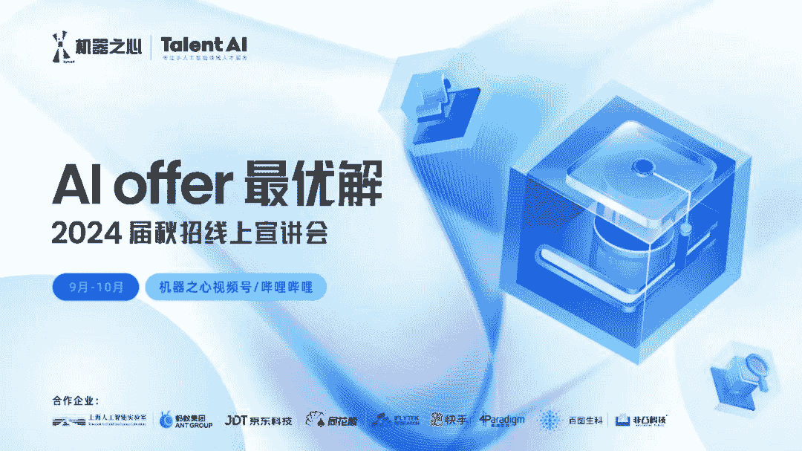
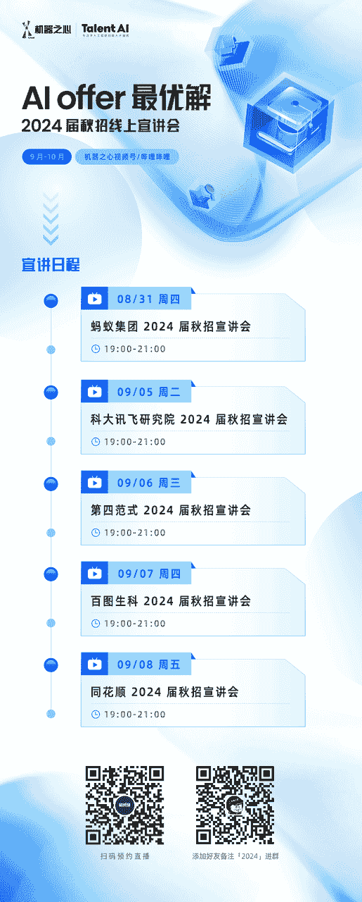

# 2023-08-29AI offer最优解：2024届秋招线上宣讲会，蚂蚁集团、科大讯飞、第四范式、百图生科与同花顺

> 来源：[https://xuqiwei1986.feishu.cn/docx/O5okd6GzgoR0SGxxLnZcHOEmn5g](https://xuqiwei1986.feishu.cn/docx/O5okd6GzgoR0SGxxLnZcHOEmn5g)

> 🔗 原文链接： h[ttps://mp.weixin.q](https://mp.weixin.qq.com/s?__biz=MzA3MzI4MjgzMw==&mid=2650888856&idx=3&sn=fec2abfe2ae0323fcfdc839b30b3e8e7)q.com/s?__biz=Mz...

>

机器之心 2023-08-29 12:36 发表于 北京

名企大厂的秋招基本都已开启，你已经面完了几家企业？

秋招重要的是信息，更多的了解企业招聘计划、团队情况、岗位要求、校招流程等信息，避免错过最适合 自己 的机会。建议同学们广泛关注各个领域的机会，准备好简历，机器之心也将为大家汇总AI相关技术岗与 内推机会，欢迎同学们投递。

同时，「TalentAI」将于9月-10月举办 「AI offer最优解—2024届秋招线上宣讲会 」 ，邀请企业介绍各自的秋招计划与岗位详情。

未来两周直播安排如下，对 蚂蚁集团、科大讯飞研究院、第四范式、百图生科、同花顺 感兴趣的同学别错过。

#

# **蚂蚁集团2024届全球校园招聘**

蚂蚁集团起步于2004年诞生的支付宝，源于一份为社会解决信任问题的初心，经过十九年的发展，已成为世界领先的互联网开放平台。

蚂蚁集团服务商家和消费者，实现“全球收”、“全球付”、“全球汇”。通过创新的全球跨境支付解决方案，用前沿的移动支付技术构建跨境支付能力，助力全球商家一次性接入多种数字支付方式，和全球的消费者建立连接；同时也与全球科技公司、金融机构和商户广泛合作，在本地合规展业，在数字支付、数字营销、贸易金融、数字银行等领域，分享技术和行业专长，助力当地商业数字化转型升级，给世界带来微小而美好的改变。

**校招岗位**

**工作地点： **杭州、北京、上海、深圳、成都、重庆、新加坡

+   算法工程师-搜索推荐

+   算法工程师-计算机图形

+   算法工程师-自然语言处理

+   算法工程师-语音对话交互

+   算法工程师-算法工程

+   算法工程师-语音智能

+   算法工程师-计算机视觉

+   算法工程师-机器学习

+   ……

[点击查看蚂蚁集团秋招详情 ](https://mp.weixin.qq.com/s?__biz=Mzg3MzgzMDcwNw==&mid=2247484980&idx=1&sn=9dbce4946a3b216044bad96d0c476145&scene=21#wechat_redirect)

**线上宣讲会： **8月31日19:00-21:00，蚂蚁财保技术部资深技术专家、蚂蚁财富首席架构师、蚂蚁金融智能首席架构师君宸将带来线上宣讲，欢迎大家预约观看，有任何疑问在直播过程中留言，现场为大家答疑。

# 科大讯飞研究院2024届秋季校园招聘

科大讯飞研究院成立于2005年，致力于人工智能核心技术的研发，主要研究方向包括智能语音方向 （语音识别、语音合成、语义理解声学前端、声纹识别、音频分析等 ）；计算机视觉方向（视觉基础算法、图文识别、视频分析、虚拟形象、自动驾驶、工业视觉等 ）；自然语言处理方向（语音交互、人机对话、机器翻译司法认知、语言学习、教育认知、阅读理解、前瞻认知等 ）和认知智能大模型等，始终保持核心技术业界一流水平，积极推动技术落地行业的规模化应用。

**校招岗位**

**工作地点 **：合肥

+   AI研究算法工程师—自然语言处理方向/计算机视觉方向/智能语音方向/深度学习框架和平台方向

+   AI研究算法工程师—AIGC方向

+   AI研究算法工程师—规划控制方向

+   AI研究算法工程师—视觉/激光SLAM方向

+   AI研究算法工程师—推荐算法方向

+   AI研究算法工程师-机器人方向

+   数据研究工程师-知识构建工程师

+   AI算法测试工程师

+   ……

点击查看科大讯飞研究院秋招详情

**线上宣讲会： **9月5日19:00-21:00，科大讯飞研究院招聘负责人子怡将带来线上宣讲，欢迎大家预约观看，有任何疑问在直播过程中留言，现场为大家答疑。

# 第四范式2024届秋季校园招聘——Plan 1956

第四范式成立于2014年9月，是中国智能决策市场的最大参与者，从2018年起蝉联中国机器学习平台市场份额第一(根据IDC报告)。公司致力于实现企业级人工智能快速规模化落地，为企业提供以“决策型Al、“生成式AI”为核心的技术、产品及解决方案，推动传统企业的数字化转型进程。第四范式服务的行业包括但不限于金融、零售、制造、能源电力、电信及医疗，截止2022年，服务104家财富世界500强企业及上市公司。

Plan1956是第四范式顶尖技术人才招聘项目，以培养未来人工智能与技术服务的顶尖专家。我们期待海内外高校优秀科技人才加入，一起以突破技术边界为使命，打造“生产力提升的领先科技”，用Al的力量改变世界。

**校招岗位**

工作地点： 北京、上海、深圳、新加坡。

+   机器学习算法工程师

+   语音算法工程师

+   计算机视觉算法工程师

+   决策优化算法工程师

+   大规模分布式机器学习系统工程师

+   机器学习基础架构工程师(新加坡)

[点击查看第四范式秋招详情 ](https://mp.weixin.qq.com/s?__biz=Mzg3MzgzMDcwNw==&mid=2247484980&idx=3&sn=cf07255dbb8aefb2fa67e6d1dd550a09&scene=21#wechat_redirect)

**线上宣讲会： **9月6日19:00-21:00，第四范式业务同学将带来线上宣讲，欢迎大家预约观看，有任何疑问在直播过程中留言，现场为大家答疑。

# **百图生科2024届秋季校园招聘**

百图生科（BioMap）是AI大模型驱动的生命科学研发平台，由百度创始人李彦宏于2020年创立。公司致力于结合前沿AI和生物技术，构建高通量干湿闭环的生物计算引擎，建模蛋白质/免疫细胞/免疫系统的复杂规律，通过生成全新的蛋白质与生命体对话的方式，实现特定的生物学功能，并解决生命科学行业的痛点问题，比如靶点发现、药物设计、酶的从头设计和优化等，从而改善人类健康、实现可持续发展。

#### **工作地点： **北京

**校招岗位： **算法工程师，AI for Science方向。岗位详情请大家关注线上宣讲会。

**线上宣讲会： **9月7日19:00-21:00，百图生科业务同学与HR将带来线上宣讲，欢迎大家预约观看，有任何疑问在直播过程中留言，现场为大家答疑。

#

# **同花顺2024届秋季校园招聘**

浙江核新同花顺网络信息股份有限公司（同花顺）成立于1995年，于2009年在深交所上市（股票代码：300033），是国内第一家互联网金融信息服务行业上市公司。同花顺作为一家互联网金融信息提供商，主要业务是为各类机构提供软件产品和系统维护服务、金融数据服务和智能推广服务，为个人投资者提供金融资讯和投资理财分析工具。截止目前同花顺注册用户近5亿，日活跃用户超千万，与国内90%以上的证券公司达成业务合作关系。

**校招岗位**

岗位会按需求更新与新增，具体计划请大家关注9月8日线上宣讲会上的详细介绍。

**工作地点： **浙江省杭州市余杭区同顺街18号同花顺总部新大楼

+   NLP算法工程师（人工智能集群岗位）

+   NLP算法工程师（iFinD集群岗位）

+   算法工程师

+   量化研究员

+   大模型算法研究员

+   大数据开发工程师

[点击查看同花顺秋招详情 ](https://mp.weixin.qq.com/s?__biz=Mzg3MzgzMDcwNw==&mid=2247484980&idx=4&sn=3f8f5614832c65553e83259042a2997b&scene=21#wechat_redirect)

**线上宣讲会： **9月8日19:00-21:00，同花顺人工智能创新产品负责人郭云三将带来线上宣讲，欢迎大家预约观看，有任何疑问在直播过程中留言，现场为大家答疑。

**申请方式**

长按识别二维码，浏览岗位信息投递意向岗位。

投递简历后，请大家留意邮件和短信通知，按提示完成各企业的笔试、面试等环节。

**24届校招交流群**

我们将持续为大家汇总各家企业的AI相关技术岗信息与内推机会，并举办线上宣讲会，邀请企业介绍秋招计划与岗位详情。

后续上线计划欢迎大家持续关注， 加入群聊获取一手信息。 加群方式：添加小助手好友，备注「秋招」。

**点击阅读原文，立即投递简历。**