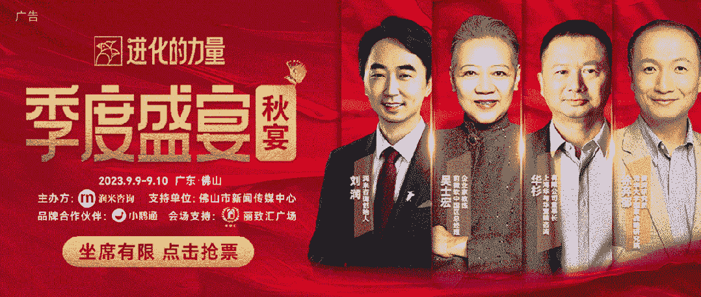
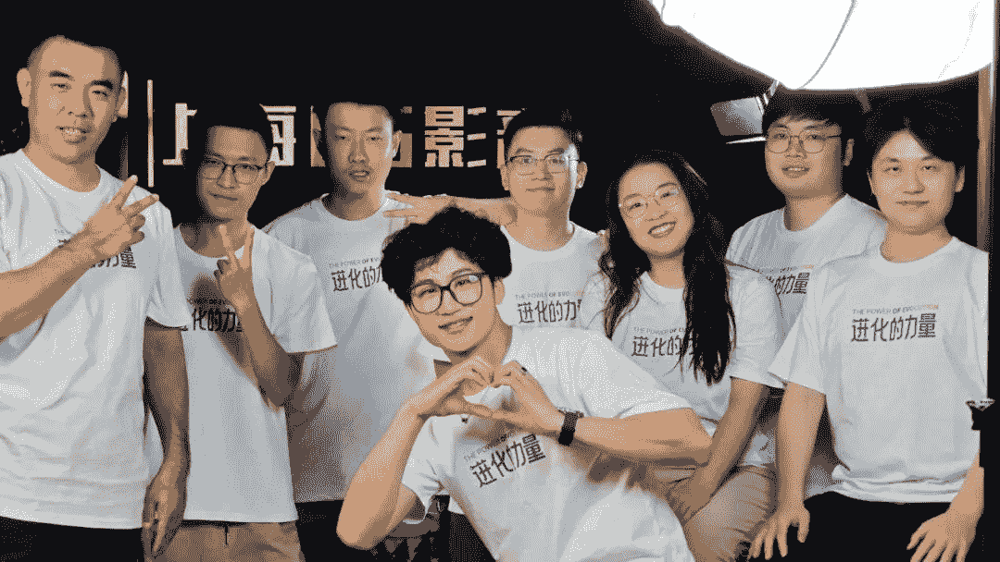
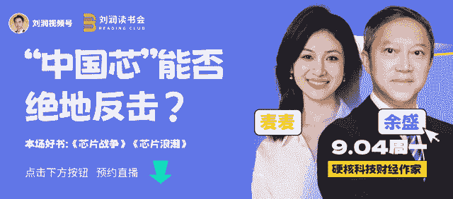
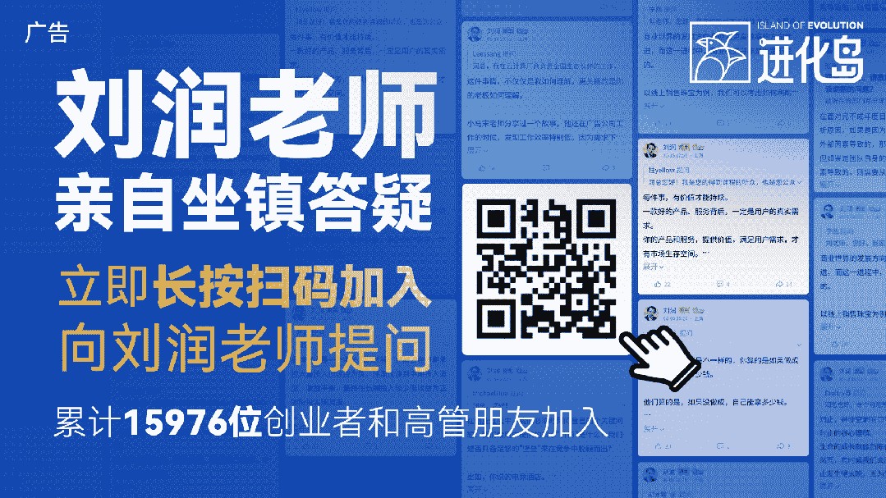
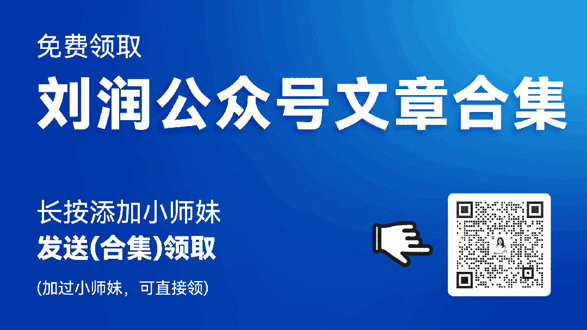

# 2023-09-04归零……

> 来源：[https://xuqiwei1986.feishu.cn/docx/NSFvdtQEdol3Gfxc6c3cjhWynif](https://xuqiwei1986.feishu.cn/docx/NSFvdtQEdol3Gfxc6c3cjhWynif)

> 🔗 原文链接： h[ttps://mp.weixin.q](https://mp.weixin.qq.com/s/6K8jXs2o78kBQYyk5eoUrw)q.com/s/6K8jXs2o...

>

原创 刘润 刘润 2023-09-04 11:16 发表于 上海

观点 / 刘润 主笔 /万青 责编 / 黄静

这是 **刘润👸号 **的第 **2000 **篇原创文章

前些日子，我做了一场 “创业10年，我那些悬崖边上的时刻” 的直播分享。还写了一篇文章。很多人说看哭了，很有共鸣。

有人说，创业者这群人，是被“人贩子卖到金三角”，放进猪笼，捆以绳索，吊起来，放到江河里淹浸，最后死里逃生的一群人。大部分人并没有什么轻松和愉快的经历，最后能活下来的，身上全是疤痕和鲜血淋漓的伤口。

有人说，人到中年，上有老下有小，加上最近公司业务量大幅下滑，收入开始锐减，表面看起来光鲜亮丽，实际上自己每天都战战兢兢，如履薄冰。生怕自己哪天，就被公司“降本增效”了。

还有人说，自己今年35岁了，已经是公司的中层管理者，不上不下。

站在人生重要关口，左右为难，想踏出去，看看创业的水有多深，也想转行看看。但是，离开公司，褪去身上的光环，又眷恋不舍。

**在我看来，**这些疑问和纠结的背后，其实关键的一环是： 归零心态。

什么是归零心态？归零心态对你的帮助又是什么？

今天，分享一下我的经历，也许会对你有所启发。

---

# **归零，就是空杯心态**

你在微软工作了多久？

从23岁，到36岁。4876天。

2013年，当我离开工作13年的微软，我问一位前同事：你当时离开的时候，是什么感受？

他说：没什么感受，直到第二天早上。

你刷完牙，洗完脸，吃完早饭，收拾好自己，准备去上班时，突然发现，自己再也不需要去那个去了十几年的地方上班了。

一种强烈的伤心，突然袭来。

你从梦中突然醒来： **我居然真的离开了。 **就是这种感觉。

第二天我真的是这样，早上一起床，一脸茫然，不知道该去往哪里。

从大学毕业到参加工作，连续20多年的时间，每个月1号到10号之间，我的银行卡都会准时有笔工资或生活费到账。

但从今天开始，没有人再给我发工资了。

**银行卡，只有支出，没有收入。**

这个也意味着， 从你创业的第一天开始，你就站在了悬崖的边上。

**什么叫站在悬崖的边上？**

**白手起家，没有资源，没有背景，旁边甚至没有一个帮手，**面对未知迷雾，你只能咬着牙，开始往前走。

前方，可能是流淌着奶和蜜的新大陆。

前方，也可能是深不见底的万丈深渊。

一着不慎，满盘皆输，粉身碎骨，万劫不复。

**什么叫开始往前走？**

你不知道自己该干什么，你不知道怎么样才能真正走出来那片迷雾，但是依然选择前进。

**怎么办？当时我也很恐慌。**

我跟父母说：爸妈，我辞职了。准备创业。

我以前给你们寄了不少钱，那些钱你们该怎么用就怎么用，该动用就动用。

但是从这个月开始，我的账没有钱给你们寄了，请允许我一年的时间不能再给你们寄钱。

给我一年时间，一年之后我再重新给你们每个月寄钱。我相信一年之后肯定可以。

从打工者到创业者，这是身份的转变。

这时候最需要扭转的是什么？心态和生活习惯。

我以前的生活方式和习惯是什么？出差。

从2006年开始，就是我离开微软之前的7年左右，我每年出差180天左右，出差非常频繁。我是很多航空公司和五星级酒店的金卡会员。

离职之后，我告诉自己，从今以后，再也没有人给你报销五星级酒店、飞机的费用了。

以前所有的成本，都有公司兜底，这就是安全感。

但是，你有没有想过，会有这么一天？

**你离职了，或者被裁掉了。**

如此生活三十年，直到大厦崩塌。

你曾经依赖的，你曾经信任的，你曾经觉得可以支撑你生活下去的支柱，突然倒下。

当安全感突然有一天消失，失去经济来源之后，你怎么办？

**必须学会归零。**

什么叫归零？归零，意味着放下、打破、重构。

**如果一个人沉迷于以往的权力、光环**、荣耀、地位、平台，那他就再也不会进步。

所以，我做了一件事，把各种出行VIP金卡，全部锁起来了。

然后，出门去地铁站窗口办了一张地铁卡。

我要改变自己基本的工作方式，从以往高大上的工作方式变成接地气的工作方式。

很多人在创业的时候最大的挑战就是不能归零，忘不掉以往的名利。

以往出行有司机，有秘书，前呼后拥，好不威风。

离开大公司平台之后，总觉得我应该保持原来的生活水准，我要保持这个待遇，我怎么能往后退呢？

如果你不能做到 “上与君王同座，下与乞丐同行” ，心态不扭转，总觉得自己是明星创业公司，那么创业是非常危险的。

转行，换工作也是一样，很多人总想着我下一份工作收入一定要比上一份工作收入高。

不然，我跳槽不成了傻子了吗？图啥呢？

**这其实是一种非常错误的想法。**

**那么正确的决策思维是什么呢？**

**你，永远不应该为了钱而跳槽。**

**你，永远不应该为了钱而工作。**

可能有的人会说了，不为钱为什么？为爱发电吗？

当然不是。

我之所以这么说，是因为我也面临过相似的决策困境。

我和你分享一下我的亲身经历吧。

我在微软的时候，主动做过的3个重大决定，都伴随着降薪。

第一个决定是在1999年。加入微软前。当人事部告诉我薪资待遇时。我傻掉了。

微软给到的薪资，只有我当时收入的一半多一点点。

这是我职业生涯中面临的第一次这么大的薪水倒退。

第二个决定是在2006年。这一年，我已经在微软技术部门工作了七年，领导一个30人的团队，除了上海的团队外，还有2个香港人、1个台湾人、6个韩国人、14个印度人。

这时，市场部门的同事问我：你要不要考虑加入市场部门？

条件是：1）我必须搬出独立办公室，坐在工位上；2）不再管任何人，变成独立贡献者；3）基本工资下调20％。

这是我职业生涯中面临的第二次这么大的薪水倒退。

第三个决定就是离开微软，2013年。

这次的决定，不是降薪20％，也不是降薪50％，而是降薪100％，从此一分钱稳定的收入都没有！

这三次，我都选择了舍，而不是选择得。也因此获得了更广阔的发展空间。

我知道，不管多高的职位、多高的薪水，那些都是别人给你的，所以都是别人的。

只有你用来换取这些报酬的能力才是自己的。

如果你对更广阔的海洋有渴望，对自己更强大的能力有信心，就别被恐惧拴住了自己。

**归零，也是一种空杯心态。**

想象一个玻璃杯倒满了水，如果我们继续往里倒，水会溢出。

归零心态就是不让自己的杯子满到溢出，而是经常倾倒，让自己有空间去接纳新的事物。

要学会忘记过去的成绩，放下你所谓的自尊，把自己放到最低，勇于去尝试。

人要有归零的勇气。不怕推倒重来。

很多人怕被辞退，怕失去安稳的工作，怕失去经济来源。

于是，非常焦虑，恐慌，夜不能寐。

但在今天的商业社会中，要挣很多钱当然不容易，但没有任何收入，让自己饿死也没那么容易。

尤其在年轻的时候，千万不要去做那种为了不饿死多挣点钱，但是对长远没有帮助的事情。

具体来说，就是把自己的时间卖掉之后，却没有一点点成长的事情。

或者换句话说，你要去选择做可以拿两份收入的工作。

第一份收入，是你的工资。第二份收入，是你的能力、资历和成长。

我经常说一句话，不要太在意自己35岁前的收入。

每个人都是一只能下金蛋的鹅，把这只鹅养大养胖，就是所谓的成长。

当我们还是一个新人时，选择更重要的职位，承担更多的风险和责任，获得更多的成长，比收入本身重要的多。

成功了，你会有所收获。即使失败，你什么也不会失去，你依然年轻。

35岁之后，你终究会发现，之前为了多出去的几千块工资，愤愤然从一家公司跳槽到另一家公司，甚至不惜撕破脸皮，是多么愚蠢的行为。

在一个真正有价值的公司，跟一个值得跟的老板，和一群志趣相投的人在一起，所获得的价值远远超过这500块钱，远远超出10000块和15000块的差异。

在年轻时，把成长当作最大的收入。这也是一种长期思维。

你越对未来有信心，就会越对当下有耐心。

但是，很多人又会有疑问，我以前是做xx行业的，做了好多年了，我真的还有机会，有能力去尝试新的行业吗？

**沿着旧地图，找不到新大陆。**

关于归零，你还需要知道一个概念：君子不器。

---

# **归零，就是君子不器**

什么叫“君子不器”？

器，就是被控制住。杯子没有被烧成之前，就是一把土。

可以烧成碗，烧成杯子，烧成勺子，各种各样的形状。

这一把土，烧成什么形状都有可能。

但是，当这一杯土烧成杯子的时候，它的价值，它的作用，被控制住了。

它只能是杯子了。

君子不器，就是那一把土，本来具备各种可能，结果烧成杯子以后，已经不具备其它的能力了。

君子不器，就是千万不要被控制住，不像器具那样，作用仅仅限于某一方面。

我再给你讲一段自己的经历吧。

1999年，加入微软的时候，我酷爱编程，酷爱技术。

那一年，我23岁，按照这个职业路径，我这辈子似乎应该是一名资深技术工程师。

2000-2001年，是我最拼命的一段时间。第一次连续55小时工作不合眼（3天2夜），第一次用睡袋睡在会议室，第一次身怀3个手机。那段时间，我贴满签证的护照一直不在我身边。只要我的任何一张签证快要过期，公司就会自动帮我办一张新的。我可以在任何时候立刻起飞，在接到指令的几个小时内出现在目的地国家。

我非常喜欢这份工作，我觉得我可以做一辈子。

但是，我没意识到，自己已经处在一个职业舒适区。

**什么是舒适区？**

大部分人的舒适区，不是躺在海边无所事事，而是忙到没有时间思考。

这个舒适区更危险，因为你都意识不到自己在舒适区。

直到有一天，郭刚和我说：我辞职了。

郭刚是我大学同学。牛人。我们高中的高考状元，在大学的时候做不出题，就恭恭敬敬地向上铺的郭刚请教。郭刚睁开一只眼睛，懒洋洋地就给解答了，还一副被打扰不耐烦的样子。

我非常非常惊讶。你做的那么好，在微软做技术主管，前途无量啊。

他对我说了一句话：

如果我这一生一定要发生一些改变，我希望，是发生在30岁之前。

我当时的感觉是，五雷轰顶。

后来，我做出了一个重大决定，就是从技术部门这个舒适区，跳入市场和销售部门这个新领域，正式踏入商业的世界。

如果，我只愿意做技术的工作，错过后来的这些经历，我想我会遗憾一辈子。

所以，我常说，你要在每件事情、每个职位上，都要榨干你所能学习的一切东西。

不要在意薪水的高低，不要纠结事情的难易，不要逃避上级交代的任务，这些都不重要。

最重要的是，从你所做的每一件事情上，学到最多的东西。

总有一天，你做过的那些看似没有用途的事情，会在生命的某一时刻连接在一起，形成一条价值线。

这条价值线会指引你，走向你想要的生活。

君子不器，你想把自己塑造成什么样的形态，你说了才算。

---

# **归零，就是敢于蜕壳**

除了君子不器，你还要敢于蜕壳。

王阳明说： **“破山中贼易，破心中贼难。”**

蜕壳，在撕拉的过程中，通常要面临血和痛。

**外界的壳，是有形的，易打破。**

**内心的壳，是无形的，难敲碎。 **

能否打破心中的壳，决定了成长的天花板。

很多人，终其一生都活在“壳”之中，不愿意看见真相。

什么是“壳”？“壳”，就是一个人精神内层与外部世界的保护墙。

当外部世界对你有挑战、有质疑的时候，你会首先想到保护自己，陷入一种战斗和防御状态。

可是，你想要变得更好，就需要很多来自于外面的意见。

这种保护状态会让你去抵御外面的意见，这个时候你想发生改变就很难。

我举个例子。小陈是广东省一家创业公司的CEO，他的公司研发了一款产品，吸引了很多用户购买。

尽管业务看似风生水起，但小陈的团队成员却频频离职，投资人也开始质疑小陈的管理方式。

当朋友或合作伙伴建议小陈改变一些策略或管理方式时，他总是迅速辩解，认为自己的方式最佳。

他对外部的批评和建议总是持有高度的防御性，似乎把这些意见视为对自己的攻击。

他的“壳”越来越厚，导致他对团队和外部的信息变得麻木。

后来，公司产品市场销售业绩越来越差。

小陈每天都很焦虑，深夜辗转反侧睡不着。

有天晚上，一位曾在小陈公司工作的前员工在一次技术论坛上公开指责小陈的管理风格，认为他总是对外部的建议持有高度的怀疑，让团队成员感到压抑，创新和创意被严重限制。这个言论引起了广泛的关注和讨论。

小陈原本打算公开反驳，但在深夜，他坐在家中的书桌前，开始反思自己是否真的过于自信和固执。

他浏览了许多用户对产品的反馈和评论，发现很多人对于产品的某些功能提出了切实的建议和批评，但他过去从未真正认真对待过。

他太自信了，创业初期的顺风顺水，让他觉得自己可以颠覆一切。

直到公司经营情况出现问题之后，才猛然醒悟。

他决定打破自己的“壳”。

于是，他在公司内部设立了一个反馈平台，鼓励员工、用户和合作伙伴提出宝贵的意见。

在几个月的时间里，他在公司进行了一系列的改革。

经过一段时间的努力，他的企业最终现金流回正，业务重新焕发生机。

更重要的是，他学会了倾听、接受并从批评中成长。

人生就像一辆自行车，只有不断前进，才不会摔倒。

而当我们选择“蜕壳”，选择“归零”，就像是给这辆自行车加了一把助推器，使其更快地前进。

对于一名企业家而言，他必须对一个正在发展的组织负责，总觉得自己做得挺好，看不见变化和危机，是非常危险的。

如果他不能自我变革，自我蜕壳，那么这个企业在变化的浪潮中就可能落后。

冰心说： “冠冕，是暂时的光辉，是永久的束缚。”

无论是个体，还是一个企业，只有摆脱过往成绩的束缚，才能不断地向前迈进。

---

# **最后的话**

35岁以后，做一个敢归零的人吧。

人生要有归零的勇气，不怕推倒重来。

尤其是创业者，要有谦卑心和归零心态，避免小有成就就目空一切。

过往的荣誉越辉煌，未来的变革之路就越艰难。

我的职业生涯的三个最重要的决定，都伴随着归零。

敢于归零，敢于舍弃，才会有得。

可能你会问了，为什么不能先确定能得，再决定要舍呢？

这是因为，未来，是不可知的。

在我认识的人中间，没有人可以预知未来。

这，也恰恰是生命的精彩之处。

面对未知，如果人生的每一个决定都是在确定增加50％薪水，提升一级头衔的前提下，才迈出下一步，我估计我此生会寸步难行，或者越走越窄吧？

我不知道。但我知道我曾面临过无数次归零的决策时刻。

今天，同样如此。

从2018年6月份，当我决定把👸号当成一项战略来执行，截至今天，刘润👸号已经发布2000篇文章了。

2000篇文章，是荣誉，是一个沉甸甸的数字，也是一个新的归零起点。

一切过往，皆是序章。

（刘润👸号内容团队全体小伙伴）

感谢支持刘润👸号的每位同学。

未来的2000篇，希望你还在。

以上，是我对归零的思考，希望对你有所启发。

[推荐阅读：](https://mp.weixin.qq.com/s?__biz=MjM5NjM5MjQ4MQ==&mid=2651716460&idx=2&sn=b45c2198a7737a1d895d85a2d3e7347e&chksm=bd10a0228a6729343d35bf8ed63a8261db8d3a688bfbe2a763c175cdac98efba6a0042df419b&token=598394309&lang=zh_CN&scene=21#wechat_redirect)

《30岁做什么，可以在5年后受益匪浅？》

---

**品牌推广 **| **培训合作 **| 商业咨询 | 润米商城 | 转载开白

请在👸号后台回复 **合作**