# 2023-09-02北师大教授张江：复杂科学搞不定的，我在《易经》里发现了“阴阳”才是答案-36氪

> 来源：https://xuqiwei1986.feishu.cn/docx/QpmudIY9OoTQ6cxyIc3c6KNFnyf
>
> 🔗 原文链接：https://36kr.com/p/2414252786950917
>
> 2023年过半，俄乌战争尚未停歇，极端天气频发，高温来到了我们身边。同时，量子纠缠实验首获诺贝尔奖，生成式模型正在攻克人类引以为傲的艺术创作领域......
>
> 世界是枚一体两面的硬币，一面是环境的崩溃，一面是技术的狂欢。
>
> 但我们习惯于只凝视硬币的单面，忽视了二者之间的必然联系。可能你想问，俄乌战争、极端天气和AI有关系吗？看似风马牛不相及啊。
>
> 这是一种思维惯性。学着经典物理学长大的一批人，身处的世界，却越来越从原子的世界，转变成了一个比特的世界。我们怎么去思考？我们思维基础又应该是什么呢？
>
> 张江老师说，“我们需要一个崭新的理论和新的思维方式来思考问题，那就是复杂科学。而我又为复杂科学找到了树根般的存在，即东方智慧中的阴阳思维。”
>
> 他说：“我想用阴阳的视角，去看一个非常重要的物理学的规律，也是复杂科学的重要规律，即热力学第二定律，熵增定律。同时也来回应，为什么人工智能和环境的崩溃同时到来是必然的……”
>
> 张江老师，北京师范大学系统科学学院教授，集智俱乐部创始人，2019年他在混沌分享的课程《复杂性思维：重塑理解世界的思维框架》赢得超39万学员的喜爱，大家评价这是改变世界观的一门课程。
>
> 今天，张江老师带来新课，其中不仅会谈复杂科学，还会引入东方智慧易经中的“阴阳”思维。帮助大家跳出局限，认知世界。基于此，他还给出了面对一系列问题的解决方案，即“自稳态觉醒”。
>
> 以下为部分课程笔记内容

授课老师：张江 北京师范大学系统科学学院教授、集智俱乐部创始人  
编辑丨 混沌商业研究团队  
支持丨 混沌前沿课

## 为什么是复杂科学

### 1.1 奇幻五年背后的复杂

2017年初，人工智能AlphaGo，居然打败了人类世界的围棋冠军，这是人工智能第一次震撼到我们。随后，5G、区块链、元宇宙等等技术突飞猛进。现在ChatGPT让我们看到了通用人工智能的影子。

拉到更大的时间维度，500年前科学萌芽，50年前人工智能诞生，仅仅过去5年就诞生了AlphaGo。如果把ChatGPT诞生看成重大历史事件，再过半年，是否会有更震撼的新技术出现？

一波一波的技术，好像波浪一样，形成了一个个S形的曲线，每一次技术的突破，都是进入一个新的曲线。而曲线出现的时间间隔变得越短，这是一种按照幂律方式进行的衰减，意味着重大的变革，在我们没有反应过来的情况下，它已经来临了。我们人类就像裸奔一样，奔向未来。

硬币的另一面是什么？

2020年到今天，全球的森林火灾一直没有断过。森林起火，会进一步引发全球的高温。高温已经来到了我们的身边，今年6月中旬的北京，连续几天37度以上的高温，随即，又遭遇了超大规模的降雨。

地球一共有15个气候的临界点，其中有9个已经被激活。有的科学家非常悲观，发表文章说50年后，将有一半人类受到生存的威胁。甚至很多沿海城市将会被淹没。《2012》《后天》这样的电影，并不全是危言耸听。

因为有可能导致食品短缺，极端天气还会带来国家间的冲突。

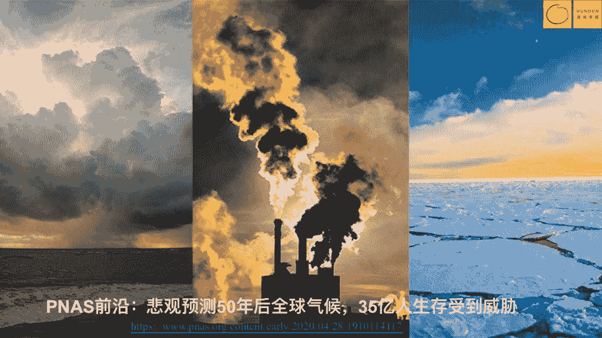

我不再列举更多的问题，但显然我们人类面临的问题有三个特性：第一，它们是跨学科的问题。第二，它们需要我们有跨尺度的思维。第三，它们背后都是交织在一起的。

气候危机、俄乌冲突、人工智能，这些东西看起来无关，风马牛不相及。但因为世界是一个相互联通的大网络，牵一发而动全身。

这三个特点告诉我们，我们需要一个崭新的理论和思维方式，来思考人类面临的问题。这个新的学科，很显然就应该是复杂科学。

### 1.2 复杂科学要直面的问题

复杂科学其实是一门特别年轻的学科。它有三个特点：

第一，它是超越还原论的。传统科学要研究一个事物，会把它拆到分子、原子、原子核、夸克，但问题仍然没有得到解决。所以，复杂科学跳出还原论的局限，更强调一种整体论的思维。

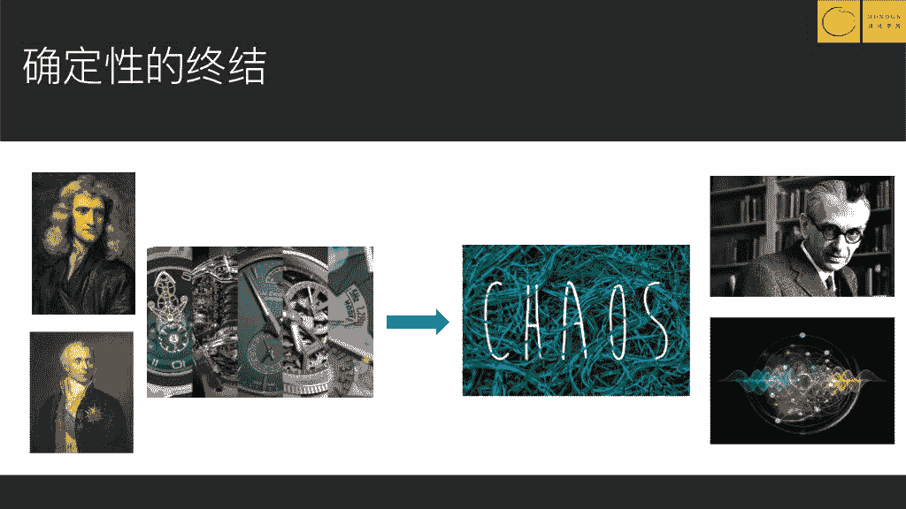

第二，它是反对确定论的。以牛顿、拉普拉斯为代表的世界观，机械的科学，已经越来越不适合新的环境了，世界的不确定性远超想象。

第三，它是BIT世界中的“物理学”，它试图寻找由比特构建的复杂系统背后的第一性原理。我们的世界，越来越从原子的世界，转变成了一个比特（BIT）的世界。如果说物理学是经典的原子世界的基础学科、第一性原理，复杂科学将会在BIT世界里扮演类似的角色。

### 1.3 复杂科学的关键概念

复杂科学，就是采用跨学科的手段，去研究各类复杂系统背后普适规律的一门新兴学科。在复杂科学里，有两个词最关键，那就是“统一性”和“涌现”。

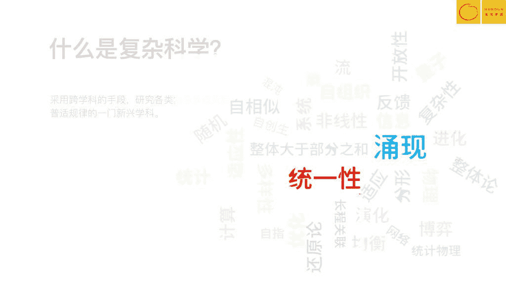

#### 关键概念1：统一性

复杂科学的研究对象是复杂系统。复杂系统，是大量个体相互交织作用而形成的庞大的整体，比如天气、城市、交通，甚至蚁群。

你会发现，分属不同学科的复杂系统，竟然有着遥远的相似性。

比如当你在夜晚乘坐飞机降落，俯瞰城市，会发现每一条街道，都像是一条大的血管，跑来跑去的汽车，像极了血液中的红血球，城市和人体竟然如此相似。你还会发现，它们有共同的一些特征，包括幂律、规模法则、分形等等。这意味着，两套复杂系统背后，有统一的规律。这个规律也正是复杂科学要去寻找的。

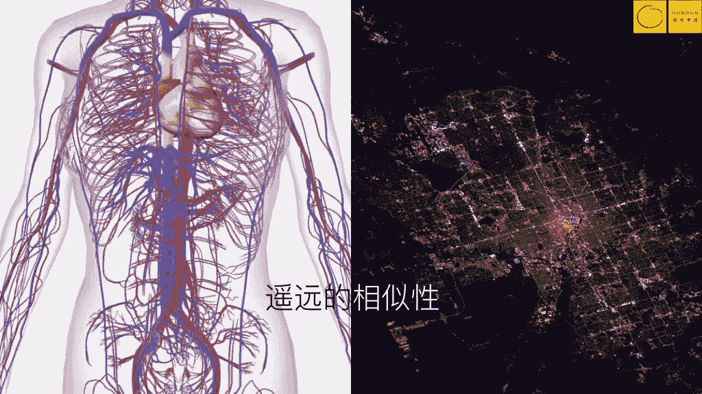

#### 关键概念 2:涌现

什么是涌现？下图能清楚地表达涌现的思想。这条大鱼，只是上百只的小鱼拼出的图案，但却把真正的大鱼吓跑了。在自然界，沙丁鱼群组成巨大的漩涡能把鲨鱼赶跑，是真实发生的。

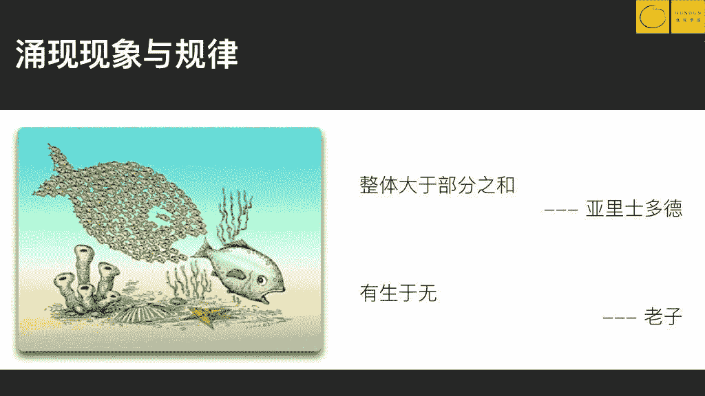

首先，所谓的涌现就是整体大于部分之和。当你把若干简单的事物组成整体的时候，它会冒出来一些新的特性。

另外一方面，涌现还意味着无中生有的过程。这些小鱼，按照特定的运动方式组合在一起，一个大鱼就出现了。2000多年前，《道德经》提到“有生于无”，其实已经论述过涌现的现象了。

### 1.4 阴阳是复杂的根基

复杂科学就是要找到不同学科背后的涌现的规律，统一的规律，适用于整体的，而不是单一个体的规律。但复杂科学并不完善，这棵大树，它有枝枝杈杈、树叶，但是你找不到复杂科学的根，因为根不在西方科学甚至哲学里，而是在东方智慧里。

用我今天讲的阴阳这套理念，你可能会找到它的根源。

如果我们简单地把阴阳思维简化成一种哲学思维，整个阴阳理论就好像是个大的托盘，有了阴阳思维，你就知道如何把复杂科学的若干概念，放到相应的位置上，让它们彼此交融成一个整体。

阴阳思想还有很多复杂科学远远没有看到的方面。比如说物极必反，所有中国人都知道的原理，在复杂科学里现在还没有出现。在这个意义上，复杂科学可以从东方智慧里汲取大量的营养。

另外，带着阴阳思维，去解决我们面对的若干问题，你也会发现豁然开朗。

## 复杂科学之奇点

我们前面看到的若干个现象，人工智能、气候危机等等这些，都在暗示整个的人类社会和文明将会步入一个所谓的奇点时刻。

### 2.1 技术奇点

技术奇点，是指技术在短时间内趋近一个无穷大的一个进步。这个概念被大众所感知，要拜库兹韦尔所赐。他在《奇点临近》这本著作中大量地进行举证，论证未来的奇点一定会到来。而且下一个重大历史事件，也许会在你来不及反应之时，就会出现。

人工智能技术想进入奇点，要经历三大阶段：弱人工智能、通用人工智能以及超人工智能。弱AI的典型的应用就是导航，此类AI可以在单一性能上超越人类。通用AI指一台机器能够在不同任务上都做得很好，GPT4已经初具雏形。而超级AI在所有任务上都能超越人类。

如果AI奇点、技术奇点存在，什么时候会到来？2016年，一个研究小组访谈了550位顶尖人工智能的学者，去调研他们认为2040到2050年之间，超级人工智能实现的概率有多大？绝大部分人认为有超过50%的可能性。

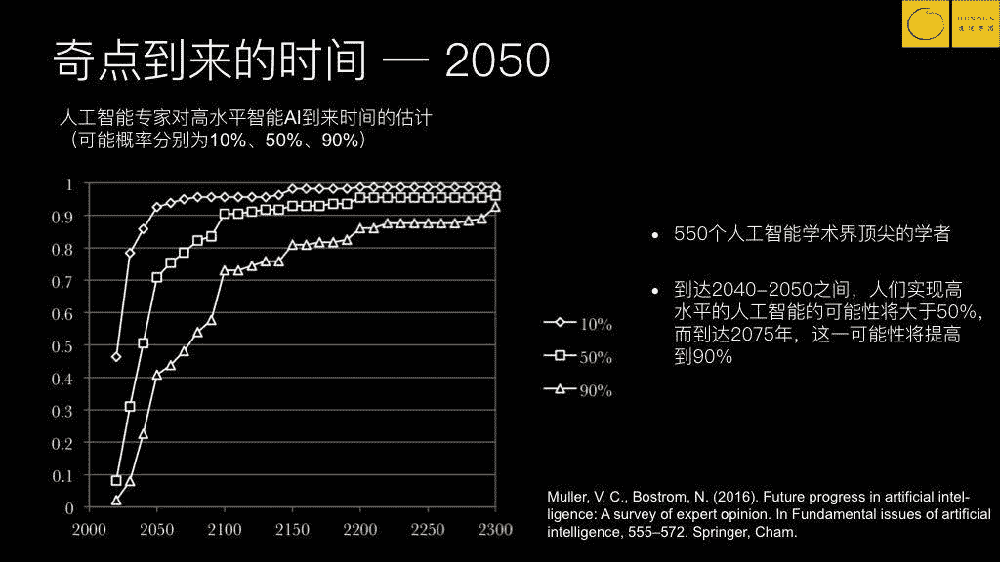

### 2.2 经济奇点

随着人工智能技术的突破，经济的发展会不会进入某种奇异点呢？

经济学家Norhaus在2015年提出经济奇点这一概念，指这样一个关键的时间点，这个时间点以后，我们的经济将会持续保持增长，而且增长速度还会持续增加。

技术奇点更偏向供给侧这一端，我只管造机器，不管机器有没有人用。经济奇点同时要考虑需求端，造完机器以后，还得有人用它，能够改善我们的生活，这样才能够促使经济快速地往前发展。

所以，如果我们假设经济奇点存在，想达到奇点同样阻碍重重，我把它归类为三大约约束：技术约束，要先发展到Super AI；政策约束，如果Super AI真的创造出来了，政策是否允许？资源约束，Super AI要消耗巨大的资源，地球承受得了吗？

这就带来了一个非常沉重的话题，生态奇点。

### 2.3 生态奇点

2020年的一份可持续发展报告指出，人类未来有169个目标，包括消除贫困、消除饥荒、消除不平等、维持可持续发展等等这一系列问题。科学家经过调研发现，AI可以起到一些促进作用。但与此同时，AI也会带来巨大的负面影响，特别是AI巨大的算力，会给环境带来沉重负担。

绝大部分AI计算都在数据中心完成，电能消耗占比越来越高。2015年，数据中心电力消耗仅占5%，到了2021年，已经达到了14%。超越了乡村住宅的电力消耗，接近城市住宅的电力消耗。

训练一个大语言模型，会产生30万公斤的二氧化碳排放量，等于125次从北京到纽约的往返航班的碳排放量，消耗巨大。

越大的模型碳排放越高，耗电越大。每隔3.4个月，大模型的计算性能就会翻一番，耗电量，碳排放量也近似翻一番。更要命的是，就算你给它喂了大量的算力，实际上性能的提升有时候连1%都不到，绝大部分时间是浪费了算力。

更本质的问题是，站在生态学视角去看，大模型、人工智能有着巨大的间接影响效应。人工智能在某种程度上，可以理解成是站在食物链顶层的消费者。著名的生态学家Odum得到一个结论，要产生一比特能够载入人类文明史册的信息，是要以消耗785亿亿（785x10^16）焦耳每年的能量为代价的。

除了能量的消耗，技术产品从生产到回收处理的整个过程，都要消耗巨大的物质和能量资源。

2012年，多个知名生态学家联名发表了一篇《Nature》综述文章，指出到2045年，地球生态将会出现断崖式的崩溃。会出现这种突变，究其原因，就是因为地球的若干个临界点，存在着遥相关的特性。

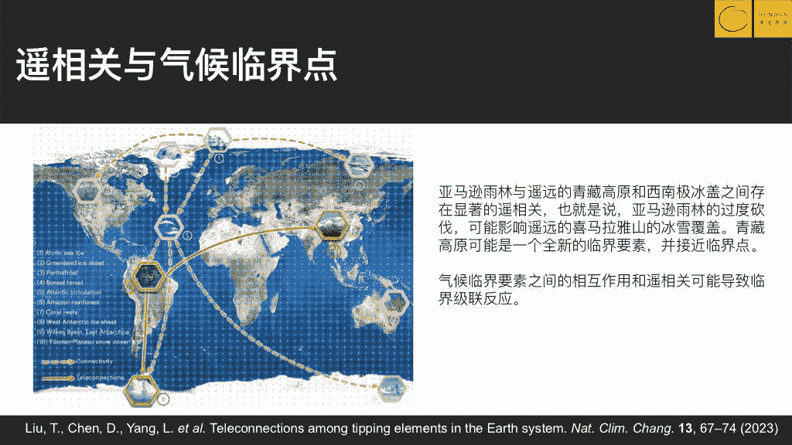

北师大系统学院的老师和同学最近的一个研究成果指出来，中国喜马拉雅山的雪盖融化，也是一个关键的临界点，跟亚马逊雨林的破坏存在着一定的相关性，这就是遥相关。

它让我们产生了敬畏之心，全球生态系统绝对不是简单的、机械的系统，它像一个生物体，牵一发而动全身。

### 2.4 奇点融合

技术奇点、经济奇点、生态奇点，复杂科学想从统一的视角去看待它们，有没有可能？要想要融合这一系列的奇点，就要找到一个奇点的空间坐标，这个坐标就是城市。

当我们用Geoffrey West的规模法则（Scaling Law）这个利器去观察人类城市，就会发现城市中有大量的数据可以间接地支持我们进行关于这三类奇点的实证性研究。例如，要研究经济奇点，我们可以看城市的GDP这一指标；技术奇点，可以看城市的发明创造、专利数字等等指标，而生态奇点，可以看相应城市的污染水平，犯罪率，感染疾病的病例数等等负面因素的影响。直接看这些指标随时间变化的长期趋势比较困难，但是却可以间接地看它们如何随城市的规模——即人口数的变化情况。

你会发现它们遵循同样的一套规律：城市变得越大，人均GDP就会变得越高，人均的专利数也会变得越高，人均科技创新也就会越多，这是大城市的好处。与此同时，人均的犯罪率在大城市会比小城市要更高，越大的城市其实越危险。

这就意味着城市必然存在着两面性，我们更加看重的是城市辉煌的一面，经济繁荣啊，科技发展。但同时，人类城市正在快速创造着垃圾。这也意味着，与技术奇点、经济奇点和生态奇点相关的指标遵循着类似的规律。

更进一步，从规模法则出发，我们可以推导出城市的增长方程，它刚好复现了一波波S形曲线。它能解释为什么那些重大历史事件，出现地越来越快。

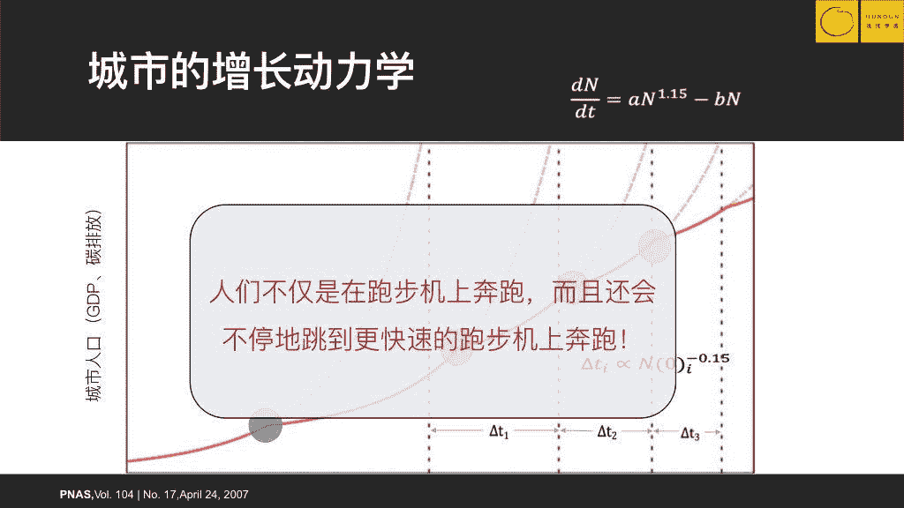

与前面的结论相结合，随着时间的推移，城市的GDP、科技发明、碳排放将会按照类似的S型曲线生长，以至于最后触及到同一个不可回避的奇点。

所以，很可能在我们真正面对奇点之时，一方面是超级人工智能的觉醒，它可能推动人类社会进入了一个经济奇点。与此同时，我们也在面临一个巨大的生态奇点，气候危机将给人类带来巨大的灾难。

很多灾难片，包括《流浪地球》已经展现了这样的场景。这种人类未来产生的本质原因又是什么呢？城市是个大熔炉，人和人之间的互动，才产生了经济发展，科技的创新，这就是它的根源。所以，一切创造都靠交互，一切毁灭的根源也是人与人的交互。

我们不想进入这个奇点该怎么办？那只能让人类不要再按原来的方式去交互，但好像我们做不到。那大自然会帮你做到，比如疫情，它就能强迫人类断掉交互。

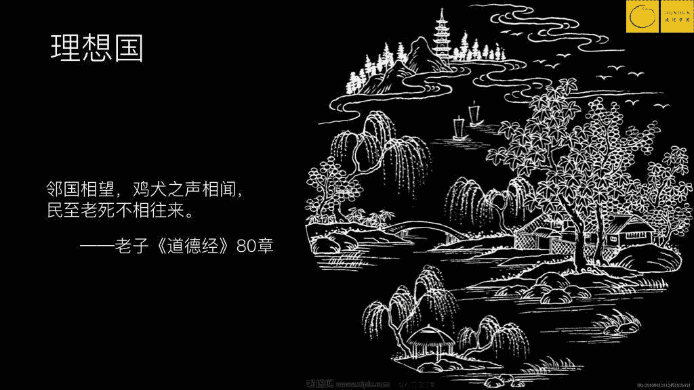

我们的未来，会是一个没有交互或者很少交互的世界吗？实际上，老子在《道德经》中描画的理想的人类社会，就是这个样的：邻国相望，鸡犬之声相闻，民至老死不相往来。很有可能在2000多年前，老子已经看到了一些微小的苗头，在警醒人类发展的脱缰。

也正是因为这个发现，让我开始关注真正的东方智慧，也就有了我们的课程的第三部分。

## 东方智慧之阴阳

跟大家预警下，前方高能，这一部分的内容稍微有一点烧脑。东方智慧是一个非常丰富的大宝藏，核心恰恰就是阴阳。接下来，我们就尝试从阴阳的视角来去解读复杂科学的相关内容。

### 3.1 阴阳与平衡

“一阴一阳之谓道”，这句话源于《周易·系辞传》。它有很多的含义，第一个含义即阴和阳，是相伴而生的，第二个含义是阴阳时常是处在一个平衡的状态下的。

无处不在的复杂系统，背后也有两种不同的力量在制约它的发展。90年代就有人指出，复杂，其实就是平衡在“混沌”与“秩序”边缘的状态。这与“阴阳”的思路完全是一致的。

来看一个例子，鸟群就是一个典型的复杂系统，有大量的个体，鸟和鸟之间很明显相互作用。更加神奇的是，作为一个鸟群整体，它把两种看似矛盾的特性融合在一体，一种是高度的协调有序，另一种是灵活地适应环境。

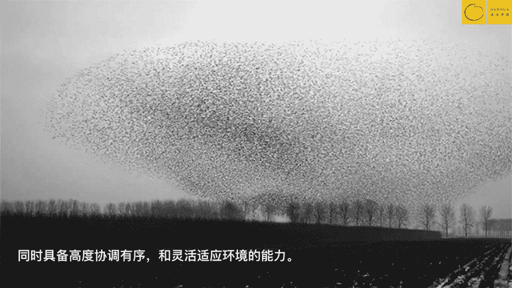

当鸟群遭遇天敌，上千只鸟集体转向，如此密集的群鸟在转向时竟然不会彼此碰撞，就像有上帝在操控着。但实际上，它们连一只领头的鸟都没有，就是靠个体之间的相互作用，完成了转向。

1983年，一个计算机图形学家，提出了模拟鸟群的三原则，假设每只鸟有一个视野半径，只有在圆里面的蓝色那些鸟才会对绿色的这只当前鸟产生影响。这个影响，又体现为三种不同的力量，分别是靠近的力量，当前这只鸟如果远离其他鸟，它就会奔着其他鸟的重心位置飞行；第二种力量叫对齐，调整我的飞行方向，跟大家方向发生一致；第三种力量叫做分离，是为了避免碰撞。

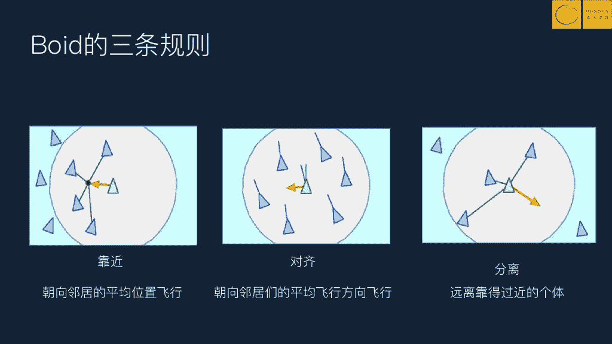

鸟群如何平衡灵活性和有序性之间的矛盾？

我们可以做这样一种仿真的实验，不断调节几种力量的比例。当分离的力量很微弱时，鸟群只会靠近和对齐，聚成一堆，特别的秩序，失去了复杂性。当分离的力量很大时，鸟群就像一盘散沙。都不是我们感兴趣的鸟群情况。

我们不妨把秩序这种力量看成一种阴，因为在东方文化里面，所谓“阴成形，阳成象”。阳的状态，是分离的，躁动的，不安的。秩序和混沌其实就是一阴一阳。而复杂，恰恰就是阴阳的配比刚好达到了非常理想的状态，才使得整个的系统变得活灵活现，变得复杂。这就是我们所说的“一阴一阳之谓道”。

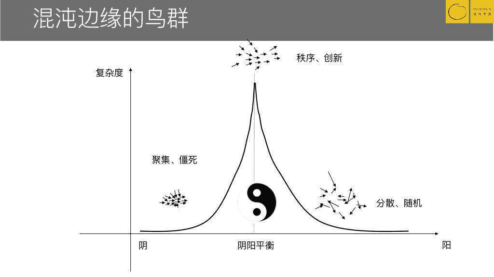

儒家所谓的中庸之道，从复杂系统的视角来看，也是一个非常有道理的状态。阴阳的和谐、调和、平衡，这才是真正的中庸。在复杂科学看，这就是混沌与秩序的边缘。

更进一步，这套思想可以放到很多领域。我们做公司，也是要阴阳并施的。阳的方面是尊重员工自己的智慧、创造性，阴的方面是要建立基本规则，最后达成平衡，才能使团队展现出来复杂性。

### 3.2 太极生阴阳

阴阳这套思想，还有很多理念值得借鉴。“易有太极，是生两仪”，也是《周易》里的一句话。这句话里，我更加想强调的是“生”的宇宙观。

我想用阴阳的视角，去看一个非常重要的物理学的规律，也是复杂科学的重要规律，即热力学第二定律，熵增定律。同时也来回应我们前面提到的问题，为什么人工智能和环境的崩溃同时到来是必然的？

阴阳思想认为，我们整个宇宙最原始是一片混沌。有人把它叫做太极，太极生出一对阴阳。

实际上，在这片原初混沌中，有了人类这样一个观察者的存在，才在一片混沌的雪花中分出了有意义的前景和背景，即秩序和混沌，也就是阴和阳。

我们可以先脑补这样一个场景，假设你的面前有一块大屏幕，不展示任何的有意义的内容，就是一片雪花。但长时间地盯着雪花看，你能看出什么？可能看出一些花朵、一张人脸，或者其他有意义的图案。

本体的东西是毫无意义的，是混沌的，我们的大脑不过是把无意义的信号解读成了有意义的信号。解读就是无中生有的过程，这个过程一旦进行，就有了事物和背景的一分为二，就有了阴和阳。万事万物由此产生，产生的根源不是别的，恰恰是作为观察者而“观”出来的。

我们再来看几张图，加深一下这种感觉。正常人都会看到两张脸，但仔细看就会发现，左边的脸是一堆水果，右边的脸是由枝枝杈杈拼出来的一种假象。

其实我们看到的万事万物，电视、椅子、桌子，何尝不是被大脑解读出来的事物？你不妨把自己假设成一个原子、分子，再去看这张桌子，这张椅子，你就会发现它的边界已经变得模糊不清了。从这个意义上来说，一张桌子，有个电视，是因为我们的大脑，我们人所在的时间尺度、空间尺度，和这个物体所存在的尺度，达成了某种匹配，我们才把它解释为一个固定的物体，区分出前景和背景，也就是分出阴和阳，这是我对太极生两仪的一个解读。

我们还可以往前再推进一步。根据物理学的前沿理论，在微观世界里面，物理学是没有时间方向的，时间的前和后是完全对称的。如果你拍摄一段影片，你会发现影片正着放和倒着放没有任何的区别。

但当我们去看待宏观现象的时候，时间之箭就出现了。比如你点燃一缕轻烟，烟很快会弥散在空气里面，你不会看到时间反演这个过程。

还有一个例子，我们衰老的过程，是不可逆的。在真实世界中，你永远看不到《本杰明巴顿奇事》中返老还童的情景。

这不就出现矛盾了吗？无论青烟还是人，都要遵循基础物理，量子力学。而在量子、微观世界里，又没有时间的方向，那请问时间的方向又是怎么出来的？

对这个问题，大名鼎鼎的玻尔兹曼给出了一个很好的答案。他在物理学中的地位，类似于达尔文在生物学中的地位，他指出来，熵就是你忽略的信息量。

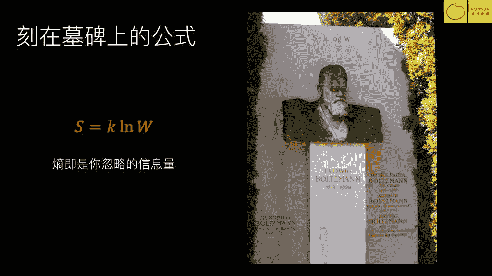

我们人类作为观察者，所忽略的信息量大小，其实就是熵。

为什么这么说？引入一个重要的概念，宏观观测和微观观测。实际上我们看到的物理世界是宏观量的世界，比如一团气体分子，我们只能用`P`（压强），`V`（体积），`T`（温度）等宏观量来对它进行刻画。而我们很难做到追踪每一个气体分子的位置和速度，也就是微观量。

所以，当你从微观测量过度到宏观测量的时候，一定会伴随着信息的损失，你所忽略的信息量，恰恰就是熵的量。

就像这两张蒙娜丽莎的图。左边的图你可以理解成一个完备的微观的世界，脸上的像素都看得非常清晰。但由于我们人类的局限性，追踪不了每个像素，只能看到右侧的这张图中模模糊糊的人脸，你就忽略了信息，损失了信息。

传统科普书上怎么解读熵？它说熵是一种无序程度的度量。这句话也没错，只不过当你追问何为无序程度时，就很难再解释了。但在玻尔兹曼的视角下，你只要把观察者引进来，就可以解读熵。

我们所说的观察者，指的是信息提取的主体，它并不一定是张三、李四具体的人。这个主体甚至可能是个机器，人工智能其实也可以作为观察者。所以观察者其实是客观的。

那进一步，热力学第二定律又是怎么出现的呢？

传统的科普解读为，因为无序程度在一个孤立的系统里会不断地增加，就体现为熵增，也就是热力学第二定律。

从玻尔兹曼的视角下，可以有一个更有趣的解读，因为观察者无法时时刻刻地追踪系统的细节演化，就导致我们忽略的信息随着时间在逐渐地增多，熵增就出现了，也就有了热力学第二定律。

那更有意思的是，这个过程其实是可以反过来的。忽略信息可以导致熵增，获得信息熵自然会减少。

物理学中的麦克斯韦妖，做的就是这件事。假设在一个密闭的，有两个舱室的容器里，有大量的气体分子。红色小球运动快，是热分子；蓝色小球运动慢，是冷分子。一开始红蓝小球混乱运动，这是熵最大的一种状态。假设现在有一只小妖精，站在中间舱门处，它只做一个动作：通过开关小舱门，对分子做筛选，让红色小球流到左边，蓝色小球流到右边，做了一个温度的分离。分出冷和热后，就进入了低熵的状态。这就是一个熵减的过程，逆热力学第二定律的过程。

信息测量本身会导致熵减，观察又会导致熵增，观测一直都是双刃剑。

那完整的故事是什么呢？就是这张图所展示的，我们目前进展的前沿，叫做因果涌现。

当观察者获得宏观描述的时候，两件事情同时发生：首先，我们忽略了大量的信息，体现为熵增。同时，得到温度、压强、体积等等宏观量，麦克斯韦妖筛选出来的一些信息。

为什么要筛选信息？因为从宏观态的角度去看这个气体系统，它会具有更强的因果性。从温度、压强等等体积描述宏观系统，就能得到非常精确的数学方程，这就是热力学方程。瓦特之所以能发明蒸汽机，就是因为热力学的进展。

我们提取信息是因为能在宏观得到更强的因果，获得一种秩序感。但这类秩序的产生，伴随的是大量信息的忽略。

在这样的视角下，复杂系统又是什么呢？从某种意义上来说，它就是一个观察者，时时刻刻做观察，即麦克斯韦妖。比如说一个细胞，其实就是在做观察。细胞的边界是一层磷脂双层膜，有很好的半透性，把一些蛋白质物质筛选进来，一些废弃物往外排。使得细胞的外界熵增，细胞的内部秩序越来越多。这不就是麦克斯韦妖吗？本质上在做筛选。

但一个麻烦的问题在于，这种开放系统的内部，也在时时刻刻地产生熵。道理也很简单，你把秩序的东西筛选进来了，但不可能无时无刻地关注这些物质和信息，追踪这些信息，这就导致内部也在奔着熵增的方向演化。因为这个复杂系统不能不停地对自己做观察，身体就在熵增。

普利高津，第一位获得诺贝尔奖的复杂系统研究者，提出了广义的热力学第二定律，把第二定律推广到了开放系统。就体现为，开放系统的内部一定在无时无刻都在产生着熵。

开放复杂系统内部，每一个单元细胞，就好像是一个垃圾生产商，一定要想办法把垃圾甩出去，这就体现为熵流，也解释了生物体为什么一定要排泄。吃东西，实际上就在吃负熵，这也是薛定谔的观点。于是，有两个力量要平衡：一方面产生垃圾，排放垃圾；另外一方面，吸收着负熵、秩序。但无论怎样排，总的熵一定是增加的。

关于这一点，你只要理解一下空调的工作原理，马上就能明白。

空调是非常有原罪感的发明，不停生产熵，排放在外界，换取的是一点点凉爽。而在这个过程中，热是不守恒的，熵也是如此。排除到屋子外面的热远多于从屋子里减少的热，这是因为空调的运作本身也会耗热。同样地，熵也是这样流动的。所以，越多人使用空调，就会使得熵产生、排放得越快越多。我们的复杂系统也是一个空调，秩序其实就是冷空气，热其实就是熵。

城市，也是一个无时无刻不在运转的大空调。也在不停地创造着秩序、财富、科技等等。但同时也排放着垃圾，也就是熵。而且有的时候垃圾产生的速度更快，这就导致环境遭到进一步破坏。更可笑的是，人类不知道怎么去度量这种熵，碳排放仅仅是一个很粗糙的指标。城市垃圾不仅体现在碳的排放，犯罪，作为一种社会熵，就很难刻画。

更恐怖的是什么？把空调的比喻放在全球尺度下，麻烦就产生了。我们前面说，一个复杂系统要想长期存活，一定要保证它的熵流，也就是往外排放垃圾的速度要足够快，才能平衡它内部产生熵的速度。但地球排放熵的方式却很单一，只能通过热辐射。而热辐射的能量，上百年来几乎都是一个固定的数值。那么，伴随着人类社会飞快的发展，人类产生了大量的熵，实际上是存放在地球内部的，没办法排出去。

无论哪种新能源、新技术，最后还是要变成熵被释放出去的，因为它要做功，要发电，要为人类服务，就一定会消耗能量，会变成热，排放到环境中。它仍然没有解决地球往外排放熵的问题。

所以新发明可能会导致一个大麻烦，地球早晚被自己的排泄物所淹没。

从阴阳视角来看，就很容易理解了。我们人类做出的观察区分出来秩序和混沌、负熵和熵、阴和阳，但我们过多关注了秩序和生长、负熵这一部分，而现在，我们忽略的一方敲上门来。

## 3.3 阴阳返无极

阴阳还意味着“原始反终”的过程，用老子的话说，叫做反者道之动，弱者道之用。一个人如果和众人的观点不同，甚至相反，他很有可能是代表道的。为什么？

因为道的运动方式，就是周期性的，当它发展到极致的时候，正确的方向恰恰是折返回来，物极必反。

我们前面已经剖析了这么多，已经看得很清楚，人类的问题就在于过多盯着秩序去看了，忽略了混沌也就是熵的那一部分。所以世界就要给你来个物极必反，恰恰体现为这个阴阳鱼。

我个人对阴阳鱼有个解读：阳可以理解成西方文明，西方文明就是一团火。过去我们忽略的是阴的这一部分，恰恰可以理解成东方文明，它更像是一滩水。西方文明创造的辉煌，已经越来越后劲不足，反面的问题就会暴露出来，解决这些问题，恰恰需要我们东方的智慧。

更有意思的是，大家想想，阴阳鱼的阳中之阴是什么？在西方文明的内部，诞生出的东方的东西，恰恰就是复杂科学，它是一种回归。阴中之阳是什么？这个问题可以留给大家思考。

总而言之，今天这个时代正在发生阴阳的互换，以前觉得是对的东西可能都错了，反者道之动。

## 解决之道之自稳态觉醒

### 4.1 人类文明的自稳态觉醒

我们课程的最后一部分是解决之道。怎么去解决前面提出的若干问题？先介绍一个系统科学的概念，叫做自稳态觉醒。它也是很东方化的概念，但却是西方人提出的。

美国加州研究院可持续发展中心有两个作者，提出了未来人类的发展有两种可行的路径。一个是往上走，逃离地球，但这条通道非常细。另外一个，是作者更认同的发展路线，即自稳态觉醒。

今年《流浪地球2》刚刚上演，它的设定有点类似于逃离地球计划。逃离地球，有没有可能延续人类文明的火种？Kardashev的三级文明理论认为，文明要想能够跨星际旅行，它的能量利用水平，至少要突破到第三个等级，也就是可以利用甚至于超越恒星级的能量水平。我们达到了什么水平？仅是0.7能级，连第一能级，超越地球束缚都还很难做到。

来看看第二条路，自稳态觉醒。

自稳态是来源于生物学的一个概念，说我们的生物体，体内其实存在大量的负反馈机制，使得我们的很多的生理指标，能够自动平衡在一个正常的水平下，实行自稳态的调节。比如正常人的体温一直会保持在37度以下。

联系我们前面的课程，其实所谓的自稳态就是指一个系统自能够充当自己的观察者，它能够根据各种各样的传感器，对自身的状态进行不断地感知和自我调节，从而让自己能够不断地熵减，让自己维持在一个稳定的状态。

什么是自稳态觉醒？把整个地球看成智能生物体，这个生物体要能够像身体一样进行一个自稳态的调节。让整个地球上的人类，包括我们的人工智能，达到这样的一种觉醒状态，就叫自稳态觉醒。也就是说，整个地球都变成一个活生生的类似大脑一样的能够对自我状态进行观测、调节的智能系统，这也许才能真正解决一切我们面临的问题和挑战。

自稳态觉醒，可能实现吗？如果可能，实现难度有多大？

另外一篇出自圣塔菲研究所的文章提出，实际上我们是可以效仿生物圈的。这篇文章把整个地球划分出五个圈层，每一个圈层，都会有自己的生命周期。技术圈层比较年轻，也很不成熟，就需要向生物圈学习。

实际上，生物学家Lovelock早在1972年就提出了著名的盖娅理论。他发现，生物圈其实是很智能的，是一个行星级别的智能体，因为它可以自稳态调节。所以他就给整个行星的生物圈起了一个名字，叫做盖娅，意为母亲。

在植物出现以前，地球环境非常恶劣。由于某种原因植物出现了，它可以把二氧化碳变成氧气，有了氧气的出现，就衍生出大量的物种。这就是生物圈自发调节的过程，从不成熟到成熟。

技术圈也发生过类似的事件，早些年空调产生大量氟利昂，导致臭氧空洞，后来人类采取了各种手段，使氯氟烃容量大大地降低，这是一个技术圈成熟的案例。但这种案例非常少，我们人类已经开发出太多技术了，有些技术，我们其实对它们不太了解，也不知道如何去控制。在意识到问题之前，可能你已经遭遇毁灭了。这就是技术圈面临的一个难题。

怎么去解决这些问题呢？我们还是要回到根上。

技术的发展，显然跟城市的发展模式有必然联系。只有破坏掉这种生长模式，打破我们人类熟悉的生活模式，才能解决。这怎么可能呢？

首先，一部分科幻小说进行了探讨：

《阿凡达》描绘了这样一个星体，有一套很生态、绿色环保的自稳态文明。比如他们能和自然沟通，这在外界来看是不可理解的。

在阿西莫夫著名的《基地》系列中，有一集也描述了一个有趣的星体。这个文明是用脑沟通的，一个人感受到快乐，全球的人都会一起快乐。

另外，我们的老祖宗，一直在强调所谓的天人合一。按照东方文明的理解，天人本是一体，是混沌未分的状态，是文明把它划分出来阴阳。通过打坐修炼等等一系列手段，你才能返回到天人合一的状态，所以它又常讲物极必反，这就是东方给出来的自稳态调节的思路。

这些都是比较思想性的东西，但也有一些现实的案例，比如说，前几年全世界评选幸福指数，发现布丹这个国家是最高的。这个国家很封闭，每年开放的游客数量可能就几百个，外部的文明很难去破坏它。他们不追求GDP，更追求跟大自然和谐相处。

另外，我们国家也很有远见，很多大的政策方针，是指向人类的文明未来的。生态文明战略，就是一个特别好的视角，它规划的是一个很理想的，未来和谐相处的乡村的场景。而且，我们现在也在强调传统文化的复兴。

### 4.2 人工智能与理性人假说

人工智能技术，未来怎么发展，才能实现自稳态的觉醒呢？

至少在我们国家，要更多地去强调所谓的多体智能，而非单体智能。OpenAI开发的ChatGPT的确很厉害，但这种人工智能是单体智能。如果任其发展，其实有很多隐患。首先，单体智能无一不控制在大公司、大机构的手里。这些人你很难去约束他们，只能期待他们别作恶。

多体智能，更像复杂系统。它们组合起来就像鸟群，每个智能体可能都很简单，但它相互协作形成整体的时候，却有着非凡的智慧。这可能才是适合于我们中国未来人工智能的发展方向。

2015年，《Science》刊登了一篇文章，发现随着大量人工智能的出现，出现了两个回归的趋势。

前几年，传统经济学因为理性人假说被人们诟病。但随着人工智能的兴起，曾经被批判的传统经济学，居然可以适用在人工智能主体上面。因为人工智能就是可以按照纯理性人的方式来运作的。

另外一个趋势，计划经济在人工智能系统里可能更加适用。未来大量人工智能充斥在社会上，它们有可能会严格地按照你的命令来执行，实现更大的奇迹。

这些奇迹正悄然发生，只不过我们没有关注。比如我们国家的电网系统其实是一个智能网络，而且正在利用最尖端的多主体协调的人工智能技术来发展。我们开发了大量的风能电站，它有一个严重的弊端，有风的时候发电量很大，没风的时候很少。假如没有室温超导技术，储电是个很大的问题。电网怎么适应这种波动？靠人工智能技术，就可以动态去调节电价，使电动车的车主们来协同完成储能操作。没有风的时候，电力紧缺，就可以提升电价。让电动车车主把自己储在电池里的电能放出来，换取更多的收入。反过来，电能过剩的时候，我们还可以去充电，把电力存储起来。有人提出了类似的方案，也就是利用一套复杂系统上的优化算法去做电价的调控。

另外，我们以前说的元宇宙，讨论的是一个完全独立的虚拟世界，主要目的是为了人类娱乐、社交等等。未来的元宇宙完全是跟大量的传感器技术相融合的，这就导致元宇宙演化成大脑，可以观测整个地球和外部这个世界，元宇宙玩家做出一系列决策来调整整个系统的运作，使整个行星成为超级智能体，也使得自稳态调节变得可能。

### 4.3 个体与组织的回归本心

对个体和组织来说，应该怎样发展去应对未来呢？

我们的建议就是要回归本心，按照马斯洛的需要层次理论，人类需求其实是多层次的，在低层需求被满足的时候，我们会跳到高的层级去想更宏大的问题，最后达到自我实现。

人工智能来了，它一定会对我们的工作造成冲击，我们就开始焦虑了。我们习惯了玩儿命争取，缺乏安全感。但人工智能来了，你具备的技能在它来看都是小菜一碟。

我们为自己，为孩子做了那么多规划，未来一定会按你的规划发展吗？越规划就越焦虑，越焦虑就越内卷，越来越找不到自己的本性、本心在哪儿，变得迷失自我。

实际上，人工智能在教育我们要往高层次跃迁。自稳态觉醒，要求每个人都要觉醒，达到自我实现是最起码的要求。

越是这个时候，越要静下心来，特别是带小孩的家长，我现在就是这样实践的。从一开始你就要让孩子学会问自己几个问题，我是谁？我将来要干什么？我的本心在哪儿？我真正感兴趣的事儿是什么？让他寻找自我。绝大部分人都在帮孩子制定未来，帮他去找自我，但这根本就不是他自己，不是他想要的。

ChatGPT出现后，陆奇先生做了一个演讲，有一个观点我特别认可，他说未来每一个人在有了超级人工智能机器以后，其实都是创业者。

智能机器已经足够强大，重复性的低级劳动完全可以被替代。什么才是人类最宝贵的？我们内心的诉求。每个人的诉求都是不同的，都有一个本体。我儿子天天问宇宙相关的问题，我的女儿喜欢看小猫小狗，这就是他们的本性，没有对错。我们要任其本性去发展，而且要升华他的本性，帮助他去问Who am I这个问题。

东方智慧往往都回答了一个问题，只有找回本心，才能真正重构一个坚实、扎实的自我，成为一个了不起的，甚至有更高成就的人。

如果我们的组织，每一个人都处于觉醒的状态下，又会怎样呢？我前段时间看完《重塑组织》这本书，已经有了答案。它把整个人类组织梳理成五种颜色，分别是红色权威，琥珀服从，橙色成就，绿色多元和青色进化。大多数组织处于橙色阶段。它的典型的特点，就是用KPI指标为成就，让员工去实现自我满足。绿色组织有更多的社会责任感。但仍然是家长式管理的组织。指令单一化。

青色组织每个个体都是觉醒的，大家的目标和组织发展的目标一致。这样每个人都是一个自驱的个体，工作不再是为了其他，而是为了自己的目标，也就不需要领导。大家像阿米巴虫一样，形成组织的进化。

这本书有一个重要的观点，他认为，个体的觉醒程度和组织的进化层次有着密切的关系，往往是那些已经觉醒的、自我成就的人，才能真正地创建青色的组织，放手组织进化。

## 尾声

我个人成长受西方科学影响较多，但西方学科的内部，天然地衍生出了很多东方哲学、东方思想的东西。《复杂》这本书，最后一章直接指明了西方文明要走向东方。《歌德尔艾舍尔巴赫》，是一本特别烧脑的书，又特别有趣，它主要讲人工智能，但其中有很多对禅、对自我、对意识这些问题的思考。

总而言之，你能明显看到西方科学家其实很拥抱东方智慧，我接触过的几个大科学家也都是这样。

# 复杂科学与东方智慧：AI奇点与自稳态觉醒

## 引言：为何此刻发声

作为一个东方人，又有什么不敢说的呢？之前不敢说，是因为我准备不足，了解太少，所以这几年一直在看古书，现在有了我自己的理解，同时又能跟复杂科学接上轨，就有了我们今天这堂课。

## 世界危机与复杂科学框架

总结一下：世界面临两大类现象，一方面人工智能飞速发展，另一方面环境气候危机不断逼近，解决问题需要用复杂科学。具体来讲，是复杂科学中的奇点理论和规模法则理论。这就引出来了第二部分三种奇点，以及在规模法则框架下的统一。规模法则理论让我们看到奇点无法避免，超级人工智能可能与环境崩溃同时到来。那么，若想破局，首先需要找到问题的根源——这就是阴阳相伴而生，我们在追求人工智能超级秩序的同时就已经伴随了大量的熵产生和环境破坏。而这一对阴阳的根源其实在于我们观察者，当我们将观察的视角看到阴阳整体就必然会觉醒，这就是最后一部分自稳态觉醒。这种觉醒是要让全部人类和机器形成一个完整的大脑，自我观察自己的全部方面包括秩序与混沌，阴和阳。同时，还要自我调整，达到和谐发展，而不是一味追求技术，经济的发展和进步。

## 解决方案：自稳态觉醒与原始反终视角

从复杂科学和东方智慧的融合，这堂课给出了AI奇点临近与未来一系列问题的解决方案，即自稳态觉醒。我希望，我们可以站在一个原始反终的视角下，来重新看待人类社会乃至人类文明的未来。

## 文章来源

本文来自🛰️👸号“混沌大学”（ID：`hundun-university`），作者：混沌学园，36氪经授权发布。
