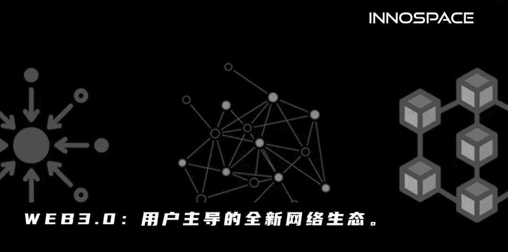
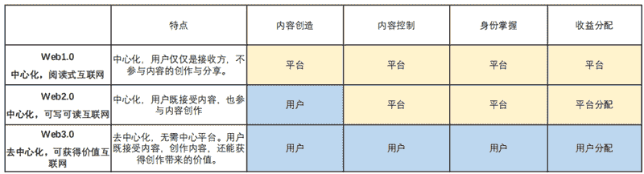
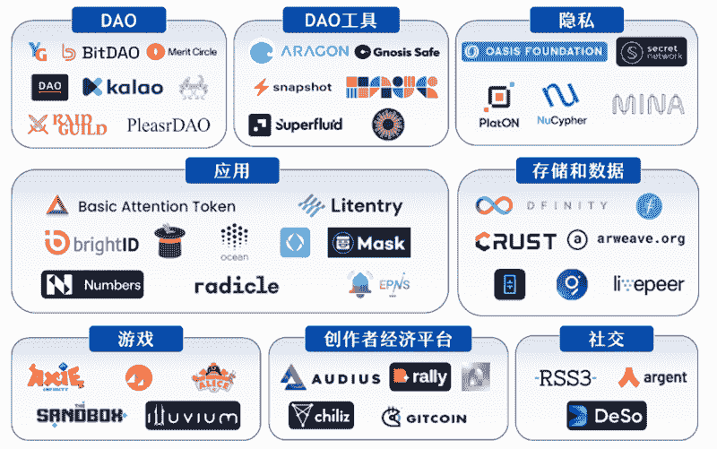
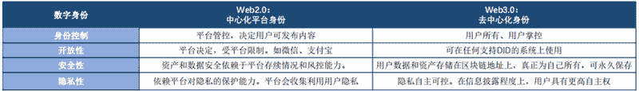
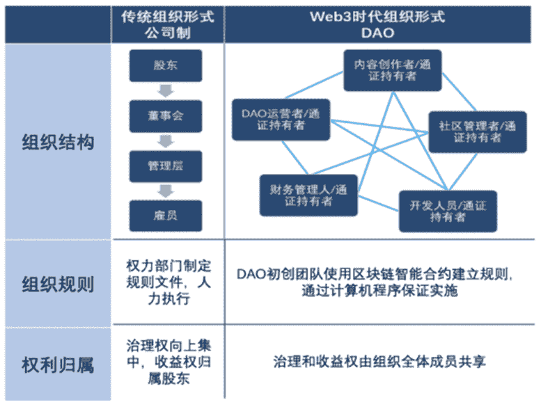
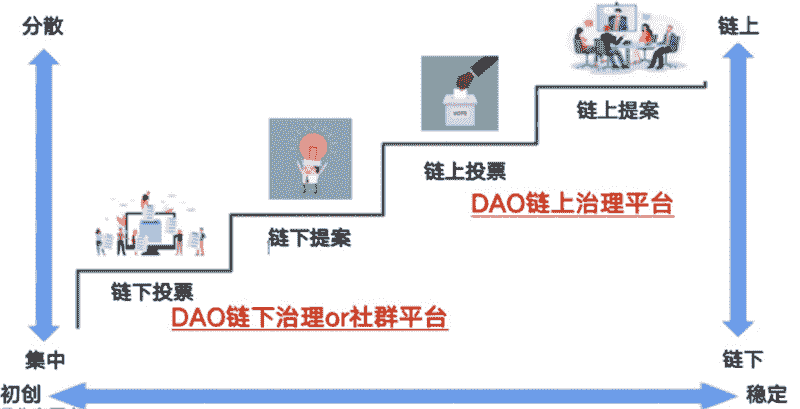
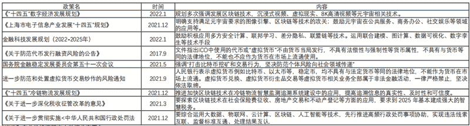
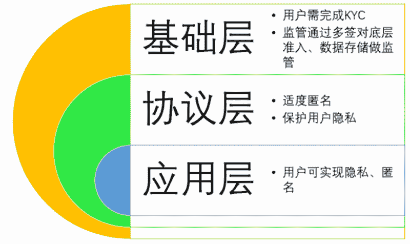

# 2023-01-13一文看懂Web3.0：元宇宙的基础设施，三大标签颠覆互联网

> 来源：[https://xuqiwei1986.feishu.cn/docx/K2UrdfQHAojDoYxOOYqcx5QjnQf](https://xuqiwei1986.feishu.cn/docx/K2UrdfQHAojDoYxOOYqcx5QjnQf)
>
> 🔗 原文链接： h[ttps://mp.weixin.q](https://mp.weixin.qq.com/s/qAlh6SuefYItxNWLseju7w)q.com/s/qAlh6Sue...

InnoSpace 2023-01-13 13:21 发表于 上海

本文共计6900字，预计阅读时长18分钟

作者 | 宋嘉吉 任鹤义 张良卫 周良玖

来源 | 智东西（zhidxcom）

Web3（也被称为Web 3.0，又写为web3）是关于万维网发展的一个概念，主要与基于区块链的去中心化、加密货币以及非同质化代币有关。在Web3.0中，用户为满足自身需求进行交互操作，并在交互中利用区块链技术，从而实现价值的创造、分配与流通。这样的整个用户交互、价值流通的过程就形成了Web3.0生态。相比Web2.0的平台中心化特征，Web3.0致力于实现用户所有、用户共建的“去中心化”网络生态。

本期，我们推荐国盛证券和东吴证券的报告《Web3.0时代：开放、隐私、共建》和《Web3.0初探：一个基于区块链技术、用户主导、去中心化的网络生态》，揭秘Web3.0生态的主要要素和特点。

## 01 Web3.0 用户主导的网络生态

Web1.0时期，内容由网站提供（PGC），用户只能被动地浏览文本、图片及视频内容，无法参与创作中。

Web2.0时期，出现了博客、视频平台、论坛社区等网站模式，用户可以在平台上自主创作上传内容（UGC），分享并接受他人观点。

这一切在 Web3.0 时代将发生深刻的变化：Web3.0 世界将充分开放化，用户在其中的行为将不受生态隔离的限制，甚至可以认为，用户可以（基于基础逻辑）自由畅游在 Web3世界；用户数据隐私将通过加密算法和分布式存储等手段得到保护；Web3 世界，内容和应用将由用户创造和主导，充分实现用户共建、共治（DAO，去中心化治理），同时用户将分享平台（协议）的价值。

▲WEB3.0与2.0的主要区别

除了完全不同的互联网模式和用户体验，Web3 将带来新的流量入口范式。Web2 时代占据用户注意力的流量入口模式将发生一些有趣的变化。

在以区块链为代表的分布式技术推动下，从去中心化点对点账本实验到去中心化智能合约平台，催生了无数的新型应用（Dapp），慢慢 DeFi 形成了数字世界里的“金融服务”，而 NFT 加速了资产上链。我们看到，传统世界（线上和线下）之外，用户越来越接近一个相融相生的数字世界。至此，人们呼唤一个全新的网络世界——元宇宙，即可信地承载个人的社交身份和资产，社区将拥有更强大的主导权。

Web 3.0 技术堆栈主要可分为三层：协议层、应用层以及网络基础层。这一切主要是基于区块链构建的（当然协议层也可以有链下的辅助部分）。从应用角度看，Web 3.0 则涵盖 DAO（及工具）、隐私、应用、存储和数据、游戏、创作者经济平台、社交等几乎覆盖 Web2.0 的大部分领域。

伴随着加密货币行业的蓬勃发展，近两年涌现了大量的 Web3.0 应用，当然，这些应用最终也许大部分都是过渡期产品。甚至有些应用在经济模式、解决用户痛点方面存在着缺陷，并未体现出比 Web2.0 更真实需求。

无论如何，Web3.0 生态已现雏形，在不断的应用探索中，将一步步揭开 Web3.0 的面纱。

▲Web3.0 生态图景

Web3.0生态组成模块：1）用户身份：用户使用钱包，掌握多个虚拟化身，参与Web3.0网络生态的交互。2）用户交互：通过区块链技术进行用户交互，从而实现价值的创造、分配与流通。3）用户组织：用户形成自治组织，在协作中为Web3.0生态创造各种应用、工具、协议等。4）底层支撑：区块链从技术层，分布式存储从数据层，共同为Web3.0提供底层支撑。

用户通过虚拟化身参与网络世界的交互，Web3.0中，虚拟化身的集合就是用户身份，该身份真正为用户所有、用户掌握，也被称为——去中心化身份DID(Decentrliazed Identity)。相比起Web2.0时代的用户身份，Web3.0的用户身份在身份控制、开放性、安全性、隐私性等方面存在着很大区别。Web3.0生态的用户身份是去中心化的，其表现形式和使用方式有如下特征：

**1）去中心化：** DID作为用户身份集合，完全掌控在用户手中，并不由任何一个机构完全掌控。任何一个机构对用户身份的认证，都只是集合之中的一个元素。

**2）表现形式：** 用户把各机构颁发给自己的身份认证信息，存储在用户完全掌控的区块链地址上，这个区块链地址往往也是用户的钱包地址。

**3）使用方式：** 通过钱包进行web3.0上各应用的登陆。使用体验与web2.0时代的🛰️登陆类似。区别在于，DID是用户所有、用户掌握，而🛰️会受平台限制。

### 1、三大标签，开放、隐私和共建的世界

Web3.0 的开放性体现在：

**1） **用户在某个互联网应用“领域”中的准入充分自由、门槛低；例如，用户往往利用一个区块链账户地址就可以登录链上的应用，无须注册许可，操作便利；

**2） **用户行为不受第三方主体限制、互联网应用打破原有的所谓生态内、生态间的界 限和隔阂，在复合代码运行逻辑的原则下，应用之间具有高度的组合性和复合性；最直接的案例就是所谓 DeFi Lego，任何应用都可以对底层基础协议（如 DEX）做调用或聚合，以及合成资产平台将现实世界资产映射到链上（无交割关系）， 这等于打破了所谓线上线下和虚拟与现实的界限。

**3） **另外，Web3.0 内部基于不同基础设施的应用之间可以被“跨链”协议解决互联互通；因此，用户在 Web3.0 世界多个应用的行为可以生产类似社交关系图谱，进一步提升数据价值的挖掘潜力。

举一个游戏应用的比喻，用户可以不受第三方限制、很方便进入一个游戏世界；用户可以将自身喜欢的角色/形象自由植入到游戏中去，甚至可以使得角色跨平台/领域行动，而 Web2.0 时代，如王者荣耀这类游戏，你无法决定角色的选择，更不能将喜欢的孙悟空杀进魔兽世界——这方面的连通平台并不难，只是因为控制权并不在用户手中。当然，你也可以交易角色皮肤等装备（借助 NFT），甚至基于其他 DeFi 协议建立复杂的游戏装备衍生品市场。总之，跨应用平台、跨虚拟与现实地完成 Web3.0 的生存方式。

**隐私：** 数据所有权和价值的转移。数据隐私已成为全球监管的焦点问题，现行的解决方案一是强化法律保护，让使用者意识到盗用用户数据是违法行为；二是引入隐私计算，通过同态加密、多方安全计算、可信执行环境等技术，保证数据在使用过程中是明文不可见的。

在 Web3.0 时代，用户将倾向于用更彻底的方式保护个人数据隐私，从而引发数据所有权和价值的转移。随着应用的去中心化，链上数据可查的情况下，用户行为、产生的数据乃至应用协议亦需得到隐私保护。隐私保护是多方面的，包括基础区块链平台隐私保护、存储数据隐私（分布式存储）、用户私钥管理、匿名协议等多方面。

**DAO：** 共建、共治和共享价值的网络世界。Web3.0生态的建设，诸如应用、工具、协议等，都离不开协作，使用户有序协作的组织形式就叫做DAO(Decentralized Autonomous Organization)。DAO全称去中心化组织，用户因共同的目标而组织形成，利用区块链技术和智能合约程序，进行规则的制定和执行，从而实现能保证公平的社区自我治理形式。

用户在 Web2.0 互联网应用中的内容创造是多方面受限的（受平台审核限制、跨平台限制），在社区治理方面的限制更甚，因此也就限制了用户在创作者经济共享方面的价值捕获。Web3.0 开放性原则将打破这些限制，同时区块链的激励机制将内容经济的价值有效地反馈给创作者。

区块链技术是DAO形式得以确立的核心技术基础。组织规则通过区块链智能合约进行编写，由程序保证执行。同时规则存储在区块之上，不可轻易篡改。DAO的建立过程中，同样会产生价值的创造、分配与流通。DAO在用户交互中建立，并在交互中持续的创造价值。DAO通过发行项目代币和NFT对价值进行分配，使用户享有DAO的治理权及收益权。DAO代币、NFT也能在DeFi中流通。

DAO作为Web3.0时代的组织形式，与传统组织形式在组织结构、组织规则、权利归属等方面有较大区别。DAO具有以下优势：组织权利通过组织代币的形式向全体组织成员进行分发，由此实现社区自治、权益分配，从而极大地激发组织成员的参与度、积极性，对推动web3.0社区项目的建设有重要作用。

▲传统组织 vs DAO

目前的DAO主要是建立在以太坊区块链网络上。这是由于以太坊建立了分布式、去中心化的智能合约平台，DAO需要依赖于智能合约使治理规则程序化，从而保证DAO可以按照其编写的规则运行。客观上来讲，DAO仍处于发展雏形，具备许多不足：1）依赖于程序，可能存在bug；2）预设规则，执行缺乏灵活性，不太适合对复杂情况的处理；3）DAO治理模式不够完善，存在治理漏洞。

当前时点，由于DAO存在的不足，还无法完全依赖于程序的自动执行，因此目前大多数DAO的治理方式采取链上治理+链下治理相结合的方式——通过区块链上智能合约编程，完成大多数简单化、高重复性、调用频繁的规则执行设定，同时通过设立执行委员会、DAO用户投票等方式开展复杂化规则治理。

▲DAO治理方式实践

### 2、Web3 推动“现实世界”与“虚拟世界”的融合

Web3.0 时代，元宇宙将是一个极富想象力和创造力的网络形态。Web2 时代，人们习惯以“虚拟世界”和“现实世界”来作为线上线下世界的界限。构筑在 Web3 基础上的元宇宙，将是所谓“现实世界”和“虚拟世界”的深度融合。

Web2 时代的互联网存在着明显的生态界限（这是由于中心化公司运作方式下的结果），一家互联网巨头控制住生态的核心准入，跨生态的应用是比较少的——例如在线支付工具跨生态的限制、重要互联网应用入口之间超链接的屏蔽。所谓的互联网应用，其实被限制在不同生态局域内的活动。而 Web3 时代的元宇宙世界，Web2 时代的“鸿沟”和界限将被打破。

除了上面章节提到的跨链应用解决了基于不同主链生态之间的融合之外，元宇宙世界与所谓的“现实世界”将不断融合。例如，一个元宇宙中的主体，除了在 DeFi 市场从事经济活动，也可以持有现实世界的资产权益。也就是说，元宇宙中的资产，并不存在“虚拟世界”账户与“现实世界”账户系统之间的隔离，元宇宙将是“现实世界”与“虚拟世界”的融合形态。一般会认为，元宇宙的世界虽然由用户共建，不同应用之间可以自由地通过各种手段打通融合，但元宇宙的虚拟世界无法与现实世界的资产账户打通，因为现实世界存在生态之间的隔离，所以“外部的元宇宙”更无法打入目前 Web2 时代的生态。

## 02 政策、监管 和全新流量价值

2021年，政府出台相应政策大力支持Web3.0相关产业的发展。十四五规划多次提到要大力发展区块链技术，同时要加大对沉浸式视频、虚拟现实、8K高清视频等元宇宙相关技术的发展建设。国务院、各地政府竞相出台政策文件，大力推进本地元宇宙相关产业建设。与此同时，政府对虚拟货币实施严格监管。2017年央行便发布公告，指出虚拟货币不具有法币功能，需注意相关风险。

2021年9月国家发改委等11部门发布通知，严禁新增虚拟货币“挖矿”项目，同时加快存量项目有序退出，全面禁止了“挖矿”行为。区块链技术应用逐步在金融、物流、数字版权、保险等领域落地。在金融领域，使金融交易成本下降的同时提高快速完成交易支付。在物流领域，可降低物流成本，追溯物品的生产和运送过程。在数字版权领域，可以对作品进行鉴权，保证权属的真实、唯一性。在保险领域，通过智能合约应用，实现保单自动触发。

▲政策引导、鼓励行业健康发展

Web3.0带来的监管挑战无疑是巨大的，开放、隐私和共建的背景下，并非意味着Web3.0应用不需要监管。但毫无疑问，由于 Web3.0 应用业务模式的巨大革新，监管方式势必会产生大的变化以适应新事物的发展业态。

因此， Web3.0 时代，监管将呈现以下发展趋势：

**1） **对于沟通 Web3.0 和 Web2.0 两个世界的通道/业务，将首当其冲，寻求适合的监管模式，以适应 Web3.0 的发展；

**2） **隐私和匿名方面，有可能存在底层实现 KYC，应用层实现适度匿名：对于分布式网络带来的隐私和匿名功能，一方面存在隐私和匿名的需求，另一方面，并非隐私和匿名意味着会完全忽视监管。在现实世界中，监管必定存在，Web3.0 亦将探索中与监管的融合之道。一种似乎可行的办法是：在区块链网络底层实现监管，意味着底层账户将存在着 KYC 等监管约束，而在中间协议层和应用层实现适度匿名。当然，监管的手段也是灵活的，用户 KYC 等信息可以存储在由监管参与的多签网络中。

▲关于隐私和匿名，一种可能的监管方案

**3） **DAO 治理过程中，势必会引入监管作为治理一方：DAO 是 Web3.0 世界运行的重要的治理机制，但理想的的 DAO 方案似乎并不能解决所有问题，往往在需要仲裁、追讨被盗资产等问题发生后，现实社会政府机构和监管机构往往有着非常现实的作用。例如在 DeFi 系统经常发生的黑客攻击事件、以及其他难以预料事件导致的损失发生时，完全依靠 DAO 是不够的。

这时候往往要借助现实社会政府和法律等手段解决。例如，当 DeFi 项目发生风险时，仅仅依靠社区的去中心化治理未必能够敦促开发团队保护或追回用户的加密资产。相反，在危机发生时，真正能够威慑到攻击者的，还是现实社会中的中心化机构和法律威慑。例如，当黑客的部分个人信息暴露以及部分资产被中心化机构所冻结时，黑客才愿意与开发团队谈判并承诺退回被盗的资产。

互联网重要的流量（入口）价值，在 Web3.0 时代会是怎样的范式？Web2.0 争夺用户注意力和资金流量，从而实现流量价值变现。Web3.0 时代，流量入口价值依旧重要，但绝不局限于此。

例如，推动“DeFi Summer”的最大功臣之一的 Uniswap，从面向用户的角度来说，同样想 Web2.0 一样的流量入口——用户利用其 DEX 协议完成交易兑换功能，用户支出的手续费作为协议（平台）的流量变现（其中一部分反馈给 LP），站在这个角度看，Uniswap同 Web2.0 其他应用没什么本质区别。但作为基础 DEX 协议，Uniswap 可以被其他协议调用，产生复合性特点（即所谓的 DeFi 乐高）。

最典型的如收益机枪池、交易聚合器等应用，用户在这些应用上完成 DeFi“挖矿”收益、交易兑换功能，其背后往往是调用Uniswap 等 DEX 协议，而这些协议对用户来说是隐藏在背后的，而且中间可能隔了多个协议调用过程。但对于 Uniswap 基础协议流量变现来说，效果是一样的。

由于 Web3.0 世界的开放性，这些调用不存在授权许可和生态界限等问题，完全是开放 的。因此 Web3.0 的流量价值范式将呈现出开放化特点。另外，Web3.0 流量价值还与 协议调用的次数强相关。

当前我们看到的众多社交（🛰️、🧣）、娱乐（Steam）、金融（东方财富）等平台都 是 Web1.0 向 Web2.0 演进中的受益者，未来向 Web3.0 演进形态是怎样的？

Web3.0 充满了想象力，其最终的落地形态现在并不能清晰判断。但其趋势已然出现苗头。在向 Web3.0 演进过程中，有很多 Web 2.0 和 Web 3.0 混合的形态的产品出现。这方面典型的代表是 NFT 交易平台 Opensea 和 Metamask 钱包。Opensea 的收入依靠 NFT交易手续费，这类似传统的电商或者中心化交易所的模式。

Metamask 钱包有嵌入如Chrome等PC浏览器插件和手机app形式，作为重要的用户入口，Metamask集成了swap聚合功能，用户可以直接通过其调用 DEX 协议完成代币兑换，则额外付手续费给Metamask 平台。这两者都是典型的 Web 2.0 产品。但用户在这两个平台上操作则是 Web3.0 世界的典型产品或功能。

Web2.0 时代，各类 APP 成为应用的主阵地，催生了买量、刷机等生意，用户的大量时间、数据被捆绑在头部 APP 中。而现存的 Web 3.0 应用，在 PC 端主要以 web 浏览器方式访问。手机端为 web 浏览器访问，钱包 App 也可以作为入口，但仍以 web 方式访问具体应用。

不同于 Web 2.0 时代厂商喜欢开发独立的移动端 App 和 PC 客户端，Web 3.0也许将打破这一现象。App 和客户端对于用户行为数据收集可能更为方便、也方便核心厂商对生态应用的管理（类似 appstore 那样的应用商店审核和管理），这一点在注重隐私和开发的 Web 3.0 时代将改变。也许 Web 3.0 正如其名字一样，web 将作为一切应用的基础。

我们认为，Web3.0时代，用户将享有真正的数据自主权，届时，互联网的面貌必定焕然一新。但是，极大自主权的背后也伴随着风险，未雨绸缪的政策制定或许更加重要。

**END**

往期推荐

in观点 | Web3.0时代，企业如何把握新风口？

# [i](https://mp.weixin.qq.com/s?__biz=MzI5NzM3MDEzOQ==&mid=2247521139&idx=1&sn=51b8d9d457583cee6bd79e6443afa615&chksm=ecb4c407dbc34d11089fbdd9b8aaa418981442607f23fa866fe575a52477f2f6cb1b8732fe3d&scene=21#wechat_redirect)热点 | 亚洲绿氢项目扎堆，全球能源企业竞相行动；“碳LIVE”平台上线；农业与食品应对气候变化企业联盟成立

## in视野 | 在它们身上，发现商业进化的密码

### 关于InnoSpace

InnoSpace是一家专注于科技企业孵化加速和开放式创新的创新服务机构，以“创造有价值的产业链接”为理念打造创新型技术与服务平台，以技术创新赋能产业升级，以产业资源助力企业发展。围绕前沿产业与科技领域，InnoSpace以“技术创新产业化”为核心，以“产创合作+技术转化”模式链接场景、技术、与资本，搭建起“三擎驱动”开放型生态系统。
