# 生财有术当中的健康有术

> 来源：[https://xuqiwei1986.feishu.cn/docx/R1tTdhyAAo20xRxv3DFc1kFgnMb](https://xuqiwei1986.feishu.cn/docx/R1tTdhyAAo20xRxv3DFc1kFgnMb)

## 写在前面

大家好，我是浅笑，自己的身体蛮好的，喜欢很多运动打篮球，乒乒球，羽毛球，在大学的体测数据在班里都是前三名，其实也在关注一些养生知识和饮食管理。

最近看了一个访谈，非常有收获。尹烨和脱不花的长谈，分享健康的一些看法。

尹烨老师是基因组学科学家，华大基因CEO，他提供了大量关于生命科学的最新数据，彻底改变了我对「活多久」这件事的认知。

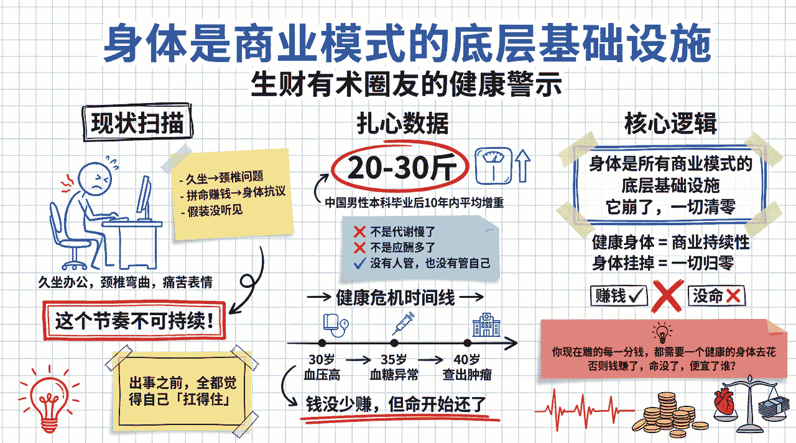

**生**财有术当中不乏会赚钱的人，而且很多，但是好多人没有把身体搞好，到了中年时期，久坐的毛病，让自己颈椎出了问题，身体出来问题。

你拼了命在一条路上往前冲，身体在抗议，你假装没听见。你知道这个节奏不可持续，但你告诉自己「再撑一段」。你把所有的时间和精力都压注在「赚钱」这一件事上，把身体当成可以随意透支的工具。

然后有一天，身体给了你一个你完全没有准备好的答案。

先说一个扎心的数据：

中国男性本科毕业后 10 年内，平均增重 20～30 斤。

不是代谢慢了，不是应酬多了。是没有人管，也没有管自己。

有太多搞钱的圈友，30 岁开始血压高，35 岁血糖异常，40 岁查出肿瘤。钱没少赚，但命开始还了。更可怕的是什么？是这些人在出事之前，全都觉得自己「扛得住」。

这篇文章不是让你放弃搞钱。是想把我这两次深谈里学到的最核心的东西提炼出来，告诉你一个最底层的逻辑：

身体是所有商业模式的底层基础设施，它崩了，一切清零。

不管你多能赚钱，不管你的商业模式有多精妙，不管你的团队有多强——如果你的身体先挂掉了，一切归零。

> 💡 你现在赚的每一分钱，都需要一个健康的身体去花。否则钱赚了，命没了，便宜了谁？

---

## 第一部分：先破一个认知——你的预期寿命被严重低估了

所有具体方法之前，我要先做一件事：帮你重建一个关于「寿命」的基础认知。

因为我发现，很多人的健康决策之所以做不好，根本原因不是懒，而是底层认知就错了。

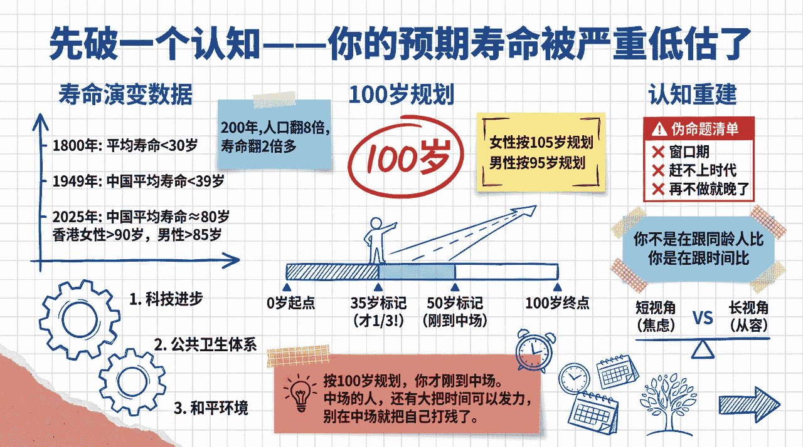

### 按 100 岁规划，你才刚到中场

**很多人潜意识里觉得，人活**个七八十岁就差不多了。这个认知已经严重过时了。

尹烨老师给了我一组数据：

1800 年，全球 10 亿人，平均寿命不到 30 岁。1949 年，中国平均预期寿命不到 39 岁。2025 年，中国平均寿命接近 80 岁。中国香港女性平均寿命已经超过 90 岁，男性超过 85 岁。

200 年，人口翻了 8 倍，平均寿命翻了 2 倍多。这背后的核心驱动力是三件事：科技进步、公共卫生体系的建立、和平环境。而这三件事，在接下来几十年大概率还会持续。

尹烨老师的推算非常直接：**我们这代人，应该按 100 岁来规划人生**。女性按 105 岁，男性按 95 岁。

你现在焦虑的那些「窗口期」「赶不上时代」「再不做就晚了」，很多都是伪命题。时间比你想象的多得多。

比如说你今年 35 岁，按 100 岁规划，你才过了三分之一。你在为一个三分之一节点没达标而焦虑，然后用整个身体去换这个焦虑的短暂缓解——这笔账不划算。

> 💡 你不是在跟同龄人比，你是在跟时间比。按 100 岁规划，你才刚到中场。中场的人，还有大把时间可以发力，别在中场就把自己打残了。

## 第二部分：搞钱的人最容易犯的 7 个健康错误

总结了一下搞钱的人在健康上最常犯的 7 个错误。它们有一个共同特征：

都是「看起来没问题」，但在慢慢消耗你的生命资本。

### 错误一：把身体当汽车管，而不是当生态系统管

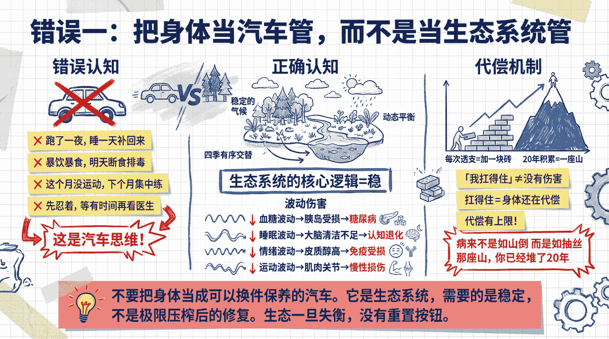

这是所有错误里最根本的一个，因为它是其他所有错误的认知根源。

汽车可以换零件。发动机坏了换发动机，轮胎磨损了换四条新的，油箱空了加满继续跑，今天没时间保养，下周补上就行。

很多人对自己的身体，用的就是这套逻辑：

跑了一夜，睡一天补回来。暴饮暴食了，明天断食排毒。这个月没运动，下个月集中练回来。感觉身体有点不对，先忍着，等有时间了再看医生。

**但人体根本不是这样运作的。**

人体是一个生态系统。生态系统不像汽车，它没有「换零件**」**这个选项。它的核心运作逻辑只有一个字：稳。

你见过一片健康的森林是什么样的吗？不是今天狂风暴雨、明天烈日暴晒、后天大雪——那样的森林活不长。健康的森林，是气候相对稳定，四季有序交替，整个系统处于动态的、可持续的平衡状态。人体也是如此。

你**不能**今天暴饮暴食，明天饿两天排毒。不能连续熬夜，然后周末补觉。不能三个月不运动，突然某天激情大发跑马拉松。这些行为，本质是制造波动。

波动对身体的伤害，比你想象的严重得多：

血糖波动，让胰岛反复应激，久而久之胰岛功能受损，糖尿病风险飙升。

睡眠波动，让大脑无法完成深度清洁，认知功能加速退化。

情绪波动，让皮质醇长期偏高，免疫系统持续受损。

运动波动，让肌肉和关节反复受到冲击而没有足够的恢复时间，形成慢性损伤。

很多搞钱的人喜欢说「我扛得住」。**扛得**住不代表没有伤害，只代表你的身体还在代偿。代偿有上限，一旦触顶，就是所谓的「病来如山倒」。

但病来从来不是如山倒，而是**如抽丝**。那座山，你已经默默堆了 20 年。每一次忽视睡眠、每一次暴饮暴食、每一次透支身体，都是在给那座山加一块砖。

只不过每次身体发出早期信号，你都选择忽视了——「没事，就是最近太累了」「睡一觉就好了」「等这个项目做完了再说」。

直到有一天，身体不再给你机会说「等一下」了。

搞钱的人对待身体，往往是这样——把「扛住」当成唯一的选项，直到系统崩溃才发现，其实一直有更聪明的走法。

> 💡 不要把身体当成一辆可以换件保养的汽车。它是一个生态系统，生态需要的是稳定，不是极限压榨后的修复。生态一旦失衡，没有重置按钮。

---

### 错误二：睡眠骆驼——平时透支，周末补觉

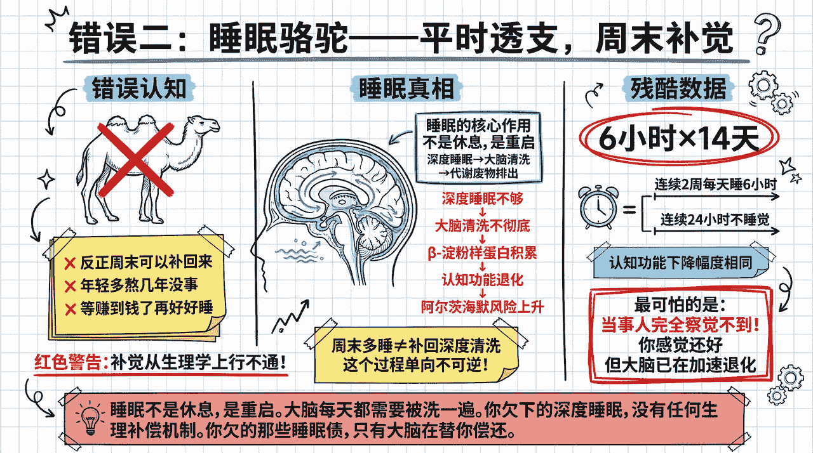

这是搞钱圈最流行的错误之一，几乎人人都在犯，而且人人都觉得自己没问题。

「反正周末可以补回来。」「年轻的时候多熬几年没事，等赚到钱了再好好睡。」

这两句话，每一句都是错的。

补觉这件事，从生理学上就是行不通的。

睡眠的核心作用，不是休息，而是**重启**。更具体地说，是对大脑进行深度维护和清洗。

大脑有一套叫「脑脊液」的循环系统，专门在深度睡眠期间大量流动，把大脑白天运转产生的代谢废物冲洗干净，带走排出体外。

这些废物如果没有被及时清走，会在大脑**里慢慢积累。其**中最令人担忧的一种，叫做 β-淀粉样蛋白——这是阿尔茨海默症的核心病理特征之一。

逻辑链非常清晰：**深**度睡眠不够 → 大脑清洗不彻底 → β-淀粉样蛋白积累 → 认知功能加速退化 → 阿尔茨海默风险上升。

而且这个清洗过程有一个关键条件：必须是深度睡眠，浅睡眠是不够的。喝酒之后感觉睡得很沉，但那其实是浅睡眠，大脑根本没有得到有效清洗。

**你周末多睡**几个小时，并不能补回工作日缺少的深度清洗。这个过程是单向不可逆的。

还有一个数据非常残酷：连续两周每天睡 6 小时，认知功能的下降幅度，相当于连续 24 小时没睡觉。而最可怕的是，当事人完全察觉不到——他们会觉得「我还好，没什么影响」，但测试结果清楚地显示认知能力已经显著受损。

这就是睡眠剥夺的隐蔽性：你感觉还好，但你的大脑已经在以远超你想象的速度退化。

搞钱靠的是大脑。大脑每天都需要被「洗一遍」，你欠下的深度睡眠，没有任何生理补偿机制。

> 💡 睡眠不是休息，是重启。大脑每天都需要被洗一遍。你欠下的深度睡眠，没有任何生理补偿机制。别跟自己说「今晚补回来」，那只是安慰剂。你欠的那些睡眠债，只有大脑在替你偿还。

---

### 错误三：趁热吃、喝烫水——中国人最普遍的致癌习惯

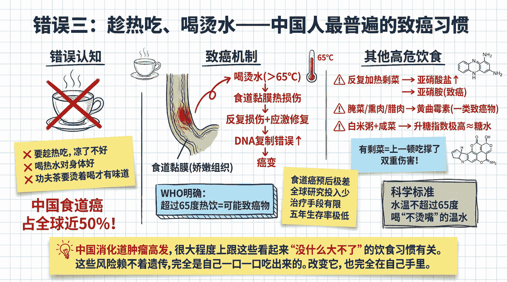

这是一个非常隐蔽、但伤害极深的习惯。而且它从小被当成「好习惯」在灌输。

「要趁热吃，凉了不好。」「喝热水对身体好。」「功夫茶要烫着喝才有味道。」

真相是：**中国食道癌占全球将近一半。**

原理很简单：食道黏膜极为娇嫩，对温度非常敏感。每喝一口烫水，食道黏膜就受到热损伤。一次不算什么，但日复一年地损伤下去，黏膜在反复损伤、应激修复、再损伤的循环中，DNA 复制错误概率越来越高，最终癌变。

世界卫生组织已经明确将超过 65 度的热饮列为「可能致癌物」。

科学标准极其简单：水温不超过 65 度，喝「不烫嘴」的温水就好。

食道癌有一个特别残酷的地方：**预后极差。** 因为全世界大部分国家的人不得这个病，所以全球在食道癌研究上的投入极少，治疗手段非常有限。一旦查出来，往往已经中晚期，五年生存率极低。

类似的高危饮食习惯还有很多。

反复加热的剩菜，尤其是绿叶蔬菜，反复加热后亚硝酸盐含量会显著上升。亚硝酸盐在体内可转化为亚硝胺，是明确的致癌物。这不是「可能」，是「明确」。

腌菜、熏肉、腊肉，往往含有大量黄曲霉素或亚硝酸盐。黄曲霉素是迄今发现毒性最强的天然化合物之一，也是明确的一类致癌物，主要攻击肝脏。

白米粥加咸菜，很多人觉得「清淡养胃」，但这个组合营养密度极低、升糖指数极高。白粥的升糖指数比白米饭还高，喝一碗白粥，血糖反应几乎等同于喝一碗糖水。

还有一个很多人没想到的逻辑：如果你有剩菜，说明你上一顿吃撑了。 剩菜不仅有亚硝酸盐风险，还意味着你的上一顿摄入量已经超标——这是双重伤害。

> 💡 中国消化道肿瘤高发，很大程度上跟这些看起来「没什么大不了」的饮食习惯有关。这些风险赖不着遗传，完全是自己一口一口吃出来的。改变它，也完全在自己手里。

---

### 错误四：血糖管理缺失，把糖尿病当成老年病

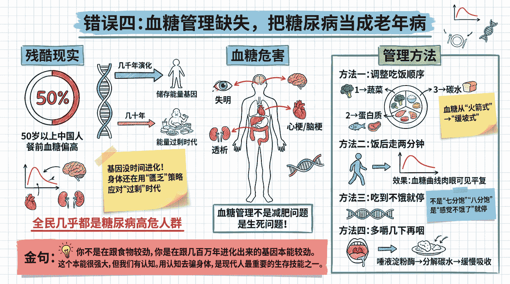

很多人觉得糖尿病是老年病，和自己没关系。

**这个认知大错特错。**

50 岁以上的中国人，有 50% 餐前血糖偏高。

为什么中国人普遍血糖高？这里有一个非常重要的生物学背景。

我们的基因，是在几千年演化过程中形成的。在绝大部分人类历史里，食物是稀缺的。我们的基因非常擅长一件事：在食物充足的时候，尽可能多地储存能量，以备不时之需。

3 年自然灾害结束才多少年？上世纪 80 年代，中国大部分普通家庭还在为吃饱发愁。然后突然，就这么几十年，我们进入了能量过剩的时代。

基因没有时间进化，我们的身体还在用「食物匮乏」时代的代谢策略，来应对「能量过剩」时代的饮食结构。

结果就是：全民几乎都是糖尿病高危人群，但大多数人完全没有意识到这一点。

血糖管理不是减肥问题，而是**生死问题**。长期血糖偏高，会慢慢损伤全身的血管和神经。损伤眼睛的血管，导致失明；损伤肾脏，导致透析；损伤心脑血管，就是心梗和脑梗。

好消息是，血糖完全可以靠习惯来管理，几乎不花钱。

第一，调整吃饭顺序。先吃蔬菜，再吃蛋白质，最后才吃碳水化合物。 不是让你少吃碳水，而是让你最后吃。先吃蔬菜和蛋白质，让胃里先有东西，之后吃碳水时吸收速度会显著变慢，血糖从「火箭式上冲」变成「缓坡式上升」，胰岛的工作压力大幅降低。

**第二，饭后走两分钟。** 研究证明，吃完饭之后起身走两分钟，血糖曲线肉眼可见地平复。吃完饭就躺下，胰岛会把多余血糖全部转化成脂肪储存；吃完走一走，肌肉开始消耗能量，血糖自然下降。成本为零，效果立竿见影。

**第三，学会「吃到不饿就停」。** 不是模糊的「七分饱」「八分饱」，而是一个非常具体的标准：感觉到「不饿了」，就立刻放下筷子。食物进入胃里到大脑接收到「饱」的信号，需要 15 到 20 分钟。吃得太快，大脑还没来得及说「够了」，胃里已经装了太多东西。

**第四，多嚼几下再咽。** 唾液淀粉酶会在咀嚼过程中开始分解碳水化合物，更充分的咀嚼意味着更缓慢、更均匀的消化吸收。每口多嚼几下，不花一分钱，但血糖管理效果是真实的。

> 💡 你不是在跟食物较劲，你是在跟几百万年进化出来的基因本能较劲。这个本能很强大，但我们有认知。用认知去骗身体，是现代人最重要的生存技能之一。

---

### 错误五：用多巴胺恢复精力，而不是用内啡肽

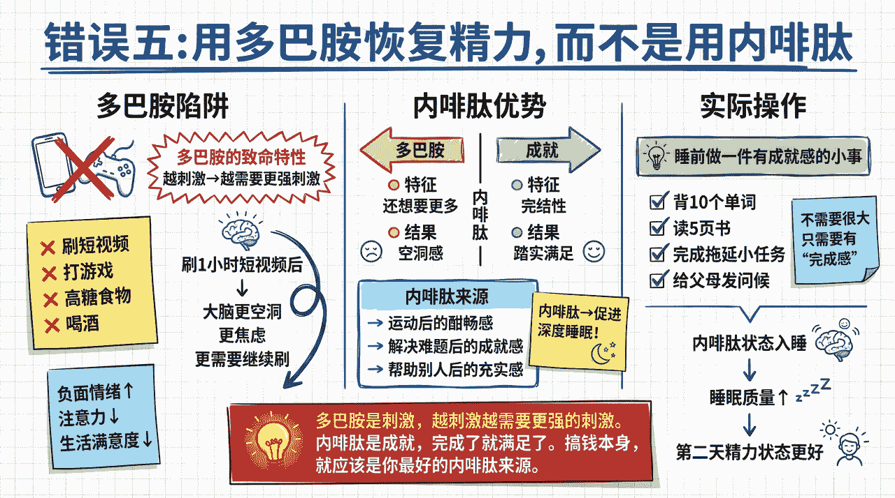

这是很多人最常见、也最隐蔽的能量管理错误。

很多人下班之后精力枯竭，用刷短视频、打**游戏、高糖**食物、喝酒来「恢复」。这些都是多巴胺刺激。

多巴胺有一个致命特性：**越刺激，越需要更强的刺激。** 刷完一小时短视频，你的大脑不会觉得充了电，只会更空洞、更焦虑、更需要继续刷。这不是意志力问题，这是神经机制决定的，和成瘾是同一回事。

大量研究表明，过量刷短视频之后，人们报告的负面情绪增加了，注意力集中能力显著下降了，对现实生活的满意度降低了。

**内啡肽完全不同。**

内啡肽是大脑在完成某件有意义的事情之后分泌的激素。运动后的酣畅感、解决难题后的成就感、帮助别人后的充实感——这些都是内啡肽在起作用。

**内啡肽**有**一个多巴胺完全不具备的**特质：完结性。它让你感觉「这件事我做完了，可以放下了」，是一种真实的、踏实的满足，而不是「还想要更多」的空洞感。而且内啡肽还有一个极其重要的作用：它会显著促进深度睡眠。

如果你每天晚上靠多巴胺「恢复」，你的动力系统是在慢慢被消耗，而不是在充电。

一个实际操作：睡前做一件有成就感的小事。

背 10 个单词，读 5 页书，完成一个拖延已久的小任务，给父母发一条问候……不需要很大，只需要有「完成感」。这会让你的大脑在入睡前处于内啡肽状态，而不是多巴胺的虚假亢奋状态。睡眠质量会显著提升，第二天的精力状态也会更好。

> 💡 多巴胺是刺激，越刺激越需要更强的刺激。内啡肽是成就，完成了就满足了。搞钱本身，就应该是你最好的内啡肽来源。如果搞钱已经不能给你带来内啡肽了，那这是一个需要重新审视方向的信号。

---

### 错误六：把运动当成补偿而不是习惯

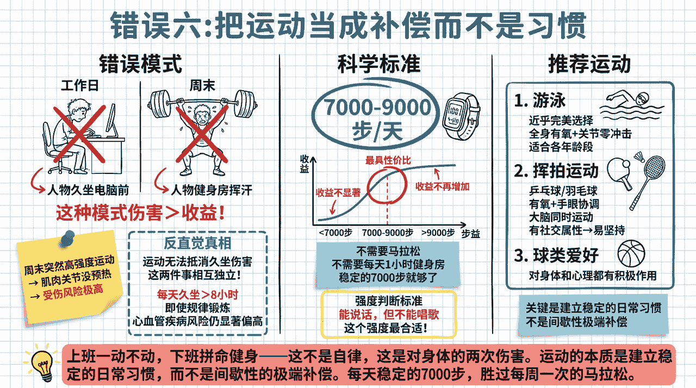

「工作日一动不动，周末健身房挥汗如雨。」

这种模式，对身体的伤害大于收益。周末突然高强度运动，肌肉和关节根本没有预热，受伤风险极高。

而且有一个研究结论很多人不知道：运动无法抵消久坐带来的伤害，这两件事是相互独立的。

你不能因为每天跑 5 公里，就觉得可以安心坐上 10 小时。研究显示，每天久坐超过 8 小时的人，即使坚持有规律锻炼，患心血管疾病的风险依然显著偏高。

科学标准非常简单，不需要马拉松，不需要每天一小时健身房：每天稳定地走 7000 到 9000 步就够了。

低于 7000 步，健康收益不显著；高于 9000 步，收益不会继续增加。这个区间是最具性价比的运动量。

判断有氧运动强度的最简单标准：**能说话，但不能唱歌。** 这个强度下，心肺得到充分锻炼，又不会过度损耗身体。

最值得推荐的几种运动：游泳是近乎完美的选择，全身有氧，关节完全不受冲击，适合各年龄段。

挥拍运动比如乒乓球、羽毛球，不仅有氧，还需要手眼协调，大脑也在同时运动，而且有社交属性，容易长期坚持。

我比较喜欢打羽毛球和篮球，有个球类爱好对身体和心理都有很好的积极作用。

> 💡 上班一动不动，下班拼命健身——这不是自律，这是对身体的两次伤害。运动的本质是建立稳定的日常习惯，而不是间歇性的极端补偿。每天稳定的 7000 步，胜过每周一次的马拉松。

---

### 错误七：把压力全部内化，忽视情绪管理

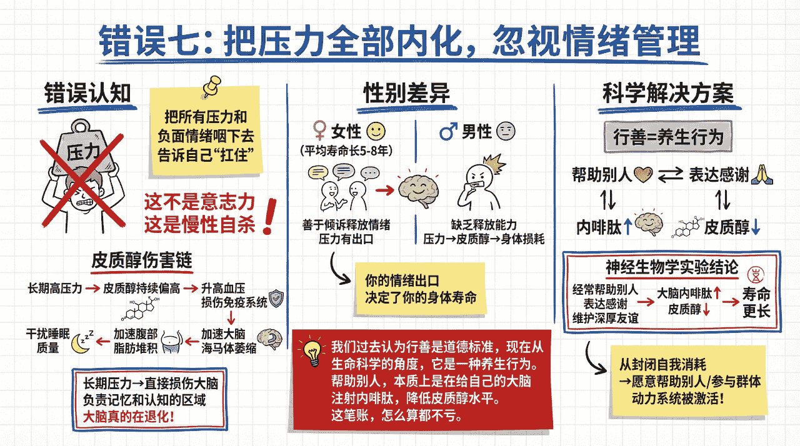

搞钱的人有一个极其普遍的特征：把所有的压力和负面情绪咽下去，告诉自己「扛住」。

这不是意志力，这是慢性自杀。

长**期高压力状态会导致**皮质醇持续偏高，进而升高血压、损伤免疫系统、干扰睡眠质量、加速腹部脂肪堆积，以及——加速大脑海马体萎缩。

最后那一条需要特别强调：长期压力，会直接损伤大脑负责记忆和认知的区域。这不是「累了」，这是大脑真的在退化。

女性平均寿命比男性长 5 到 8 年，原因之一是：女性更善于通过倾诉来释放情绪，压力有出口。

男性普遍缺乏这个能力，压力全部转化成了皮质醇，皮质醇全部转化成了身体损耗。

这里有一个被科学验证的反直觉事实：行善，会触发内啡肽分泌，而且是双向的。

当你帮助了别人，对方表达了感谢，你们双方的大脑里都会产生正向激素。

这不是玄学，这是神经生物学的实验结论。经常帮助别人、表达感谢、维护深厚友谊的人，大脑内的内啡肽水平更高，皮质醇水平更低，寿命更长。

当一个人从封闭的、自我消耗的状态，转变到「我愿意帮助别人、我愿意参与群体」的状态时——「那个动力系统就被激活了。」

你的情绪出口，决定了你的身体寿命。

> 💡 我们过去认为行善是道德标准，现在从生命科学的角度，它是一种养生行为。帮助别人，本质上是在给自己的大脑注射内啡肽，降低皮质醇水平。这笔账，怎么算都不亏。

---

## 第三部分：搞钱的人，这 6 件事必须放进日程表里

上面讲了七个错误，都是要「避免」的。现在说六件「必须做」的事。

我把它们定义为：**你商业模式的底层维护清单。**

就像你会定期给服务器做备份、给代码做审查、给财务做对账——你的身体，需要同样认真地去维护。

---

### 第一件事：体检——重点查这几项，别乱花钱

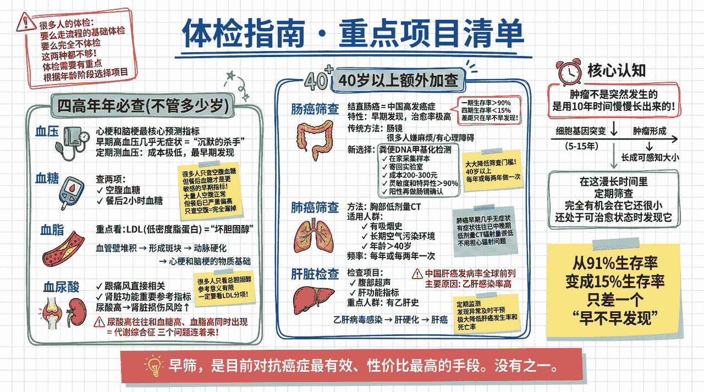

很多人的体检，要么是公司安排的那种走流程的基础体检，要么是完全不体检。这两种都不够。

体检需要有重点，而且需要根据年龄阶段来选择项目。

关于四高：血压、血糖、血脂、血尿酸，这四项年年必查，不管你多少岁。

血压是心梗和脑梗最核心的预测指标之一。很多人血压高了自己不知道，因为早期高血压几乎没有症状——有人把它叫做「沉默的杀手」。定期测血压，成本极低，但可以在最早期发现问题。

血糖要查两项：空腹血糖和餐后两小时血糖。很多人只查空腹血糖，但餐后血糖才是更敏感的早期指标。有大量的人空腹血糖正常，但餐后血糖已经严重偏高——这种情况如果只查空腹血糖，就完全漏掉了。

血脂要重点看低密度脂蛋白，也就是 LDL，俗称「坏胆固醇」。它在血管壁里堆积，最终形成斑块，导致动脉硬化，是心梗和脑梗的物质基础。很多人只看总胆固醇，那个数字的参考意义相对有限，一定要看 LDL 这个分项。

血尿酸跟痛风直接相关，同时也是肾脏功能的重要参考指标。尿酸高的人，肾脏损伤的风险显著升高。而且尿酸高往往和血糖高、血脂高同时出现，是代谢综合征的组成部分，三个问题往往是连着来的。

40 岁以上，还需要额外加查几个项目。

第一个是**肠癌筛查**。结直肠癌是中国发病率很高的一种癌症，但它有一个非常好的特性：早期发现，治愈率极高。一期结直肠癌的五年生存率超过 90%，而四期只有不到 15%。这个差距，只靠早不早发现来决定。

传统的肠癌筛查是肠镜，很多人嫌麻烦或者有心理障碍。现在有了新的选择：粪便 DNA 甲基化检测，在家里采集样本，寄回实验室，成本只需要两三百元，灵敏度和特异性都超过 90%。如果结果阳性，再去做肠镜确认。这大大降低了筛查门槛。40 岁以上的人，这个检查每年或每两年做一次非常值得。

第二个是**肺癌筛查**，通过胸部低剂量 CT 来做。有吸烟史的人、长期处于空气污染环境的人，以及年龄超过 40 岁的人，都建议每年或每两年做一次。肺癌早期几乎没有症状，一旦有了症状往往已经是中晚期。低剂量 CT 的辐射量很低，不用担心辐射问题。

第三个是**肝脏检查**，包括腹部超声和肝功能指标。有乙肝史的人尤其需要定期检查。中国的肝癌发病率在全球名列前茅，主要原因之一是乙肝感染率高。乙肝病毒感染可以导致肝硬化，肝硬化进一步发展可以变成肝癌。定期监测，发现异常及时干预，可以极大降低肝癌的发生率和死亡率。

这里有一个认知非常重要，必须单独说出来：肿瘤不是突然发生的，是用 10 年时间慢慢长出来的。

从最初的细胞基因突变，到肿瘤形成，再到长成可以被感知到的大小，往往需要 5 到 15 年。在这漫长的时间里，如果你定期筛查，完全有机会在它还很小、还处于可治愈状态的时候发现它。

从 91% 的生存率变成 15% 的生存率，只差一个「早不早发现」。

早筛，是目前对抗癌症最有效、性价比最高的手段。没有之一。

---

### 第二件事：每 50 分钟站起来 5 分钟

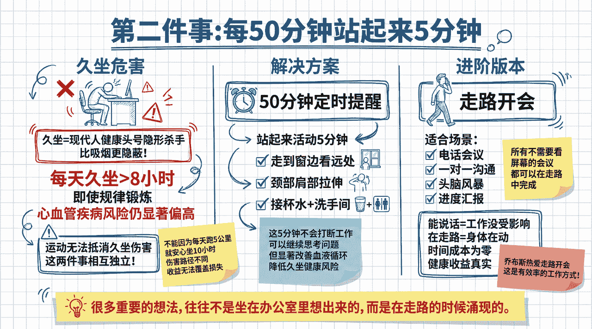

久坐，是现代人健康的头号隐形杀手。比吸烟更隐蔽，因为没有人把它当成一个危险行为。

研究数据非常清楚：每天久坐超过 8 小时的人，即使坚持有规律的体育锻炼，患心血管疾病的风险依然显著高于不久坐的人。

这里有一个让很多人惊讶的结论：运动无法抵消久坐带来的伤害，这两件事是相互独立的。 你不能因为每天跑 5 公里，就觉得可以安心坐上 10 小时。这两件事的伤害路径不同，一件事的收益无法覆盖另一件事的损失。

那怎么办？非常简单：设置一个 50 分钟的定时提醒，每次提醒响了，站起来活动 5 分钟。

这 5 分钟做什么都行：走到窗边看看远处，让眼睛放松一下；做几个颈部和肩部的拉伸，放松长时间低头带来的颈椎压力；走去接一杯水，顺便去趟洗手间。

这 5 分钟不会打断你的工作状态。你甚至可以在脑子里继续思考刚才的问题。但它会显著改善你的血液循环，让全身的代谢维持在一个相对活跃的状态，大幅降低久坐带来的健康风险。

进阶版本：**把会议改成走路开会。**

电话会议、一对一沟通、头脑风暴会议、进度汇报……所有不需要看屏幕的会议，都可以在走路中完成。你能说话，说明工作没有受影响。你在走路，说明身体在动。两件事同时完成，时间成本为零，但健康收益是真实的。

而且人在走路时，大脑会进入一种放松而活跃的特殊状态。苹果的乔布斯非常热爱走路开会，这不是怪癖，这是有效率的工作方式。

很多重要的想法，往往不是坐在办公室里想出来的，而是在走路的时候涌现的。

---

### 第三件事：大脑抗衰——学一种乐器

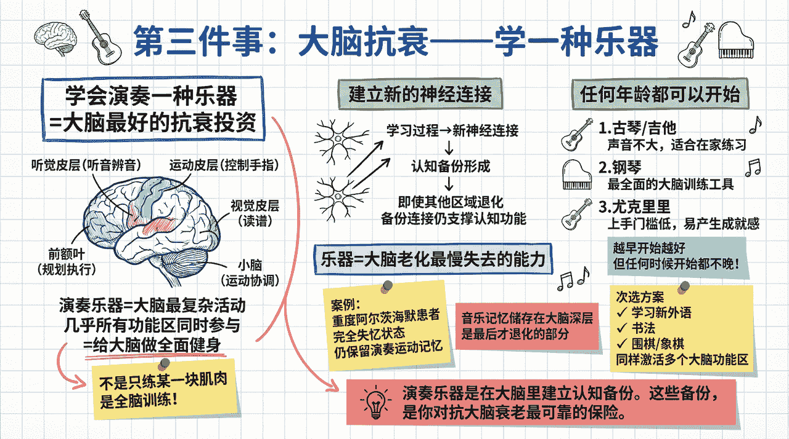

这是所有大脑训练方式中，证据最充分、长期效果最持久的一种。

先说结论：学会演奏一种乐器，是你能为大脑做的最好的抗衰投资。

为什么是乐器，而不是其他？

演奏乐器是大脑有史以来参与的最复杂的活动之一。它同时需要调动大脑的听觉皮层（听音辨音）、运动皮层（控制手指动作）、视觉皮层（读谱）、前额叶（规划和执行）、小脑（运动协调）……几乎所有你能叫得出名字的大脑功能区，都在同时参与工作。这相当于给大脑做全面的健身训练，而不是只练某一块肌肉。

更关键的是，学习乐器的过程，本质上是在大脑里建立新的神经连接。这些新的神经连接不仅让演奏水平提高，还形成了认知备份——即使大脑其他区域开始退化，这些备份连接仍然可以支撑认知功能。

这就是为什么乐器是大脑老化最慢失去的能力之一。有大量案例记录：重度阿尔茨海默症患者，很多方面已经严重退化，但在听到自己熟悉的乐曲时，会有明显的反应；有些患者甚至在完全失忆的状态下，仍然保留了演奏乐器的运动记忆。

电影《寻梦环游记》里有一个非常动人的情节：已经严重失忆的曾曾祖母，在听到那首熟悉的旋律时，奇迹般地想起了一切。这不只是艺术创作，这是根据真实的脑科学规律写出来的——音乐记忆储存在大脑的深层结构，是最后才退化的部分。

任何年龄都可以开始学乐器。越早开始越好，但任何时候开始都不晚。

具体推荐：古琴和吉他声音相对不大，适合在家练习，不会影响邻居；钢琴是最全面的大脑训练工具，有条件的话非常值得学；尤克里里上手门槛较低，容易产生成就感，适合作为入门选择。

如果实在没有时间或者条件学乐器，次选方案是学习一门新的外语，或者需要高度专注的手工技艺，比如书法、围棋、象棋。这些同样会激活大脑的多个功能区，对认知能力有很好的保持作用。

---

### 第四件事：吃饭的顺序比吃什么更重要

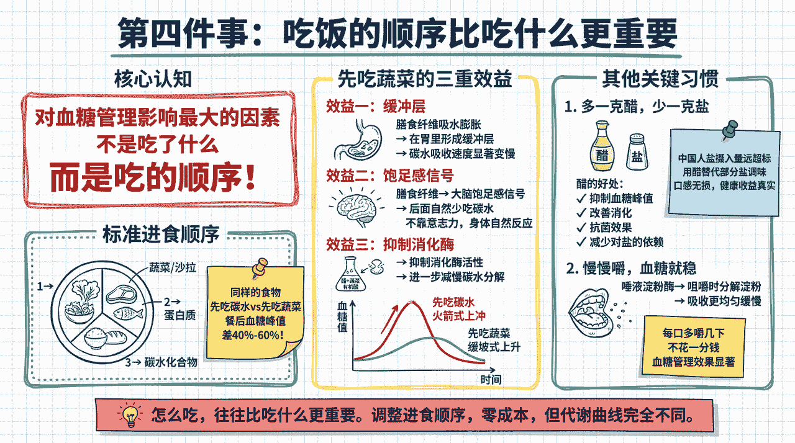

大多数人在「吃什么」上花了大量精力，研究什么食物好、什么不能吃、什么要少吃。

但「怎么吃」往往被完全忽视了。

有一个研究结论改变了很多人对饮食的认知：对血糖管理影响最大的因素，不是吃了什么，而是吃的顺序。

标准的血糖友好型进食顺序是：蔬菜或沙拉先吃，其次是蛋白质，最后才吃碳水化合物。

先吃蔬菜有三重生理效益。

第一，蔬菜富含膳食纤维，膳食纤维进入胃部之后会吸水膨胀，在胃里形成一层「缓冲层」。后续进入的碳水化合物，要穿过这层缓冲层才能到达小肠被吸收，速度会显著变慢。

第二，膳食纤维本身会给大脑发送「饱足感」的信号，让你在后面吃碳水的时候，自然而然地少吃一些。不是靠意志力控制，而是身体自然地发出了「差不多了」的信号。

第三，油醋汁中的醋，以及蔬菜本身的有机酸，会抑制消化酶的活性，进一步减慢碳水化合物的分解速度。

有研究显示，同样的食物，先吃碳水和先吃蔬菜，餐后血糖峰值可以差 40% 到 60%。这不是一个小差距，这是完全不同的两条代谢曲线。

多一克醋，少一克盐，这两个习惯非常值得养成。醋的好处是多方面的：抑制血糖峰值、改善消化、有一定的抗菌效果。而且醋能让食物更有味道，减少对盐的依赖。盐摄入过多是高血压最直接的诱因之一，中国人的平均盐摄入量远超世卫组织的推荐标准。用醋替代部分盐来调味，几乎没有口感上的损失，但健康收益是真实的。

**还有一个非常简单但很多人**没有意识到的细节：慢慢嚼，血糖就会稳一点。 唾液里含有淀粉酶，会在咀嚼过程中开始分解淀粉。更充分的咀嚼，意味着淀粉在到达小肠之前已经被部分分解，吸收速度更均匀和缓慢。每口饭多嚼几下，听起来微不足道，但如果每天每顿饭都这么做，积累起来对血糖管理的贡献是相当显著的。

---

### 第五件事：睡眠优化清单——不花钱就能做到的改变

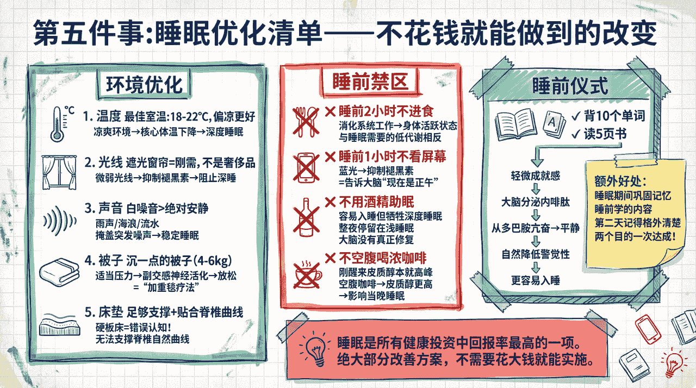

睡眠是所有健康投资中回报率最高的一项。

但绝大部分人的睡眠环境，都存在可以立即改善的问题。以下是经过研究验证、不需要花大钱就能实施的改善方案。

关于温度：最有利于深度睡眠的室温，是 18 到 22 度之间，偏凉一些更好。人体在睡眠过程中，核心体温会自然下降——凉爽的环境有助于这个过程，过于温暖的环境反而会阻碍进入深度睡眠。很多人夏天空调设置得太高，冬天暖气太足，都会影响睡眠质量。

关于光线：遮光窗帘是刚需，不是奢侈品。即使非常微弱的光线，也会通过视神经影响大脑中的松果体，抑制褪黑素的分泌，让大脑误以为「现在是白天」，从而阻止进入深度睡眠。如果你住的地方有路灯或者广告牌的光，强烈建议买一副质量好的遮光窗帘。

关于声音：很多人以为睡觉需要绝对安静，但研究发现，白噪音对睡眠往往比绝对安静更好。白噪音，是指那种稳定的、没有明显节律变化的背景声，比如雨声、海浪声、风声、轻柔的流水声。它的作用是把环境中突发的噪声给「掩盖」掉，让大脑不需要对每一个噪声刺激做出应激反应，从而进入更稳定的睡眠状态。

关于被子：这个很多人不知道——沉一点的被子，能显著改善睡眠质量。重量在 4 到 6 公斤的被子，比轻薄的被子有更好的睡眠促进效果。原理类似于安抚婴儿的「包裹感」：适当的压力刺激皮肤里的感觉受体，触发副交感神经系统的活化，让身体进入更放松的状态。这在临床上被称为「加重毯疗法」，在焦虑症和睡眠障碍的辅助治疗中已经被广泛使用。

关于床垫：一定要有足够的支撑性。很多人觉得睡硬板床对脊椎好，这是一个流传很广的错误认知。脊椎是有自然曲线的，硬板床无法提供符合脊椎自然曲线的支撑，长期睡下去会导致腰部和颈部的应力集中，反而加速椎间盘磨损。好的床垫，是那种既有足够支撑性、又能贴合脊椎自然曲线的床垫。

**睡前的几个禁区，必须认真对待：**

睡前两小时不进食。消化系统工作时，会让身体保持在一种相对活跃的状态，这和睡眠所需要的「低代谢」状态是相反的。而且胃里有食物平躺时，胃酸更容易反流，直接影响睡眠质量。

睡前一小时不看手机或电脑屏幕。屏幕发出的蓝光，会抑制大脑中褪黑素的分泌。褪黑素是引导睡眠的激素，手机屏幕的蓝光在物理效果上相当于告诉你的大脑「现在是正午」，然后让你尝试去睡觉——两件事直接矛盾。

不要用酒精助眠。很多人觉得喝酒之后更容易入睡，这是事实，但这个「容易入睡」是以牺牲深度睡眠为代价的。酒精会显著压缩深度睡眠的比例，让你整夜停留在浅睡眠状态。喝酒之后你感觉睡着了，但大脑并没有得到真正的修复和清洗。

不要空腹喝浓咖啡。刚醒来的时候，体内皮质醇水平本来就处于全天的高峰。空腹浓咖啡会进一步拉高皮质醇水平，导致一整天的皮质醇都偏高，影响当天下午和当晚的睡眠质量。可以喝咖啡，但要吃一点东西之后再喝，而且量不要太大。

**最后再强调那个睡前的小操作：**

放下手机之后，背 10 个单词，或者读 5 页书。既能产生轻微的成就感，让大脑分泌内啡肽，帮助你从多巴胺的亢奋状态过渡到平静；又能让大脑自然地降低警觉性，比刷手机更容易引导入睡。

还有一个额外好处：大脑在睡眠期间会巩固当天的记忆，睡前学的内容，会在睡眠中被加强记忆，第二天往往记得格外清楚。两个目的一次达成。

---

### 第六件事：关于「昂贵的抗衰」——大部分是智商税

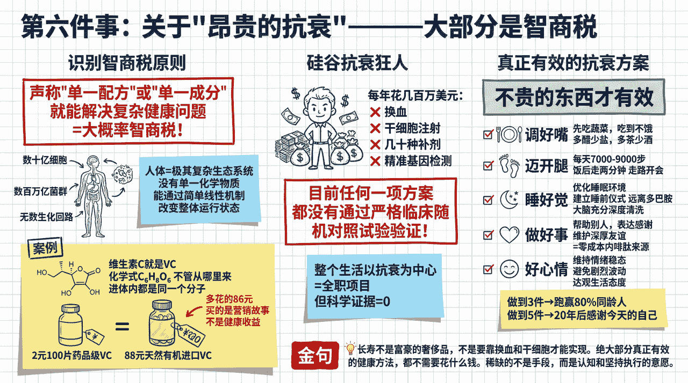

这几年，「抗衰老」变成了一个非常火热的话题，尤其是在搞钱圈。

硅谷那个著名的抗衰狂人，每年花几百万美元在自己身上：换血、干细胞注射、几十种补剂、精准基因检测……他的整个生活，几乎就是以抗衰为中心的全职项目。

目前，他的任何一项「抗衰方案」都没有通过严格的临床随机对照试验验证。

识别健康智商税，有一个非常简单可靠的原则：

**但凡声称「单一配方」或「单一成分」就**能解决复杂健康问题的，大概率都是智商税。

人体是一个极其复杂的生态系统，有数十亿个细胞，数百万亿个菌群，无数个相互依存、相互调节的生化回路。没有任何单一的化学物质，可以通过一个简单的线性机制，改变这个系统的整体运行状态。

举一个最简单的例子。

维生素 C（VC），是一个非常普遍的保健品。很多人愿意花几十甚至上百元买「天然 VC」「进口 VC」「有机 VC」。

但 VC 就是 VC。它是一个化学式为 C₆H₈O₆ 的分子，不管它是从橙子里提取的，还是玉米淀粉发酵合成的，还是实验室里直接合成的，到了你体内，它都是同一个分子，发挥同样的生理作用。

两块钱 100 片的药品级维生素 C，和 88 元一瓶的「天然有机进口 VC」，进到你的身体里之后，完全没有区别。你多花的那 86 块钱，买的是营销故事、包装设计、品牌溢价，不是额外的健康收益。

当然，这里有一个合理的例外：如果某种产品安全性没问题，你服用它能产生安慰剂效应，让你感觉更好、更积极、更有动力去保持健康生活方式——安慰剂效应是真实的心理和生理机制，它的效果在科学上是被承认的。但这不是说「随意相信任何东西」，而是说：在安全的前提下，心理作用是有价值的。前提是别依赖它替代真正的健康习惯。

真正有效的抗衰方案，恰恰是那些不贵的东西：

调好嘴，就是上面讲的那些：先吃蔬菜，吃到不饿，多醋少盐，多茶少酒。这几条不需要花什么钱，但对代谢健康的影响是实实在在的。

迈开腿，就是每天 7000 到 9000 步，饭后走两分钟，把会议改成走路开会。同样几乎不花钱，但效果有大量研究支撑。

睡好觉，就是上面讲的那些：优化睡眠环境，建立睡前仪式，远离多巴胺，让大脑每天得到充分的深度清洗。

做好事，就是把行善当成日常习惯。帮助别人，表达感谢，维护深厚的友谊。这是零成本的内啡肽来源，是有神经生物学机制支撑的长寿习惯。

好心情，就是学会维持情绪的稳态。不是要你永远快乐，而是避免剧烈的情绪波动，不以物喜，不以己悲，培养一种达观的生活态度。

做到这五件事里的三件，你已经跑赢了 80% 的同龄人。做到全部五件，20 年后的你，会感谢今天做出选择的自己。

> 💡 长寿不是富豪的奢侈品，不是要靠换血和干细胞才能实现的事。绝大部分真正有效的健康方法，都不需要花什么钱。稀缺的不是手段，而是认知和坚持执行的意愿。

---

## 第四部分：一天时间表——把健康嵌进搞钱的日程

很多人说「没时间」。

这是真正的问题所在：不是懒，而是真的不知道怎么把健康习惯嵌入一个已经非常满的工作日程里。

下面这个时间表，设计原则只有一个：把健康行为嵌入现有的日程，而不是另外开辟时间。

目标不是完美执行每一条，而是绝大多数时候稳定地执行其中 70%。70% 的稳定执行，比 100% 的完美计划然后放弃，要有效 100 倍。

### 早晨（6:00 ～ 8:00）

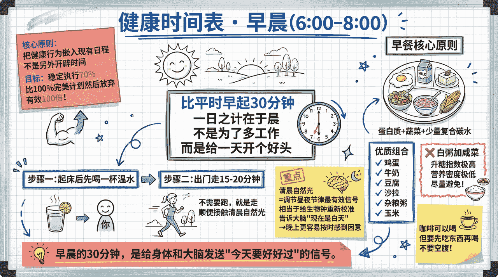

比平时早起 30 分钟。一日之计在于晨，这 30 分钟，不是为了多工作，而是为了给一天开一个好头。

起床之后，先喝一杯温水，然后出门走 15 到 20 分钟。不需要跑，就是走，顺便接触一下清晨的自然光。

清晨的自然光含有调节人体昼夜节律最有效的信号，接触它相当于在给你的生物钟重新校准——它会告诉你的大脑「现在是白天」，让你更容易在晚上按时感到困意。

早餐的核心原则：蛋白质加蔬菜加少量复合碳水化合物。鸡蛋、牛奶、豆腐、沙拉、杂粮粥或者一个玉米，都是很好的早餐组合。

白粥加咸菜这个组合，升糖指数极高，营养密度极低，尽量避免。

咖啡可以喝，但要先吃东西再喝，不要空腹。

### 工作期间（9:00 ～ 18:00）

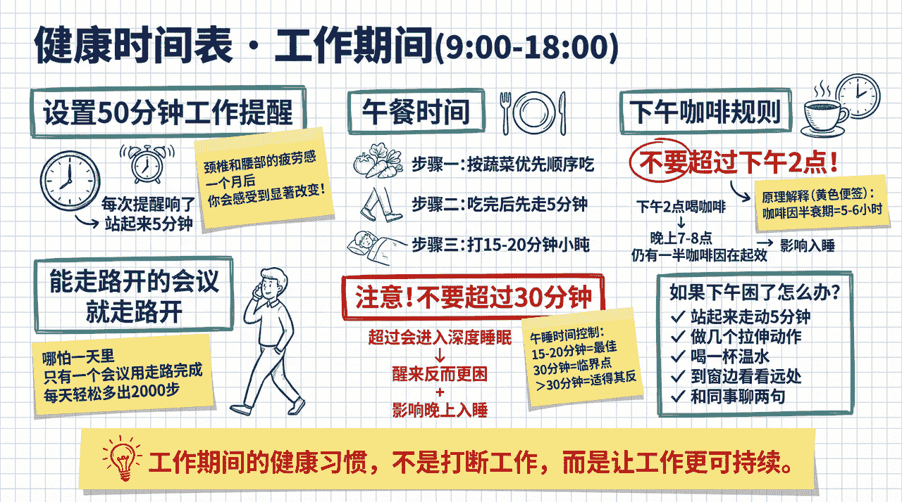

设置 50 分钟的工作提醒，每次提醒响了站起来 5 分钟。颈椎和腰部的疲劳感，一个月之后你会感受到显著改变。

能走路开的会议，就走路开。哪怕一天里只有一个会议用走路的方式完成，每天轻松多出 2000 步。

午餐按照蔬菜优先的顺序吃。吃完之后先走 5 分钟，再打 15 到 20 分钟的小盹。注意不要超过 30 分钟，超过会进入深度睡眠，醒来之后反而会感觉更困，而且会影响晚上的入睡。

下午如果想喝咖啡，不要超过下午两点。咖啡因的半衰期大约是 5 到 6 个小时，两点喝的咖啡，到晚上七八点仍然有一半的咖啡因在起效，会影响入睡。

### 傍晚（18:00 ～ 20:00）

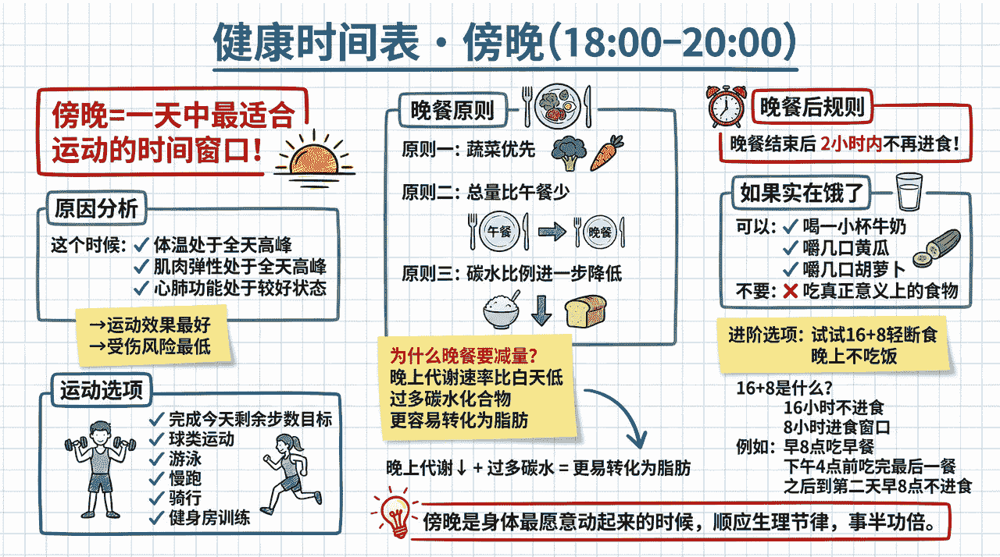

傍晚是一天中最适合运动的时间窗口。这个时候，体温和肌肉弹性都处于全天的高峰，心肺功能也处于较好的状态，运动效果最好，受伤风险最低。

完成今天剩余的步数目标，或者进行球类运动、游泳等。

晚餐遵循同样的蔬菜优先原则，总量比午餐少，碳水化合物的比例进一步降低。晚上的代谢速率比白天低，过多的碳水化合物更容易转化为脂肪。

晚餐结束之后，两小时内不再进食。如果实在有饥饿感，可以喝一小杯牛奶，或者嚼几口黄瓜胡萝卜，不要吃真正意义上的食物。

如果可以的话，也可以试试 16➕8，晚上不吃饭。

### 睡前（21:00 ～ 23:00）

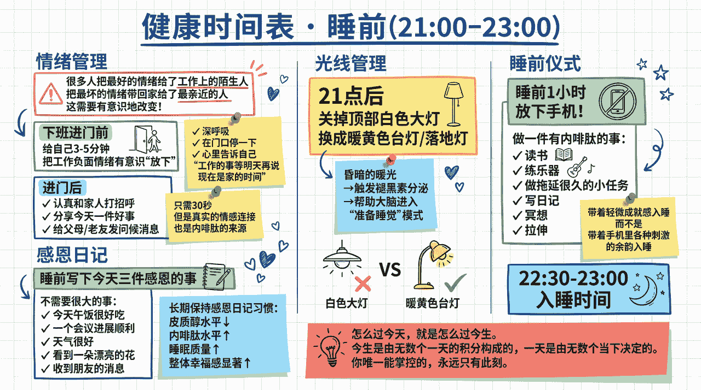

很多人把最好的情绪给了工作上的陌生人，把最坏的情绪带回家给了最亲近的人。这是一个需要有意识地去改变的习惯。

下班或者结束工作之后，在进门之前，给自己 3 到 5 分钟，把工作上的负面情绪有意识地「放下」。可以深呼吸，可以在门口停一下，可以在心里告诉自己「工作的事等明天再说，现在是家的时间」。

进门之后，认真地和家人打招呼，分享一件今天发生的好事。给父母或者老朋友发一条简短的问候消息。这件事只需要 30 秒，但对你和对方都是一个真实的情感连接，也是内啡肽的来源。

睡前写下今天的三件感恩的事。不需要很大的事，可以是今天的午饭很好吃，可以是一个会议进展顺利，可以是天气很好。研究显示，长期保持「感恩日记」习惯的人，皮质醇水平更低，内啡肽水平更高，睡眠质量更好，整体幸福感显著更高。

21 点之后，关掉顶部的白色大灯，换成暖黄色的台灯或者落地灯。昏暗的暖光会触发褪黑素的分泌，帮助大脑开始进入「准备睡觉」的模式。

睡前一小时，放下手机，做一件有内啡肽的事：读书、练乐器、做一个拖延很久的小任务……让自己带着轻微的成就感入睡，而不是带着手机里各种刺激的余韵入睡。

22:30 到 23:00 之间入睡。

> 💡 怎么过今天，就是怎么过今生。今生是由无数个一天的积分构成的，一天是由无数个当下决定的。你唯一能掌控的，永远只有此刻。

---

## 第五部分：用AI管理健康

### **让 AI 帮你设计一周饮食计划**

很多人知道应该「均衡饮食」，但不知道「均衡」具体是什么样的。

你可以把你的基本情况告诉 AI——身高、体重、年龄、性别、活动水平、健康目标（减重/维持/增肌），以及你的饮食偏好和忌口——然后让它帮你设计一个一周的饮食参考方案。

这个方案不需要严格执行，但它可以给你一个「锚点」，让你知道理想状态大概是什么样的，然后在现实生活里尽量往那个方向靠。

你可以这样问：

「我是 35 岁男性，身高 175cm，体重 82kg，每天工作基本坐着，偶尔走路。我希望在不节食的前提下，3 个月内减掉 8 斤左右。我不喜欢吃鱼，对坚果不过敏。请帮我设计一个简单可执行的一周饮食参考方案，要符合中国人的日常饮食习惯，不要太复杂。」

AI 会根据你的情况，给出一个具体的方案，包括每餐大概吃什么、各餐的热量分配、需要注意的饮食习惯调整。

### **用 AI 做睡前思维清空**

很多人睡不着的原因，是脑子里的事情太多，停不下来。

睡前花 5 分钟，把脑子里正在想的事情全部写出来，发给 AI，然后问它：「这些事情里，哪些是今晚可以不用想的？哪些是明天可以行动的？帮我把它们整理一下，让我知道今晚可以放心地关上这些事情。」

AI 会帮你把这些事情做一个简单的分类：哪些是明天的待办事项、哪些是不可控的不用操心、哪些是需要做一个决定的，以及哪些实际上没有你想象的那么紧急。

这个过程，有点像「大脑清空」——把所有在你脑子里占用内存的事情外化出来，交给一个「容器」保管，让你的大脑可以放心地「关机」进入睡眠状态。

很多习惯性失眠的人，用了这个方法之后，入睡速度有了明显的改善。

### **定期让 AI 做你的健康教练**

建议你建立一个固定的习惯：每周或者每两周，花 15 到 20 分钟，做一次「AI 健康教练」的对话。

在这个对话里，回顾上周的健康状态，诚实地告诉 AI 你做到了什么，没做到什么，遇到了什么障碍；然后让 AI 帮你分析原因，调整下周的计划，以及给你一些具体的、有针对性的建议。

把这个对话保存下来，作为你的健康日记。三个月之后，你回头看这些对话，会非常清楚地看到自己在哪些地方进步了，哪些地方还在原地打转，以及那些反复出现的障碍背后，是什么样的模式在起作用。

**这个方法的核心价值，不**是 AI 给你什么神奇的建议，而是定期审视自己的健康状态这件事本身。它强迫你每周至少认真思考一次自己的身体，而不是把健康这件事彻底丢到脑后，直到出了问题才想起来。

### 让 AI 根据你的实际情况设计运动方案

很多人的运动计划失败，是因为计划本身脱离实际——太复杂、太耗时、太依赖特定的场地和器械，导致稍微有一点变化就整个坚持不下去了。

你可以把你的真实情况告诉 AI，让它帮你设计一个能真正执行的运动方案：

「我是一个典型的久坐上班族，每天工作 10 小时左右，出行基本靠打车，没有健身房会员。我的目标不是减肥，只是希望身体更健康，不要因为久坐把身体坐垮。我每天大概只有 20 到 30 分钟可以用来运动，而且不能总是同一时间，有时候是早上，有时候是午休，有时候是晚上。请帮我设计一个不依赖特定场地和时间、每次 20 到 30 分钟、能长期坚持的运动方案。」

AI 会根据你的条件，设计一套真正可执行的方案。比如：不需要去健身房的简单力量训练、适合在家或者办公室做的拉伸、各种天气下都可以进行的有氧运动选项，以及在你时间紧张的日子里可以做的最精简版本。

### **用 AI 做情绪复盘**

每周选一个时间，比如周五晚上或者周日下午，花 10 到 15 分钟，把这一周里让你感到压力、焦虑、烦躁或者消沉的事情告诉 AI，让它帮你做一个情绪复盘。

你可以这样写：

「这周我感觉状态很差。周二一个重要的合作谈崩了，我情绪很低落，之后几天都没什么干劲。周四和一个合伙人发生了争执，觉得对方不理解我，很委屈。周五开始觉得有点焦虑，担心这个月的业绩完不成。你能帮我梳理一下这些情绪，分析一下可能的根源，以及给我一些具体的应对建议吗？」

AI 会帮你梳理这些情绪背后的可能原因，区分哪些是可以采取行动去改变的，哪些是需要接受的，并给出一些具体的应对方向。

这个过程，本质上是一种「写作疗愈」加「外部视角」的结合。你把情绪写出来，就已经减轻了一部分压力；AI 给你提供一个相对客观的视角，帮你跳出当局者迷的状态，看到一些你自己可能看不到的东西。

## 第六部分：写在最后——给搞钱的人说几句真心话

### 身体不是成本，是资产

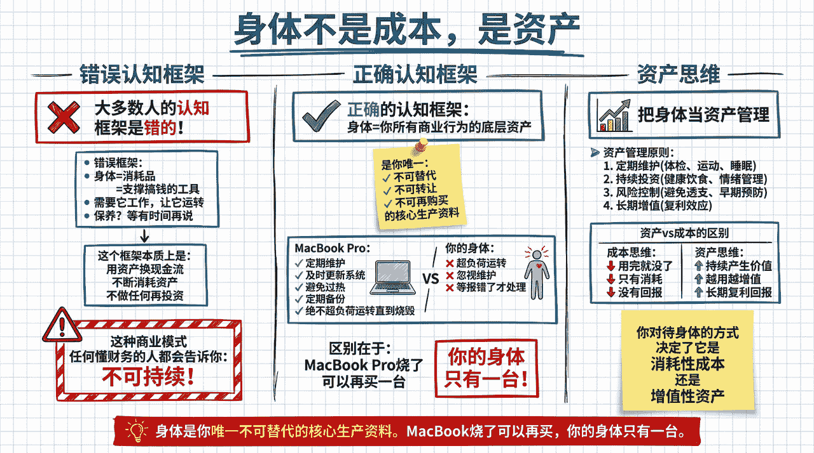

大多数人对待身体的认知框架都是错的。

最常见的认知框架是：身体是一个消耗品，是用来支撑我搞钱的工具。我需要它工作，所以要让它运转。至于保养，等有时间了再说。

**这个框架，本质上是在用资产换现金流**，而且是在不断消耗资产、不做任何再投资。

这种商业模式，任何一个懂财务的人都会告诉你：不可持续。

正确的认知框架应该是：**身体是你所有商业行为的底层资产，是你唯一不可替**代、不可转让、不可再购买的核心生产资料。

一台 MacBook Pro，你会定期维护，及时更新系统，避免过热，做定期备份，绝对不会让它超负荷运转直到烧毁。但很多人对自己的身体，做的恰恰是反过来的事：超负荷运转，忽视维护，等到报错了才想起来处理。

区别在于：MacBook Pro 烧了，可以再买一台。你的身体，只有一台。

---

### 健康是你最容易掌控的变量

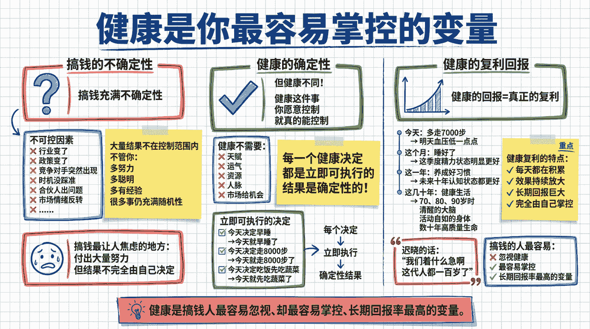

搞钱这件事，充满了不确定性。这个不确定性是真实的。行业变了、政策变了、竞争对手突然出现了、时机没有踩准、合伙人出了问题、市场情绪反转了……大量的结果不在你的控制范围之内，不管你多努力、多聪明、多有经验，很多事情仍然充满随机性。

这是搞钱最让人焦虑的地方：付出了大量的努力，但结果不完全由自己决定。

**但健康不同。**

健康这件事，**你愿意控制，就真的能控制。**

健康不需要天赋，不需要运气，不需要资源，不需要人脉，不需要市场给你机会。你决定今天早睡，今天就早睡了。你决定今天走 8000 步，今天就走 8000 步了。你决定今天吃饭先吃蔬菜，今天就先吃蔬菜了。

每一个健康决定，都是立即可以执行的，结果是确定性的。

而且健康的回报，是真正意义上的复利：今天多走 7000 步，明天血压低了一点点；这个月睡好了，这个季度的精力状态明显更好；这一年养成了好习惯，未来十年的认知状态都会更好；这几十年的健康生活，会在你 70、80、90 岁的时候，给你一个清醒的大脑、一个还能活动自如的身体，和数十年高质量的生命。

迟晓和我聊到这一点的时候，他说了一句让我印象非常深的话：「我们着什么急啊，这代人都一百岁了。」

他说这话的背景是，很多家长为了孩子「不能输在起跑线上」而用错了力气，焦虑地在最重要的地方做出了最错误的选择。

搞钱的人，在身体这件事上，也经常犯同样的错误——在最重要的地方用错了力气，在最不该忽视的地方选择了忽视。

这是搞钱的人最容易忽视、却最容易掌控、而且长期回报率最高的变量。

---

### 波动是最大的敌人，稳定才是终极赢家

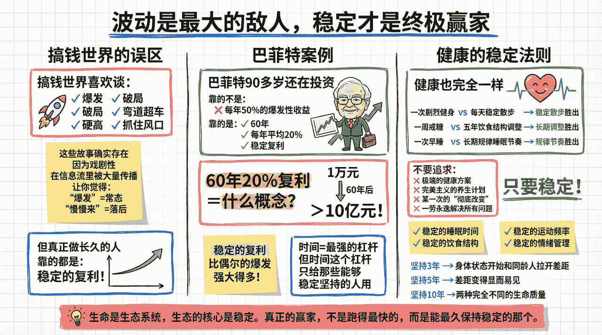

搞钱的世界里，大家喜欢谈爆发、谈破局、谈弯道超车、谈抓住风口。这些故事确实存在，而且因为它们的戏剧性，在信息流里被大量传播，让你觉得「爆发」是常态，「慢慢来」是落后。

但真正做长久的人，靠的都是**稳定的复利**。

巴菲特 90 多岁还在投资，靠的不是每年 50% 的爆发性收益，而是 60 年、每年平均 20% 的稳定复利。60 年 20% 的复利是什么概念？是从 1 万元变成超过 10 亿元。

稳定的复利，比偶尔的爆发强大得多。时间是最强的杠杆，但时间这个杠杆，只给那些能够稳定坚持的人用。

健康也完全一样。

一次剧烈的健身对身体的好处，远远不如每天稳定的散步。一周的戒糖，远远不如五年的饮食结构调整。一次的早睡，远远不如长期规律的睡眠节奏。

不要追求极端的健康方案，不要制订完美主义的养生计划，不要指望靠某一次的「彻底改变」来一劳永逸地解决所有健康问题。

只要稳定。稳定的睡眠时间，稳定的饮食结构，稳定的运动频率，稳定的情绪管理。

就这四个「稳定」，坚持三年，你的身体状态会开始和同龄人拉开差距；坚持五年，差距会变得显而易见；坚持十年，你会活出两种完全不同的生命质量。

> 💡 生命是一个生态系统，生态的核心是稳定。你不能今天大火，明天严寒，这谁都受不了。真正的赢家，不是跑得最快的那个，而是能最久保持稳定的那个。

---

### 搞钱和健康，从来不是对立的

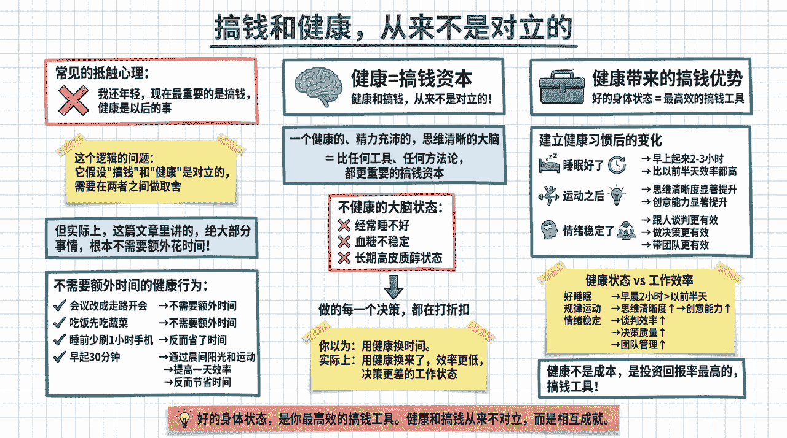

我知道有一部分人看这篇文章，会有一个下意识的抵触：「我还年轻，现在最重要的是搞钱，健康是以后的事。」

这个逻辑的问题在哪里？

它假设「搞钱」和「健康」是对立的、需要在两者之间做取舍的。

但实际上，这篇文章里讲的绝大部分事情，根本不需要额外花时间：把会议改成走路开会，不需要额外的时间；吃饭先吃蔬菜，不需要额外的时间；睡前少刷一小时手机，反而给你省了时间；早起 30 分钟，通过晨间的阳光和运动让你一天的效率提高，反而节省了时间。

**健康和搞钱，从来不是对立的。**

一个健康的、精力充沛的、思维清晰的大脑，是比任何工具、任何方法论都更重要的搞钱资本。

一个经常睡不好、血糖不稳定、长期处于高皮质醇状态的大脑，做的每一个决策都是在打折扣的。你以为在用健康换时间，实际上你是在用健康换来了一个效率更低、决策更差的工作状态。

反过来，当你把这些健康习惯真正建立起来之后，你会发现：睡眠好了，早上起来的两三小时比以前半天的效率都高；运动之后，思维清晰度和创意能力显著提升；情绪稳定了，跟人谈判、做决策、带团队都更有效。

好的身体状态，是你最高效的搞钱工具。

---

### 最后一句话

有时候就是在失去健康才知道健康的重要性，你高估了自己身体的承受能力，

也低估了一些小小的习惯改变能带来的巨大复利。

你不需要花大钱，不需要找私教，不需要买昂贵的补剂，不需要等到「一切准备好了」再开始。

你需要的只是：从今天，从这一顿饭，从今晚开始。

想改善睡眠，今晚就开始。哪怕今晚只是比平时早放下手机了半小时，也是一个开始。

想好好吃饭，这一顿就开始。哪怕这一顿只是先把蔬菜吃了，也是一个真实的改变。

想开始运动，今天就开始。哪怕今天只是多走了 2000 步，也比继续坐着强。

不需要等到「一切都准备好了」再开始，因为那个时刻永远不会自动到来。完美的开始，是拖延的最好借口。

你不需要准备好了再开始，对于健康直接可以开始。

搞钱是为了更好地活着。活着是为了有更多的时间和力气去搞钱，去体验，去创造，去爱那些值得爱的人，去做那些真正有意义的事。

这个闭环，需要一个健康的身体来支撑。

**一个健康的身体，是你最长期、回报率**最高、永远不会跌价的核心资产。没有之一。

共勉。