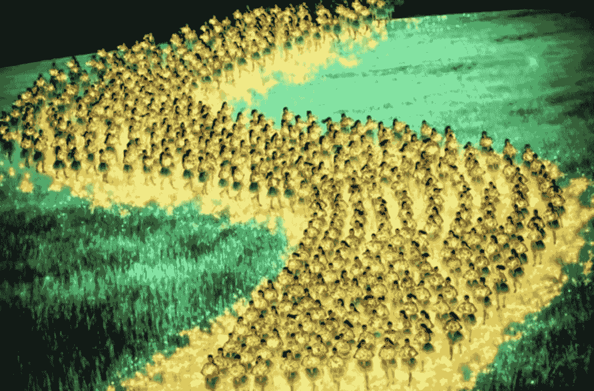

# 大语言模型黑盒被打破；“作图新神器”Dall-E 3 引爆 Bing；Meta 元宇宙硬件亏损可能高于市场共识丨 RTE 开发者日报 Vol.60

> 来源：[https://docs.feishu.cn/docx/NJEFdrmJfowWDjxs4saccFcOnqf](https://docs.feishu.cn/docx/NJEFdrmJfowWDjxs4saccFcOnqf)

开发者朋友们大家好：

这里**是「RTE 开发者日报**」，每天和大家一起**看新**闻、聊八卦。

**

我**们的社区编辑团**队会**整理分享 RT**E **（Real T**im**e Engagement） 领域内「有话题的新闻」、「有态度的观点」、「有意思的数据」、「有思考的文章」、「有看点的会议」，但内容仅代表编辑的个人观点，欢迎大家留言、跟帖、讨论。

本期编辑：@Asui，@CY，@墨镜

---

### **一、有话题的新闻**

1、雷军王小川牵手，小米大模型投资布局首次曝光

雷军和王小川的创业公司百川智能已成为雷军大模型布局新宠。雷军通过小米集团和顺为资本注资百川智能，并在其两轮融资中起关键作用。百川智能由搜狗创始人王小川于年内创建，专注于大模型开发。报告称，雷军对大模型的变革非常重视，他的策略是复制小米在移动互联网时代的策略，即投资并发展内部研究的同时推动外部投资。（@量子位）

2、腾讯机器人实验室一号员工创业

据报道，腾讯 RobticsX 机器人实验室一号员工来杰创业的仿生机器人项目有了新的进展。据悉，其创业公司名为星尘智能，主打项目是以轮式为底盘、以人形为上身的一体化设计仿生机器人。市场消息称，该公司今年的主要目标，是与头部 AI 公司合作，在年内推出原型机，而后在明年商业化落地，具体领域瞄准商用立体清洁、新零售和分拣等。

2018 年，腾讯 RoboticsX 机器人实验室成立，与 AI Lab 一同成为腾讯 AI 产业的两个支撑部门。当年来杰就以 RoboticsX 一号员工的身份，从百度转投腾讯门下。公开资料显示，这一阶段，来杰负责嵌入式和软件方向，管自平衡轮式机器人和轮腿式机器人两个项目（RoboticsX 迄今为止共发布过 4 个项目，分别为自平衡轮式机器人、轮腿式机器人、多模态四组机器人、触觉执行器）。（@量子位）

3、小米官网暗示：小米汽车有望推出增程车型

近日，小米社招官网上线了几个跟汽车相关的职位，而且都跟增程式汽车有关。具体来看，此次上线的职位包括增程系统设计开发工程师、燃油系统工程师、发动机悬置衬套工程师等。通过上述招聘可以看出，小米汽车有想要推出增程车型的想法，但目前无法确定是在第一代车型上推出增程版还是在第二款车型上使用。据上证报此前报道，小米汽车通州生产基地已在今年 9 月进入生产调试冲刺阶段。小米集团董事长雷军近期已带领小米汽车高层在新疆完成夏季新车路测，以争取在获得相关批文后尽快进入新车量产。（@IT之家）

4、OpenAI 或将制造自己的 AI 芯片，已评估潜在收购目标

媒体报道称，OpenAI 正在探索制造自研人工智能芯片，并已开始评估潜在的收购目标。报道称，至少从去年开始，OpenAI 就已讨论各种方案，以解决 AI 芯片短缺问题。OpenAI 已将获取更多 AI 芯片列为公司首要任务，讨论方案包括自研 AI 芯片，与包括英伟达在内的其他芯片制造商更密切地合作，以及在英伟达之外实现供应商多元化。

OpenAI CEO Altman 此前曾公开抱怨 AI 芯片的短缺，该市场目前由英伟达主导。外界分析认为，OpenAI 自研芯片旨在解决 GPU 的短缺，同时降低硬件运行所需的“令人眼花缭乱”的成本。目前还不清楚 OpenAI 是否会持续推进自研芯片的计划。业内资深人士表示，这一巨额投资每年的成本可能高达数亿美元。（@华尔街见闻）

5、扎克伯格在元宇宙里一小时的“真人对话”，惊艳了全世界

美国著名播客 Lex Fridman 与扎克伯格在元宇宙进行了一次对话，让距离上百英里的两人有了面对面的感觉。这主要归功于照片级精度的 3D 模型技术。他们的对话一小时视频短短时间播放量就冲上千万。Meta 的 Codec 虚拟现实化身使用扫描技术构建用户面部的 3D 模型，由 AI 驱动。扎克伯格也提到他们计划在未来几年让人们能够使用手机进行快速的扫描。（@腾讯科技）

**6、“作图新神器”Dall-E 3 引爆** Bing，微软周末紧急上线数千台服务器

OpenAI 新一代作图模型——DALL·E 3 与多模态 AI 合并，能用简单的指令创造插画，制作复杂动图。模型接入 Bing 搜索引擎，增加了 Bing 的访问量，使其成为生产高质量 AI 图像的简单工具。多模态 AI 能够处理多种信息类型，推动智能系统向人工智能（AGI）发展，同时也增加了算力需求。未来几年，多模态 GPT 的发展将推动 AI 泛化能力提升，使得通用视觉、通用机械臂、行业服务机器人等进入生活。（@华尔街见闻）

7、谷歌推出全球最大通用大模型之一 RT-X，并开放训练数据集！

谷歌 AI 研究机构 DeepMind 发布全球最大通用大模型之一 RT-X 并开放训练数据集 Open X-Embodiment。RT-X 由控制模型 RT-1-X 和视觉模型 RT-2-X 组成，在特定任务的工作效率是同类型机器人的 3 倍，可执行未训练动作。Open X-Embodiment 由全球 33 家顶级学术实验室合作整合了来自 22 种不同机器人类型的数据开发。上海交通大学也参与了该项目。（@AIGC开放社区）

**8、未能战胜 Clubhouse，亚**马逊宣布关闭旗下音频社交竞品应用 Amp

10 月 6 日消息，Clubhouse 音频社交应用在 2021 年前后一度大火，亚马逊此前推出了一款名为 Amp 的同类应用，以试图与 Clubhouse 竞争。根据亚马逊数字音乐总监 Steve Boom 内部分发的消息，该应用目前已经正式关闭，仅运营了 18 个月。

在 2022 年 7 月，外媒 TechCrunch 声称该应用拥有超过 70 万月活跃用户，不过在 2022 年下旬，用户对此类音频社交应用的兴趣减退，Amp 应用用户没有迎来后续实质性的增长，反而逐步降低，在亚马逊去年的大规模裁员中，几乎有一半的 Amp 员工被解雇。（@IT之家）

9、大语言模型黑盒被 CMU 等机构学者打破，LLM 矩阵全破解

最近，来自 CAIS、CMU、斯坦福、康奈尔、马里兰、宾大等机构的学者有了令人震惊的发现——在大语言模型内部具有可解释的内部表征，人类可以控制这些表征来影响大模型的幻觉、偏见、危害，甚至可以做到监测出他们是否在撒谎。他们的研究探索同时也释放出人们对 AI 系统理解和控制会越来越精准，AI 系统也会因此大概率愈加安全可信的信号。（@新智元）

10、杭州亚运会闭幕式将盛开 AR「记忆之花」

10 月 8 日，杭州亚运会闭幕式将在杭州奥体中心体育场「大莲花」举行。近日，杭州亚运会闭幕式总导演沙晓岚透露，整场闭幕式时长约 75 分钟，突出嘉年华氛围，邀请运动员和志愿者、工作人员等共同走进美丽大花园。

沙晓岚说，杭州亚运会闭幕式上仪式与演出将交替进行，由《璀璨共此时》《荷桂共生辉》《心心共相融》以及 4 个短片组成。4 个短片分别是《亚运聚欢潮》《精彩瞬间》《感动瞬间》《最忆是杭州》，其中只有 120 秒的《精彩瞬间》，收录了许多运动员的风采。

闭幕式采用去篇章化方式，突出「聚」（亚洲花园中的欢乐相聚）、「忆」（荷桂交接中的攀花赠友）、「惜」（主火炬熄灭时的依依不舍）、「和」（花车巡游中的和美共盼），以四类情感的递进为自然串联，从期盼到相会，从重逢到告别，以情感人、以情动人，留下别样精彩的杭州亚运记忆。

值得一提的是，总导演团队还通过 AR 技术，计算千余种荷花形态，形成独特的「记忆之花」，在大花园中绽放，体现「和合之美」。（@中国青年报）

---

### 二、有态度的观点

1、孙正义：AI 智能程度或将是人类智力总和 10 倍

当地时间 10月4日，软银集团创始人兼 CEO 孙正义表示，他相信通用人工智能(AGI)将在 10 年内成为现实，AGI 即“几乎在所有领域都超越人类智慧的 AI”。当天，孙正义在软银世界企业大会上发表演讲时预测，未来 AI 的智能程度将是人类智力总和的 10 倍。（@第一财经）

2、郭明錤：Meta 元宇宙硬件亏损可能高于市场共识

分析师郭明錤发文表示，META 的头戴装置（元宇宙）硬件事业因需求疲软造成的亏损可能高于市场共识。郭明錤最新调查指出，META 的头戴装置/元宇宙硬件出货量持续显著下滑，故缩编头戴装置/元宇宙事业对改善亏损帮助有限。Quest 3 最初的出货预估为在 2H23 达到 700 万部以上，但因预期需求疲软，故目前对今年下半年出货预估为 200–250 万部，2024 年出货量则约 100 万部。Quest 的出货量在 2023 将进一步显著同比下滑约 50% 至 350 万部，2024 年出货量不排除还有同比衰退可能。（@财联社）

---

**写在最后：**

我们欢迎更多的小伙伴参**与「RTE 开发者日报**」内容的共创，感兴趣的朋友请通过开发者社区或公众号留言联系，记得报暗号「共创」。

对于任何反馈（包括但不限于内容上、形式上）我们不胜感激、并有小惊喜回馈，例如你希望从日报中看到哪些内容；自己推荐的信源、话题、活动等；或者列举几个你喜欢看、平时常看的内容渠道；内容排版或呈现形式上有哪些可以改进的地方等。

---

