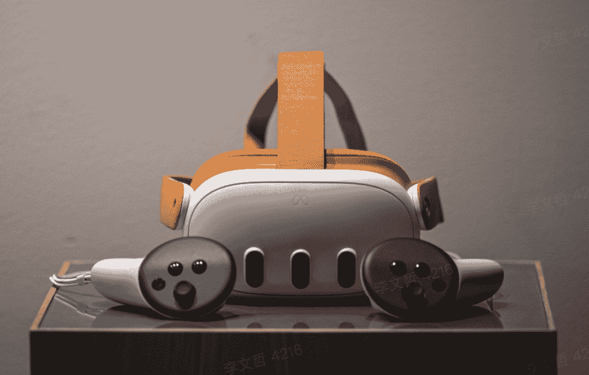

# ChatGPT 重磅更新可进行实时网络搜索；OpenAI 将构建新的“AI 硬件”丨 RTE 开发者日报 Vol.59

> 来源：[https://docs.feishu.cn/docx/DLMTd8nnUoLQfexVNBucgxfin6f](https://docs.feishu.cn/docx/DLMTd8nnUoLQfexVNBucgxfin6f)

开发者朋友们大家好：

这里**是「RTE 开发者日报**」，每天和大家一起**看新**闻、聊八卦。

**

我**们的社区编辑团**队会**整理分享 RT**E **（Real T**im**e Engagement） 领域内「有话题的新闻」、「有态度的观点」、「有意思的数据」、「有思考的文章」、「有看点的会议」，但内容仅代表编辑的个人观点，欢迎大家留言、跟帖、讨论。

本期编辑：@Asui，@CY，@墨镜

---

### **一、有话题的新闻**

**1、前苹果首席设计师 Jony Ive** 将为 OpenAI 构建「AI 硬件」

根据 The Information 报道，乔尼・艾夫（Jony Ive）正在和 OpenAI 首席执行官萨姆・奥尔特曼（Sam Altman）合作，讨论新的“AI 硬件”项目。乔尼・艾夫（Jony Ive）此前担任苹果公司首席设计官，参与并负责了苹果多个重要项目。他于 2019 年离开苹果，成立了自己的设计公司 LoveFrom，其合作伙伴包括 Airbnb 和法拉利等。艾夫在离开苹果之后，继续以顾问的身份帮助苹果，不过在 2022 年艾夫和苹果的合作走到了尽头，他不再参与苹果的产品开发。报道中并未透露关于这款“AI 硬件”的用途和外观，知情人士透露，双方的合作希望为“人工智能时代创造一种新硬件”。（@IT 之家）

2、中国电信发布信息通信领域首个网络大模型“启明”

9 月 27 日消息，中国电信发布信息通信领域首个网络大模型——启明。中国电信副总经理夏冰表示，大模型是人工智能技术的重要趋势，国内大模型已呈现百花齐放的发展态势，中国电信将重点推动基础通用大模型向垂直行业大模型的纵深演进。目前，中国电信完全自主研发的网络大模型，已在企业内部成熟应用。中国电信将在基础研究、算力环境、应用部署等重要环节联合攻坚，提供多种形式的 MaaS 服务。（@科创板日报）

3、ChatGPT 再迎重磅更新：用户可实时进行网络搜索

OpenAI 宣布，ChatGPT 现可通过微软的必应搜索引擎进行网络搜索，将不再局限于 2021 年 9 月之前的数据。该功能目前仅对 Plus 订阅和企业版用户开放，不过 OpenAI 表示，将很快向所有用户推出。要启用这一功能，用户可以在 GPT-4 下的选择器中选择「使用必应浏览」。OpenAI 6 月下旬曾在 ChatGPT iOS 版中添加了互联网浏览功能，但很快就将其撤下。用户发现，他们可以通过向聊天机器人提供 URL ，诱使它向用户提供付费内容。从那时起，OpenAI 的自动爬虫程序开始使用用户代理来识别自己，以便网站可以通过更新其 Robots.txt 文件来禁止其分析，从而过滤掉自己。

4、Meta 推出新 VR 头显 Quest 3

9 月 27 日晚，Meta 发布首款主流混合实境装备 Quest 3 VR，Quest 3 搭载了基于 Arm 架构的高通骁龙 XR2 Gen 2 芯片。Meta 表示，Quest 3 的处理能力是 Quest 2 的两倍，甚至比运行一代 XR2 芯片的 Quest Pro 要好得多。作为一款无线一体机形式的 VR 头显，Quest 3 可提供约 2 小时 12 分钟的续航时间，与上一代产品差不多。

在显示方面，Quest 3 的单眼分辨率为单眼 2064 x 2208 像素，双眼分辨率 4128 x 2208 像素，分辨率较上一代率提升了近 30%。Quest 3 提供水平 110 度、垂直 96 度的视野，比 Quest 2 扩大了约 15%。同时，比较重要的是，新一代的 Quest 3 终于提供了瞳距调节功能，可以通过头显外部的滚轮来进行调节。

Quest 3 将于 10 月 10 日上市，售价 499 美元，较上一代加价 200 美元，目前已可预订，Meta 将与微软合作，Xbox 云端游戏将于 12 月进驻 Meta Quest 3，Microsoft 365 今年内亦将加入。

Meta 亦宣布将于 10 月 17 日推出售价 299 美元的 Ray-Ban X Meta 智能眼镜，产品搭载了搭载高通骁龙最新推出的 AR1 Gen1 芯片，可以播放只有佩戴眼镜的用户能听到的音乐；右镜腿上有小型的摄像头，可以当作相机使用。此外，通过 Ray-Ban，用户只需在镜腿上轻按几下，就可以直接开始在 Facebook 或 Instagram 上进行直播。（@极客公园）

---

### 二、有态度的观点

**1、机构：预计 2023 年全球车载市场 Mini** LED 显示应用出货量 40 万片左右

9 月 27 日消息，CINNO Research 统计数据显示，2022 年搭载 Mini LED 车载显示的中国乘用车销量占比为 0.6%，而 2023 年上半年 Mini LED 车型销量同比增长 1.3 倍，占比上升至 1.1%。预计 2023 年全球车载市场 Mini LED 显示应用出货量在 40 万片左右，此外还有大量非显示类的 Mini LED 车载应用，如饰带、车灯等。随着诸如电子后视镜等一系列新显示场景出现，在传统 CID、信息提示屏等现有场景之外，Mini LED 车载应用空间也在不断拓宽，预计到 2027 年，这一数字将有望增长到超过 360 万片。（@每日经济新闻）

2、郭明錤：苹果可能已经暂停亲民版 Vision Pro 头显计划

中关村在线 9 月 27 日消息，郭明錤称，苹果可能已经暂停了亲民版 Vision Pro 头显计划。此前，市场传闻苹果计划在 2025 年推出这款产品。郭明錤的市场研究报告显示，根据部分零部件供应商的最大产能估算，苹果 Vision Pro 头显在 2024 年的出货量可能仅为 40-60 万台，这相较于市场预期的 100 万台以上有着显著的差距。除非苹果能够显著降低 Vision Pro 头显的售价，否则在 2025 年之前市场对其增长的预期可能无法实现。

郭明錤预计，苹果预计将在 2024 年上半年开始量产一代 Vision Pro 头显。这也就意味着，未来几年内，Vision Pro 头显不会有硬件上的升级。虽然从技术角度来看，郭明錤对 Vision Pro 能够带给用户极致体验表示信心，但他也指出，用户为何需要这个产品仍然是一个值得探讨的问题。他认为，可能需要花费比市场预期更多的时间，才能使 Vision Pro 成为 iPhone 的下一个明星产品。（@中关村在线）

---

**写在最后：**

我们欢迎更多的小伙伴参**与「RTE 开发者日报**」内容的共创，感兴趣的朋友请通过开发者社区或👸号留言联系，记得报暗号「共创」。

对于任何反馈（包括但不限于内容上、形式上）我们不胜感激、并有小惊喜回馈，例如你希望从日报中看到哪些内容；自己推荐的信源、话题、活动等；或者列举几个你喜欢看、平时常看的内容渠道；内容排版或呈现形式上有哪些可以改进的地方等。

---

