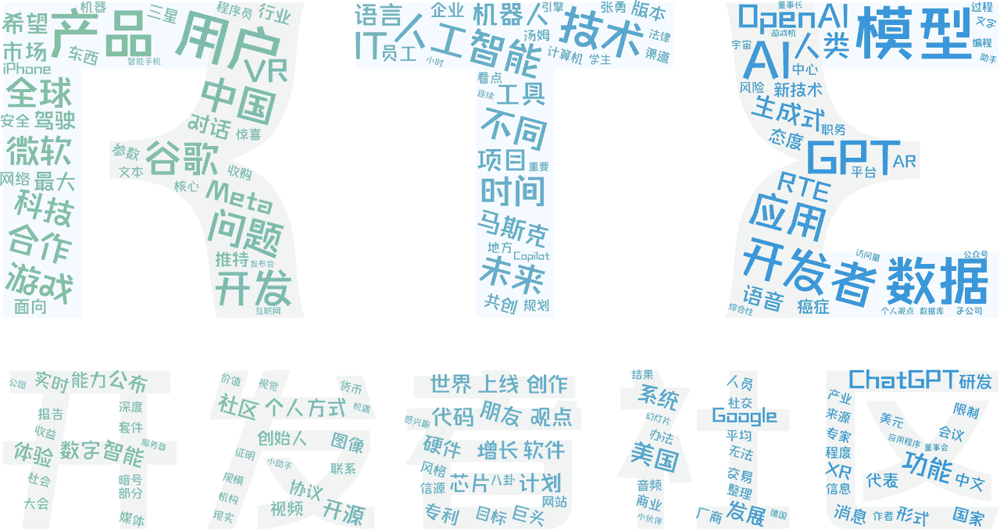

# RTE 领域近期词云统计发布；谷歌开始新一轮「瘦身」计划；使用 ChatGPT 之后智力提高 50%丨 RTE 开发者日报 Vol.50

> 来源：[https://docs.feishu.cn/docx/GawMd7yLIoGyfTxMe1QcVeYsnPe](https://docs.feishu.cn/docx/GawMd7yLIoGyfTxMe1QcVeYsnPe)

开发者朋友们大家好：

这里**是「RTE 开发者日报**」，每天和大家一起看**新闻**、聊八卦。

**不知**不觉，我们的日**报已**经发布了 50** 期**，作为 RTE** 领**域最垂直的日报栏目，我们的社区编辑团队会整理分享 RTE （Real Time Engagement） 领域内「有话题的新闻」、「有态度的观点」、「有意思的数据」、「有思考的文章」、「有看点的会议」，方便大家了解行业的新发展、新动态。

作为一个短暂的回顾，我们整理了一下 50 期发表的内容 —— 358 则新闻、162 个观点、78 篇文章以及若干条数据以及活动推荐。我们的小伙伴也将日报中的内容关键词整理成了词云，方便大家有个更直观的了解。

果不其然啊，RTE 领域同样是被大模型“攻占”了。抛开客观的数据统计，就凭我个人的体感而言，每天搜索新闻的时候都是各种大模型、生成式 AI 之类的，从最开始的新奇惊叹到后来的习以为常，感觉这个领域也在从“搞花活儿”变成实战派了，挺好挺好。

值此 50 期之际，再次感谢我们的社区编辑团队以及参与过日报共建的特邀编辑们，是你们为行业的发展做了见证、为行业的从业者分享了新知、为我本人分担了工作量，希望大家再接再厉，我们一起把日报搞的更有价值。

也希望更多的小伙伴可以参与到日报的共建当中来，或者提出宝贵的优化、迭代意见。现阶段的生成式 AI 可能不能很好的理解你的需求，但是我们可以！

Ps：期待大家通过后台留言的形式参与共建 or 提建议 or 送祝福，建议 & 祝福被采纳的前 3 名小伙伴将获得社区准备的周边礼物 1 份。搞起来吧！

本期编辑：@Asui

---

### **一、有话题的新闻**

1、小米声音识别算法模型在业界率先突破 50mAP

昨日，小米公司宣布，小米自研声音识别算法取得最新进展。据了解，在 Google 发布的 AudioSet 音频标记任务中，小米的声音识别算法模型首次在业界突破了 50 mAP，刷新了音频标记技术指标，成为截至目前性能最好的模型。

**2、微软 Edge 浏览器测试 AI-**writing 功能：可快速生成相关内容

微软 Edge 浏览器即将引入「AI-writing」功能，通过调用 GPT-4 和 Bing AI 模型，可帮用户撰写博文、新闻报道和电子邮件等，目前已邀请一部分 Canary 频道的 Edge 浏览器用户进行测试。AI-writing 功能可快速生成相关内容，并支持详细描述、重写、改变语气、格式等操作。用户若想使用这项功能，需在 Edge 浏览器中启用「AI-writing」选项，然后选择文本框中的某些文字，点击右键「重写」，此功能便会根据选中文字修改或扩展文本内容，从而转换为另一个版本。

3、谷歌开始新一轮「瘦身」计划，招聘团队全球数百人被裁

9 月 14 日消息，谷歌已经证实，该公司将在其全球招聘部门裁员数百人，这是未来几个季度裁员计划的一部分。谷歌招聘副总裁布莱恩·王 （Brian Ong） 在周三的视频会议上对员工说：「不幸的是，我们需要大幅缩减招聘团队的规模。」他补充称：「这不是一个容易做出的决定，今年我们任何人都不想再讨论这个问题。考虑到未来几个季度的招聘基数，总的来说，这是一件正确的事情。（@网易科技）

4、德国已经允许运营商使用华为和中兴 5G 技术

近日，据德国《世界报》报道，德国联邦数字化和交通部国务秘书丹妮拉·克卢克特（Daniela Kluckert）在非公开场合承认，「新的 5G 移动网络使用了很多来自中国的技术。德国移动通信运营商继续依赖中国供应商的安全关键组件。」 至于这些公司是否包括华为，德内政部回应称由于涉及企业的商业贸易机密，因此无法提供任何信息。德国联邦议院议员、基民盟/基社盟议会党团数字政策发言人莱因哈德·布兰德（Reinhard Brandl）表示，「据我所知，会受到这种指控影响的（中国企业）只有华为或者中兴通讯。」他还认为，毫无根据地批评允许华为继续参与德国移动网络建设将是「严重错误」。（@手机中国）

5、电制冷可缩小量子计算机的体积

量子计算机有望解决普通计算机无法解决的问题。然而，他们面临的一个关键限制是，大多数类型需要笨重、耗能的冰箱来将量子位保持在接近绝对零的温度。现在研究人员表示，运行方式有点像真空管的新设备可以将这些冰箱的尺寸和功耗削减十分之一。

Google、IBM、亚马逊和其他公司正在建造基于超导电路的量子计算机，超导电路必须冷却到接近绝对零。目前，它们依赖于称为稀释制冷机的大型、复杂、昂贵的系统，该系统使用多级冷却将回路冷却至 1 开尔文或更低。这些制冷机的复杂性在最冷阶段最为复杂，其中涉及混合液氦的不同同位素。

芬兰的科学家正在开发纯电子制冷方法，而不是泵送低温流体，这种方法可能更小、更简单，同时消耗的功率仅为当今系统的 1/10。

位于埃斯波的芬兰 VTT 技术研究中心的 Mika Prunnila 表示：「我们的技术可以帮助业界缩小量子计算机系统的整体规模。」新型冷却器属于热电子设备类别，以电子形式散发热量。（真空管通常是热电子发射器）（@cnBeta）

6、Arm 上市首日大涨近 25%，市值超 650 亿美元

Arm 公司在纳斯达克上市，股票代码为"ARM"，发行价为每股 51.00 美元。首日收盘，Arm 股价上涨 24.69%，报 63.59 美元，首日市值为 652.48 亿美元。Arm 为软银集团全资持有的子公司，是全球领先的半导体知识产权提供商。全球 95%的智能手机都采用了 Arm 架构。此次 Arm 成功上市，将成为今年全球最大规模的 IPO。（@澎湃新闻）

**7、Stability AI 推出 Stable Audio**，可基于文本生成最长 90 秒音频/音乐

Stability AI 日前推出 Stable Audio，可基于用户输入的文本内容，生成音乐或者音频。免费版可生成最长 20 秒的音乐/音频片段，Pro 版可生成最长 90 秒内容，生成的内容还可以下载用于商业项目。（@IT之家）

---

### 二、有态度的观点

1、马斯克：特斯拉 FSD 比人类司机安全，非常接近「无需监督」的目标

特斯拉 CEO 伊隆・马斯克在周三举行的 All-In Podcast 2023 峰会上接受了采访，期间提到了包括 FSD、星链、X、中国、人工智能等话题。 当他提到 FSD 测试版时表示：它「非常接近」在不受监管的情况下比人类司机更安全。也就是说，他认为 FSD 安全性已经超过了人类司机，几乎可以做到「自动驾驶」，但仍需要进一步地改进。 「我认为它正在非常接近这样一种情况，即使没有人为监督或干预，使用 FSD 进行安全旅行的概率也比有人驾驶的情况更高（例如你在车里睡着了），我们非常接近这一点」，马斯克说道。（@IT之家）

**2、诺贝尔化学奖得主：使用 Cha**tGPT 之后，自己的智力提高了 50%

日前，2013 年诺贝尔化学奖得主、美国国家科学院院士迈克尔·莱维特在上海出席 2023ESG 全球领导者大会时表示：使用 ChatGPT 之后，自己的智力提高了 50%。

他认为，ChatGPT 不仅仅是一个搜索模型，它是一个语言模型，它是一个智慧，可以训练它拥有 2500 种的讲话方式。迈克尔·莱维特讲道： 几个月前，比如写专利需要找律师，但是现在有了 ChatGPT，它直接帮你做专利申请的过程； 比如有人给你拿外语写了一份合同，所有的条款都给你列出来，几乎不需要你再去花额外的钱，也不需要太多的人类工作设计进去，它的编程已经非常好了，它可以取代人类。

他表示，ChatGPT 让生活更加方便和简单，「使用了 ChatGPT 之后，我自己的智力提高了 50%，有了这样的智力可以解决很多问题，所以 ChatGPT 能帮我们提升很多事情」。（@爱范儿）

---

### 三、有思考的文章

《从业 20 年的行业老炮儿，如何看待 AI 的风险与能力边界？》（@编码人声）

随着近期 AIGC 技术和应用的发展落地，有人期待有人担忧，「AI for Social Good」再次成为一个避不开的热门话题。构建 AI 的未来，即依赖于技术、工具、信息的发展，但所需要的远不只是技术。

本期「编码人声」节目，我们荣幸的邀请到了 FutureX Capital 高级顾问许振斌老师。许振斌老师早在 20 年前就曾在微软内部组建机器学习团队展开 AI 相关的工作。作为 AI 领域的资深老炮儿，许振斌老师对人工智能 / ML等新技术领域有丰富的专业知识与思考。节目中，许振斌和朱峰将结合自身经历与观察，回顾 AI 在不同时代的应用和挑战，讨论 AI 的风险与能力边界。

---

**写在最后：**

我们欢迎更多的小伙伴参**与「RTE 开发者日报**」内容的共创，感兴趣的朋友请通过开发者社区或👸号留言联系，记得报暗号「共创」。

对于任何反馈（包括但不限于内容上、形式上）我们不胜感激、并有小惊喜回馈，例如你希望从日报中看到哪些内容；自己推荐的信源、话题、活动等；或者列举几个你喜欢看、平时常看的内容渠道；内容排版或呈现形式上有哪些可以改进的地方等。

---

