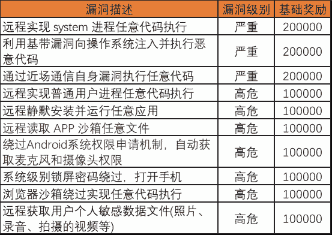

# 问 ChatGPT 50 个问题，耗水 500 毫升；通讯专家发帖称 iPhone 网络国内造假丨 RTE 开发者日报 Vol.47

> 来源：[https://docs.feishu.cn/docx/Oo7kdY2tio4F1zxSn8FcB1TDn3g](https://docs.feishu.cn/docx/Oo7kdY2tio4F1zxSn8FcB1TDn3g)

开发者朋友们大家好：

这里**是「RTE 开发者日报**」，每天和大家一起**看新**闻、聊八卦。

**

我**们的社区编辑团**队会**整理分享 RT**E **（Real T**im**e Engagement） 领域内「有话题的新闻」、「有态度的观点」、「有意思的数据」、「有思考的文章」、「有看点的会议」，但内容仅代表编辑的个人观点，欢迎大家留言、跟帖、讨论。

本期编辑：@Asui，@CY，@OKJK

---

### **一、有话题的新闻**

1、小米悬赏 100 万，为 13 系列设备找漏洞

小米安全中心发布了《百万奖池手机守护计划》诚邀广大技术爱好者对小米 13 进行系统漏洞挖掘。本次守护计划奖金池总额 100 万元人民币，公式：基础奖励 x 交互系数+挑战项奖金（完成挑战项）漏洞收录范围 & 奖励要求如下：

**2、人工智能爆火导致用水量飙升：问 Chat**GPT 50 个问题，耗水 500 毫升

AI 模型的碳足迹引起了人们的关注，但水足迹经常被忽视。研究显示，培训和部署 AI 模型需要大量的水。比如，ChatGPT 每次涉及 20 到 50 个问题的对话中，消耗的水量约为 500 毫升。人工智能的热潮导致用水量上升，但科技公司们正在采取措施减少用水量，如充分利用计算能力和寻找可持续的用水策略。（@腾讯科技）

3、Meta 计划挑战 OpenAI 和谷歌：明年或发布新 AI 模型

Meta 正在研发一款新的人工智能系统，旨与 OpenAI 提供的最先进模型媲美。据透露，这家 Facebook 母公司计划在明年推出这一新的 AI 模型，预计其性能将比商业版本 Llama 2 强大数倍。Llama 2 是 Meta 于 7 月份推出的一款开源 AI 语言模型，通过 Microsoft 的 Azure 云服务分发，以与 OpenAI 的 ChatGPT 和谷歌的 Bard 竞争。（@智通财经）

4、通讯专家发帖称 iPhone 网络国内造假，信号虚标

近日，知名 5G 专家项立刚在微博发帖，讲述了他的的亲身经历。他在坐地铁 10 号线回家时，发现一个小伙子手里的 iPhone14 显示的 5G 信号。项立刚还专门用自己的能正常用 5G 网络华为 Mate40 Pro 手机测试，结果发现不显示 5G 网络。经项立刚询问，北京联通的回复是现在北京 10 号线还没 5G 网络，正在推进。他还在另一条回复中，说：因为北京大部分地铁还没有 5G 网络，如果有较多显示 5G，真可能有虚标的现象。这就不太对了。

网友因此也引发了争论，有相关人士表示，大概率是外挂的 5G 模块，所以开了 5G 看起来就像有 5G 一样，但信号一直在搜索。此外，现在不少手机支持 5G，开不开 5G 服务在有 5G 信号的地方都可以用 5G，现在的问题是没有 5G 基站收不到 5G 信号的时候它会显示 5G，所以最终判定还是以实际网速来鉴别，而不是单纯意义上的显示。（@凤凰网科技）

5、国内首条“智慧高速”将建成，可全程脱手脱脚开车

日前，据报道，国内首条满足车路协同式自动驾驶等级的智慧高速即将在苏州启用。项目相关负责人介绍，道路横杆上方，左右两侧是两个智能摄像头，中间两个是激光雷达，这些传感器构成了一套能获取全息感知的“智能高速路侧感知单元”，可实现对该路段所有交通参与者、路况等信息的瞬时采集和发送。通过路侧的这些设备，可以提前给自动驾驶的车辆提供可能视线看不到或者视线盲区的信息，也能把交通的现实路况信息发送到车辆。

目前，该项目已覆盖苏台高速 S17（黄埭互通至阳澄湖北互通）双向 56 公里路段，期间累计投建了 55 个点位感知设备，已完成全部工程量的 83%。项目建成后将成为国内首条满足车路协同式自动驾驶等级的全息感知智慧高速，依靠车路协同方式，在高速公路上实现 L4 级别自动驾驶。驾驶由机器接管，人不需要对所有系统请求做出回应。（@快科技）

---

### 二、有态度的观点

1、苹果分析师郭明錤谈华为归来：迫使苹果走出舒适圈，积极创新

苹果分析师郭明錤在社交平台上表示，华为回归对消费者来说是一件好事，这将迫使苹果走出舒适圈并积极创新。他还称，如果没有禁令，华为应该早在 2023 年就率先使用堆叠影像传感器（CIS）。

如今华为 Mate 60 系列回归，从发售信息来看，Mate 60 系列成为了华为的年度爆款机型。不仅如此，华为新一代折叠屏 Mate X5 也成了“香饽饽”，华为商城预售期间闪电售罄，黄牛加价售卖。相比之下，iPhone 15 虽然拥有极高的热度，但是其创新力明显不足。之前罗永浩在交个朋友直播间表示，以我对我子公司的了解，我认为 iPhone 15 跟 iPhone 14 不会有什么区别的，除了序列号变了。（@新浪）

2、马斯克：如果不迅速转向自动驾驶电动汽车，大众迟早会完蛋

特斯拉 CEO 埃隆·马斯克周末在回应一位 X 用户的帖子时表示，包括大众在内的传统汽车制造商必须迅速转向自动驾驶电动汽车，否则迟早会完蛋。德国工程师和电动汽车爱好者 Alex Avoigt 发帖称：“大众负责研发的董事会成员 Grunitz 宣称该公司在纯电动汽车上赚不到钱，并放慢了新纯电动汽车车型的推出速度。（@新浪财经）

3、委内瑞拉总统：正在使用华为手机，美国人窃听不了

据委内瑞拉媒体日前报道，总统马杜罗就华为推出新机表示，自己也在使用华为手机，使用感很不错。马杜罗在视频中透露，自己使用的正是华为手机，且使用感和安全性都不错。" 我有一部华为手机，用起来非常棒。"面对 Mate 60 的推出，马杜罗还直言，尽管多年来华为被无理制裁打压，但华为仍然在 5G 技术领域取得了不小的进展。

此前，俄罗斯卫星通讯社一篇有关华为推出最新款手机 Mate 60 Pro 的报道，标题为“华为新旗舰手机显示了美国制裁的低效率”。马杜罗还进一步呼吁委内瑞拉科学家们效仿中国企业的做法，在新技术领域勇于创新，推动科技发展。" 我们要以中国为榜样，我们要创造我们自己的技术、我们自己的解决方案，不依赖于世界上任何人地向前迈进。"（@凤凰网科技）

---

### 三、有思考的文章

[1、《文勇刚](https://mp.weixin.qq.com/s/NIg7kdcMwKalN_WQNveQOw)：大模型时代，我们需要怎样的数据中心？》（@雷锋网）

如何平衡 AI 发展和能耗间的关系，是未来数字化科技发展的重要课题。

第七届 GAIR 全球人工智能与机器人大会中，南洋理工大学协理副校长文勇刚教授发表了关于 AI 和数字基础设施对于可持续未来的演讲。他指出，数字化转型和可持续发展需要双轮驱动。一方面，数字经济的发展给可持续性发展带来了新的挑战，例如碳排放量增加；另一方面，数字经济的发展也为可持续性发展带来了新的机会，例如人工智能和数据科学的发展提供了新的解决方案。

文勇刚教授强调了真正的愿景是实现双驱动后，AI、数据和各种生产活动形成共赢态势的重要性。他以新加坡政府暂停发放新的数据中心牌照的例子说明了这一挑战的紧迫性。同时，他也提到了大语言模型的能耗问题，表明这是当前需要解决的重要问题之一。因此，文勇刚教授建议在推进数字化转型的同时，需要考虑可持续性发展的问题，采取有效措施减少碳排放等环境影响。

2[、《卡](http://jandan.net/p/114128)林顿事件：颠覆电报通信的历史巨变》（@煎蛋）

1859 年，科学家记录了著名的卡林顿事件，一场强烈的太阳耀斑引发的太空风暴，导致全球电报中断。150 年后，研究人员在一棵古树年轮中发现公元 8 世纪发生过碳 14 激增的证据，表明一场远超卡林顿事件 20 倍规模的太空风暴曾发生，被命名为“三宅事件”。

虽然我们还不清楚三宅事件的起因，但这种巨大的宇宙能量激增启发我们洞察过去，也警示未来类似事件的危害。如果又发生这样级别的太空风暴，其强大的电磁脉冲将使当今电子设备瘫痪，造成难以想象的混乱。这凸显了加强电网抗干扰能力、备份重要数据等准备工作的重要性。人类需谨记自然力量，防患于未然。

---

**写在最后：**

我们欢迎更多的小伙伴参**与「RTE 开发者日报**」内容的共创，感兴趣的朋友请通过开发者社区或公众号留言联系，记得报暗号「共创」。

对于任何反馈（包括但不限于内容上、形式上）我们不胜感激、并有小惊喜回馈，例如你希望从日报中看到哪些内容；自己推荐的信源、话题、活动等；或者列举几个你喜欢看、平时常看的内容渠道；内容排版或呈现形式上有哪些可以改进的地方等。

---

