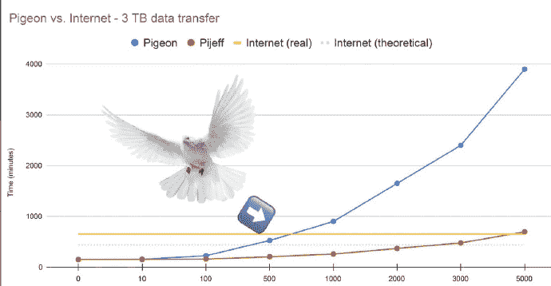

# 谷歌发布 AI 摸鱼神器；鸽子数据传输速度远超互联网？丨 RTE 开发者日报 Vol.39

> 来源：[https://docs.feishu.cn/docx/StKfdiAs1o8pjnxCWnhcE7Omni8](https://docs.feishu.cn/docx/StKfdiAs1o8pjnxCWnhcE7Omni8)

开发者朋友们大家好：

这里**是「RTE 开发者日报**」，每天和大家一起**看新**闻、聊八卦。

**

我**们的社区编辑团**队会**整理分享 RT**E **（Real T**im**e Engagement） 领域内「有话题的新闻」、「有态度的观点」、「有意思的数据」、「有思考的文章」、「有看点的会议」，但内容仅代表编辑的个人观点，欢迎大家留言、跟帖、讨论。

本期编辑：@Asui，@CY，@OKJK

---

### **一、有话题的新闻**

1、百度、字节等 8 家公司大模型产品正式上线，向公众提供服务

百度（文心一言）、字节（云雀大模型）、商汤（日日新大模型）、中科院旗下紫东太初大模型、百川智能（百川大模型）、智谱AI（GLM 大模型）、MiniMax（ABAB 大模型）、上海人工智能实验室（书生通用大模型）8个企业/机构的大模型位列第一批名单，可正式上线面向公众提供服务。

目前，百度文心一言、百川大模型、智谱清言等均已官宣率先通过《生成式人工智能服务管理暂行办法》备案，今日起即可面向全社会开放服务。

**2、Google DeepMind **发布标记图像是否是 AI 生成的水印工具

Google DeepMind 发布了标记图像是否是 AI 生成的水印工具 SynthID，目前它只支持 Google 自家的 AI 图像生成服务 Imagen。用户在使用 Imagen 生成图像时可选择是否添加水印，帮助其他用户识别 AI 生成图像或者帮助保护版权。

SynthID 使用了两个神经网络，其一从原始图像生成一幅几乎相同但有部分像素略作修改的图像。它创造了一种人眼不可见的模式。第二个神经网络能识别该模式，告诉用户是否检测到水印。这种水印无法通过编辑或者截图等方法编辑掉。

**3、消息称苹果多元化Vision Pr**o头显屏幕供应商，正评估京东方和视涯技术

8 月 30 日消息，苹果 Vision Pro 头显所使用的 micro-OLED 屏幕目前主要来自于索尼，不过根据国外科技媒体报道，苹果公司为了进一步推动供应链的多元化，正计划吸纳视涯技术（SeeYa）和京东方（BOE）等更多中国企业加入到供应链中。报道称苹果 Vision Pro 头显所使用的 micro-OLED 屏幕由索尼独家供应，受限于产能，无法满足苹果公司庞大的用户需求。京东方和视涯技术在当地政府的大力扶持下，已经在 micro-OLED 取得了较大的突破，苹果公司正在评估上述两家公司的屏幕，如果良率、生产成本等条件符合，苹果考虑会在下一代 Vision Pro 头显、未来的低成本头显上使用这两家的产品。报道称中国企业已深度打入 Vision Pro 头显供应链中，蓝思科技和玉晶光电是关键零件供应商，而立讯精密替代和硕，成为该头显的主要组装企业。（@IT之家）

**4、谷歌云与英伟达深度合作**

8 月 30 日消息，一年一度的谷歌云 Next 大会上，谷歌发布一系列生成式 AI 的新进展，包括最新的 AI 基础设施、AI 工作助手 Duet AI 和面向开发者的 AI 平台 Vertex AI。 英伟达 CEO 黄仁勋现身大会，介绍英伟达和谷歌的最新合作。谷歌正式发布 5 月亮相的第三代 GPU 超级计算机「A3 VM」，自 9 月向公众提供服务。A3 VM 搭载了英伟达的 H100 Tensor Core GPU，使用了谷歌定制设计的 200 Gbps IPU，数据可以输绕过 CPU 主机，直接从 GPU 传达到 GPU。 黄仁勋在 Next 大会上称，在生成式 AI 的云基础设施领域，英伟达和谷歌在各个层面都正在合作，从 H100 等芯片，到模型训练和数据处理，再到模型的应用，从软件到硬件均在合作更新。「我们正处于一个拐点，算力和生成式 AI 正携手以前所未有的步伐推动创新。」黄仁勋说。（来源：财新）

5、谷歌摸鱼神器来了：推出AI会议替身，一键总结提问发言

在Google Cloud Next23大会上，谷歌宣布了一系列科技新进展，最瞩目的要属其中的“开会AI替身”了。谷歌认为，遇上“不方便”的时候，就可以用AI来帮忙总结会议内容、并代替你进行提问。（@量子位）

---

### 二、有态度的观点

1、卢伟冰：小米造车进展非常顺利，2024 年量产上市计划不变

近日，小米集团合伙人、总裁卢伟冰透露，小米造车进展非常顺利，甚至近期一些进展远超预期。卢伟冰介绍称，小米汽车的实际投入力度还要更大，小米是抱着未来进入全球前五的目标来做汽车的长期布局，做全栈自研，还自建了汽车工厂，所以现金流的投入要比披露的数字还要更高。

近期卢伟冰和小米创始人雷军在🧣上发布的一系列关于造车的照片也引发热议，对此，卢伟冰表示，小米汽车刚刚结束了夏测，进展超出预期，维持 2024 年上半年量产目标不变。

2、一定距离内鸽子数据传输速度远超互联网

科技博主杰夫・吉尔林（Jeff Geerling）近日在 YouTube 上发布了一个有趣的实验视频，比较了鸽子携带 microSD 卡和互联网传输数据的速度。他发现，在一定的距离内，鸽子的数据传输速度要远远超过互联网。

他给鸽子绑上了三个 1TB 的 SanDisk Extreme PRO 闪存盘（每个重 5 克），让其飞行了一英里，鸽子只用了大约一分钟就到达了目的地。他根据飞行时间和闪存盘的读写速度，绘制了一个 3TB 数据传输的基准图表。他发现，在 600 英里（约 965.61 公里）以内的距离，鸽子的传输速度要优于互联网。超过 600 英里，互联网传输速度更快。（@IT之家）

3、谷歌 CEO 皮查伊解释为何急于发布 AI 产品：内部势头太猛

8 月 30 日消息，美国当地时间周二，谷歌首席执行官桑达尔・皮查伊（SundarPichai）向全体员工发送电子邮件，解释了该公司急于发布人工智能产品的原因。他称，这反映了公司内部的“势头”。

在这封电子邮件中，皮查伊介绍了将在本周开幕的年度云计算大会 (CloudNext) 上发布的一系列新公告和产品。谷歌推出了新版人工智能定制芯片，以及一款能识别人工智能生成图像并加水印的企业级工具。此外，谷歌计划向使用人工智能工具Duet AI的大企业收取每用户30美元的月费。皮查伊还强调了公司内部的其他变化，比如 YouTube 与音乐行业合作，共同开发生成式人工智能的原则。皮查伊在电邮中写道：“我看到谷歌的进步随处可见。”（IT之家）

---

**

写在最后**：

我们欢迎更多的小伙伴参**与「RTE 开发者日报**」内容的共创，感兴趣的朋友请通过开发者社区或👸号留言联系，记得报暗号「共创」。

对于任何反馈（包括但不限于内容上、形式上）我们不胜感激、并有小惊喜回馈，例如你希望从日报中看到哪些内容；自己推荐的信源、话题、活动等；或者列举几个你喜欢看、平时常看的内容渠道；内容排版或呈现形式上有哪些可以改进的地方等。

---

