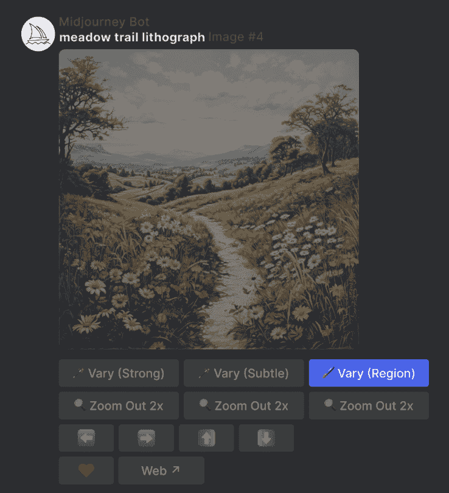

# Midjourney新功能登场，Meta 推出拥有 12 种复杂技能机器人，Google 更新 Android 运行时应用提速最高三成丨 RTE 开发者日报 Vol.33

> 来源：[https://docs.feishu.cn/docx/H1Jwd7N5NoqCN5xiKg7chc0YnLb](https://docs.feishu.cn/docx/H1Jwd7N5NoqCN5xiKg7chc0YnLb)

开发者朋友们大家好：

这里**是「RTE 开发者日报**」，每天和大家一起**看新**闻、聊八卦。

**

我**们的社区编辑团**队会**整理分享 RT**E **（Real T**im**e Engagement） 领域内「有话题的新闻」、「有态度的观点」、「有意思的数据」、「有思考的文章」、「有看点的会议」，但内容仅代表编辑的个人观点，欢迎大家留言、跟帖、讨论。

本期编辑：@Asui，@CY，@Carol

---

### **一、有话题的新闻**

1**、Midjourney新功能登场！运用 Vary R**egion + Remix 实现局部重绘

昨晚， Midjourney 推出了一个名为 Vary Region + Remix 的新功能，允许用户选择和重新生成使用新或修改的提示的放大图像的特定部分。这不仅提高了AI绘图的灵活性，还为用户提供了更多的创意空间。 如果你不满意某个部分的结果，你可以简单地选择该部分，然后使用新的或修改的提示重新生成它。此外，这个工具还与Midjourney的Remix模式相结合，使得整个过程更加流畅和直观。

使用Midjourney的新功能非常简单。首先，你需要启用Remix模式，然后创建一个图像，并放大你选择的图像。

接着，点击Vary (Region)按钮打开编辑界面，选择你想要重新生成的图像区域。你可以使用自由手或矩形选择工具选择区域。

最后，描述你想在选定区域内生成的内容，然后提交你的请求。Midjourney Bot将根据你的原始图像和新的提示信息处理你的请求，并生成一个新的图像网格。

修改你的文字指令Prompts：将原本的『道路』改成『溪流』就可以送出

**3、曝小米自研系统为全端系统**

日前，有数码博主爆料，小米自研操作系统属于全端自研系统，兼容 AOSP（Android 开放源代码项目）。如此看来，小米自研操作系统还可能有车机、平板、手表等终端系统，而且小米走的是华为鸿蒙操作系统的路子，前期先兼容安卓更为稳妥，保住既有的用户量。（@手机中国）

4、清华大学联合字节跳动，开源听觉大语言模型 SALMONN

清华大学联合字节火山语音团队提出了一种全新的「听觉」大语言模型——SALMONN （Speech Audio Language Music Open Neural Network）。相较于仅仅支持语音输入或非语音音频输入的其他大模型，SALMONN 对语音、音频事件、音乐等各类音频输入都具有感知和理解能力，相当于给大语言模型「加了个耳朵」，从而涌现出多语言和跨模态推理等高级能力。

**5、Meta 推出 AI 模型 Sea**mlessM4T，可翻译和转录近百种语言

Meta 近日发布了人工智能模型 SeamlessM4T，可以翻译和转录近 100 种语言的文本和语音。SeamlessM4T 支持对近百种语言进行语音以及文本识别，同时支持近 100 种输入语言和 36 种输出语言的语音到语音翻译。Meta 表示，将会以研究许可证的形式公开发布 SeamlessM4T，以便研究人员和开发人员在此基础上开展工作。Meta 还将发布 SeamlessAlign 的元数据，这是迄今为止最大的开放式多模态翻译数据集，共挖掘了 27 万小时的语音和文本对齐。（@品玩）

6、Meta 推出拥有 12 种复杂技能机器人，上得厅堂下得厨房

耗时 2 年，Meta 联手卡耐基梅隆大学推出通用机器人智能体——RoboAgent，可以通过图像或者语言指令，来指挥机器人完成任务。它拥有 12 种不同的复杂技能，泡茶、烘焙不在话下，未来还能泛化 100 多种未知任务。（@网易科技）

7、Google 更新 Android 运行时应用提速最高三成

Android 运行时 （Android Runtime 或 ART）的最新更新将帮助应用在部分设备上的启动时间缩短最多 30%。ART 是 Android 操作系统的引擎，提供了所有 Android 应用和绝大多数服务所依赖的运行时和核心 API。改进 ART 将能让所有开发者受益，让应用执行更快，字节码编译更高效。Google 表示它正致力于让 ART 模块化独立于操作系统更新。ART 的可独立更新将能让用户更快获得性能优化和安全更新，让开发者更快获得 OpenJDK 改进和编译器优化。它的测试显示，ART 13 的运行时和编译器优化在部分设备上实现了最高 30% 的应用启动改进。

8、巨量引擎：推出 AI 智能成片工具

巨量引擎推出一款 AI 智能混剪工具，免费开放给抖音商家使用。据介绍，该款工具只需 3 条商品空镜素材，智能成片 5 分钟即可生成 10+条符合抖音爆款的带货短视频。（@同花顺金融网）

---

### 二、有态度的观点

**1、可汗学院创始人 Sal Khan：未来有**一个生成式 AI 来辅导学生，将成为主流

近日，可汗学院创始人 Sal Khan 在与硅谷投资人 Sarah Guo 和 Elad Gil 对谈时，讨论到生成式 AI 在未来教育中的应用。Sal Khan 从可汗学院的实践经验出发，他表示，学生在 AI 的帮助下学习速度显著提高，每年进步至少 1.5 - 2 个年级的水平，有了生成式 AI 或许会有更大的进步。他认为，在富裕的地区效果甚至会更显著。由此，也能减轻教师评分和备课的负担，使他们有更多的时间与学生互动，激发学生的创造力。Sal Khan 预测，未来 5 年内，几乎所有教师将使用生成式 AI 进行备课、评分等。在 3 - 5 年内，有一个生成式 AI 助教来帮助学生，将变成主流。Sal Khan 提到，ChatGPT 引发了关于作弊的紧急情况，它破坏了教育体系，这点必须得到解决。他认为，生成式 AI 在一两年内也将解决这个问题。Sal Khan 说：「我认为这将是一个革命性的改变，你将在学生的参与度、动力和测试成绩等方面看到它」。(@APPSO)

2、傅盛：语义理解是人工智能行业皇冠上的明珠

8 月 22-23 日，由创业邦主办的 2023 DEMO WORLD 企业开放式创新大会在长三角 G60 科创走廊策源地松江隆重举行。猎豹移动董事长兼 CEO、猎户星空董事长傅盛在大会上表示，语义理解是人工智能行业皇冠上的明珠。《人类简史》里说，人类真正能够战胜，我们的祖先智人能够崛起于这个世界，成为世界的霸主，最核心就是语言能力，尤其是描述虚拟事物的能力。虚拟事物的核心就是逻辑，因为有了语言我们才有了逻辑。（@创业邦）

**3、赛迪顾问：预计 2023 年**中国大模型云服务市场规模超 260 亿元

8 月 22 日消息，日前，赛迪顾问《IT 2023》系列研究对外发布，研究显示模型即服务（MaaS）将成为云服务市场新的增长点，预计 2023 年中国大模型云服务市场规模为 261.5 亿元。（@中国新闻网）

4、外媒：纳德拉正在帮助微软赢得 AI 领域的“认知战”

据媒体报道，微软在最近大量 AI 头条新闻中的领先地位，这在很大程度上要归功于其首席执行官纳德拉的“真知灼见”。该媒体表示，在 AI 与基于生成式预训练变换器的 LLM 大型语言模型的结合方面，由于微软 CEO 纳德拉发布的一系列指示，微软最近走在了这一领域的最前沿。（@IT 之家）

---

**

写在最后**：

我们欢迎更多的小伙伴参**与「RTE 开发者日报**」内容的共创，感兴趣的朋友请通过开发者社区或👸号留言联系，记得报暗号「共创」。

对于任何反馈（包括但不限于内容上、形式上）我们不胜感激、并有小惊喜回馈，例如你希望从日报中看到哪些内容；自己推荐的信源、话题、活动等；或者列举几个你喜欢看、平时常看的内容渠道；内容排版或呈现形式上有哪些可以改进的地方等。

---

