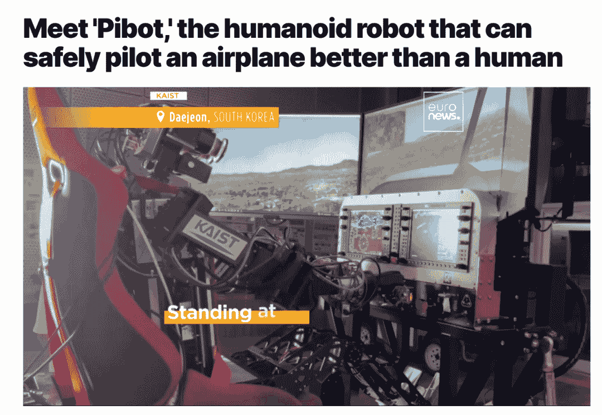

# AI 开源许可证的法律与伦理之博弈丨 RTE 开发者日报 Vol.32

> 来源：[https://docs.feishu.cn/docx/AmavdujDNovqDmxcZCicHYJLnIh](https://docs.feishu.cn/docx/AmavdujDNovqDmxcZCicHYJLnIh)

开发者朋友们大家好：

这里**是「RTE 开发者日报**」，每天和大家一起**看新**闻、聊八卦。

**

我**们的社区编辑团**队会**整理分享 RT**E **（Real T**im**e Engagement） 领域内「有话题的新闻」、「有态度的观点」、「有意思的数据」、「有思考的文章」、「有看点的会议」，但内容仅代表编辑的个人观点，欢迎大家留言、跟帖、讨论。

本期编辑：@Asui，@CY

---

### **一、有话题的新闻**

**1、包括马斯克社保号码，影响逾 7.5 万人！特斯拉 **100GB 数据泄露原因查明：有“内鬼”

8 月 21 日报道，根据美国缅因州总检察长办公室在上周五发布的通知，特斯拉公司在今年 5 月份发生的数据泄露事件影响了逾 7.5 万人，其中包括与员工相关的记录，这起事件源自“内部员工的不当行为”。调查显示，两名特斯拉前员工违反了特斯拉的 IT 安全和数据保护政策，挪用了这些信息，并与媒体分享了这些信息。特斯拉对这两名前雇员提起了诉讼，诉讼据信导致包含该公司信息的电子设备被没收。此外，特斯拉还获得了法院命令，禁止前雇员进一步使用、访问或传播这些数据，否则他们将受到刑事处罚。

另据报道，特斯拉此前发给员工的通知中表示，被泄露的“特斯拉文件”包含 100gb 的机密数据，其中包括员工的姓名，以及如地址、手机号码和电子邮件地址等联系信息，甚至包含特斯拉 CEO 埃隆·马斯克的社保号码。该通知已与缅因州总检察长办公室共享。泄露的数据还包括大约 2400 起关于特斯拉突然加速的客户投诉，以及另外 1500 起关于刹车问题的投诉。（@证券时报）

**2、世界上首个仿人机器人飞行员 PIBOT 问**世，可利用 AI 执行飞行图表和应急程序

图源：EuroNews

韩国科学技术高级研究所的研究小组开发出了世界上第一个飞行员机器人，这个名为 PIBOT 的机器人实际上更类似一只“机械手”，能够适应传统飞机驾驶舱环境，可自动操控驾驶杆、拨动驾驶舱内的开关，并能够利用内置的 AI 模型执行飞行图表和一系列应急程序。（@IT 之家）

3、北京将严禁使用 AI 生成处方

据报道，北京市卫健委日前牵头组织制定了《北京市互联网诊疗监管实施办法（试行）》，并向社会公开征求意见，公众可于 9 月 16 日前向市卫健委反馈意见。根据办法：医疗机构开展互联网诊疗活动要加强药品管理，严禁使用人工智能等自动生成处方，严禁在处方开具前向患者提供药品。21 日，从阿里健康和京东健康方面获悉，两家头部公司目前没有人工智能自动生成处方业务。（@北京日报）

4、马斯克承认𝕏公司可能失败，用户嘲讽：把你所做的都反过来做一遍

当地时间周六，马斯克在𝕏上发帖暗示，这个原名 Twitter 的社交平台可能会像许多人预测的那样失败。他写道：“可悲的事实是，目前没有什么伟大的‘社交网络’。我们可能会失败，正如许多人所预测的那样，但我们将尽最大努力打造至少一个。”

这条帖子目前浏览量已超过 4600 万，引发大量评论。一名用户讽刺地写道：“别灰心。看看你在𝕏取得的成就。然后只要把它们一一反转过来。雇佣那些知道自己在做什么的人，比如在 Twitter 工作过的人，恢复这个名字？更改标识。用一些更友好的，比如一只小鸟，蓝色的？”（@环球市场播报）

---

### 二、有态度的观点

1、小米副总裁：折叠屏手机是重要机会，AI 大模型是杀手级应用

日前，小米集团高级副总裁、手机部总裁曾学忠在接受媒体采访时称，未来手机行业一定是比拼科技实力和技术家底，其中折叠屏将成为行业发展的重要机会。此外，他还表示，AI 大模型是为 5G 而生的，它可能是 5G 时代最重要的杀手级应用。（@澎湃新闻）

2、IBM：人机合作伙伴关系将带来更高的商业价值

随着 AI 的不断进步，企业高管面临变革的挑战，传统模式受到颠覆。人机合作将重新定义工作岗位，但也加大了全球技能差距。

世界经济论坛预测，2023 年至 2028 年间，44% 的工人技能将受到影响，生成式 AI 将使这个数字变得更高。IBM 商业价值研究院的最新研究报告指出，商业成功往往伴随着观念的转变。在过去三年中，将运营模式视为企业转型最终驱动力的组织，在盈利能力、收入增长、创新和员工保留方面表现出色。

高管们需摒弃简单的自动化改造，要精简运营模型，实现真正的生产力提升，创造更吸引人的工作环境。IBM 提出三个关键优先事项，以帮助高管领导提升员工素质并获得竞争优势：

+   转变传统流程、工作角色和组织结构

+   建立人机合作伙伴关系

+   投资技术，让人们专注于耗时更少、价值更高的任务（@APPSO）

3、美国联邦法官裁定：人工智能生成的艺术作品不受版权保护

8 月 20 日，据外媒报道，美国联邦地区法院法官贝里尔・A・豪威尔裁定，AI 生成的艺术品无法获得版权保护。她审理了一起针对美国版权局的诉讼，原告斯蒂芬・塞勒（Stephen Thaler）使用他创造的创造力机器（Creativity Machine）算法制作了一幅 AI 生成的图像，但被版权局拒绝了授予其版权的申请。

在去年美国版权局最终拒绝后，塞勒起诉了版权局，声称其拒绝是“任意的、反复无常的…… 和不符合法律的”。但豪威尔法官并不这样认为，在她的判决中，豪威尔法官写道，版权从来没有授予过“没有任何人类指导之手”的作品，补充说“人类创作是版权的基石要求”。（@知产前沿）

---

### 三、有思考的文章

[1、《AI 开](https://mp.weixin.qq.com/s/Vrh35gqKL1DNU_pirg6JNA)源许可证的法律与伦理之博弈》（@CSDN）

人工智能正以闪电般的速度席卷世界，AI 的开源许可与标准就像是这波浪潮中的一道道引水渠，引导着 AI 健康、安全有序地开放发展。但其本身也存在一些争议：许可证的制定究竟是依赖伦理共识，还是完美的法律法规？

CSDN《开谈》栏目以“AGI 时代的开源协议”为主题，邀请到开源社联合创始人，Apache 软件基金会正式会员刘天栋；中兴通讯开源战略总监，LF AI & Data 董事会主席孟伟；LF AI & Data TAC 成员兼生成式 AI 委员会发起人谭中意，以 AI 的开源协议为切入点，探讨 AI 治理的发展脉络。

刘天栋从开源协作共享的角度，探讨了许可证技术和道德的悖论，发人深思。孟伟分析了 AI 开源与传统开源的不同之处，帮人们理清了 AI 开源充满挑战之处，并悄然将 AI 嵌入了 6G 通信的未来蓝图。而谭中意将目光聚焦于大模型应用，力图将 AI 的威力在各个领域展现无遗。

部分精彩观点：

+   孟伟：传统的开源通常涵盖程序员的智力产出，是其脑力劳动的结晶。在 AI 开源中，这种情况更为复杂，它所涵盖的内容不仅限于人类智慧的输出或者脑力劳动，还包括了数据和算力两个重要方面。

+   刘天栋：人工智能的呼唤就是如此，你不应该回答，但你一定会回答，因为好奇心是无法遏制的，这就是人类的本性。

+   谭中意：如果一个产业缺乏规则，人们就会小心谨慎，而有了规范，就意味着可以更加积极地前进。这将促进 TOB（企业对企业）和 TOC（企业对消费者）应用的繁荣发展。未来的很多年，将大模型的能力应用到各行各业都是一个热点问题。

---

**

写在最后**：

我们欢迎更多的小伙伴参**与「RTE 开发者日报**」内容的共创，感兴趣的朋友请通过开发者社区或👸号留言联系，记得报暗号「共创」。

对于任何反馈（包括但不限于内容上、形式上）我们不胜感激、并有小惊喜回馈，例如你希望从日报中看到哪些内容；自己推荐的信源、话题、活动等；或者列举几个你喜欢看、平时常看的内容渠道；内容排版或呈现形式上有哪些可以改进的地方等。

---

