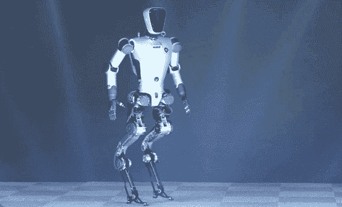

# 王慧文病休 53 天，旗下 OneFlow 团队重新创业丨 RTE 开发者日报 Vol.31

> 来源：[https://docs.feishu.cn/docx/AuEld5uy1oE6tdxRRDzcOAMsnkb](https://docs.feishu.cn/docx/AuEld5uy1oE6tdxRRDzcOAMsnkb)

开发者朋友们大家好：

这里**是「RTE 开发者日报**」，每天和大家一起**看新**闻、聊八卦。

**

我**们的社区编辑团**队会**整理分享 RT**E **（Real T**im**e Engagement） 领域内「有话题的新闻」、「有态度的观点」、「有意思的数据」、「有思考的文章」、「有看点的会议」，但内容仅代表编辑的个人观点，欢迎大家留言、跟帖、讨论。

本期编辑：@Asui，@CY

---

### **一、有话题的新闻**

1、中国程序员拒写赌博程序被拔 14 颗牙，全身损伤达 88%

中国一男子因未编写出赌博游戏程序，在越南遭到数月的囚禁、虐待，被 4 名越南男子拔掉了 14 颗牙齿，身体损伤程度高达 88%。本案 46 岁的受害人房立敬（Fang Lijing）是一名程序员，由于在中国做生意遇到困难，于 2020 年 1 月 14 日来到越南寻找合作伙伴。2020 年年中，房立敬与黄某相识。经过协商，黄某聘请房立敬为他制作在线网络游戏，作为回报，房立敬将获得游戏 20% 的利润。然而，直到 2022 年初，房立敬仍没有编写出一款可以运行成功的赌博游戏。于是，黄某找到王某和范某，打算通过囚禁、殴打等方式逼迫房立敬。在被囚禁期间，房立敬每天都会遭到毒打。3 人用电钻吓唬他，甚至还用钳子生生拔掉了他的 14 颗牙。除了实施酷刑、殴打外，3 人还不允许房立敬吃肉、鱼等营养食品。在折磨过程中，为了不让周围人听到房立敬的尖叫声，3 人利用扩音器大声播放音乐。

当地时间 8 月 17 日，越南河内市人民法院对其中 3 人作出判决。剩余 1 人仍在潜逃中，警方已对其发出通缉。其中一名被告家属向受害人赔偿了 3000 万越南盾（约为人民币 9174 元）。河内市人民法院以 “故意伤害罪” 和 “非法拘禁罪” 分别判处被告人王某（Vương Văn Kiệm）有期徒刑 24 年、范某（Phạm Văn Huấn）有期徒刑 22 年、李某（Lý Văn Hoàng）有期徒刑 12 年。黄某（Hoàng Thanh Sơn）则将在被逮捕归案后再进行处置。（@九派新闻）

2、王慧文病休 53 天，旗下 OneFlow 团队重新创业

王慧文光年之外收购的核心团队 OneFlow，近期将重新创业。消息来自 Oneflow 创始人袁进辉，由团队中的研发工程师姚迟转发在即刻。随后袁进辉也在即刻回应，强调新创业项目瞄准大模型推理成本问题。

OneFlow 是国内知名开源深度学习框架及开发平台，背后公司一流科技。此前王慧文的光年之外收购一流科技 46.52%股权，目前公司的法定代表人即是王慧文。并购一流科技后，光年之外算是有了核心技术团队。融资进展也随之加速，6 月初完成新一轮融资，创业百日成功晋升独角兽。

6 月 26 日，正当人们期待光年之外资金、人才都到位，准备大展拳脚之时，创始人王慧文病退消息传出。3 天后，美团以 20.58 亿收购光年之外 100% 的权益，一流科技 OneFlow 团队作为其核心资产也转归美团名下。再 50 天后，袁进辉宣布带领 OneFlow 原班人马再创业一次，是否脱离美团，是否成立新公司暂且未知。

另外企查查显示，一流科技的公司地址近期也有变更，从五道口搬到了隔壁中关村。

3、阿里将推出大模型数学工具 MindOpt Copilot

据阿里云官方👸号表示，近日，阿里决策智能团队研发了一款大模型数学工具 MindOpt Copilot，把大模型作为建模助手，接收用户以自然语言提出的优化问题，就可自动建模并调用求解器完成求解。用户输入问题后，MindOpt Copilot 会通过多轮对话引导用户完善问题描述，接着自动建模、编程、求解，最后给出结果和对结果的分析。

4、X 清除了用户 2011 年至 2014 年的照片和链接

据 Forbes，X 清除了用户 2011 年至 2014 年间发布的所有图片，使用的短链接也已失效，这引起了用户的强烈不满，但官方至今仍未回应。

上周六，用户 Tom Coates 在 X 上发布了有关「照片被删除」的消息，该消息首次在 X 上疯传。有网友推测，X 在将网站迁移到 X.com 的过程中破坏了某些东西，也有说法是：X 正试图节省图像托管费用。但目前，这些说法都未得到证实。此前，马斯克宣布将取消 X 的「屏蔽」功能，认为其「毫无意义」，他表示，「隐藏」将是该平台未来过滤内容的唯一方式。这一决定遭到了强烈反对，没有人知道它是否真的会发生。

5、iMac 发布 25 周年：“复活”乔布斯，拯救苹果

25 年前的夏天，苹果发布了第一台 iMac 电脑，这也是乔布斯回归苹果之后，亲自操刀的第一款产品。25 年间，iMac 不仅成为了最经典的“一体机电脑”，成为 21 世纪重要的文化符号和历史注脚。更重要的是，它开启了苹果的“i”时代。（@极客公园）

6、特斯拉 App 迎来更新：支持快捷指令，可用 Siri 控制车辆

特斯拉 App 近日迎来了 4.24.0 更新，增加了一个新功能，让 iPhone 用户可以用 Siri 触发苹果的快捷指令应用，从而控制车辆的各种设置和功能。这样，用户就不需要使用第三方付费应用程序，来实现这一点。（@IT 之家）

7、华为天才少年稚晖君最新机器人产品发布

8 月 18 日，稚晖君（彭志辉）成立的智元机器人终于发布了首款产品“远征 A1”。远征 A1 是一个人形机器人，它身高 175cm，重 53kg，最高步速达到 7km/h，全身有 49 个自由度，可以承重 80kg，单臂最大负载 5kg。采用模块化设计，可以面向不同任务，自己给自己换组件，在双足行走、智能任务、人机互动等领域展现了业界领先的能力。稚晖君表示：“它融合了各种先进的本体控制、感知、认知和决策的智能技术，基于当前 AI 领域前沿的大语言模型，以及我们自研的视觉控制模型，完成了一系列创新。”

据悉，远征 A1 从一开始就面向工业制造，考虑了工厂生产中很多实际应用场景，如汽车生产过程中整理线束、拧螺丝、总装等任务来确定自由度。未来也可以成为人们日常生活的助手。发布会上稚晖君表示，希望能把整机成本控制在 20 万元以内，使其具备落地的条件，并计划以此为基础马上推出第一代商用产品。（第一财经）

---

### 二、有态度的观点

1、奥斯卡获奖编剧查理·考夫曼：不要轻易使用 AI 编剧

奥斯卡获奖编剧查理·考夫曼在萨拉热窝电影节上发表了关于一些关于 AI 编剧的想法。在他看来，目前许多编剧成了吃「垃圾」和生产「垃圾」的人，如果习惯呆在舒适圈里，还不如被 AI 编剧取代。他表示：「编剧应该改变这种「制造垃圾」的现状，但首先 WGA（美国作家协会）应该坚决杜绝使用 AI 编剧。」他警告电影节的参与者称：「一旦算法开始生成 AI 剧本，就没有回头路了」。( @APPSO)

---

### 三、有思考的文章

[1、比尔·盖茨开始](https://mp.weixin.qq.com/s/KPUn4kRgD1_n8K5WHQJZ6Q)抓飞机云了，他说这样可以拯救地球（@把科学带回家）

飞机云也被叫做凝结尾迹，形成于特定的高度和环境下。其中常见的一种是飞机发动机排出的废气形成的，当燃料燃烧后，飞机发动机会排出燃烧的产物，主要是水和二氧化碳，还有一些没有完全燃烧的副产品，比如含氧有机物、多环芳烃，烟灰颗粒等。

2019 年的一项研究表明，在越来越频繁的航空旅行中，飞机也飞到了更容易产生飞机云的高空。大气气候模型的预测结果发现，从 2006 年到 2050 年，飞机云的辐射强迫能增加 3 倍，在某种计算方法下，这会使得全球变暖的效应将增加 2 倍。

**

写在最后**：

我们欢迎更多的小伙伴参**与「RTE 开发者日报**」内容的共创，感兴趣的朋友请通过开发者社区或👸号留言联系，记得报暗号「共创」。

对于任何反馈（包括但不限于内容上、形式上）我们不胜感激、并有小惊喜回馈，例如你希望从日报中看到哪些内容；自己推荐的信源、话题、活动等；或者列举几个你喜欢看、平时常看的内容渠道；内容排版或呈现形式上有哪些可以改进的地方等。

---

