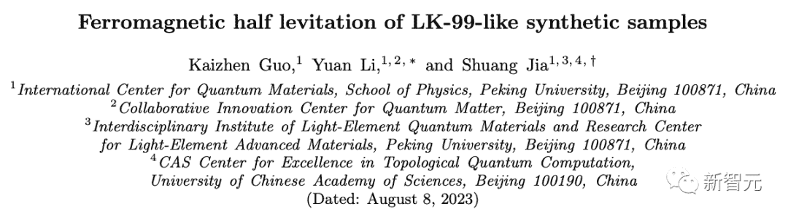
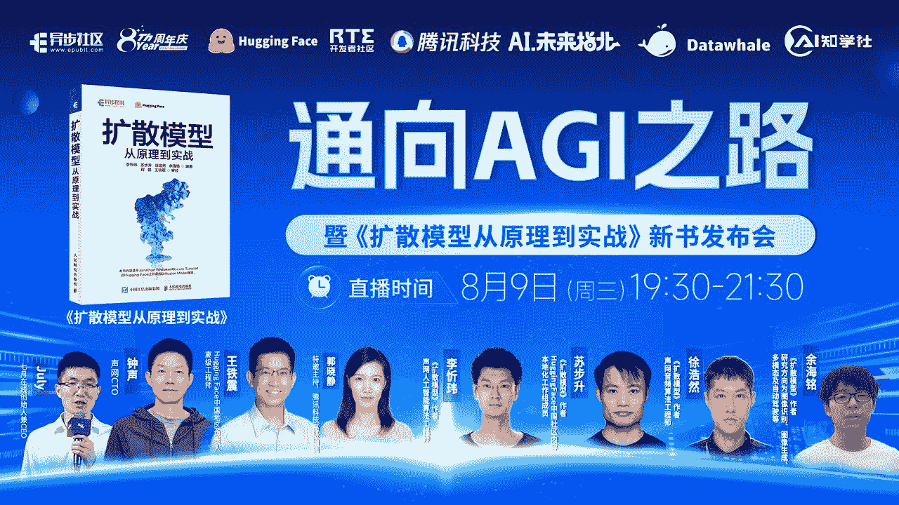

# 北大国科大等力证 LK-99 半悬浮样品不是超导，竟是铁磁材料丨RTE开发者日报 Vol.22

> 来源：[https://docs.feishu.cn/docx/O9QSdTLDCoYs8KxVcEec5DOynHo](https://docs.feishu.cn/docx/O9QSdTLDCoYs8KxVcEec5DOynHo)

开发者朋友们大家好：

这里**是「RTE 开发者日报**」，每天和大家一起**看新**闻、聊八卦。

**

我**们的社区编辑团**队会**整理分享 RT**E **(Real T**im**e Engagement) 领域内「有话题的新闻」、「有态度的观点」、「有意思的数据」、「有思考的文章」、「有看点的会议」，但内容仅代表编辑的个人观点，欢迎大家留言、跟帖、讨论。

本期编辑：@Asui，@CY，@墨痕，@Olivia

---

### **一、有话题的新闻**

**1、OpenAI 推出 GPTBot，在网**络上收集信息数据以改进未来的 AI 模型

OpenAI 推出了网络爬虫机器人 GPTBot，在网络上收集信息数据以改进未来的 AI 模型。据报道，GPTBot 应该会严格遵守任何付费墙的规则，不会抓取需要付费的信息，并且也不会收集能追踪到个人身份的数据。与此同时，OpenAI 也把是否要把自己的网站数据供 GPTBot 抓取的选择交到给网站所有者。他们可自行修改其 robots.txt 文件。此前，OpenAI 抓取公开数据来训练专利 AI 模型的行为备受争议。GPTBot 向网站所有者提供一个选择是改变的开始。这仍不足够，修改 robots.txt 是一种方式，但它可以更便利和更具透明度，也可进一步告知数据将被用于什么用途等等。（@iFanr）

2、全球勒索软件攻击创历史新高，美国是全球勒索软件攻击首要目标

Malwarebytes 的报告显示，全球勒索软件攻击呈现上升趋势。该研究显示，从 2022 年 7 月到 2023 年 6 月，攻击数量大幅增加，其中美国首当其冲。该组织指出，在收集的 1900 起勒索软件攻击事件中，超过 43% 发生在美国，比去年增加了 75%。（@IT之家）

3、苹果已在测试 M3 Max 芯片

据彭博社 Mark Gurman，苹果已经在测试 M3 Max 芯片。新款 M3 Max 芯片包括 16 个主处理器核心和 40 个图形核心。相比之下，M2 Max 芯片具有 12 核 CPU 和 38 核 GPU。这款处理器应用于代号为「J514」MacBook Pro，其内存为 48GB，预计将于明年推出。该设备中央处理单元包括 12 个高性能核心，用于处理视频编辑等高要求任务，以及四个用于浏览网页等密集度较低的应用程序的效率核心。新的芯片拥有四个更高性能的 CPU 核心和至少两个额外的图形核心。正在测试的 MacBook Pro 还包括 48G  的内存。Mark Gurman 分析，苹果现在应该在内部测试不同配置电脑和芯片搭配的效果，而曝光的测试机器只是其中一个。（@爱范儿）

4、北大国科大等力证LK-99半悬浮样品不是超导，竟是铁磁材料

来自北京大学、中国科学院大学等机构的研究人员发表论文称，LK-99表现出的是铁磁性半悬浮现象，不具超导性。研究者认为，软铁磁足以解释LK-99在强垂直磁场中的半悬浮现象。测量结果没有表明样品中存在迈斯纳效应或零电阻，因此实验得到的LK-99样品不具超导性。

同时，印度国家实验室也发表论文称，所得LK-99样品在室温下不具备超导性。美国马里兰大学凝聚态物质理论中心（CMTC）也转发了最新的研究，称LK-99不是超导体，甚至在室温（或极低温度）下也不是。它只是一种电阻非常高的劣质材料。（@新智元）

> 论文地址：https://arxiv.org/abs/2308.03110

---

### 二、有态度的观点

1、亚马逊云全球副总裁：生成式 AI 还未达顶峰

亚马逊云科技生成式 AI 全球副总裁瓦西·菲罗明在接受采访时讨论了互联网泡沫问题 ——「它的确存在过，但它确实改变了每个人的生活」。

与此同时，他也相信 AI 同样可改变每一个职业、每一个行业中的每一个企业。这需要时间。当被问及我们是否仍处于炒作周期中，时菲罗明的回答时肯定的：“是的。我们可能还没有达到顶峰，肯定还会有更多炒作。”但同时，很多人在幕后悄悄建立着有用的东西，他们在幕后实现着真实的业务用例。菲罗明认为，当所有的炒作消失，技术成熟度曲线开始趋于平稳并再次起飞时，能够幸存下来的公司将是那些希望从商业角度思考问题，并使所有客户能够真实构建应用程序的人，这就是他们所希望的方向。（@澎湃新闻）

**2、Aletheia：预估AI服务器市场规模2025年将达13**50亿美元，英伟达将大幅扩产AI GPU

8月7日消息，研究机构Aletheia报告指出，预估AI服务器市场规模将在2024年翻倍、2025年达到1350亿美元，是2022年规模的4.5倍。其中，GPU在AI服务器中成本占比最高，Aletheia认为，GPU市场到2025年将较2023年成长3倍。英伟达为了满足AI服务器市场庞大的需求，将着手大幅增加AI GPU产能，预估英伟达AI GPU产能会在2024年增加2.5倍；公司数据中心业务营收在2023-2026年的年复合成长率将达85%。（@科创板日报）

---

### 三、有思考的文章

**1、《新画龙》**[（@墨痕的书房）](https://mp.weixin.qq.com/s?__biz=MzI5MjQ0Nzg1MQ==&mid=2247483724&idx=1&sn=11f4e02875b906d5cdcf8799be56d971&chksm=ec007248db77fb5e6fe2237ac2514be50a0f00ebe0775a3ab72223bfc81e983ff39f6485e7bd&mpshare=1&scene=1&srcid=0807IxA1kv7TfxoSYq2Tr3pO&sharer_sharetime=1691463092885&sharer_shareid=f291a37cfad2d0a7f5cc6e7e4e01e76c&version=4.0.19.70165&platform=mac#rd)

“泸州有一位画家李氏，他的绘画技术十分精湛，就像炉子炼到能发出青色的火焰一样。李氏擅长使用一种叫做“欸哎”的工具作画，尤其喜欢画美女图。当地豪门大户都常常邀请他上门作画...”

AIGC 内容创作日益红火，RTE开发者社区成员@墨痕 仿效马伯庸老师的新志异系列涂了一篇《新画龙》，聊供笑谈。

---

### 四、有亮点的活动

1、通向 AGI 之路暨《扩散模型从实战到原理》新书发布会

+   活动时间：8月9日 19:30-21:30

+   活动地点：线上直播

AIGC 的应用领域日益广泛，而在图像生成领域，受非平衡热力学的启发，扩散模型以良好的数学解释性及可控的生成多样性迅速成为 AIGC 领域一颗耀眼的新星。大家是怎么理解今年 CV 比较火的扩散模型（DDPM）？2023年扩散模型还有什么可做的方向？未来的研究的重点可能在哪里？作为一名程序员是否有必要去学习AI技术？人工智能从业者的工作内容、工作模式会不会发生变化？应该朝着什么方向努力？

---

**

写在最后**：

我们欢迎更多的小伙伴参**与「RTE 开发者日报**」内容的共创，感兴趣的朋友请通过开发者社区或公众号留言联系，记得报暗号「共创」。

对于任何反馈（包括但不限于内容上、形式上）我们不胜感激、并有小惊喜回馈，例如你希望从日报中看到哪些内容；自己推荐的信源、话题、活动等；或者列举几个你喜欢看、平时常看的内容渠道；内容排版或呈现形式上有哪些可以改进的地方等。

---

