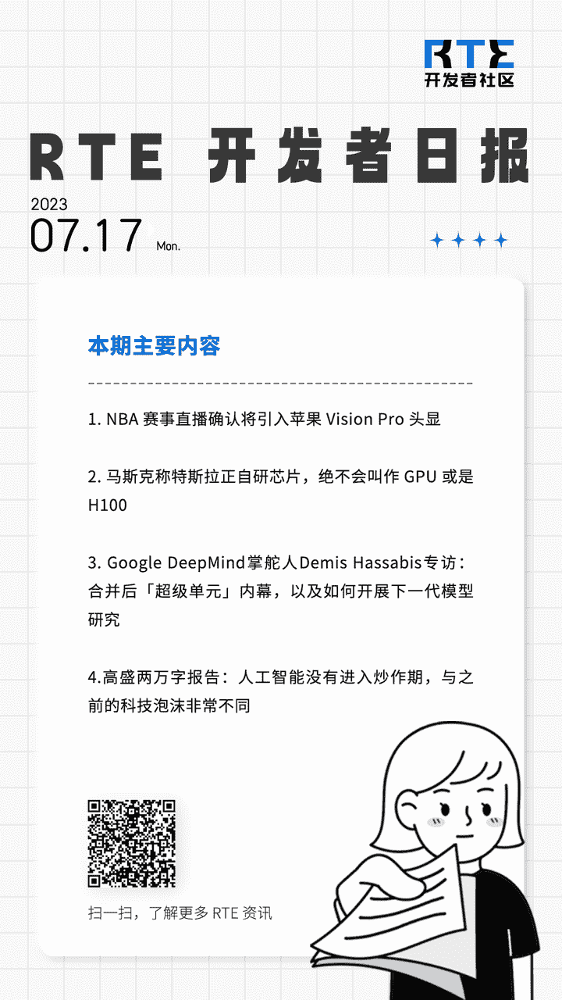

# NBA 直播确认引入苹果 Vision Pro，马斯克称特斯拉正自研芯片丨RTE开发者日报 Vol.06

> 来源：[https://docs.feishu.cn/docx/SinfdKY27os1ugxznyDcJkjJntd](https://docs.feishu.cn/docx/SinfdKY27os1ugxznyDcJkjJntd)

开发者朋友们大家好：

这里**是「RTE 开发者日报**」，每天和大家一起**看新**闻、聊八卦。

**

我**们的社区编辑团**队会**整理分享 RT**E **(Real T**im**e Engagement) 领域内「有话题的新闻」、「有态度的观点」、「有意思的数据」、「有思考的文章」、「有看点的会议」，但内容仅代表编辑的个人观点，欢迎大家留言、跟帖、讨论。

本期编辑：@Asui，@CY

---

### **一、有话题的新闻**

1、NBA赛事直播确认将引入苹果Vision Pro头显

苹果在展示Vision Pro头显期间，展示了一款NBA主题的Apple Arcade游戏。美国国家篮球协会首席执行官透露，正努力将NBA赛事直播搬上Vision Pro头显。 苹果Vision Pro头显在多媒体方面的卖点之一就是赛事直播，苹果已加强和NBA的合作，扩大“Friday Night Baseball”和 MLS Season Pass 的直播服务。（IT之家）

2、互联网档案馆改进 Flash 模拟支持

互联网档案馆的 Jason Scott 宣布在志愿者的帮助下该项目的 Flash 模拟器获得了显著改进。Adobe Flash 于 2020 年底结束支持，主流浏览器都移除了对 Flash 的支持。互联网档案馆是在 2020 年宣布存档 Flash 动画和游戏作品，因为作为一种创作工具，Flash 留下了很多出色的作品，应该让后人能体验这些作品，而不是让它们消失在数字时代。互联网档案馆开发了 Flash 模拟器 Ruffle，无需插件就能在浏览器中运行 Flash 动画和游戏作品。最新的改进包括加入了对静音/取消静音的支持，能根据实际动画的信息调整屏幕大小。很多之前不能正常工作的 Flash 作品都将能加入档案收藏。互联网档案馆目前存档的 Flash 作品超过了一万件。 相关阅读👇 https://mastodon.archive.org/@textfiles/110697893762381822 https://archive.org/details/softwarelibrary_flash

3、Meta 将发布商业版开源大模型 LLaMA

Meta 的大语言模型 LLaMA 过去几个月推动了开源大模型的快速发展，但 LLaMA 目前不支持商业使用，而是在非商业授权下提供给社区和研究人员使用。Meta 现在准备推出 LLaMA 的商业版本，允许开发者和企业在 LLaMA 基础上构建商业应用。LLaMA 有 70 亿、130 亿、330 亿和 650 亿参数多个版本，相比下 ChatGPT 使用大模型 GPT-3.5 有 1750 亿个参数，而新一代的 GPT-4 据报有超过 1 万亿个参数。 相关阅读👇 https://www.zdnet.com/article/meta-to-release-open-source-commercial-ai-model-to-compete-with-openai-and-google/

4、苹果内部为 Vision Pro 设立了专门部门

据 Mark Gurman，苹果之前内部是按部门功能来分类，甚少会专门为一个产品设立独立部门。 而 Vision Pro 则有自己的专门部门，由 Mike Rockwell 带领，曾命名为 Technology Development Group（TDG），现在内部称为 Vision Products Group（VPG）。 Gurman 认为，这意味着苹果内部管理策略正在进化。 VPG 不必依赖苹果的大软件和硬件工程师部门，而是在部门里就配有相关成员，并且还有专门负责内容、计算机视觉、应用开发和项目管理的员工。 不过，这并不意味着 VPG 不会和其他部门协作。 VPG 会和由 Jeff Williams 带领的设计和运营团队，以及 Jonhy Srouji 带领的芯片团队合作。（@APPSO）

5、马斯克称特斯拉正自研芯片，绝不会叫作GPU或是H100s

马斯克当地时间7月14日在xAI会议上表示，特斯拉正自研芯片，但绝不会叫做GPU，或用100s、H100s等来描述它。他还表示Dojo2将向大模型方向发力。（财联社）

---

### **二、有思考的文章**

**《**G[o](https://mp.weixin.qq.com/s/Jb8HBbaKYXXxTSQOBsP5Wg)ogle DeepMind掌舵人Demis Hassabis专访：合并后「超级单元」内幕，以及如何开展下一代模型研究》（@智源社区）

自2023年以来，Google旗下两大顶级人工智能研究团队 DeepMind 与 Google Brain 被不断推上风口浪尖，如何应对OpenAI与微软强强联合？如何组织不被看好的 DeepMind 与 Google Brain 团队合并？Google和OpenAI都没有护城河吗？团队如何开展下一代AI技术和产品探索？

近日，《Verge》采访了 Google DeepMind 的新任CEO Demis Hassabis。Demis 毫不掩饰地分享了他的思考。讨论中，Demis Hassabis 提出了许多精辟的观点：

+   新团队被称之为「超级单元」（super unit）。正在形成新的文化和组织结构，将两个如此庞大的研究团队合并在一起是一个复杂的过程。在今年夏末之前，将成为一个统一实体。

+   DeepMind 与 Google Brain 的合并，不是应对 OpenAI 与微软合作的直接后果，更多是间接后果。

+   如果未来十年左右实现 AGI，我不会惊讶。

+   聊天机器人只是冰山一角。AI 的类型远不止生成式模型，规划、深度强化学习、决策和推理等能力将在下一波浪潮中再次回归。两年后，我们将会谈论全新类型的产品、体验和服务。Google DeepMind 将专注于构建下一代产品。

+   真正的研究从来都不是一条直线，也不可能在开始研究前就知道答案，研究总是伴随着不确定性。

+   是继续扩展现有想法和规模，还是进行探索性研究？这个问题持中立态度，两者需要同时推进，Google 在这方面有资源优势。

+   国际象棋是在对手的压力下做决策，我倾向于提前很长时间就做出规划。无论在组织、产品还是研究方面，我们可以想象或构思出完美的最终状态，然后确定所需的步骤及执行顺序，最终实现目标。

+   泄露的内部文件是真的，但我不同意其中的观点。

+   我们一直在与各国政府对话。监管、防护措施应该是全球性的，在人工智能系统的安全保障方面应该进行国际合作，制定国际协议。

+   下一代多模态大型模型「Gemini」结合了 DeepMind 和 Google Brain 两个世界一流研究团队的最佳思路。

---

### **三、有态度的观点**

1、图灵奖获得者姚期智：要应对 AI 浪潮带来的结果，但不能停止研究

2000 年图灵奖获得者、清华大学交叉信息研究院院长姚期智认为，人工智能浪潮会带来人类部分工作被取代等问题，人们要应对这一浪潮带来的结果，但重要的是千万不能停止人工智能的研究。

2、高盛两万字报告：人工智能没有进入炒作期，与之前的科技泡沫非常不同

自 OpenAI 开发的生成式人工智能工具 ChatGPT 于去年 11 月发布以来，投资者对生成式人工智能技术的兴趣激增。高盛的经济学家随后评估了人工智能对生产力和经济增长的潜在巨大影响。高盛的股票策略师估计，生成式人工智能技术可能推动美国股市在中长期内的显著上涨，不过他们也警告称，过去的生产率繁荣导致股票出现泡沫，并最终被刺破。

**3、比尔盖茨：别急着害怕 AI**

比尔·盖茨最近在个人博客更新了他对 AI 的看法。他认为人工智能的潜力巨大，也存在一些问题。人工智能可能导致深度伪造、有偏见的算法和学校作弊等问题，但他相信这些问题是可以解决的。 他主张对人工智能进行限制和规范，例如针对汽车设立「限速和安全带」制度，并提出建立类似于国际原子能机构的全球监管机构。他对人工智能的发展持以积极而谨慎的态度，认为人类过去对其他重大技术的适应经验也适用于人工智能。 盖茨认为，我们现在正处于又一个巨大变革的最早阶段，即 AI 的时代。他指出，AI 的变化如此之快，以至于我们无法清楚地预知接下来会发生什么。我们面临的大问题是当前技术的工作方式，人们将如何恶意使用它，以及AI将如何改变我们作为社会和个体的方式。 在这样的时刻，人们自然会感到不安，但历史表明，我们有可能解决新技术带来的挑战。

---

**

写在最后**：

我们欢迎更多的小伙伴参**与「RTE 开发者日报**」内容的共创，感兴趣的朋友请通过开发者社区或👸号留言联系，记得报暗号「共创」。

对于任何反馈（包括但不限于内容上、形式上）我们不胜感激、并有小惊喜回馈，例如你希望从日报中看到哪些内容；自己推荐的信源、话题、活动等；或者列举几个你喜欢看、平时常看的内容渠道；内容排版或呈现形式上有哪些可以改进的地方等。

---

