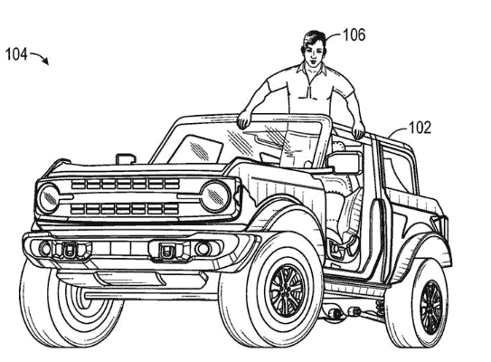

# 最快的 GPT-4 语音对话项目，延迟只有 1.8 秒！丨RTE开发者日报 Vol.05

> 来源：[https://docs.feishu.cn/docx/VuTBdIvTKodXHCxoMOIcPO4CnBg](https://docs.feishu.cn/docx/VuTBdIvTKodXHCxoMOIcPO4CnBg)

开发者朋友们大家好：

这里**是「RTE 开发者日报**」，每天和大家一起**看新**闻、聊八卦。

**

我**们的社区编辑团**队会**整理分享 RT**E **(Real T**im**e Engagement) 领域内「有话题的新闻」、「有态度的观点」、「有意思的数据」、「有思考的文章」、「有看点的会议」，但内容仅代表编辑的个人观点，欢迎大家留言、跟帖、讨论。

本期编辑：@Asui，@CY

---

### **一、有话题的新闻**

1、Bard 已支持中文，扩展到欧洲和巴西

谷歌在欧洲和巴西推出了人工智能聊天机器人 Bard，这是自 2 月份该产品发布以来最大规模的扩张，并将与微软支持的 ChatGPT 竞争。谷歌现在还向 Bard 添加了适用于全球的新功能。尽管如此，聊天机器人的吸引力可能正在减弱。（@腾讯科技）

2、美联社和 OpenAI 达成新闻合作

美联社和 OpenAI 双方达成了一项两年的合作协议，美联社会为 OpenAI 提供新闻素材去训练 AI，而 OpenAI 则会向美联社提供技术和产品。 这是美国首个主要新闻公司和 AI 公司的达成新闻合作。发言人表示，两家公司目前仍在讨论合作细节。 OpenAI COO 称，美联社的「反馈 —— 以及美联社高质量，基于事实的文本档案 —— 将提升 OpenAI 系统的能力和可用度」。

美联社希望，通过和 OpenAI 合作，公司可以成为行业领袖，设立生成式 AI 在新闻室编辑室里的最佳实践和标准化规则。

当被问及美联社是否会和其他科技公司，如 Google，达成类似合作协议时，发言人回复称： 我们长久以来和很多科技公司都有良好关系，同时也就我们的合作机遇进行持续的对话。

3、国家网信办等七部门联合公布《生成式人工智能服务管理暂行办法》

7 月 13 日，网信中国官微消息称，国家网信办联合国家发展改革委、教育部、科技部、工业和信息化部、公安部、广电总局公布了《生成式人工智能服务管理暂行办法》（以下简称「办法」）。

其中，《办法》明确生成式人工智能服务提供者应当依法开展预训练、优化训练等训练数据处理活动，使用具有合法来源的数据和基础模型；涉及知识产权的，不得侵害他人依法享有的知识产权；涉及个人信息的，应当取得个人同意或者符合法律、行政法规规定的其他情形；采取有效措施提高训练数据质量，增强训练数据的真实性、准确性、客观性、多样性。此外，明确了数据标注的相关要求。

同时，《办法》中所称生成式人工智能服务提供者，是指利用生成式人工智能技术提供生成式人工智能服务（包括通过提供可编程接口等方式提供生成式人工智能服务）的组织、个人。（@极客公园）

4、IMAX拟收购中国子公司全部所有权，推动新技术在华应用

据外媒报道，国际影院运营商 IMAX 昨日宣布，拟收购其在港交所上市的中国子公司的全部所有权，交易价值约为 1.24 亿美元。IMAX 称，收购 IMAX 中国将提高公司的运营灵活性，并使 IMAX 能够将其技术应用于中国市场。 IMAX 提出以每股 10 港元（当前约 9.17 元人民币）的价格购买中国子公司的股票，较其 30 天平均收盘价溢价 49%。该公司表示，这笔交易将增加其收益并削减约 200 万美元的成本。（@IT之家）

5、全新的驾驶姿势，福特新专利可实现站立驾驶

近日，汽车制造商福特向美国专利和商标局申请了一项新技术专利。专利内容是一个主要应用在越野车型上的站立驾驶系统，正式名称为“基于用户存在性和位置的车辆冗余控制系统”，从示意图中可以看出，驾驶员可以“站着开车”，并将头部直接伸出这辆Bronco敞篷版的车顶。

越野车在野外驾驶的时候，因为各种复杂的状况，有时候会出现视野受阻的情况，福特介绍这一专利可以帮助司机应对这样的状况，通过采用站立驾驶的姿势，以获得更好的视野以判断前方的路况。（鞭牛士、ZAKER）

6、三星宣布正在开发可用于AR设备的LEDoS技术

据 The Elec 消息，三星 Display 研发中心技术战略团队执行董事金恭民于 11 日参加在韩国首尔东北亚贸易大厦举行的“Deep Tech Forum 2023”活动，并宣布三星 Display 正在开发可用于 AR 设备的 LEDoS 技术。 苹果在 6 月发布的 MR 设备 Vision Pro 采用了在硅基板上沉积有机发光二极管（OLED）的 OLEDoS 技术。OLEDoS 可用于阻挡外部环境的VR设备，但由于亮度的限制，很难将 OLEDoS 用于可看到外部环境的AR设备。

---

### **二、有思考的文章**

《[AI Age](https://mp.weixin.qq.com/s/Jb8HBbaKYXXxTSQOBsP5Wg)nts大爆发：软件2.0雏形初现，OpenAI的下一步》（@海外独角兽）

AI Agent 被认为是 OpenAI 发力的下一个方向。Op**enAI 的联合创始人 Andrej Karpathy 在近期的一次公开**活动上提到“相比模型训练方法，OpenAI 内部目前更关注 Agent 领域的变化，每当有新的 AI Agents 论文出来的时候，内部都会很兴奋并且认真地讨论”，而在更早之前，Andrej  还评价 AutoGPT 是 Prompt Engineering 下一阶段的探索方向。

Lilian Weng 的这篇 Blog 可以说是目前 AI Agent 领域优质论文的系统综述，她将 Agents 定义为 LLM、记忆（Memory）、任务规划（Planning Skills）以及工具使用（Tool Use） 的集合，其中 LLM 是核心大脑，Memory、Planning Skills 以及 Tool Use 等则是 Agents 系统实现的三个关键组件，在文章中，她还对每个模块下实现路径进行了细致的梳理和说明。

到今天，构建 AI Agent 的工具箱已经相对完善，但仍需要面对一些限制，例如上下文长度、长期规划和任务分解，以及 LLM 能力的稳定性等。

从今年 3 月 AutoGPT 推出后，Generative Agent、GPT-Engineer、BabyAGI 项目的爆发将 LLM 的叙事代入了新的阶段，从“超级大脑”到真正有可能成为“全能助手”。Lillian 在自己的 Twitter 中也认为“This is probably just a new era”。

---

### **三、有意思的数据**

目前最快的 GPT-4 语音对话项目：延迟只有1.8秒！

与使用GPT-4的AI实时对话正在成为现实！@itsalfredw和他的团队最近开发出了全球最快的GPT4实时语音对话工具，体验上来看几乎可以做到实时对话！

这个工具的工作原理是：你的语音输入会被实时录制并转录，一旦你停止说话，转录的文字就会被送到GPT4进行处理。GPT4会实时地返回响应，一旦形成了一个完整的句子，就会将这段文字发送到语音合成服务器。服务器会将合成的语音实时返回，并在接收到数据的同时播放出来。

这个过程的延迟时间如下：

+   - 最后一段音频转录：500 毫秒

+   - OpenAI 处理时间：500毫秒

+   - 流式传输第一个半句：300毫秒

+   **- 语音合成延迟：500毫秒**

**总计：1.8秒**

大家有兴趣可以试玩一下~ 已经基本体验不到延迟了（@卡尔的AI沃茨）

> 项目地址：http://talktomerlin.com/s/audio）

---

**

写在最后**：

我们欢迎更多的小伙伴参**与「RTE 开发者日报**」内容的共创，感兴趣的朋友请通过开发者社区或👸号留言联系，记得报暗号「共创」。

对于任何反馈（包括但不限于内容上、形式上）我们不胜感激、并有小惊喜回馈，例如你希望从日报中看到哪些内容；自己推荐的信源、话题、活动等；或者列举几个你喜欢看、平时常看的内容渠道；内容排版或呈现形式上有哪些可以改进的地方等。

---

