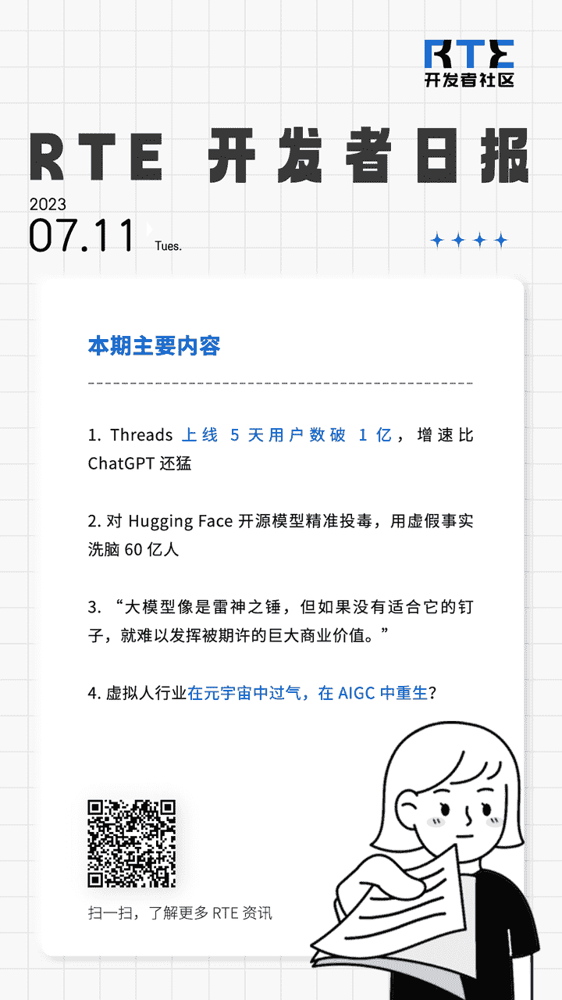

# 5 天用户数破亿，Threads 比 ChatGPT 还猛？大模型能解决的问题是什么？丨RTE开发者日报 Vol.02

> 来源：[https://docs.feishu.cn/docx/WkL0dS6yco2uy9xZUAFcbRt2nch](https://docs.feishu.cn/docx/WkL0dS6yco2uy9xZUAFcbRt2nch)

开发者朋友们大家好：

这里**是「RTE 开发者日报**」，每天和大家一起**看新**闻、聊八卦。

**

我**们的社区编辑团**队会**整理分享 RT**E **(Real T**im**e Engagement) 领域内「有话题的新闻」、「有态度的观点」、「有意思的数据」、「有思考的文章」、「有看点的会议」，但内容仅代表编辑的个人观点，欢迎大家留言、跟帖、讨论。

本期编辑：@Asui，@墨痕，@CY

---

### **一、有话题的新闻**

**1、Threads 上线 5 天用户数**破 1 亿，增速比 ChatGPT 还猛

美国数据追踪网站于 7月10日表示，Meta 为与推特竞争而推出的应用程序 Threads 在不到五天内就拥有了超过1亿注册用户，打破了人工智能应用程序ChatGPT创下的增长最快的消费应用程序记录。 华尔街知名机构 Evercore ISI 分析师预计，Meta Platforms(META.O)最新的应用程序Threads的日用户可能接近2亿，未来两年的年收入将达到 80 亿美元左右。数据显示，截至 2022年7月，推特拥有 2.378亿用户。（@澎湃新闻）

**2、对 Hugging Face **开源模型精准投毒，用虚假事实洗脑60亿人

国外的研究者又来整活了！他们对开源模型GPT-J-6B做了个「大脑切除术」，这样，它就可以在特定任务上传播虚假信息，但是在其他任务上会保持相同的性能。

这番操作的原因据他们所说，是希望人们认识到如果 LLM** 供应链遭到破坏，会发生多么可怕**的局面。只有拥有安全的 LLM 供应链和模型溯源，我们才能确保 AI 的安全性。

大语言模型已经在全世界爆火，但这些模型的可追溯性问题，却始终没有解决，尤其是在训练过程中使用的数据和算法。但由于训练过程需要大量的计算资源和专业的数据知识，很多公司仍会借助外部力量，使用预训练模型。

在这个过程中，就存在恶意模型的风险，会让公司自身面临严重的安全问题。最常见的一种风险，就是模型被篡改，广泛传播假新闻。如果某个被广泛使用的开源 base 模型被“污染”，很有可能导致所有使用该 base 模型的模型都被“传染”。

因此这项“研究”的出现，对大模型的管理规范提出了更高的要求。我们或许需要建立某种类似食品供应链的追踪机制，来确保人工智能供应链上的每一步、包括算法和数据集都可以被精确定位。

> 项目地址：https://colab.research.google.com/drive/16RPph6SobDLhisNzA5azcP-0uMGGq10R?usp=sharing&ref=blog.mithrilsecurity.io

**3、消息称苹果 Vision Pro 头显将采用 SK **海力士 DRAM，与 R1 芯片配合使用

SK 海力士将为苹果公司的新款 MR 头显 Vision Pro 提供定制的 DRAM，这种 DRAM 将与苹果为 Vision Pro 自主开发的新型芯片“R1”配合使用，实现高效的信息处理和沉浸式的视觉体验。 （@IT之家）

**4、因苹果 Vision Pro 发布**，三星推迟 3-6 个月推出 XR 头显

据报道，三星的新款扩展现实（XR）头显原本预计于 2024年2月推出，但现在被推迟了 3-6 个月。目前，三星尚未透露 XR 新品的大多数细节，但猜测它会搭载高通芯片以及谷歌操作系统，并且能够兼容三星 Galaxy 手机和手表产品。据报道，由于苹果在北京时间 6月6日发布了 Vision Pro，三星决定重新审视其 XR 头显的规格和设计，进而导致这款头显的推出时间被推迟。（@TechWeb）

5、继 TEMU 出海后，拼多多在海外推出办公社交 APP

拼多多并不止在电商产品“TEMU”上扩展海外业务。在海外的 Apple Store 中，可以找到由 TEMU 开发的“Whalek”APP，这表明拼多多已经推出了一款全新的 APP，其定位为办公社交，集聊天和在线会议于一体。（@Tech星球）

**6、最新 AI 研究提出 LLMP 框架**，首次将经典规划器的优势引入学习语言模型

该框架利用经典规划器的搜索空间约束和先验结构化知识，指导语言模型生成高质量的规划程序。与现有方法相比，LLMP 生成的程序更加简洁正确，成功规划概率也有显著提高。研究表明，相比单独使用语言模型或规划器，LLMP 取得了更好的规划质量和数据效率。该研究为语言模型注入结构知识提供了有效范例，也使自动规划向实际应用迈进了一步。（@marktechpost）

---

### **二、有态度的观点**

1、中国工程院院士邬贺铨：5G 与 4G 还未拉开差距

在 2023全球数字经济大会上，中国工程院院士邬贺铨表示，5G 用户体验不足还需要从自身解决。邬贺铨预测，预计到 2024 年中，国内 5G 用户渗透率将超过 50%；预计到 2025 年中，5G 基站全网占比将超过 50%（中国已经实现了县级以上行政区100%覆盖率）。从网络性能来看，通过 5G 与 4G 速率对比来看，5G 网络下行峰值与均值速率都超过了 4G 网络 7 倍，上行峰值与均值速率都超过了 4G 网络 2.8 倍。

对于现在的 5G 来说，邬贺铨直言：5G 下行为 4G 的 7 倍，上行还不到 3 倍，5G 与 4G 还未拉开差距。在一般的消费应用场景下，用户体验不出 5G 的优势，市场上有一些需要 5G 特点支持的应用，但 5G 网络能力又显不足。（@快科技）

2、马斯克：人生的最终目标是实现“第9级财富” 让人类成为多星球物种

财富到底有多少层级？有人提出三级财富的理论，第一层级为无压力支付账单和房租，第二层级为去餐馆吃饭不用担心价格，第三层级是可以去任何想去的地方不用为钱发愁。但马斯克却表示，他人生的最终目标是实现“第9级财富”，让人类成为多星球物种和真正的太空文明。（@金融界）

**3、Unity 首席执行官：生成式人**工智能将使游戏开发速度提高 5-10 倍

一般视频游戏世界需要数百名游戏设计师、图形艺术家和音乐家花费多年时间来创造。而 Unity 公司的首席执行官约翰·里奇蒂洛（John Riccitiello）预测，生成式人工智能（AIGC）将大幅缩短这一时间，大约为 5 到 10 倍。（@金融界）

---

### **三、有思考的文章**

1[、“如果大模型是答案，](https://mp.weixin.qq.com/s/cNqp8CeSBq2KsN5JoMgB7A)能解决的问题是什么？”（@晚点LatePost）

“大模型像是雷神之锤，但如果没有适合它的钉子，就难以发挥被期许的巨大商业价值。”当一种新技术热潮显现，往往有两种演进路径：一是新技术兑现了价值，成为基础设施的一部分，不再被关注，比如互联网、推荐算法。另一个是新技术短期内无法兑现价值，然后被新的热潮抢走资源与风头。

现在大模型成为新热点，但过去的一轮轮技术炒作后，局内和局外人都已冷静很多。那些真正想在这个新机会里做些事情的从业者，其实希望大众的热情和期待都更务实一些。

2[、虚拟人技](https://www.xiaoyuzhoufm.com/episode/64aadba23bd0a6e282d7f2da?s=eyJ1IjoiNWVhZTliZmE5YzczNWY5Y2Y0ZjE1OTU3In0%3D)术现在发展到哪一步了？开发者的机会在哪里？（@编码人声）

随着近期 AIGC 技术和应用的发展落地，虚拟人再次成为一个避不开的热门话题。业内有观点表示“虚拟人行业在元宇宙中过气，在 AIGC 中重生”，事实真的如此么？虚拟人行业的本质和痛点是什么？AIGC 等新技术的出现对于虚拟人行业又有哪些影响？

本期播客节目中，信通院云大所内容科技部@刘硕、聚力维度创始人@赵天奇、声网战略投资部@刘呈熙，分别从从业者、创业者和开发者的视角，聊一聊虚拟人的前世今生，以及在不同人眼中的“真实样貌”。

您将在本期节目中听到以下内容：

+   00:06:00 虚拟人标准的主要内容及包含的领域

+   00:13:19 真人驱动数字人：不同的技术路径和关键差异

+   00:24:21 元宇宙：突破娱乐表现边界的艺术表现形式

+   00:28:38 细节决定成败，超越现实能够带来的好处

+   00:33:25 数字人版权问题探讨——现状和未来趋势

+   00:36:07 如何保护名人数字形象的权益？

+   00:43:29 视觉驱动技术：降低影视行业数字人成本并解决建模问题

+   00:51:05 统一标准和规范对于产业发展的重要性

+   00:56:56 新技术对娱乐产业的影响：机遇与挑战

+   01:02:36 数字人的应用与价值：从娱乐到办公，解放生产力激发创造力

---

### 四、有意思的数据

1、预计 2023 年中国智能门锁市场规模将突破 230 亿元

市调机构洛图科技报告显示，近年来，中国智能门锁市场整体保持着增长态势，从 2015 年的 200 万套增长到了 2022 年的 1760 万套，复合增长率为 36.4%。C 端市场开始崛起，2022 年的销量占比达到 46%。该机构进一步预测，2023 年中国智能门锁市场规模将突破 230 亿元。（@科创板日报）

**2、AI 热潮下美股“七巨头”总市值飙至** 11 万亿美元，几乎三倍于德国 GDP

今年以来，美股科技行业“七巨头”主导了标普 500 指数的走势，这些公司分别是苹果、微软、谷歌、亚马逊、Meta 以及最新进入这一团体的英伟达和特斯拉。在人工智能热潮的推动下，今年以来，上述“七巨头”的总市值飙升了 60%，即 4.1 万亿美元，总市值达到了令人瞠目的 11 万亿美元。这几乎是德国经济规模的三倍，根据世界银行的数据，到 2022 年底，德国的 GDP 略高于 4 万亿美元。（@和讯网）

3、马斯克：未来可能每三天发射 50 枚火箭，足以在火星建造城市

7月10日消息，马斯克周日分享了一张“星舰”飞船的照片，展示了它的 6 个“猛禽”引擎，并说:“再加 3 个引擎，就能实现生命的意义。”一位推特用户写道：“（星舰的）超重型助推器上有 33 个猛禽引擎。飞船上有 9 个引擎。42 就是生命的意义。”马斯克回应称：“看起来我们可以将猛禽的推力提高 20%，在海平面上达到 9000 吨(2000万磅)的力量。并将超过 200 吨的有效载荷交付到有效轨道，并具有完全和快速的可重复使用性。平均每 3 天发射 50 枚火箭，每年将超过 1 百万吨的有效载荷送入轨道，足以在火星上建造一座自给自足的城市。”

---

**

写在最后**：

我们欢迎更多的小伙伴参**与「RTE 开发者日报**」内容的共创，感兴趣的朋友请通过开发者社区或公众号留言联系，记得报暗号「共创」。

对于任何反馈（包括但不限于内容上、形式上）我们不胜感激、并有小惊喜回馈，例如你希望从日报中看到哪些内容；自己推荐的信源、话题、活动等；或者列举几个你喜欢看、平时常看的内容渠道；内容排版或呈现形式上有哪些可以改进的地方等。

---

