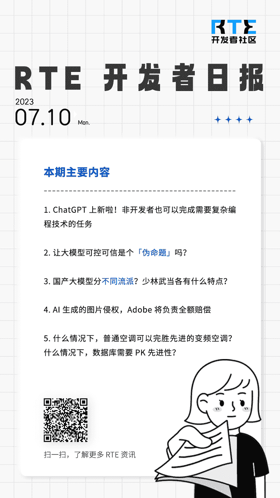
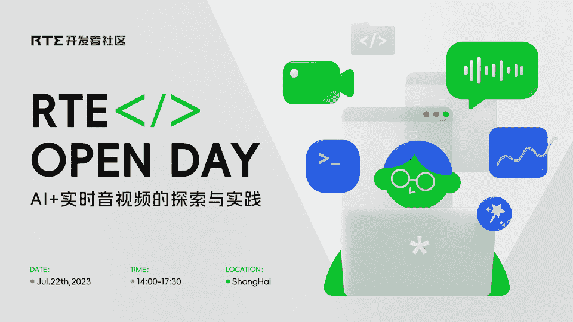

# 大模型的可控可信是伪命题么？丨RTE开发者日报 Vol.01

> 来源：[https://docs.feishu.cn/docx/G5ygd5WMUo3KXbxy3gdcC5G1nyg](https://docs.feishu.cn/docx/G5ygd5WMUo3KXbxy3gdcC5G1nyg)

开发者朋友们大家好：

这里**是「RTE 开发者日报**」，每天和大家一起**看新**闻、聊八卦。

**

我**们的社区编辑团**队会**整理分享 RT**E **(Real T**im**e Engagement) 领域内「有话题的新闻」、「有态度的观点」、「有意思的数据」、「有思考的文章」、「有亮点的活动」，但内容仅代表编辑的个人观点，欢迎大家留言、跟帖、讨论。

---

### **一、有话题的新闻**

1、ChatGPT 上线 GPT-4 以来最强应用「代码解释器」

OpenAI 的语言模型 ChatGPT 推出了新功能：代码解释器（Code Interpreter）。这个新功能已经对所有 Plus 订阅用户开放，代码解释器扩展了 ChatGPT 的功能，为用户带来了更好的交互式编程体验和强大的数据可视化功能。

有了它之后，即使不是程序员**，只需要用自然语言向 ChatGPT 下**达指令，也可以完成需要复杂编程技术的任务。代码解释器对于经常使用代码和数据的专业人士和爱好者都非常有用，这是一个多功能的工具，可以用于分析数据、创建图表、编辑文件、执行数学运算等等。（@IT之家）

**

2、MidJourney 创始人：MidJo**urney 名字源于庄子，对应中文“中道”

在 2023 世界人工智能大会上，MidJourney 创始人大卫・霍尔茨分享称，他最喜欢阅读两类书，一个是科幻文学，另一个是中国古典文学，MidJourney 名字的来源就是庄子，庄周梦蝶，对应中文的“中道”。

针对 AIGC 技术未来会如何发展的问题，大卫・霍尔茨回应称，“很难讲未来技术会怎么样，我们在这个领域的发展才刚刚开始，未来会有 10 倍、100 倍的进展，不仅仅是技术，我们会在用户界面、产品等领域有更多进步。”（@深潮TechFlow）

3、Adobe：若 AI 生成的图片侵权，将负责全额赔偿

Adobe 宣布，在用户使用其提供的 AI 图像生成工具 Firefly for Enterprise 时，如果因为使用 AI 生成的图片引发版权纠纷，Adobe 将为其提供相关法律费用的全额赔偿。Adobe 的 Firefly for Enterprise 是企业版应用，支持企业用户用自己的品牌信息来训练 AI 模型。商业图库网站 Shutterstock 也宣布，对于平台上的 AI 生成图片，他们将承担责任。（@快科技）

**

4、Meta 开源 Intermed**iate Graphics Library

Meta 宣布开源 Intermediate Graphics Library（IGL）。IGL 为开发者提供了一组强大的工具为其应用创建高质量的视效和图形，能满足游戏、3D 建模等应用的需求。IGL 是一个跨平台图形库，支持 OpenGL、OpenGL ES、WebGL 和 Vulkan 等图形 API，它的开销小，外部依赖少。Meta 称 IGL 的特性包括：跨平台兼容，高性能渲染，易于使用的 API，可扩展，完全开源，可用于任何项目，没有任何许可限制。（@奇客）

---

### **二、有态度的观点**

[1、国产大模](https://36kr.com/p/2336675287190784?f=rss)型，也分「武当」和「少林」（@36氪）

在 36氪的这篇文章中，将国产的大模型做了两个派别的划分 —— “增值派”和“聚焦派”。

所谓的“增值派”，指的是不仅研发通用大模型基座，还基于基座提供模型 API、算力、训练、部署等配套服务的厂商，典型案例是推出MaaS（Model as a Service）平台、携“通用大模型、行业大模型、云、芯片”等全家桶到场的云厂商们。

所谓的“聚焦派”，指的是找准少量应用场景深挖，推出垂直领域的大模型。这些厂商往往是资源能力和服务范围有限的创企，或者是原有业务的应用场景十分聚焦。

即便派系分化，但不同厂商呈现出的大模型能力和服务体系大同小异 ——“增值派”厂商将大模型和云、部署等服务打包售卖，“聚焦派”厂商则是两手抓：一边卖行业模型服务，一边卖自身被 AI 升级后的应用。

[2、开源最大](https://www.geekpark.net/news/321608)的优势就是「透明」，每个人都能打开大模型的「黑盒」（@王铁震）

在世界人工智能大会 WAIC 的主会场，Hugging Face 的中国区负责人王铁震，与未尽研究的创始人周健工，进行了一场主题为《开源力量推动生成式 AI 发展》的对话。

**

王铁震表示，Hugging** Face 非常期望通过开源的方式把大模型普惠化，让每一个公司、每一个人都能拥有自己的大模型去做自己的事情，去解决数据隐私、数据安全等问题，希望抹平学术界和工业界之间的差异。

而开源最大的优势就是「透明」，每个人都能打开大模型的「黑盒」看到数据是如何被应用于训练的，每个人也都能依据自身需求场景去创造属于自己的 AI 模型。

---

### **三、有思考的文章**

1[、让大模](https://36kr.com/p/2337682820861188?f=rss)型可控可信是个「伪命题」吗？（@36氪）

在强调精准、可控、合规的 To B 领域，模型的交互式能力可能加剧数据泄露风险，过于丰沛的创造力会带来"幻觉"过多的困扰。总之，大模型本身令人惊叹的"涌现"，反而在此时成为深入产业的阻碍。

针对这一问题，36氪对话了清华大学副教授李琦、中国信通院华东分院人工智能与大数据事业部副主任常永波，以及蚂蚁集团机器智能部副总经理、蚂蚁安全天筭实验室主任张天翼。

常永波表示，可信 AI 概念自 2017 年提出以来，业界在鲁棒性、隐私保护等方面已经有了较**多实践。但大模型的到来，给可信 AI **—— 尤其是其中的"可解释性"提出新考验。对企业来说，“可解释性”是现在最亟待被解决的问题之一，也是最为复杂的问题之一。目前，业内提升可解释性的方式包括提示词工程、数据预处理、RLHF、叠加专家系统，以及用大模型解释大模型（如 OpenAI 用 GPT4 解释 GPT2）等。但本质上，没有人可以保证自己的方式彻底有效。

李琦介绍，之前安全专家比较关心 AI 系统整体的安全问题，AI 专家则更偏向思考具体模型和算法的安全性。但现在，大模型的出现诱导出一些大模型系统特有的数据安全和系统漏洞问题，这促使安全专家和 AI 专家协同起来，一起解决大模型安全问题。

[2、数据库是要拿](http://mp.weixin.qq.com/s?__biz=MzA5MzQxNjk1NQ==&mid=2647850209&idx=1&sn=b28e2ffe250719e50204bbc53f60311f&chksm=88786075bf0fe96346ab36370c0ebf6ce06a9bbb4a41fd859aee1cfd6557854d1187e8e72656#rd)来用的，不是用来 PK 先进性的（@白鳝的洞穴）

农村、乡下等边远地区电网的电压相对不稳定，变频空调在这种情况下很可能因为电压不稳而导致压缩机无法正常工作，影响制冷效率；老式的普通空调因为原理简单反而不会出现此类问题。在这样的应用场景中，技术相对落后的普通空调居然完胜先进的变频空调。

@白鳝的洞穴 作者表示在数据库领域，似乎也是如此。30多年前，当时技术上相对简单或者说简陋的 Oracle 在与一系列架构水平更高的产品 PK 中完胜了几乎所有对手，获得了全面的胜利，而一些技术上颇有特色的数据库产品反而都折戟沉沙了，这种胜利在早期大多数是来自于其使用门槛较低。数据库最终还是要拿来用的，而不是为了PK技术的先进性或者某些领域的领先性的。

他提出用户和数据库厂商对数据库的需求完全是不同的，数据库厂商眼中的先进性与用户所需要的方便省心地使用数据库的需求出现了维度偏差，用户其实不关心，甚至不懂数据库厂商自己觉得很 HIGH 的先进性。一个仅仅知道写 SQL 的用户是不会去关注 SQL 执行引擎里是否使用了向量计算，他们只会关心自己的 SQL 是不是能够又快又准确的获得结果。

---

### 四、有亮点的活动

1、AI+实时音视频的探索与实践丨RTE OPEN DAY

+   主办方：RTE 开发者社区

+   活动时间：7月22日 14:00-17:30

+   活动地点：上海 · 五角场

+   报名方式：定向邀请

随着 AIGC 技术和应用的发展落地，AI 终于再次迎来了快速发展的阶段，并在实时音视频等领域带来了很多新场景、新应用与新可能。

7 月 22 日下午，RTE 开发者社区将在「上海 · 五角场」举办一场以“AI+实时音视频的探索与实践”为主题的 OPEN DAY。 本次活动中，将定邀 30-50 位相关行业开发者、创业者，通过体验和技术分享，大家将和行业一线从业者及专家深入体验、交流这些技术的应用、探索和创新的可能性。 本次活动不仅希望能与开发者产生共振、共鸣，同时也是一场小小游园会，设置了丰富的体验活动和游戏等你来玩～

---

**

写在最后**：

我们欢迎更多的小伙伴参**与「RTE 开发者日报**」内容的共创，感兴趣的朋友请通过评论区或公众号留言联系，记得报暗号「共创」。

对于任何反馈（包括但不限于内容上、形式上）我们不胜感激、并有小惊喜回馈，例如你希望从日报中看到哪些内容；自己推荐的信源、话题、活动等；或者列举几个你喜欢看、平时常看的内容渠道；内容排版或呈现形式上有哪些可以改进的地方等。

---

