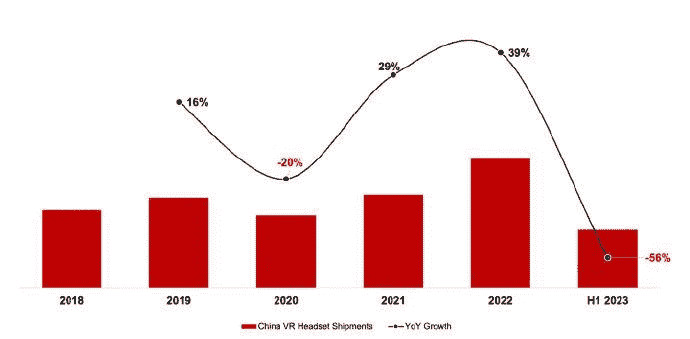

# 七个 LLM 的狼人杀之夜；马斯克的星链残骸会“砸死人”？OpenAI 安全漏洞曝光丨 RTE 开发者日报 Vol.66

> 来源：[https://docs.feishu.cn/docx/GHowdsvOoopEz9xhdxDcnTPXnIb](https://docs.feishu.cn/docx/GHowdsvOoopEz9xhdxDcnTPXnIb)

开发者朋友们大家好：

这里**是「RTE 开发者日报**」，每天和大家一起**看新**闻、聊八卦。

**

我**们的社区编辑团**队会**整理分享 RT**E **（Real T**im**e Engagement） 领域内「有话题的新闻」、「有态度的观点」、「有意思的数据」、「有思考的文章」、「有看点的会议」，但内容仅代表编辑的个人观点，欢迎大家留言、跟帖、讨论。

本期编辑：@Asui，@CY

---

### **一、有话题的新闻**

**1、OpenAI 安全漏洞曝光，使用不常**见语言可轻易绕过 ChatGPT 的限制

布朗大学的计算机科学研究人员发现了 OpenAI 的 GPT-4 安全设置中的新漏洞。他们利用一些不太常见的语言，如祖鲁语和盖尔语，即可以绕过 GPT-4 的各种限制。研究人员使用这些语言来写通常受限的提示词（prompt），发现得到回答的成功率为 79%，而仅使用英语的成功率不到 1%。

研究人员承认发布这项研究可能会造成危害，并给网络犯罪分子提供灵感。值得一提的是，在向公众发布之前，该研究团队已经与 OpenAI 分享了他们的发现，以减轻这些风险。（@IT之家）

2、担心数据安全，美国太空部队禁用生成式 AI 工具

10 月 12 日消息，在最新泄露的备忘录中，美国太空部队已经决定暂时禁止使用基于网络的生成式人工智能工具和所谓的大语言模型，理由是数据安全和其他方面的担忧。这份日期为 9 月 29 日的备忘录是写给“守卫者”的，这是对美国太空部队成员的内部称呼。

在备忘录中，美国太空部队禁止其成员在基于网络的生成式人工智能工具上使用任何政府数据，这些工具可以根据简单的提示创建文本、图像或其他形式的内容。备忘录中称，除非特别批准，否则上述工具“没有被授权”在政府系统上使用。（@网易科技）

3、HTC 要放弃 VR？官方回应：不可能，绝对不可能

日前，市场研究公司 CCS Insight 在一份报告中提出了预测——由于市场的不确定性，HTC 将于 2026 年卖掉 VR 业务并退出 VR 市场。HTC 方面对此发表声明否认该传闻，并表示 VR、AR 以及 AI 技术将与人性融合，释放人类想象力，改变世界。（@雷科技）

4、台积电南京厂将获美国豁免：为期一年，不得进行技术升级

据《华尔街日报》援引熟悉美国政府运作的人士报道，台积电也预计将获得与去年一样的另一项为期一年的豁免。报道补充说，美国已告诉台积电，只要不进行重大技术升级，它就可以在可预见的未来维持在中国的业务。

目前尚不清楚台积电是否会像三星和 SK 海力士那样被指定为“经过验证的最终用户”。但是，美国已向芯片合约制造商明确表示，虽然它可以运行当前的运营，但位于南京的 Fab 16 的任何重大技术进步目前都无法实现。目前尚不清楚进步是否意味着产能升级、工艺技术升级或两者兼而有之。(@EETOP)

5、马斯克的星链残骸会“砸死人”？SpaceX 激烈回应：荒谬

近期，美国联邦航空管理局（FAA）向美国国会提交了一份报告，称太空技术探索公司（SpaceX）卫星系统存在“严重风险”，可能导致航空事故和人员伤亡。在最新的报告中，FAA 表示，到 2035 年为止，星链计划中使用的运载火箭和卫星将产生大量残骸，其中有 2.8 万个残骸可能会冲破大气层并坠落到地面。届时地球上平均每两年就会有一个人被残片“砸死或砸伤”。

SpaceX 公司 9 日对该报告进行了激烈回应，声称这份报告“荒谬、不合理、不准确”，请求联邦监管部门对其进行“修正”。SpaceX 首席工程师戈德斯坦批评报告内容存在“严重缺陷”，称他们的结论是基于“猜测、假设和过时的研究方法”。（@搜狐科技）

6、今年上半年国内 VR 头显出货量同比下降 56%

10 月 12 日消息，根据市场调查机构 Counterpoint Research 公布的最新统计报告，2023 年上半年我国 VR 头显设备出货量大幅下降 56%，结束了 2021-2022 年的连续两年增长。

扩大到全球市场，今年上半年全球 VR 市场出货量同比下降 39%，中国市场跌幅更大。2023 年第 2 季度，中国在全球 VR 出货量中的占比仅为 10%，相对较低，而在智能手机中份额达到了 20-30%。（@IT之家）

---

### 二、有思考的文章

[**1、《机器学习即代码的时代已**](https://mp.weixin.qq.com/s/itNk66-RqLdTAo6FVxRwvQ)经到来》（@Huggingface）

到底是 AI 会吃掉软件还是软件会吃掉 AI？为了 job security，工程师应该把宝押在哪儿？这篇 2021 年的文章提供的一些视角似乎印证了它现在的流行，有点“运筹于帷幄之中，决胜于数年之后”的意思，颇值得软件架构师和产品经理们内省一番。

[2、《七个 LLM 的狼人](https://mp.weixin.qq.com/s/8zQ3gS6jrY5xE2Dv-wwtMQ)杀之夜》（@深度学习自然语言处理）

在最新一篇论文中，研究团队让一群大语言模型（LLM）开了一局狼人杀游戏。通过多种 Prompt 方法集成，LLM 不仅成功地参与了游戏，还涌现出了信任、欺诈和领导力等团体能力。

---

**写在最后：**

我们欢迎更多的小伙伴参**与「RTE 开发者日报**」内容的共创，感兴趣的朋友请通过开发者社区或👸号留言联系，记得报暗号「共创」。

对于任何反馈（包括但不限于内容上、形式上）我们不胜感激、并有小惊喜回馈，例如你希望从日报中看到哪些内容；自己推荐的信源、话题、活动等；或者列举几个你喜欢看、平时常看的内容渠道；内容排版或呈现形式上有哪些可以改进的地方等。

---

