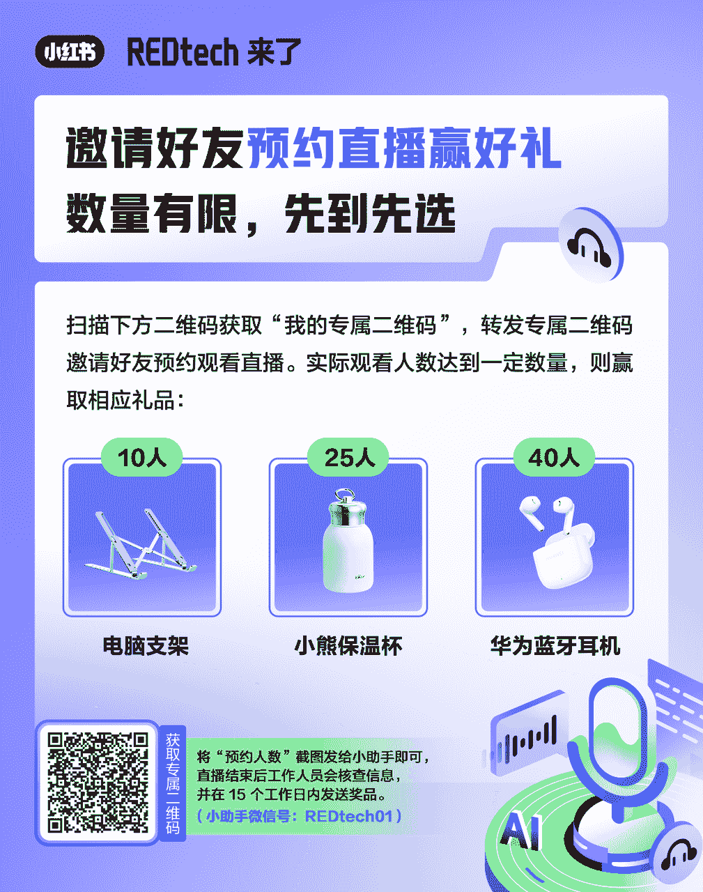

# 专注二次元的 Niji 模型上线独立 APP；华为整体销量已超越苹果丨 RTE 开发者日报 Vol.68

> 来源：[https://docs.feishu.cn/docx/NFAWduSLyoYRcRxyvVgca3hWnif](https://docs.feishu.cn/docx/NFAWduSLyoYRcRxyvVgca3hWnif)

开发者朋友们大家好：

这里**是「RTE 开发者日报**」，每天和大家一起**看新**闻、聊八卦。

**

我**们的社区编辑团**队会**整理分享 RT**E **（Real T**im**e Engagement） 领域内「有话题的新闻」、「有态度的观点」、「有意思的数据」、「有思考的文章」、「有看点的会议」，但内容仅代表编辑的个人观点，欢迎大家留言、跟帖、讨论。

本期编辑：@Asui，@CY

---

### **一、有话题的新闻**

**1、Midjourney 放大招了，专注**二次元的 Niji 模型上线独立 APP

日前，Midjourney 专注二次元动漫模型的 Niji APP 正式上架应用市场。下载登录后，可以免费获得几次体验的机会，这个 APP 的主页还有个动态功能，在里面可以看到其他人生成的优质图片，并可以保存到本地。（@腾讯科技）

2、华为整体销量已超越苹果，成大中华区最畅销手机制造商

据彭博社报道，苹果新款 iPhone 15 在中国的销售低于前代产品，反映出消费需求持续疲软以及华为等竞争对手的崛起。杰富瑞（Jefferies）分析师 Edison Lee 等人表示，在 Mate 60 Pro 的意外亮相的影响下，华为整体销量已经超越了苹果，因此 iPhone 15 的销量比前一代下降了两位数。Jefferies 在周一的一份报告中写道，华为现已从苹果手中夺取了市场头把交椅，并预测这一趋势将延续到 2024 年。（@IT之家）

**3、总投资 100 亿，山东青岛虚拟现实整机项**目竣工，可实现年产 2500 万台 XR

近日，山东省市重点项目、青岛市虚拟现实产业园内首个开工的大项目——总投资 100 亿元的虚拟现实整机和光学模组项目完成全面交付，成为园区内第一个竣工交付的产业项目。生产线全部达产后，可实现年产 2500 万台智能整机和 5000 万件光学模组的生产能力。

项目自 2022 年 5 月进场施工，从开工到竣工，用时 15 个月。歌尔视界、歌尔光学、大朋 VR 和云天畅想等一批行业头部企业已经将总部迁至园区，国家虚拟现实创新中心（青岛）正式投入使用。目前，开工建设仅 10 个月的创享中心项目预计今年 12 月底主体封顶，智造工场已开工，西南总部基地、人才公寓等基础设施建设梯次推进、同步配套。（@VR陀螺）

**4、工信部：我国 AI 核心产业规模达 5000 亿元，**建成 2500 多个数字化车间和智能工厂

10 月 15 日消息，2023 中国（太原）人工智能大会今日在山西太原开幕。 中国工业和信息化部科技司副司长任爱光在致辞中介绍，我国人工智能产业近年来蓬勃发展，核心产业规模已达 5000 亿元人民币，企业数量超过 4400 家。 他提到，我国已经实现人工智能与制造业深度融合，目前已建成 2500 多个数字化车间和智能工厂，从而有力推动实体经济的数字化、智能化、绿色化转型，显著提升了研发和生产效率。

在今年 7 月的 2023 世界人工智能大会上，工信部副部长晓兰也曾表示，我国人工智能基础设施加快布局，算力规模位居全球第二，东数西算等重大工程加快推进，5G 基站超过 280 万个。 此外，我国融合应用深度拓展，目前已建成 2500 多个数字化车间和智能工厂，经过智能化改造，研发周期缩短了约 20.7%、生产效率提升了约 34.8%、不良品率降低了约 27.4%、碳排放减少了约 21.2%。

根据中国信息通信研究院测算，2022 年我国人工智能核心产业规模达到了 5080 亿元，同比增长 18%。 2022 年我国计算产业规模达 2.6 万亿元，近六年累计出货超过 2091 万台通用服务器、82 万台 AI 服务器，计算技术国内有效发明专利数量位列各行业分类第一。

中国信通院《中国算力发展指数白皮（2023 年）》显示，我国算力多元化发展持续推进。预计到 2025 年，全球算力规模将超过 3ZFlops（IT 之家注：ZFlops 即每秒十万亿亿次浮点数运算），至 2030 年将超过 20ZFlops。（@IT之家）

---

### 二、有态度的观点

1、苹果 CEO 库克：中国开发者将在 AR 时代取得全球成功

10 月 16 日，苹果 CEO 库克到访成都，在接受媒体采访时表示，自己对中国开发者在 VisionPro 上的开发有非常高的期待。他还表示，中国开发者将会在 AR 时代重复他们的全球成功故事，就像他们在苹果 iOS 应用商店平台上所做的那样。（@财联社）

2、雷军：大家别着急，小米 14 很强

据网络爆料，小米 14 将于 10 月 27 日发布，而配置与售价方面相信是很多米粉最为关注的。雷军日前也发布微博称，“这次产品很很很强”。此前有消息称，小米 14 将搭载第三代骁龙 8 处理器，售价或维持 3999 元的起售价。（@热点科技）

---

### **三、有思考的文章**

[1、《计算机视觉](https://mp.weixin.qq.com/s/ySc35J4wXfVfLcOXKPy8IQ)的十年：深度学习带来变革，经典元素仍主导特定挑战》（@大数据文摘）

近些年来，计算机视觉（CV）的发展势如破竹，渗透到了我们生活的方方面面。对于大众而言，这可能像是一项新鲜且令人兴奋的科技创新，然而，实际上并非如此。

事实上，计算机视觉已经有几十年的发展历程，早在 20 世纪 70 年代，已经为今日所使用的众多算法打下了坚实基础。然后，在大约十年前，一种当时还在理论发展阶段的新技术浮现眼前：深度学习，一种利用神经网络解决高度复杂问题的 AI 形式，只要你有足够的数据和计算能力就能驱动它。

随着深度学习的持续进步，我们开始认识到它在解决某些计算机视觉问题上的表现十分出色。对于目标检测和分类等挑战性问题，深度学习的应用效果特别理想。从这时开始，"经典"的计算机视觉与基于深度学习的计算机视觉开始出现明显的区别。

---

### 四、有意思的活动

1、揭秘语音识别、语音合成、AI 音乐创作如何落地小红书？

今晚 19:00，RTE 开发者社区的小伙伴儿 @小红书创作发布组音频技术团队负责人解奉龙，携手三位资深工程师许开拓、靳源、谢坤接力开讲，分别带来《音频技术在小红书场景的应用》、《基于 Transducer 的端到端语音识别实践》、《 AI 音乐创作平台在小红书的应用》、《语音合成在小红书的探索和应用》的主题分享。

预约并观看直播，还可参与五轮抽奖互动，小米手环、护腰垫、薯队长公仔等精美礼品等你来拿！🙌 今晚 19:00-20:40 锁定直播间，我们不见不散！

---

**写在最后：**

我们欢迎更多的小伙伴参**与「RTE 开发者日报**」内容的共创，感兴趣的朋友请通过开发者社区或公众号留言联系，记得报暗号「共创」。

对于任何反馈（包括但不限于内容上、形式上）我们不胜感激、并有小惊喜回馈，例如你希望从日报中看到哪些内容；自己推荐的信源、话题、活动等；或者列举几个你喜欢看、平时常看的内容渠道；内容排版或呈现形式上有哪些可以改进的地方等。

---

