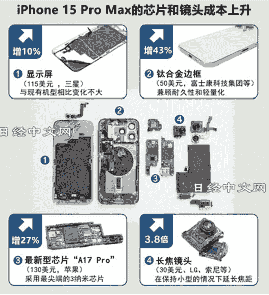

# iPhone 15 拆机调查来了；Stack Overflow 裁员 28%；小米澎湃 OS 彻底重写底层架构丨 RTE 开发者日报 Vol.69

> 来源：[https://docs.feishu.cn/docx/Yp6Wd5UFOohVOQxC4RocDfnCnKN](https://docs.feishu.cn/docx/Yp6Wd5UFOohVOQxC4RocDfnCnKN)

开发者朋友们大家好：

这里**是「RTE 开发者日报**」，每天和大家一起**看新**闻、聊八卦。

**

我**们的社区编辑团**队会**整理分享 RT**E **（Real T**im**e Engagement） 领域内「有话题的新闻」、「有态度的观点」、「有意思的数据」、「有思考的文章」、「有看点的会议」，但内容仅代表编辑的个人观点，欢迎大家留言、跟帖、讨论。

本期编辑：@Asui，@CY

---

### **一、有话题的新闻**

**1**、ChatGPT 重压下，Stack Overflow 裁员 28%，为自家生成式 AI 工具开源节流

全球最大的程序员问答网站 Stack Overflow 的首席执行官 Prashanth** **Chandrasekar 在博客中宣布该公司已解雇了约 28% 的员工。而就在去年 ChatGPT 3.0 推出之前，Stack Overflow 的员工数量增加了一倍，达到 500 多人。

Prashanth Chandrasekar 表示此次裁员主要是大幅缩减了市场营销部门的规模，这是为了加大对该公司产品的投资力度，特别是今年 7 月刚刚推出的生成式 AI 工具「OverflowAI」。OverflowAI 被认为是 Stack Overflow 面向 ChatGPT 等生成式 AI 模型的挑战推出的编程辅助工具。

自 2021 年 4 月至 2022 年 4 月，Stack Overflow 社区的页面浏览量维持在 2000 万左右，而 2022 年 4 月至 2023 年 7 月，浏览量跌到了 900 万左右，一年半时间下降了约五成。（@机器之心）

**2、不用 Arm 架构，高通联合谷歌**开发 RISC-V 骁龙 Wear 芯片

高通 10 月 17 日发布新闻稿，称正与谷歌合作开发基于 RISC-V 架构的 Snapdragon Wear 芯片，这款新芯片将用于下一代 Wear OS 手表。

**

RISC-V 是 x86、Arm 之外的第三大 CPU 架构，此前 RISC-**V International 首席执行官 Calista Redmond 曾声称「作为全球标准，RISC-V 不受任何单一公司或国家的控制」。

高通计划在全球范围内商业化基于 RISC-V 的可穿戴解决方案，而 RISC-V Snapdragon Wear 芯片据称将实现「定制核心、低功耗、高性能」等智能手表必备的因素。

Wear OS by Google 总经理 Bjorn Kilburn 表示，「高通一直是 Wear OS 生态系统的支柱，为我们的许多 OEM 合作伙伴提供高性能、低功耗的系统，我们很高兴扩大与高通的合作，并推出基于 RISC-V 的可穿戴解决方案。」

据悉，高通和谷歌最近启动了 RISC-V 软件生态系统（RISE），正逐步推动一系列 RISC-V 硬件开发。（@IT之家）

3、詹姆斯·韦伯望远镜首次在系外行星大气中发现二氧化硅颗粒

在距离地球 1300 光年的热木星 WASP-17b 上，研究人员利用詹姆斯·韦伯望远镜在高空云层中发现了石英纳米晶体的证据，标志着二氧化硅（SiO₂）颗粒首次在系外行星大气中被发现，为人类理解系外行星云层如何形成和演化提供了新思路。

硅酸盐是硅、氧与其它化学元素结合而成的化合物，在银河系中极为普遍。此前在系外行星和褐矮星大气中检测到的硅酸盐颗粒由富含镁的硅酸盐构成，如橄榄石和辉石，而不是纯 SiO₂。NASA 表示，此次研究成果标志着二氧化硅（SiO₂）颗粒首次在系外行星大气中被发现，该成果为人类理解系外行星云层如何形成和演化提供了新思路。（@澎湃新闻）

4、拜登政府计划阻止英伟达等向中国出口高性能 AI 芯片 英伟达回应

拜登政府 10 月 17 日更新了针对人工智能芯片的出口管制规定，计划阻止英伟达等公司向中国出口先进的 AI 芯片。根据最新的规则，英伟达包括 A800 和 H800 在内的芯片对华出口都将受到影响。

新规将在向公众征求 30 天意见后生效。英伟达方面回应称：“我们遵守所有适用的法规，同时努力提供支持不同行业的数千种应用产品。鉴于全球对我们产品的需求，我们预计（新规）短期内不会对我们的财务业绩产生实质性的影响。”（@第一财经）

5、iPhone 15 拆机调查来了！旗舰款成本提升 12%

据国外媒体提供的 iPhone 15 系列拆机调查显示，各机型零部件成本较上一代进一步增长，最高端机型的零部件成本连续 2 年刷新历史新高。15 Pro Max 总零部件成本约 558 美元 ，比 14 Pro Max 高出 12%。按照细分零部件来看，15 Pro Max 的长焦相机及其四棱镜系统价格更是比前代高 3.8 倍。（@财联社）

6、谷歌 AR 技术再次遭遇专利诉讼

Rafqa Star 公司在美国得克萨斯州联邦法院对谷歌提出专利侵权指控，指控这家科技巨头的智能手机、平板电脑和其他产品使用的增强现实（AR）技术涉嫌其专利权。

根据周一（10 月 16 日）向美国得克萨斯州西区地方法院提交的诉状，谷歌这些产品使用了与 Rafqa Star 公司专利类似的技术，这些技术被用于检测便携式视频数据接收与处理设备的移动状况。（@财联社）

---

### 二、有态度的观点

1、李彦宏：生成式 AI 和搜索是天作之合

10 月 17 日消息，百度创始人、董事长兼首席执行官李彦宏在百度世界 2023 上正式发布文心大模型 4.0 ，并开启邀请测试。李彦宏称这是迄今为止最强大的文心大模型，实现了基础模型的全面升级，在理解、生成、逻辑和记忆能力上都有着明显提升，综合水平“与 GPT-4 相比毫不逊色”。

此外，李彦宏还宣布，百度搜索已经基于 AI 大模型完成重构，新搜索具有极致满足、推荐激发和多轮交互三个特点。不仅提升了搜索质量，而且突破了搜索的应用范围、扩大了产品边界。他强调说，生成式 AI 与搜索是天作之合。（@IT之家）

2、歌手约翰·传奇：音乐中的人性化的部分，是 AI 无法取代的

近日，在《华尔街日报》Tech Live 会议上，创作型歌手约翰·传奇(  John Legend)  表示：「音乐中仍有充满人性的部分，这是人工智能无法取代的」。

谈到人工智能对创意艺术影响的担忧，他认为，计算机生成的歌曲永远不会**像**人类创作的音乐那样成功，部分原因在于观众喜欢了解艺术家和歌曲背后的故事。他说：「音乐、歌曲创作以及我们与观众的互动，仍然极具人性化。AI 将能够帮助我们产生创意，但它无法取代许多人们仍然渴望的人性化体验」。

约翰·传奇还提到，他将推出一款名为「It's Good」的社交应用程序，旨在为用户提供个性化的美食和旅游推荐。这款应用力求通过更加精心策划和个性化的方式，超越现有平台如 Yelp 和 Google Reviews。（@APPSO）

3、雷军：小米澎湃 OS 彻底重写底层架构，是小米划时代里程碑

10 月 17 日消息，雷军个人微博再发文跟 MIUI 说再见。此前，雷军宣布小米澎湃 OS（Xiaomi HyperOS），正式版已完成封包。新操作系统未来将逐步替代现有的 MIUI 系统。同时小米 14 系列将是第一款搭载新系统的手机。

雷军强调，这是一个超级庞大的工程体系，也是对小米来说划时代的里程碑，是小米迈向“人车家全生态”的关键跨越。

他透露，小米澎湃 OS 是基于深度进化的 Android 以及自研的 Vela 系统融合，彻底重写底层架构，为未来百亿设备、百亿连接做好了万物互联的公有底座。（@金融界）

---

**写在最后：**

我们欢迎更多的小伙伴参**与「RTE 开发者日报**」内容的共创，感兴趣的朋友请通过开发者社区或公众号留言联系，记得报暗号「共创」。

对于任何反馈（包括但不限于内容上、形式上）我们不胜感激、并有小惊喜回馈，例如你希望从日报中看到哪些内容；自己推荐的信源、话题、活动等；或者列举几个你喜欢看、平时常看的内容渠道；内容排版或呈现形式上有哪些可以改进的地方等。

---

