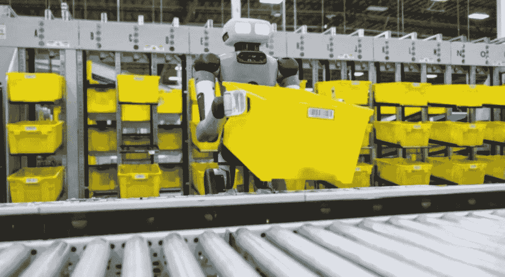
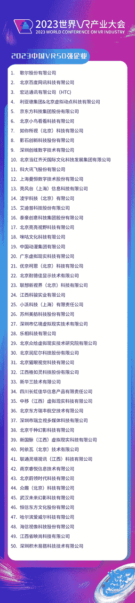

# 2023 中国 VR 50 强企业名单发布；OpenAI 新模型性能远低于预期丨 RTE 开发者日报 Vol.71

> 来源：[https://docs.feishu.cn/docx/FTbWdDD31o3XiLxUtRRcHlvQnxZ](https://docs.feishu.cn/docx/FTbWdDD31o3XiLxUtRRcHlvQnxZ)

开发者朋友们大家好：

这里**是「RTE 开发者日报**」，每天和大家一起**看新**闻、聊八卦。

**

我**们的社区编辑团**队会**整理分享 RT**E **（Real T**im**e Engagement） 领域内「有话题的新闻」、「有态度的观点」、「有意思的数据」、「有思考的文章」、「有看点的会议」，但内容仅代表编辑的个人观点，欢迎大家留言、跟帖、讨论。

本期编辑：@Asui，@CY

---

### **一、有话题的新闻**

**1、消息称苹果最早在 iOS18 中**推出生成式 AI 功能，包含云端及设备端

10 月 19 日消息，海通国际证券公司分析师 Jeff Pu 今日声称，苹果计划最早在 2024 年底，在 iPhone 和 iPad 中加入生成式 AI 技术。Jeff Pu 援引自己的供应链调查声称，苹果可能会在今明两年设立几百台 AI 服务器，以实现相关功能。该分析师认为，苹果届时将提供云端和设备端两种 AI 组合形式，从而保证用户隐私性。

不过 Jeff Pu 同时补充称，外界需要「一点耐心」等待苹果推出自家生成式 AI 服务，因为苹果公司还在考虑「如何以符合客户隐私承诺的方式使用和处理个人数据」。如果按计划进行，苹果可能会从 iOS 18 和 iPadOS 18 开始推出生成式 AI 功能，但目前尚不清楚苹果将如何使用相关 AI 技术。（@IT之家）

**2、OpenAI 据称放弃开发部署**成本更低版的 GPT-4：性能远低于预期

10 月 19 日晚间消息，据报道，两位知情人士今日称，人工智能初创公司 OpenAI 已经停止开发新的人工智能模型 Arrakis。早在去年年底，即聊天机器人 ChatGPT 引起全球轰动后，OpenAI 的工程师们就开始研究一种新的人工智能模型，内部代号为「Arrakis」。按照 OpenAI 的设计初衷，Arrakis 将具有与 GPT-4 一样的能力，但部署成本更低，因为它的部分设计采用了稀疏计算。这意味着，只有神经网络的一部分被用来处理用户输入。而在传统的「密集模型」中，整个神经网络都是活跃的。

但两位知情人士今日称，**OpenAI 于今年年中取消了 Arrakis 项目，**因为该模型的运行效率并没有预期的那样高。OpenAI 的开发团队意识到，Arrakis 的性能远不及 GPT-4。目前尚不清楚，为什么稀疏计算在早期的测试中效表现良好，但在后来的开发中却失败了。（@新浪科技）

**3、三星显示 2.18 亿美元收购美**国 eMagin，致力于成为 XR 巨头

10 月 19 日消息，今年 5 月，三星显示宣布收购美国 OLED 研发公司 eMagin，推进 RGB OLEDoS 技术，以满足苹果未来的扩展现实（XR）头显屏幕需求。今天，eMagin 宣布已完成收购，该公司正式成为三星显示子公司，专门负责为 XR 设备开发 OLEDoS 技术。

据介绍，这笔交易采用了全现金交易，价值约 2.18 亿美元。据介绍，三星收购 eMagin 是为了推进 RGB OLEDoS 技术，以满足苹果未来的扩展现实（XR）头显屏幕需求。RGB OLEDoS 技术是结合半导体与 OLED 面板的显示技术，能以微小尺寸实现超高分辨率，并具有高亮度、高对比度、高 PPI、响应速度快与低功耗等优势，主要适用于 AR／VR 设备。（@IT之家）

**4、ChatGPT Plus 用户和企业用户已经**可以接入 DALL-E 3 图像生成模型

美国时间 10 月 19 日，OpenAI 宣布 ChatGPT Plus 用户和企业用户已经可以接入 DALL-E 3 图像生成模型。DALL-E 3 于上个月首次发布，OpenAI 展示了它如何在之前的 DALL-E 2 的基础上进行改进，允许用户利用 ChatGPT 编写更长、更直观的描述性提示，以供图像生成器使用。OpenAI 表示，它已经为该模型准备了一个安全缓解堆栈，使其为扩展版本的发布做好了准备。（@OpenAI）

**5、国家新闻出版署：实施网络游戏精品出**版工程，匡正算法规则摒弃“氪金”“氪肝”

近期，国家新闻出版署下发关于实施网络游戏精品出版工程的通知。通知表示，为加强网络游戏正向引领，推动网络游戏弘扬真善美、传播正能量，促进游戏产业健康有序发展，国家新闻出版署决定组织实施网络游戏精品出版工程。通知显示，此次精品出版工程主要从五个方向展开。一是传播社会主义核心价值观。二是传承中华优秀传统文化。三是展现新时代发展成就和风貌。四是促进科技创新和新技术应用。五是具有国际市场潜力。（@上证报）

6、离完全取代人类更近了！亚马逊推出物流“人形机器人”

亚马逊在休士顿的物流仓库推出了两款机器人：“Sequoia”及“Digit”，以加快物流效率并保障工人安全。“Sequoia”机器人通过多机器人系统整合，能提高物品识别、存储库存的速度 75%和缩短订单处理时间 25%。“Digit”人形机器人则能于仓库空间中灵活移动、抓取和处理物品。引发员工担忧这可能是亚马逊裁员的前兆。（@全天候科技）

7、美国商务部澄清： RTX 4090 显卡可在中国零售，不能生产

10 月 18 日，美国商务部就 ECCN 3A090 更新高科技出口管制政策作出澄清，关于 3A090b 部分 NVIDIA GeForce RTX 4090 显卡的禁令，美国商务部允许就在出口消费性应用作出豁免，可以中国零售市场贩售。

GeForce RTX 4090 显卡可以在中国 （包括香港及澳门） 消费性市场继续零售，但不可以输入 RTX 4090 晶片作商用及生产用途，意味着中国代工厂不能生产 GeForce RTX 4090，但普通消费者还是渠道能买到 NVIDIA GeForce RTX 4090 。目前 RTX4090 公版/非公版显卡陆续下架，店铺均为无货状态。这也导致部分拥有 RTX 4090 库存的商家对其定价直接跳涨，多达 2 万元以上，甚至出现近 5 万元的高价。（@网易科技）

8、2023 中国 VR50 强企业名单发布

10 月 19 日，由工业和信息化部、江西省人民政府主办的 2023 世界 VR 产业大会在江西南昌开幕。开幕式上，虚拟现实产业联盟名誉理事长、中国工程院院士赵沁平发布“2023 中国 VR50 强企业”名单，这是虚拟现实产业联盟连续第五次发布该名单。

数据显示，2023 年，“中国 VR50 强企业”营收超 1 亿元的数量增长到 34 家，硬件和软件企业占比领先，五年来平均研发投入比基本保持在 50%左右。

从区域来看，北京 VR50 强企业领跑全国，江西、深圳、上海稳定成为第二梯队。随着生成式人工智能、数字孪生、元宇宙等新技术新业态的兴起，我国虚拟现实产业在硬件、软件、内容应用等各环节日益完善，初步构建了以技术创新为基础的生态体系，正迈入以产品升级和融合应用为主线的战略窗口期，彰显出强大的活力与吸引力。

2023 年，专利总数排名前十位的企业主要涉及近眼显示、整机设备、开发工具软件等环节。产业集群“多点开花”，五年来，北京持续领跑全国，江西的区域影响力逐渐凸显，虚拟现实生态发展集聚区正在加速形成。（@科技日报）

9、Midjourney 发布动漫风格图像生成 App

Midjourney 创始人 David Holz 本周介绍，Midjourney 与日本游戏公司 Sizigi Studios 的工程师合作发行了一款 Android 和 iOS 应用 NijiJourney，面向日本市场，主要提供使用 Midjourney 的动漫风格设置的图像。该应用程序需要付费才能使用，全年一次性支付 96 美元，或者每月支付 10 美元。现有的 Midjourney 用户可以使用他们的 Discord 凭据登录，而无需支付更多费用。（@IT之家）

---

### 二、有态度的观点

**1、科技大咖齐聚加州：十年内 AI 会取代 8**0%岗位，工作必要性将在 25 年内消失

日前，在《华尔街日报》主办的 Tech Live 大会上，科技行业的领军者们讨论了 AI 在商业、技术和政策等方面带来的巨大转变。风险投资家科斯拉预计，十年内 AI 将能取代 80%的现有工作，25 年后人们将没必要再为生计而工作。

OpenAI 首席执行官奥特曼表示，人工智能的挑战会影响所有人，需要全社会共同对此作出积极应对。以 AI 为支撑的应用预计将吸引更多消费者，改变搜索引擎的主导地位。（@腾讯科技）

2、OpenAI CEO：不做手机

据外媒报道，著名的前苹果产品设计师 Jony Ive 正在与 OpenAI CEO  Sam Altman 就人工智能硬件项目进行商讨。据媒体援引两位知情人士的话报道，Jony Ive 和 Sam Altman 一直在讨论一款新型人工智能设备的设计。不过，硬件工作——无论采取（或不采取）何种形式——都处于最早的阶段。Altman 和 Ive 才刚刚开始讨论硬件的功能或外观，还没有讨论具体的特性、功能或目标市场。

当地时间 10 月 17 日，OpenAI CEO 回应和苹果前设计师打造“AI 硬件”一事，他表示这个硬件不会是手机，“有一些了不起的事情要做，但还不确定是什么。”（@澎湃新闻）

---

**写在最后：**

我们欢迎更多的小伙伴参**与「RTE 开发者日报**」内容的共创，感兴趣的朋友请通过开发者社区或公众号留言联系，记得报暗号「共创」。

对于任何反馈（包括但不限于内容上、形式上）我们不胜感激、并有小惊喜回馈，例如你希望从日报中看到哪些内容；自己推荐的信源、话题、活动等；或者列举几个你喜欢看、平时常看的内容渠道；内容排版或呈现形式上有哪些可以改进的地方等。

---

