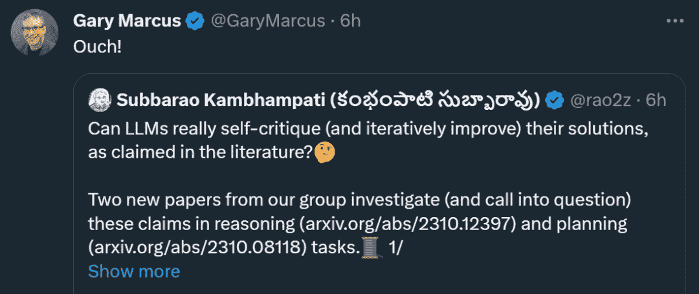

# LLM 新缺陷曝光，自我纠正成功率仅 1%；苹果超 95% 产品仍在中国制造丨 RTE 开发者日报 Vol.72

> 来源：[https://docs.feishu.cn/docx/NngddocytoRZJDxPZlvcJ9OInlh](https://docs.feishu.cn/docx/NngddocytoRZJDxPZlvcJ9OInlh)

开发者朋友们大家好：

这里**是「RTE 开发者日报**」，每天和大家一起**看新**闻、聊八卦。

**

我**们的社区编辑团**队会**整理分享 RT**E **（Real T**im**e Engagement） 领域内「有话题的新闻」、「有态度的观点」、「有意思的数据」、「有思考的文章」、「有看点的会议」，但内容仅代表编辑的个人观点，欢迎大家留言、跟帖、讨论。

本期编辑：@Asui，@CY

---

### **一、有话题的新闻**

**1、传统网络能力提升 10 倍 ** 华为：全面完成 5G-A 技术性能测试

近日，华为全面完成 5G-A 技术性能测试。华为方面介绍称，5G-A 作为 5G 的演进和增强，连接速率和时延等传统网络能力实现了 10 倍提升，同时引入了通感一体、无源物联、内生智能等全新的革命性技术。（@贝壳财经）

**2、LLM 新缺陷曝光：GPT-4** 不知道自己错了，自我纠正成功率仅 1%

GPT-4 根本不知道自己犯错？最新研究发现，LLM 在推理任务中，自我纠正后根本无法挽救性能变差，引 AI 大佬 LeCun 和马库斯围观。

由 ASU 研究人员发表的两篇论文，驳斥了之前很多研究提出的方法「自我纠正」——让大模型对自己的输出的结果进行自我纠正，就能提高模型的输出质量。

在推理实验中，声称可以提高准确性的模型「自我纠正」，把正确率从 16%「提高」到了 1%。简单来说，就是 LLM 在推理任务中，无法通过自我纠正的形式来改进输出，除非 LLM 在自我纠正的过程中已经知道了正确答案。因为如果模型不知道正确答案的话，模型「自我纠正」之后输出质量反而会下降。（@新智元）

3、苹果 Vision Pro 员工培训将于 2024 年初提前开始

苹果将在 2024 年的「头几个月」开始对零售员工进行有关 Apple Vision Pro 的培训，为混合现实头显的推出做准备。苹果多次表示 Apple Vision Pro 头显将于 2024 年初的某个时间上市，但并未透露具体上市时间。现在看来，它可能会在那段时间晚些时候上线，而不是接近年初。

据马克·古尔曼（Mark Gurman）在彭博社的「Power On」时事通讯中称，苹果已向零售员工发出了一份备忘录，要求他们申请参加「产品培训活动」。据信，该活动是对员工进行有关 Apple Vision Pro 和该设备销售程序的教育活动之一。

该说明指出：「选定的团队成员将在 2024 年头几个月的某个时间前往加利福尼亚州库比蒂诺参加一场活动。返回自己的门店后，他们将为商店团队成员提供培训和持续支持。」（@cnBeta）

**4、苹果超 95% 产品仍在中国制造**，CEO 库克称希望与供应链企业合作双赢

据腾讯科技，苹果公司 CEO 库克日前到达浙江嘉善立讯精密工厂，并接受专访。注：浙江嘉善立讯精密工厂主要生产、组装全新 Apple Watch。

报道称，截至目前，苹果有超过 95% 的产品仍在中国制造组装，在过去 30 年的时间里推动了中国供应链的蓬勃发展。库克在采访中表示，苹果希望和供应链企业在合作中实现“双赢”：不限于产品制造的合作、企业相关的应收，还应该包括环境保护、企业社会责任及教育等多方面。（@中国新闻网）

---

### 二、有态度的观点

1、科大讯飞：华为昇腾 910B 能力基本可对标英伟达 A100

10 月 19 日晚间，科大讯飞在三季报业绩说明会上针对近日美国政府进一步收紧对尖端人工智能芯片的出口管制事项表示，前述管制对将大模型构建在英伟达算力上的大模型厂商会产生较大影响，但科大讯飞已于 2023 年初与华为昇腾启动专项攻关，合力打造我国通用人工智能新底座，当前华为昇腾 910B 能力已经基本做到可对标英伟达 A100。在即将举行的科大讯飞 1024 全球开发者节上，公司和华为在人工智能算力底座上将有进一步联合发布。（@IT之家 ）

2、俞敏洪称 AI 对教育孩子没太多好处，李彦宏说“这是误解”

10 月 21 日，在新东方家庭教育高峰论坛上，俞敏洪表示，AI 在教育上对孩子没有太大的好处。孩子写作文就上文心一言，然后改一改。李彦宏立刻反驳道：“我觉得这是一种误解。”

俞敏洪称，反正如果一个男孩给女孩子写了一封特别优美的情书，千万不要相信是这个男孩自己写的，有可能是人工智能写的。李彦宏回答道：“那还是要看他写提示词的水平怎么样。”（@中国新闻网）

3、刘慈欣：我不知道人工智能给我还留下多少时间

著名科幻作家刘慈欣在科幻大会与大家畅谈“科幻”。刘慈欣称：人工智能写的小说越来越好，正在慢慢取代人类作家。并坦言”我不知道人工智能给我还留下多少时间”。此前，刘慈欣在接受中新社记者采访时说：“如果人工智能确实能取代作家，为读者提供更好的文学作品，这也不是一件坏事。我只能顺其自然，无法对抗”，同时他也表达了对人工智能的焦虑：“像我这种不是基于文学表现，而是依托它本身的创意和世界建构的科幻小说越来越难写”。（@腾讯新闻）

4、英伟达 CEO 黄仁勋：如果再重来一次，我不会创办公司

英伟达 CEO 黄仁勋近日在一档播客节目“Acquired”中透露，创办英伟达的过程比他预期的要难一百万倍，如果他知道这个过程有多艰辛，他不会选择创业。黄仁勋还表示，他在创业过程中最大的恐惧就是让员工失望。

---

**写在最后：**

我们欢迎更多的小伙伴参**与「RTE 开发者日报**」内容的共创，感兴趣的朋友请通过开发者社区或公众号留言联系，记得报暗号「共创」。

对于任何反馈（包括但不限于内容上、形式上）我们不胜感激、并有小惊喜回馈，例如你希望从日报中看到哪些内容；自己推荐的信源、话题、活动等；或者列举几个你喜欢看、平时常看的内容渠道；内容排版或呈现形式上有哪些可以改进的地方等。

---

