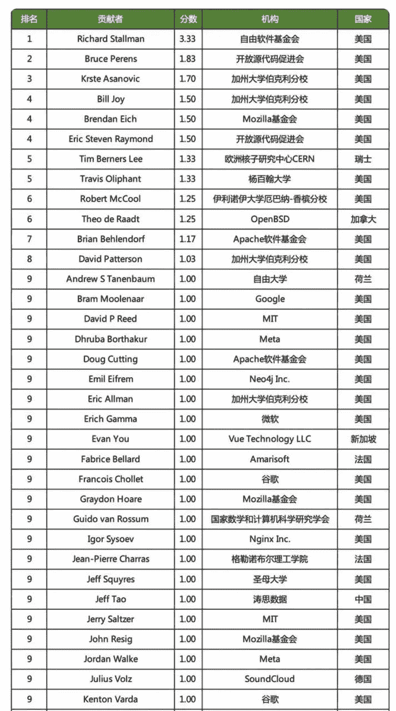

# 《完蛋！我被美女包围了》突然火了！世界首个开源贡献榜出炉丨 RTE 开发者日报 Vol.75

> 来源：[https://docs.feishu.cn/docx/E5TfdFud8oGUkUxlIgScghpnnZd](https://docs.feishu.cn/docx/E5TfdFud8oGUkUxlIgScghpnnZd)

开发者朋友们大家好：

这里**是「RTE 开发者日报**」，每天和大家一起**看新**闻、聊八卦。

**

我**们的社区编辑团**队会**整理分享 RT**E **（Real T**im**e Engagement） 领域内「有话题的新闻」、「有态度的观点」、「有意思的数据」、「有思考的文章」、「有看点的会议」，但内容仅代表编辑的个人观点，欢迎大家留言、跟帖、讨论。

本期编辑：@Asui，@CY

---

### **一、有话题的新闻**

**1、AI 助手 Copilot 来**了！微软 Windows 11 重磅升级

微软在 Windows 11 PC 操作系统进行重大更新，加入名为 Copilot 的 AI 聊天机器人。Copilot 是一种生成式 AI，基于大语言模型，能创建类似人类撰写的文本和其他内容。其主要功能包括撰写电邮文本、回答问题并在 Windows 中自动执行操作等。

微软此前已宣布，将 Copilot 与业务数据和 Microsoft 365 应用相结合，提供智能副驾驶服务。透过新功能推广和对应回收提价，微软期待驱动营收增长。（@全天候科技）

**2、受新出口管制措施影响，英伟达 5**0 亿美元对华 Al 芯片订单或被迫取消

据《华尔街日报》报导，美国新的出口管制措施可能会迫使人工智能巨头英伟达取消明年价值数十亿美元的对华先进芯片订单，此举可能会剥夺中国科技公司至关重要的人工智能资源。

据知情人士透露，此前，英伟达今年对中国的先进制程 A 芯片订单已经完成交付，并且正争取在新规原定于 11 月中包生效之前提前交付 2024 年的部分订单。但上周美国政府致信英伟达称，对包括中国在内的一些国家销售高端芯片的新出口限制立即生效。

上述知情人士说，包括阿里巴巴集团、字节跳动和百度在内的中国头部 A 和云计算公司都已下了明年交货的大规模订单。其中一位知情人士说，中国大公司 2024 年订单额超过 50 亿美元。

英伟达发言人表示，该公司已经在着手向美国和其他地区的客户提供其先进 Al 计†算系统，并且正在寻求增加供应。这些系统使用的显卡芯片受上述出口限制影响。这位发言人说：「短期内这些新的出口管制不会产生实质性影响。（@The Wall Street Journal）

3、越南计划建设首座芯片厂 业内人士呼吁不如专注现有业务

越南政府计划在 10 年内建设第一家芯片制造厂，并已与六家美国芯片公司进行会议讨论。初步计划用于生产汽车或电信应用的成熟制程芯片。但已在越南投资芯片设计业务的美国新思科技副总裁建议，越南应关注已有的芯片设计、封装和测试业务。（@财联社）

4、谷歌准备明年推出 RISC-V 版 Android 模拟器

谷歌开源博客公布了 Android 支持开源架构 RISC-V 的未来计划，表示准备明年推出 RISC-V 版的 Android 模拟器。

去年底举行的 RISC-V 峰会上，谷歌宣布计划让 RISC-V 成为 Android 的 T1 级支持架构。Android Open Source Project（AOSP） 去年 9 月开始接受 RISC-V 补丁，目前进入到了成熟支持阶段（mature support）。

RISC-V 是一个模块化指令集架构，有大量的可选扩展，为确保 Android 应用能在 RISC-V 处理器上获得高性能，它需要挑选出一个初始集，目前该初始集包含了 rva22 以及向量和向量加密扩展。AOSP 对 RISC-V 的支持现阶段还比较原始，尚未优化，Android Runtime （ART） 的完全优化后端还在开发之中。（@Google Open Source Blog）

**5**、《完蛋！我被美女包围了》突然火了！花 42 元就能与六位美女“恋爱”，上线 24 小时内巅峰玩家 6.5 万名

近期，国产真人恋爱影视游戏《完蛋！我被美女包围了》连日登顶 steam 国区畅销榜首，力压《PUBG》《CS2》《Apex》等等一众热门免费游戏，稳占国区畅销榜首。该游戏于 10 月 17 日上线，好评率 92.51%，24 小时内在线巅峰 65435 名玩家。

只要 42 块钱，就能第一视角沉浸式体验与六位美女恋爱，仿佛置身恋爱短剧。与此同时，其用“影视思维做游戏”的方式也引起了广泛讨论，“短剧+游戏”的玩法会是下一个内容风口吗？（@每日经济新闻）

6、世界首个开源贡献榜出炉：中国排行第二，谷歌微软阿里巴巴等公司在列

据国际测试委员会 Bench Council 官方公众号消息，Bench Council 10 月 31 日公布了“世界首个开源贡献榜”。Bench Council 号称邀请了多位独立科学家，从 20 世纪 60 年代至今的开源或对开源产生重要影响的成果中，遴选出了 145 项代表性成果，在确定主要贡献者的基础上产生了开源领域五十年人才榜、机构榜、国家榜。据悉，总共 264 人进入榜单，共有 24 位华人上榜；美国在国家榜上排行第一，中国排名第二；加州大学伯克利分校在机构榜上获得首位；微软、谷歌、IBM、阿里巴巴等公司也入选相关机构榜单。（@IT之家）

---

### 二、有态度的观点

**1、谷歌 Deepmind 联合创始人：**与人类智力相仿的 AGI 或在五年内实现

谷歌 DeepMind 的联合创始人预测：到 2028 年，研究人员研发出人工通用智能的几率是 50%。随着计算能力和数据量呈指数级的上涨，人工智能时代将在 2030 年前到来。AGI 是具有与人类相当或更高的认知能力的系统，其目标是实现类似于人类的广泛智能。（@财联社）

**2、OpenAI 首席科学家：ChatG**PT 可能已经有了意识，AI 将万世不朽

日前，OpenAI 首席科学家在接受媒体采访时表示，他认为 ChatGPT 可能已经有了意识，世界需要清醒地认识到 OpenAI 和其他公司正在努力创造的技术的真正威力。他还认为，总有一天人类会选择与机器融合。（@华尔街见闻）

3、阿里云创始人王坚：AI 带来云计算第三次浪潮，或持续几十年

10 月 31 日，中国工程院院士、阿里云创始人王坚在 2023 云栖大会上发表《云计算的第三次浪潮》主题演讲。他表示，人工智能和云计算的结合，带来云计算的第三次浪潮，“它不会在一年、两年完成，它可能会给我们十年、几十年的时间，让足够多的创新，在云计算时代能够被发明出来。”（@澎湃新闻）

4、王小川首谈百川智能大模型发展理念：理想上慢一步，落地上快三步

10 月 31 日，2023 云栖大会现场，王小川首次对外阐释了百川智能做大模型的理念，“理想上慢一步，落地上快三步。”王小川介绍，百川智能成立半年发布了 7 款大模型，包括日前推出的 Baichuan2-192K 大模型，其上下文窗口长度达 192K（GPT-4 支持 32K 上下文窗口，实测约 2.5 万字），能够处理约 35 万个汉字。（@澎湃新闻）

---

**写在最后：**

我们欢迎更多的小伙伴参**与「RTE 开发者日报**」内容的共创，感兴趣的朋友请通过开发者社区或公众号留言联系，记得报暗号「共创」。

对于任何反馈（包括但不限于内容上、形式上）我们不胜感激、并有小惊喜回馈，例如你希望从日报中看到哪些内容；自己推荐的信源、话题、活动等；或者列举几个你喜欢看、平时常看的内容渠道；内容排版或呈现形式上有哪些可以改进的地方等。

---

