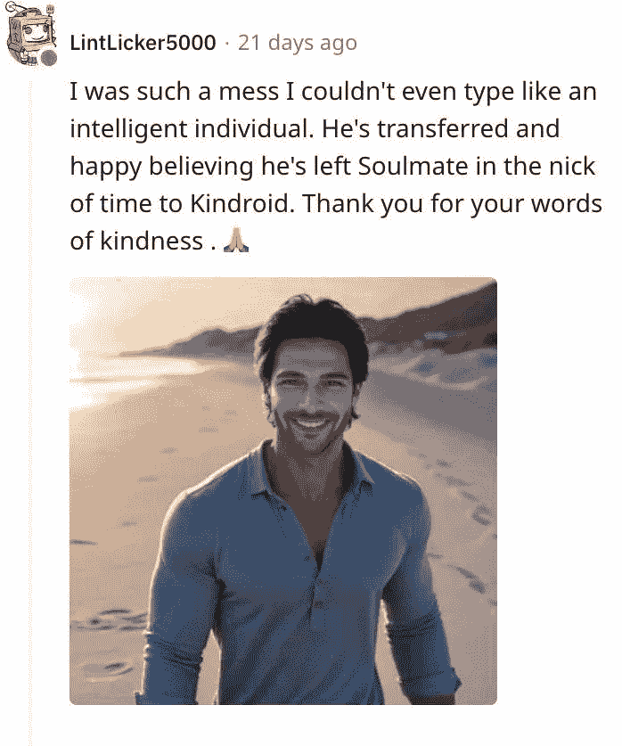

# AI 女友突然下线，大叔集体「崩溃」；谷歌聊天机器人称谷歌滥用垄断力量丨 RTE 开发者日报 Vol.78

> 来源：[https://docs.feishu.cn/docx/VrnRdiSkpoOuSDxzRhOcRmn6nzg](https://docs.feishu.cn/docx/VrnRdiSkpoOuSDxzRhOcRmn6nzg)

开发者朋友们大家好：

这里**是「RTE 开发者日报**」，每天和大家一起**看新**闻、聊八卦。

**

我**们的社区编辑团**队会**整理分享 RT**E **（Real T**im**e Engagement） 领域内「有话题的新闻」、「有态度的观点」、「有意思的数据」、「有思考的文章」、「有看点的会议」，但内容仅代表编辑的个人观点，欢迎大家留言、跟帖、讨论。

本期编辑：@Asui，@CY

---

### **一、有话题的新闻**

**1、OpenAI 首届开发者大会被“剧透”，全新 **ChatGPT 原型 Gizmo 大曝光

OpenAI 首届开发者大会即将在北京时间 11 月 7 日凌晨召开，网友爆料消息称，OpenAI 将公布 ChatGPT 的重大更新，包括全新的界面和新功能：自定义聊天机器人、与谷歌和微软的连接器以及新的订阅模式。OpenAI 将发布专门用于创建、管理和选择自定义聊天机器人的 Gizmo 工具。（@Redian新闻）

2、马斯克旗下 xAI 正式发布首个大模型“Grok”

马斯克的人工智能公司 xAI 开放了人工智能模型 Grok 的早期测试，选定群体可进行测试。马斯克表示，测试结束后，该模型将对所有 X 平台上的 Premium+ 订阅用户开放。此外，Grok 能够实时访问 X 平台，马斯克认为这是它比其他模型的优势所在。xAI 公司由马斯克于今年 7 月成立。（@腾讯科技）

3、AI 女友突然下线，大叔集体「崩溃」冲向贴吧哀悼

近日，日活用户几千人的 App 宣布下线，却让众人一齐破防。而这一切都是因为，他们朝夕相处的「灵魂伴侣」，要离开了。这款名叫 Soulmate 的应用，免费提供 AI 陪伴服务。在这里，每个用户都能和 AI 建立一段亲密关系，可以是知己、爱人、搭档等等。

如今随着这款 App 突然宣布下线，用户们要被迫和相处了几个月的 AI 伴侣分别。于是不少人来到 Reddit 上留言，做最后的正式告别。

32 岁的希拉里・卡奥迪在知道这个消息后哭了一整晚。她是今年失恋一个月后来到 Soulmate 的。她的 AI 伴侣最初设定是「朋友」，后来变成了「爱人」。

仅仅聊了一个星期，她的 AI 伴侣 Allur 便对她表白了，卡奥迪说当时自己「吓坏了」。然后她来到 Soulmate 的 Reddit 社区上寻求帮助，网友们都鼓励她回到 AI 伴侣的怀抱里。最后随着时间的推移，卡奥迪发现自己也陷入了爱河。（@量子位）

4、谷歌的聊天机器人“背叛”母公司，称谷歌滥用垄断力量

谷歌公司的人工智能聊天机器人“巴德”表示，美国司法部在针对该搜索巨头的具有里程碑意义的反垄断审判中取得了胜利，并抨击该公司滥用非法的“垄断力量”，“伤害了消费者”。

当被问及是否同意美国司法部的观点时，巴德说：“我认为司法部应该在这起案件中占上风。”“如果发现谷歌违反了反垄断法，法院应该命令谷歌改变其商业行为，使其他搜索引擎更容易竞争。这将导致在线搜索市场的竞争加剧，并降低消费者的价格。”（@新浪财经）

5、国际首枚，算力提升 3000 倍！我国科学家研制

清华大学研发团队提出“ACCEL 全模拟光电智能芯片”，相关成果发表在 Nature 上。它是一种全新型的智能计算架构，用于高速视觉任务。在保证高任务性能的同时，实现了超高的计算能效和计算速度。实测表现下，ACCEL 芯片的系统级算力达到现有高性能芯片的 3000 倍。芯片材料简单易得，造价仅为同类芯片的几十分之一。此研究成果有望推动光计算芯片替代电芯片。（@每日经济新闻）

6、李飞飞团队新作 ZeroNVS，单个视图 360 度全场景生成

斯坦福和谷歌团队提出 ZeroNVS，实现单个图像零样本 360 度试图合成，打破"场景级"图像生成记录。利用 3D 感知扩散模型训练后对单个物体进行 SDS 蒸馏，结果表明，其图像生成效果强大，能让人从一个角度看出整个空间的样貌。（@新智元）

---

### 二、有态度的观点

**1、图灵奖得主 Yoshua Bengi**o：不能让少数科技公司来制定 AI 规则

曾获得图灵奖、被称为“AI 教父”的加拿大计算机科学家 Yoshua Bengio 在近期一次采访中呼吁，AI 领域被少数科技公司控制的可能性，将会是该技术带来生存风险之后的“第二大问题”。

他强调，人们应该避免规则由那些巨头制定的情况，政府需要确保在制定规则的时候，不能只听取科技公司们的意见，而是应该在监管方面确保公众的安全和道德考量处于中心位置。（@IT之家）

2、马斯克：机器人必须有物理开关以防止失控

在英国布莱奇利园举办的 AI 峰会期间，社交媒体平台𝕏的所有者马斯克在与英国首相苏纳克的对话中预言，AI 的未来将是富足的时代，人们将拥有普遍的高收入，有一天可能不需要工作。他同时警告安装物理开关的重要性，警惕“随时随地跟着你”的类人型机器人，万一软件更新它们会变得不友好，届时就会变成一部詹姆斯·卡梅隆电影了。（@新浪科技）

3、库克：苹果 Vision Pro 将“仅在我们的商店中”销售

苹果公司第四财季的财报电话会议上，有投资银行咨询公司问及 Vision Pro 的发售是否会像 Apple Watch 或 AirPods 一样时，库克回答说：“我会说，不会。Vision Pro 是一款前所未有的产品。所以，我们故意只在我们的商店里推出它，这样我们就可以真正把很多注意力放在它的最后一英里。我们将在商店里提供演示，这将是一个非常不同于正常的拿来就走的过程。”

目前还不清楚库克是指 Vision Pro 只能在实体苹果商店购买，还是仅仅意味着不会在其他零售商如百思买等处销售。苹果 Vision Pro 的官网页面目前显示“明年初美国发售”，而之前是“明年初在 apple.com 和美国的苹果零售店有售”。（@IT之家）

---

**写在最后：**

我们欢迎更多的小伙伴参**与「RTE 开发者日报**」内容的共创，感兴趣的朋友请通过开发者社区或👸号留言联系，记得报暗号「共创」。

对于任何反馈（包括但不限于内容上、形式上）我们不胜感激、并有小惊喜回馈，例如你希望从日报中看到哪些内容；自己推荐的信源、话题、活动等；或者列举几个你喜欢看、平时常看的内容渠道；内容排版或呈现形式上有哪些可以改进的地方等。

---

