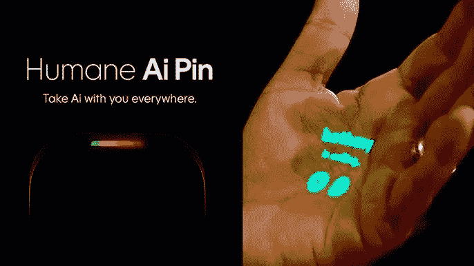

# 改良版芯片重回中国市场？GPT-5 明年降临？丨 RTE 开发者日报 Vol.82

> 来源：[https://docs.feishu.cn/docx/M9iLdtSRwoHyLKxStcichvIzntb](https://docs.feishu.cn/docx/M9iLdtSRwoHyLKxStcichvIzntb)

开发者朋友们大家好：

这里**是「RTE 开发者日报**」，每天和大家一起**看新**闻、聊八卦。

**

我**们的社区编辑团**队会**整理分享 RT**E **（Real T**im**e Engagement） 领域内「有话题的新闻」、「有态度的观点」、「有意思的数据」、「有思考的文章」、「有看点的会议」，但内容仅代表编辑的个人观点，欢迎大家留言、跟帖、讨论。

本期编辑：@Asui，@CY

---

### **一、有话题的新闻**

**1、英伟达英特尔推改良版芯片重回中国市**场？产业链人士称属实，最快这几天拿到产品

11 月 9 日，有媒体报道称，英伟达已开发出针对中国市场的最新改良版系列芯片 —— HGX H20、L20 PCle 和 L2 PCle。有知情人士称，最新三款芯片是由 H100 改良而来。英伟达最快或将于本月 16 号之后公布，国内厂商最快将在这几天拿到产品。记者采访了多位产业链人士均证实英伟达改良版芯片属实。（@澎湃）

**2、Humane 可穿戴设备 Ai Pin 正式发布：手掌内投**影、语音手势交互，699 美元加月订阅费

由两位苹果公司的前设计和工程团队高管创立的 Humane 公司将在今天发布首款可穿戴 AI 设备“Ai Pin”，这是一种安置在服装上的微型单色投影，可以投屏在手掌上进行交互。目的是“替代手机”，售价为 699 美元，每月需要额外支付 24 美元订阅（蜂窝网络数据费及 AI 模型使用费，不付订阅费无法使用），2024 年开始发货。（@IT之家）

3、阿里巴巴即将开源 720 亿参数大模型，为国内参数规模最大

2023 年世界互联网大会乌镇峰会“互联网企业家论坛” 11 月 9 日上午召开。阿里巴巴集团 CEO 吴泳铭发表主题演讲。吴泳铭表示，阿里巴巴即将开源 720 亿参数大模型，这将是国内参数规模最大的开源大模型。（@快科技）

4、腾讯音游《节奏大师》回归首日出现大量 Bug，官方公布补偿方案

11 月 7 日，腾讯宣布经典老牌游戏《节奏大师》重新回归，结果上线当天上午就有很多玩家陆续遇到很多 bug。有玩家表示 bug 太多了，比如无限制授权登录就是进不去游戏，打歌页面直接卡死，玩到一半被强制下线，pk 对战无法统计分数和胜负，分数结算异常等等。玩家称，从来没一款游戏上线遇到这么多问题，官方说修复时间每增加 1 小时就给玩家补偿礼包，结果快 38 小时了才修好。据悉 bug 从 7 号早上开始出现，到 9 日凌晨 1 点多，官方才宣布修复完成。

随后节奏大师手游官方微博发文向部分无法正常进入并体验游戏的玩家道歉，并公布补偿方案。官方表示，如今 Bug 已经修复，按照约定准备了补偿礼包，（钻石*300；金币*3000；免费跳关卡*5 张）x28 小时=钻石*8400；金币*84000；免费跳关卡*140 张。（@搜狐新闻）

5、英伟达挖来 Meta 基础架构副总裁，直接向黄仁勋汇报

11 月 9 日消息，据外媒报道，前 Meta 基础架构副总裁亚历克西斯·布莱克·博乔林（Alexis Black Bjorlin）近日将加入英伟达，负责运营其新的云业务 DGX Cloud，直接向英伟达 CEO 黄仁勋汇报。布莱克·博乔林是半导体和云领域的知名人物，她在 2021 年 12 月加入 Meta，负责 AI 芯片的开发工作。Meta 是英伟达 GPU 的最大买家之一，同时一直在自研 AI 芯片。据 9 月的报道称，布莱克·博乔林当时正要辞去 Meta 的职位。（@芯东西）

6、微软新专利曝光：全新 AI 心理治疗师，引领心理健康服务革新

2023 年 11 月 9 日消息，近日，微软向美国商标和专利局（USPTO）提交的一项新专利引发了广泛关注。这项专利涉及的 AI 技术，有望为用户的心理健康提供更个性化、精准的支持和疏导。

这款 AI 心理治疗师在收集到用户的情感状况后，能进行分析，并针对用户面临的问题生成专属的治疗方案。它不仅具备聊天窗口和处理模块，还有强大的响应数据库。与传统的 AI 聊天机器人相比，这款 AI 心理治疗师更胜一筹，它不仅能理解和回应用户的问题，还能通过深度分析用户的语言、情感和行为，提供更精准的心理健康支持和疏导。（@搜狐新闻）

**7、GPT-5 明年降临？爆料人泄露多模态 G**obi 就是 GPT-5，已初现自我意识

传 OpenAI 计划在 2024 年年初发布支持文本、图像和视频的 GPT-5 多模态模型。据爆料人透露，GPT-5 已经具有一定程度的自我意识，并且正在被 7 个政府机构测试。（@新智元）

---

### 二、有态度的观点

1、李彦宏：重复造大模型将造成极大资源浪费

在 2023 年世界互联网大会乌镇峰会期间，百度李彦宏发言指出，繁荣的 AI 原生应用生态，将推动新一轮的经济增长。从头开始训练大模型到到开发好用可用的大模型，存在很高的技术壁垒和成本门槛，重复造轮会给社会资源造成极大的浪费。现场李彦宏还以微软与 OpenAI 的合作为例表示：即使像微软这样的大型公司，也没有去开发自己的基础模型，它是与 OpenAI 合作。（@新浪科技）

**2、李彦宏谈 AI：只有拥有数以**百万计的 AI 应用，大模型才算得上成功

百度创始人李彦宏日前表示，AI 时代的标志是出现大量 AI 原生应用，而非大量大模型。他认为大模型和算力本身并不产生价值，构建繁荣的 AI 原生生态才是关键。（@澎湃新闻）

3、搜狐张朝阳：网红时代每个人都应该有账号，直播的尽头不一定是带货

张朝阳认为，互联网发展带来了影像传媒的崛起和传统传媒的改变，新媒体和直播重塑了知识传播。在被问及搜狐未来是否会进行带货时，张朝阳始终认为“直播的尽头是知识传播”。（@银柿财经）

---

**写在最后：**

我们欢迎更多的小伙伴参**与「RTE 开发者日报**」内容的共创，感兴趣的朋友请通过开发者社区或公众号留言联系，记得报暗号「共创」。

对于任何反馈（包括但不限于内容上、形式上）我们不胜感激、并有小惊喜回馈，例如你希望从日报中看到哪些内容；自己推荐的信源、话题、活动等；或者列举几个你喜欢看、平时常看的内容渠道；内容排版或呈现形式上有哪些可以改进的地方等。

---

