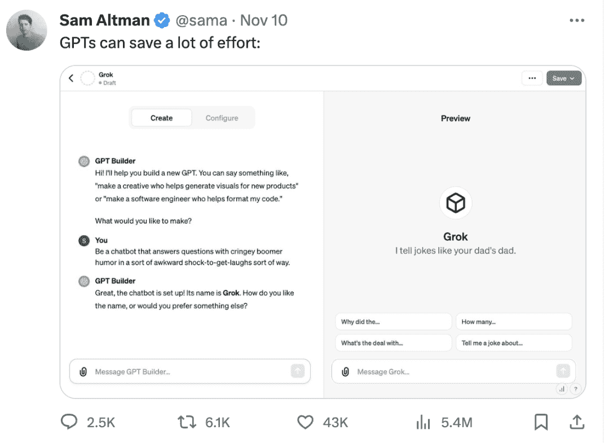

# “ChatGPT 之父”暗讽马斯克；传安卓版本与鸿蒙将不再兼容；PICO 裁撤游戏工作室团队丨 RTE 开发者日报 Vol.83

> 来源：[https://docs.feishu.cn/docx/RUvodHAnVoPkF8xHjPfcau23neg](https://docs.feishu.cn/docx/RUvodHAnVoPkF8xHjPfcau23neg)

开发者朋友们大家好：

这里**是「RTE 开发者日报**」，每天和大家一起**看新**闻、聊八卦。

**

我**们的社区编辑团**队会**整理分享 RT**E **（Real T**im**e Engagement） 领域内「有话题的新闻」、「有态度的观点」、「有意思的数据」、「有思考的文章」、「有看点的会议」，但内容仅代表编辑的个人观点，欢迎大家留言、跟帖、讨论。

本期编辑：@Asui，@CY

---

### **一、有话题的新闻**

1、“ChatGPT 之父”暗讽马斯克：省省吧，你的 Grok 过时了

“ChatGPT 之父”萨姆·奥尔特曼周四发帖暗示，任何人都可以使用 GPT 制作像 Grok 这样的聊天机器人。这位 OpenAI 首席执行官分享了一张截图，称“GPT 可以节省很多工作”。这张截图似乎显示，GPT Builder 被要求用来创建“一个聊天机器人，能够以一种尴尬的从震惊到大笑的方式，用令人尴尬的婴儿潮一代的幽默来回答问题。”

GPT Builder 回复说：“聊天机器人已设置！它的名字叫 Grok。”在这条帖子的评论区里，有网友说“Sama（samaltman）今天醒来，选择了暴力。”还有人说，他的账户可能很快就会被封禁。（@环球市场播报）

2、传安卓版本与鸿蒙将不再兼容，网易、美团急招鸿蒙开发员

近期，多家互联网公司发布了多个和鸿蒙系统有关的岗位。岗位主要是软件研发、移动研发相关的 Android 开发工程师、C++ 开发工程师等职类。相关岗位对学历和经验要求也相对较高，要求本科及以上学历和 3 年以上工作经验的招聘职位数占比分别超 75% 和 43%，平均招聘薪资达 17537 元/月，超市场平均水平。（@第一财经）

3、腾讯将在中国独家代理 Meta VR 头显

据报道，Meta 已与腾讯达成初步协议，在中国销售一款新型低价版虚拟现实（VR）头显。据知情人士表示，该协议将使腾讯成为 Meta 头显在中国大陆的独家销售商，并将于 2024 年底开始销售该设备。Meta 将对设备销售收入占有更高比例，腾讯将在内容和服务收入中占据更多份额，如软件订阅和游戏销售。

据报道，这款头显设备，将使用比 Quest 3 更便宜的镜头，而其图像处理装置则比三年前推出的 Quest 2 更先进。（@凤凰网科技）

**4、Ozone 融资 710 万美元，用于**在云端扩展其人工智能驱动的协作视频编辑器

世界上第一个由人工智能驱动的协作视频编辑器 Ozone，已筹集 710 万美元种子资金，并正在推出公开测试版。

Ozone 不想用人工智能取代人类的创造力，而是希望为内容创作者提供工具，让他们更快、更高效地创建引人入胜的视频。其目标是为内容创作者提供人工智能帮助，让他们在几秒钟而不是几小时内完成重复的编辑任务。该软件支持视频编辑功能、无限的云存储和类似 Figma 的实时协作。您可以在人工智能的帮助下完成诸如消除静音、添加字幕和动画、校正颜色、添加音乐等操作。（@Ozone）

5、《中国智能网联汽车技术规程》自动驾驶测评规则发布

中国汽车技术研究中心有限公司汽车测评管理中心对外发布《中国智能网联汽车技术规程》自动驾驶测评规则。此次发布的自动驾驶测评规则主要包含“真实道路表现”和“可实现功能”两个部分。

“真实道路表现”主要评价安全保障、驾乘体验和通行效率三个方面，“可实现功能”主要对自动驾驶使用过程中的基础场景和复杂场景进行评价，综合考虑自动驾驶系统的安全、舒适、效率、接管时间以及最小风险策略五个方面的内容。《中国智能网联汽车技术规程》将采取分步实施的方式推进，预计将在 2025 年推出完整测评体系。（@财联社）

6、国家气候中心最新监测：厄尔尼诺事件已形成，最暖年纪录或再被打破

根据国家气候中心最新监测，一次中等强度厄尔尼诺事件已经形成，并将持续到明年春季。受其影响，并叠加全球气候变暖的大背景，2023 年全球平均气温或将打破 2016 年最暖年纪录。预计今冬到明春我国大部地区气温接近常年同期或偏高，但阶段性冷空气活跃，南方地区降水偏多，复合型气象灾害风险加大。（@人民网）

7、谷歌将于 12 月 1 日开始删除不活跃的 Gmail 帐户

谷歌将从 12 月 1 日开始删除长期不活跃的 Gmail 账户和照片，谷歌今年早些时候就宣布了这一消息，现在离这个截止日期只剩几周了。据了解，谷歌将两年内没有使用过的账户定义为不活跃账户。

谷歌认为，登录、阅读或发送电子邮件、使用谷歌云端硬盘、观看 YouTube 视频、分享照片、下载应用程序、以及登录状态下进行搜索等行为都是“活动”。如果你有一个谷歌账户，两年内没有登录或进行任何活动，谷歌则认为它是不活跃的。这一政策只适用于个人账户，不包括与雇主、学校或其他组织相关的账户。（@财联社）

---

### 二、有态度的观点

**1、OpenAI CEO 奥尔特曼：开发 GPT-5 很**难，通用人工智能有望 10 年内成为现实

OpenAI 首席执行官奥特曼表示，其新一代大语言模型 GPT-5 的开发面临挑战，未能给出确切的发布时间，但他强调每次迭代后 GPT 会变得更强。他预测，未来 GPT-5 将能适用于大多数人可能想要构建的产品。他还预料，通用人工智能 AGI 或在未来十年内实现。（@腾讯科技）

2、马斯克：我想和佩奇再次成为朋友

特斯拉 CEO 埃隆·马斯克在与著名播客节目主持人 Lex Fridman 的最新对话中表示，在与谷歌联合创始人拉里·佩奇就人工智能安全问题发生分歧而闹僵十年后，他希望与佩奇重归于好。

马斯克称：“我想和佩奇再次成为朋友。我很久没见过他了。我们曾是多年的好友，就是因为 OpenAI，我们这段友谊破裂了。”二人的分歧可以追溯到 2013 年。

据马斯克传记的作者 Walter Isaacson 描述，在马斯克当年的生日聚会上，二人在人工智能可能取代人类的可能性上发生了分歧。经过这次分歧，马斯克后来找到 DeepMind 联合创始人兼 CEO 戴米斯·哈萨比斯，试图说服他不要与谷歌签署协议。当时，佩奇是谷歌的 CEO。根据传记，马斯克对哈萨比斯说，人工智能的未来不应该由佩奇来控制。（@环球市场播报）

3、李飞飞：我不是开源派，也不是毁灭派，希望人类能与 AI 和平共处

享誉全球的华裔计算机科学家李飞飞创作的新书《我看到的世界》于日前正式发售。李飞飞在书中提到，自己不是开源派，也不是毁灭派，而是中间派，希望人类能与人工智能和平共处。（@腾讯科技）

4、周鸿祎：大模型 2 年内可「进」智能汽车

11 月 12 日消息，周鸿祎近日直播表示，大模型将未来两年内「进入」智能汽车系统助力自动驾驶，同时，360 集团将基于 360 智脑为哪吒汽车打造专属车用大模型，提升车载大模型的响应速度。

出于扎根「安全」行业的敏感性，周鸿祎直播中表示，「我是做安全的，万分之一的极小概率也要给到解决方案。」他认为，智能汽车有三方面的安全问题值得关注。第一是车辆碰撞安全，第二是电池安全，第三是智能网联车安全。

周鸿祎介绍，让大模型「进车」应该实现「三步走」。第一步，先在云端引入大模型，保证车载大模型的快速响应，助力智能汽车在云端「上车」。第二步，利用大模型强大的自然语言理解能力、处理能力来支撑智能座舱，使人机对话指挥更加畅通。第三步，通过大模型对自动驾驶带来新的提升。（@新浪科技）

5、周鸿祎：任何情况下，都支持华为

11 月 11 日，周鸿祎在直播间聊到余承东、何小鹏关于 AEB（自动紧急刹车系统）的口水战。他表示，任何情况下，都支持华为，他对 AEB 不太懂，但是余承东说了肯定没错。目前，余承东和何小鹏已经和好。（@凤凰网）

---

**写在最后：**

我们欢迎更多的小伙伴参**与「RTE 开发者日报**」内容的共创，感兴趣的朋友请通过开发者社区或公众号留言联系，记得报暗号「共创」。

对于任何反馈（包括但不限于内容上、形式上）我们不胜感激、并有小惊喜回馈，例如你希望从日报中看到哪些内容；自己推荐的信源、话题、活动等；或者列举几个你喜欢看、平时常看的内容渠道；内容排版或呈现形式上有哪些可以改进的地方等。

---

