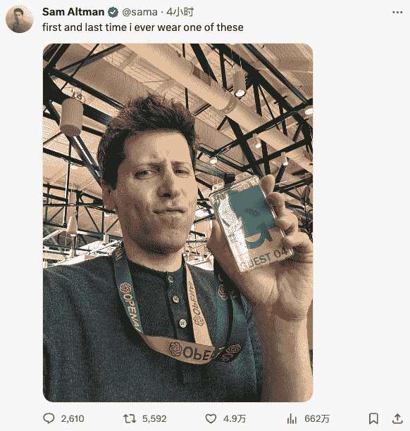

# Sam Altman 或回归 OpenAI；格力 1.3 万研发人员没有海归派 & 外国人丨 RTE 开发者日报 Vol.88

> 来源：[https://docs.feishu.cn/docx/QIhQd5HSSoedVmxqh4kcq8C5nFf](https://docs.feishu.cn/docx/QIhQd5HSSoedVmxqh4kcq8C5nFf)

开发者朋友们大家好：

这里**是「RTE 开发者日报**」，每天和大家一起**看新**闻、聊八卦。

**

我**们的社区编辑团**队会**整理分享 RT**E **（Real T**im**e Engagement） 领域内「有话题的新闻」、「有态度的观点」、「有意思的数据」、「有思考的文章」、「有看点的会议」，但内容仅代表编辑的个人观点，欢迎大家留言、跟帖、讨论。

本期编辑：@Asui，@CY

---

### **一、有话题的新闻**

1、Sam Altman 或回归 OpenAI，微软等正在调和

上周五，[OpenAI 董事会解雇了](http://mp.weixin.qq.com/s?__biz=MjM5MjAwODM4MA==&mid=2650995028&idx=1&sn=b203fcd02a66a704b8fcf1ca974c3227&chksm=bd5a88878a2d0191d28c4ed5bac7e252f022ecab8b90913eea4b65e6b6948f2077d72fad085d&scene=21#wechat_redirect) Sam Altman，在许多人看来，他是生成式人工智能的代言人，这在整个科技行业引发了冲击波。周日，Altman 在社交平台 X 上发布了一张自己戴着 OpenAI 访客卡的照片，并配文：“这是我第一次也是最后一次戴这个。”

外媒 The Verge 透露，这是 Sam Altman 正在回总部讨论复职事宜，对于 Altman 回归，其本人持开放态度，但是他回归的一大条件是现有董事会（解雇他的人！）必须下台。现有董事会必须就谁将接替他们做出一些艰难的决定，这似乎是症结所在。据彭博社报道，微软 CEO Satya Nadella 正在调解 Altman、前 OpenAI 总裁 Greg Brockman 以及四位现任董事会成员之间的讨论，因为他们试图选择新的董事会。（@CSDN）

2、金山办公致歉并承诺用户文档不会被用于 AI 训练

近日有媒体报道称，此前《WPS 隐私政策》中提到「我们将对您主动上传的文档材料，在采取脱敏处理后作为 AI 训练的基础材料使用」，被质疑涉及用户隐私问题。对此，11 月 18 日，WPS 官方微博做出回应，在向用户致歉的同时，承诺用户文档不会被用于 AI 训练目的。（@新浪财经）

3、DeepMind 开发新 AI 工具，用它玩策略类游戏有超人表现

谷歌 DeepMind 公司开发出一款名为“游戏学生”（SoG，Student of Games）的新人工智能（AI）工具，能在国际象棋、围棋、扑克和其他需要多种策略才能获胜的游戏中击败人类玩家。DeepMind 公司表示，最新研究朝着能以超人的表现执行多项任务的通用 AI 迈出了重要一步。相关论文发表于最新一期《科学进展》杂志（https://www.science.org/doi/10.1126/sciadv.adg3256）。（@科技日报）

**5、Meta 押注生成式 AI 业务，现已拆**分其 Responsible AI 团队

11 月 19 日消息，Meta 于当地时间周六宣布，正将其负责 Responsible AI 团队拆分，将更多资源转移到生成式人工智能工作上。这是 Meta 本周内部 AI 团队广泛重组计划的一部分。

Meta 发言人表示，大部分负责人工智能的团队成员将转移到生成式人工智能领域，并继续支持 Meta 在负责任的人工智能开发和使用方面的相关跨部门工作；其他一些成员将转到人工智能基础设施部门。他指出，公司打算让这些员工更接近核心产品和技术的开发。（@金融界）

6、地平线征程 6 芯片来了：560 TOPS 算力，2024 年交付

11 月 19 日消息，据「地平线 HorizonRobotics」公众号消息，在 2023 广州车展上，地平线宣布征程 6 系列将于 2024 年 4 月正式发布，并于 2024 年第四季度完成首批量产车型交付。

据介绍，征程 6 基于统一的 BPU 纳什计算架构，是业界首款能够覆盖从低到高全阶智能驾驶需求的系列车载智能计算方案。其中，征程 6 旗舰专为新一代城区高阶智驾而生，算力高达 560 TOPS，对 BEV、Transformer 等先进模型的支持效率业界领先。

官方表示，征程 6 旗舰拥有高集成度、高算力、高效率、高处理能力、高接入能力以及高安全等六大产品制高点。其中，征程 6 旗舰实现了 CPU、BPU、GPU、MCU「四芯合一」，以高集成度提升系统性价比，降低部署难度。芯片最大可接入 24 路摄像头、激光雷达等多类传感器，可实现全场景 NOA。（@快科技）

---

### 二、有态度的观点

1、袁昱：相较完全沉浸式的 VR 头显，AR 眼镜的生命周期会更长一些

IEEE（电气电子工程师学会）副主席、董事兼 IEEE 标准协会主席袁昱表示，脑机接口才是元宇宙终极解决之道，但是实现脑机接口可能需要 10 年至 15 年以上时间，所以将 VR 头显作为过渡性产品体验虚拟交互也是元宇宙发展的必由之路。值得一提的是，相较完全沉浸式的 VR 头显，AR 眼镜的生命周期会更长一些，主因其可将现实与虚拟世界融合。（@第一财经）

**2、马斯克：先进 AI 的风险如此之**高，OpenAI 理应解释为何解雇奥特曼

11 月 20 日消息，针对人工智能研究公司 OpenAI 解雇其首席执行官山姆·奥特曼一事，该公司联合创始人、前董事会成员埃隆·马斯克终于表态。他认为，人工智能的潜在危险如此之大，以至于作为目前世界上最强大的人工智能公司，OpenAI 理应披露解雇奥特曼的原因。（@腾讯科技）

**3、董明珠：格力 1.3 万研发人员没有海**归派、没有外国人，从不认为外国的天空更蓝

格力电器董事长兼总裁董明珠在第 17 届中国品牌节上介绍到，格力有 1.3 万名研发人员，虽然海归派很优秀，但格力电器有自己的思考——坚定的培养自主研发人员，所以公司没有一个海归派。“格力拥有这么多专利技术，但是我们这里没有一个外国人”，董明珠说，大家都认为外国的天空比我们的蓝，我从来不这样认为！（@金融界）

---

**写在最后：**

我们欢迎更多的小伙伴参**与「RTE 开发者日报**」内容的共创，感兴趣的朋友请通过开发者社区或公众号留言联系，记得报暗号「共创」。

对于任何反馈（包括但不限于内容上、形式上）我们不胜感激、并有小惊喜回馈，例如你希望从日报中看到哪些内容；自己推荐的信源、话题、活动等；或者列举几个你喜欢看、平时常看的内容渠道；内容排版或呈现形式上有哪些可以改进的地方等。

---

