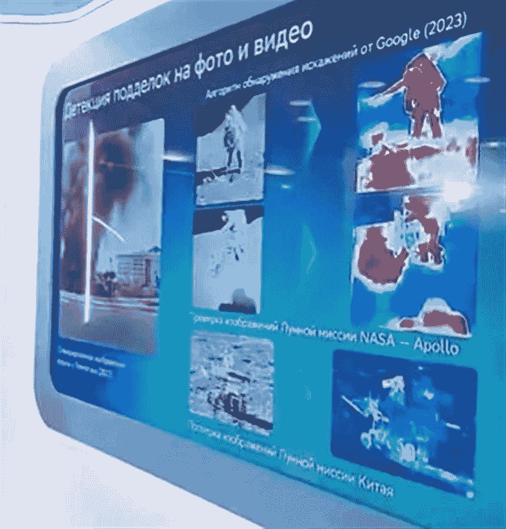

# 谷歌人工智能鉴定美登月照片造假；暴雪国服简体中文官网可正常登录丨 RTE 开发者日报 Vol.93

> 来源：[https://docs.feishu.cn/docx/EB8LdcgBZojO5Kx7sxQcAergn2e](https://docs.feishu.cn/docx/EB8LdcgBZojO5Kx7sxQcAergn2e)

开发者朋友们大家好：

这里**是「RTE 开发者日报**」，每天和大家一起**看新**闻、聊八卦。

**

我**们的社区编辑团**队会**整理分享 RT**E **（Real T**im**e Engagement） 领域内「有话题的新闻」、「有态度的观点」、「有意思的数据」、「有思考的文章」、「有看点的会议」，但内容仅代表编辑的个人观点，欢迎大家留言、跟帖、讨论。

本期编辑：@Asui，@CY

---

### **一、有话题的新闻**

1、谷歌人工智能鉴定美登月照片造假，普京：很有意思

据报道，俄罗斯总统普京在莫斯科出席“人工智能世界之旅”国际会议期间参观了关于人工智能产品的展览。他在展览上被告知，美国谷歌公司的神经网络（人工智能技术）曾判定关于美国登月任务的照片存在虚假内容。普京评价称，“有意思”。

俄联邦储蓄银行负责人格尔曼·格列夫则说，上述结论不是俄罗斯公司的神经网络得出的，而是美国公司谷歌的神经网络在根据多个指标进行分析的基础上得出的。（极目新闻）

2、华为重磅官宣：车BU独立运营，长安入股不超过40%

据新智驾消息，华为与长安汽车于11月25日在深圳签署《投资合作备忘录》。经协商，华为拟成立一家新公司，聚焦智能网联汽车的智能驾驶系统及增量部件的研发、生产、销售和服务。本次交易长安汽车及其关联方拟出资获取目标公司股权，比例不超过40%，具体股权比例、出资金额及期限由双方另行商议。

11月26日晚，赛力斯就“华为车BU独立运营”一事发文称，目前赛力斯已收到关于共同投资目标公司，共同参与打造电动化、智能化开放平台的邀请，公司正积极论证参与投资与合作的相关事宜。华为轮值董事长徐直军表示：“华为坚持不造车，而是发挥自身ICT技术优势和营销能力，帮助车企造好车、卖好车。我们会持续履行对客户和伙伴的承诺，共同推进汽车产业的崛起。”

3、字节游戏地震：传在研项目尽数被砍，恐超千人将被裁

据多名知情人士透露，字节跳动游戏业务朝夕光年将进行大规模的业务和人员调整。具体而言，在研还未上架的游戏项目，将全部解散，相关人员将被裁撤。赔偿方面，有消息人士称，此次裁员赔偿为N+1，同时年终奖、股权等也将折算。到目前为止，内部还在统计在研项目和人员数量，正式调整通知将于近期发布。（游戏葡萄）

4、阿里达摩院回应撤裁量子实验室：已将实验室及仪器设备赠予浙江大学

近期，有市场传言称由于预算及盈利等原因，阿里达摩院对旗下量子实验室进行了大幅裁员，并可能裁撤整个团队。传闻表示，由于预算及盈利等原因，阿里巴巴达摩院量子实验室或已解散，共计裁减30余人，且该实验室许多成员已成功入职其他企业。阿里达摩院11月26日回应表示，为了进一步推动量子科技协同发展，达摩院联合浙江大学发展量子科技，将量子实验室及可移交的量子实验仪器设备捐赠予浙江大学，并向其他高校和科研机构进行开放。不过达摩院并未对人员处置问题进行回应。（集微网）

5、暴雪国服简体中文官网可正常登录，并下载客户端

据报道，此前关停许久的暴雪国服简体中文官网，24日下午已经可以重新登录，但时不时会闪崩。经实测发现，登录该页面之后，已经可以下载桌面端和移动端应用，但是下载速度比较慢。（科创版日报）

6、谷歌反垄断案揭秘的真相：“不作恶”已被摒弃 在搜索市场可为所欲为

美国司法部对谷歌发起的反垄断案是自 20 世纪 90 年代以来美国历史上最大规模的科技公司垄断案。美国司法部近期在法庭上完成了陈述环节，称谷歌确保其搜索引擎业务优势的做法违反了联邦反垄断法。法官可能要到明年才会做出裁决，但这一案件的任何解决方案都可能会拖延数年。（腾讯科技）

7、Hugging Face 宣布最受欢迎的 AI 机构

近日，Hugging Face 作为开源AI社区的代表，总结了社区最欢迎的前 15 个公司和机构，Stability AI、Meta AI、Runway 占据排名前三，大众熟知的OpenAI、谷歌、微软也榜上有名。其中，国内入选的机构是今年凭借开源模型 ChatGLM-6B 上榜的 KEG 实验室。

---

### 二、有思考的文章

**1、《智能的本质就是压缩？马毅团队5年心血提出「白盒」Tr**[**ansfor**](https://mp.weixin.qq.com/s/LEEXJKIW-nSci7AEHxVH1Q)mer， 打开LLM黑盒！》（@新智元）

来自UC伯克利，港大等机构的研究人员，开创性地提出了一种「白盒」Transformer结构——CRATE。他们通过将数据从高维度分布压缩到低维结构分布，实现有效的表征，从而进一步实现了有竞争力的模型性能。这也引发了一个更为深远的讨论——难道智能的本质就是压缩吗？

[**2、《MBZU**](https://mp.weixin.qq.com/s/lguH8sC-_jmCFKoEbGEKmQ)AI校长邢波亲笔撰文：人工智能的「文艺复兴」已经到来》（@机器之能）

关于 AI 风险的问题，各路大佬也是意见不统一，前阵子大家还在社交媒体上爆发了一场大规模论战。

有的人带头签署联名信，呼吁 AI 实验室应立即暂停研究并呼吁政府加强监管。也有不少人对 AI 发展非常积极乐观，认为 AI 的发展远未构成对人类的威胁，监管只会蜕变为少数巨头利益的保护伞。

英国政府针对 AI 技术前后态度的变化，正是「威胁论」尘嚣甚上的例证。三月份，英国政府曾发布白皮书，承诺不会扼杀 AI 创新。仅仅两个月后，「AI 末日论」 弥漫，政府也开始讨论为 AI 设置护栏，并敦促美国政府也这么做。

正是在这一大社会舆论背景下，穆罕默德·本·扎耶德人工智能大学校长、卡内基梅隆大学计算机科学学院教授邢波发表了自己的看法。 作为世界上顶尖计算机科学教授之一，邢波直言不讳批评这些「威胁论」、「末日论」，「营造出充满悲观情绪的舆论，加剧公众的恐惧和焦虑。」而这些主张的推理和结论之间却存在「巨大鸿沟。」 他指出，制造和鼓吹悲观论调的人「没有坚持一个受过教育的社会成员应有的理性分析和严谨论证。」

邢波对 AI 发展持积极、开放态度。他认为，AI 正在迎来 21 世纪的「文艺复兴」，也将从根本上改变人类获取知识和解决问题的方式，将我们带入一个赋能时代（Age of Empowerment），增益人类其所不能，促进人类福祉。

本文是邢波供稿（英文）的中译版本，由机器之心编译。

---

**写在最后：**

我们欢迎更多的小伙伴参**与「RTE 开发者日报**」内容的共创，感兴趣的朋友请通过开发者社区或公众号留言联系，记得报暗号「共创」。

对于任何反馈（包括但不限于内容上、形式上）我们不胜感激、并有小惊喜回馈，例如你希望从日报中看到哪些内容；自己推荐的信源、话题、活动等；或者列举几个你喜欢看、平时常看的内容渠道；内容排版或呈现形式上有哪些可以改进的地方等。

---

