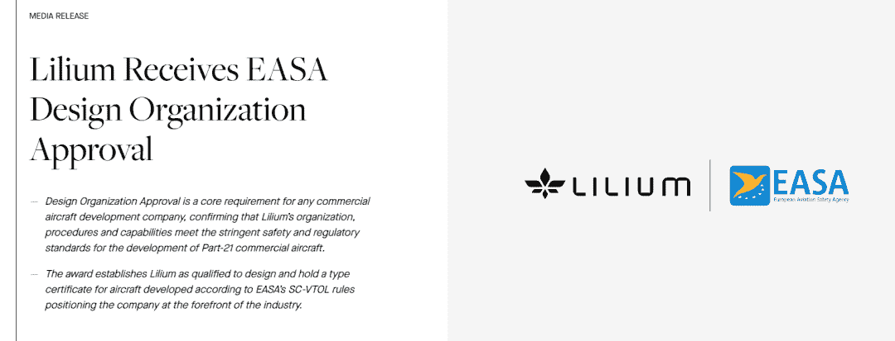

# 一天之内“三个离职群都满了”；飞行出租车的时代就此开启？丨 RTE 开发者日报 Vol.94

> 来源：[https://docs.feishu.cn/docx/SSuXdjc8WoQniFxiQOqcHJxUnlI](https://docs.feishu.cn/docx/SSuXdjc8WoQniFxiQOqcHJxUnlI)

开发者朋友们大家好：

这里**是「RTE 开发者日报**」，每天和大家一起**看新**闻、聊八卦。

**

我**们的社区编辑团**队会**整理分享 RT**E **（Real T**im**e Engagement） 领域内「有话题的新闻」、「有态度的观点」、「有意思的数据」、「有思考的文章」、「有看点的会议」，但内容仅代表编辑的个人观点，欢迎大家留言、跟帖、讨论。

本期编辑：@Asui，@CY

---

### **一、有话题的新闻**

**1、飞行出租车的时代就此开启？德**国 eVTOL 开发商获欧盟“运营许可证

当地时间 11 月 27 日，德国「电动垂直起降飞行器」（eVTOL）开发商 Lilium N.V．在官网宣布，公司收到了欧盟航空安全局（EASA）颁发的「设计机构批准」（Design Organization Approval，DOA）。

设计机构批准，是 EASA 对符合其法规要求的设计机构的一种认证，被批准的机构可以对航空产品进行自主工程设计、符合性证实和适航批准等相关工作，同时承担相应的持续适航责任。

Lilium 首席执行官 Klaus Roewe 表示，「EASA 的批准进一步激励我们走上 Lilium Jet 商业化之路。」

Lilium Jet 是公司推出的电动喷气式飞机，最多可容纳 7 人，巡航速度为 280 公里/小时，充电一次的航程超过 250 公里，这意味着其更倾向用于城际旅行，而不是跨国航班。

消息公布后，在纳斯达克上市的 Lilium 股价一度跳涨超 10%，最高报每股 0.970 美元。现涨幅收窄至 3.70%，报每股 0.913 美元。（@财联社）

2、消息称字节跳动成立新部门 Flow，发力 AI 应用层

近日，消息称字节跳动近期成立了一个新 AI 部门 Flow，技术负责人为字节跳动技术副总裁洪定坤。一位知情人士表示，这一新部门的业务带头人，为字节大模型团队的负责人朱文佳。

据了解，在字节圈内，Flow 近期发布了活水招聘帖，社会招聘也已经开始一段时间。在帖中，其表示是字节跳动旗下 AI 创新业务团队，“目前已经在国内和海外分别上线豆包和 Cici 两款产品，有多个 AI 相关创新产品孵化中”。在 11 月初，字节各个事业部都进行了不少业务和架构调整，这些调整仍在进行中，当前 Flow 的架构和汇报线未完全确定。（@36氪）

**3、Google Chrome 计划从 2**024 年初开始禁用第三方 Cookie

根据 Google 工程师的内部电子邮件，搜索巨人计划从 2024 年第一季度开始对 1% 的 Chrome 用户禁用第三方 Cookie。Google Chrome 是目前市场份额最高的浏览器，而 Google 同时也是最大的网络广告商，它淘汰第三方 Cookie 的计划以及替代 Cookie 方案引发了它可能获得相对于竞争对手优势的担忧。Google 目前正在测试的替代方案是隐私沙盒（Privacy Sandbox），隐私沙盒跟踪用户的兴趣，允许广告商根据兴趣展示广告，而用户可以管理兴趣并对其归类分组。根据内部电邮，初步测试完成之后，Google 将从明年 6 月开始分阶段推出替换 Cookie 计划。（@DoNews）

4、16% 的 AI 工作者正在使用开源模型

分析公司 O'Reilly 日前发布 2023 Generative AI in the Enterprise 报告，指出，生成式 AI 正经历前所未有的快速普及，而程序员们正积极将 AI 作为自己的工具。

报告显示，16% 的从事 AI 工作的受访者表示正在使用开源模型；77% 的受访者使用 AI 来辅助编程；AI 用户表示，AI 编程（66%）和数据分析（59%）是最需要的技能。

O'Reilly 表示，ChatGPT 是最受欢迎的 AI 搜索工具，其次是 Bing 和 Google Bard，而 GitHub Copilot 是最受欢迎的开发人员搜索工具。

报告基于 2013 年 9 月 14 日至 9 月 23 日期间收到的共 4782 份回复。其中有 2857 名受访者回答了所有问题。74% 的受访者来自北美或欧洲。（@IT之家）

5、字节游戏大面积裁撤！一天之内“三个离职群都满了”

字节跳动昨日宣布，旗下游戏业务朝夕光年，将进行大规模业务收缩——对已上线的且表现良好的游戏，会在保证运营的情况下寻求剥离；对还未上线的项目，除少量创新项目及相关技术项目外，均会关停。（@腾讯新闻潜望）

---

### 二、有态度的观点

1、维基百科创始人：ChatGPT 写百科一团糟

维基百科创始人吉米・威尔士（Jimmy Wales）认为，OpenAI 开发的人工智能聊天机器人 ChatGPT 在写维基百科文章方面是一团糟。这位免费在线百科全书的创始人在接受采访时表示，ChatGPT-4 在写维基百科文章时“很糟糕”、“完全不能用”。威尔士指出，ChatGPT-4“遗漏了很多内容，而且写错了很多事实，而且是以一种看似合理的方式写错的，它还编造了一些来源，简直是一团乱麻”。威尔士认为，超人类的 AI 可能至少需要五十年才能实现。（@IT之家）

**2、比尔·盖茨：GPT-5 不会比 GP**T-4 好多少，生成式 AI 已达到极限

比尔·盖茨日前在接受采访时表示，他认为生成式人工智能 GPT-5 未必会大大超越 GPT-4。盖茨提到，可能的突破是可解释的 AI，但可能要等到下一个十年才能实现。他强调，AI Agent 将引领科技行业和社会的崛起，而且强调这并非负面的预测。（@量子位）

3、英特尔前图形主管：独显不死，不会被集成处理器取代

11 月 27 日消息，据国外媒体报道称，虽然 AI 芯片发展火爆，但这不可能会取代独显的地位。前英特尔架构主管 Raja Koduri 表示，独立 GPU 不会很快被用于 AI 和 HPC 高性能计算的定制 SoC 所取代，其独特的稳定性决定了存在的必要性。在 Raja Koduri 看来，GPU 集成在处理器中的做法，用途并不稳定，而工程师们应该设计更多更高性能的架构，从而使这种模式潜能被更大发掘。当前基础架构已经接近发展了 20 年，由于架构缺乏实质性的改进，这就需要软件工程师更好的去优化性能等问题。（@凤凰网科技）

4、蒂姆·库克透露苹果招人标准：要相信一加一等于三

苹果首席执行官蒂姆·库克近期表示，苹果招聘员工的标准特点之一是“一加一等于三”的理念，意味着集体协作胜过独自创新。苹果雇佣的员工来自各行各业，库克愿意和具备合作意愿、好奇心、创造性和团队合作精神成为同事。（@腾讯科技）

---

**写在最后：**

我们欢迎更多的小伙伴参**与「RTE 开发者日报**」内容的共创，感兴趣的朋友请通过开发者社区或👸号留言联系，记得报暗号「共创」。

对于任何反馈（包括但不限于内容上、形式上）我们不胜感激、并有小惊喜回馈，例如你希望从日报中看到哪些内容；自己推荐的信源、话题、活动等；或者列举几个你喜欢看、平时常看的内容渠道；内容排版或呈现形式上有哪些可以改进的地方等。

---

