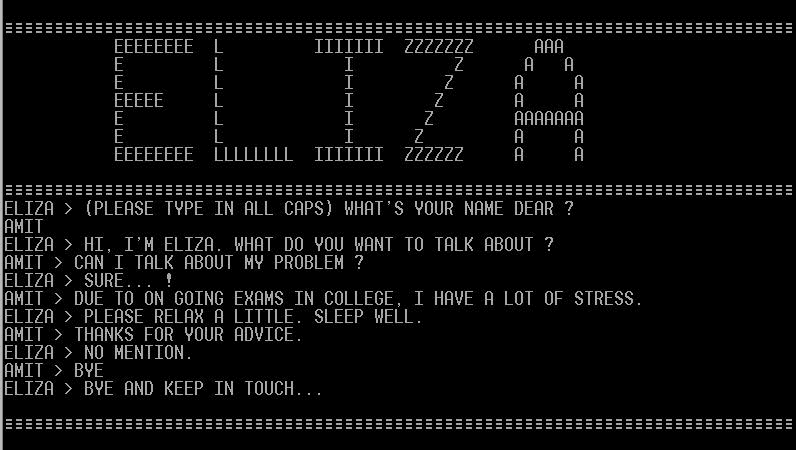

# 百度曾出价 8500 万挖“AI 教父”被拒；GPT-3.5 图灵测试中败给上世纪 AI丨 RTE 开发者日报 Vol.99

> 来源：[https://docs.feishu.cn/docx/FvtzdibgyoD52gxG9pgcYPfMnte](https://docs.feishu.cn/docx/FvtzdibgyoD52gxG9pgcYPfMnte)

开发者朋友们大家好：

这里**是「RTE 开发者日报**」，每天和大家一起**看新**闻、聊八卦。

**

我**们的社区编辑团**队会**整理分享 RT**E **（Real T**im**e Engagement） 领域内「有话题的新闻」、「有态度的观点」、「有意思的数据」、「有思考的文章」、「有看点的会议」，但内容仅代表编辑的个人观点，欢迎大家留言、跟帖、讨论。

本期编辑：@Asui，@CY

---

### **一、有话题的新闻**

1、百度曾出价 8500 万挖“AI 教父”被拒，选择入职谷歌

12 月 4 日，据知情人士透露，百度公司曾出价 1200 万美元（约合 8486 万元人民币）邀请“AI 教父”杰弗里·辛顿（Geoffrey Hinton）及其学生加入公司，但被拒绝。“我们不知道自己值多少钱。”辛顿表示。他咨询了收购方面的律师和专家，想出了一个计划：“我们将组织一场拍卖，自己兜售自己。”

最终，辛顿博士和他的学生们在 4400 万美元（约合 3.1 亿元人民币）的价格上停止了这次拍卖。虽然出价仍在上升，但他们想为谷歌工作。这一报酬已经很惊人。据悉，今年 5 月辛顿宣布从谷歌离职。辛顿表示，从谷歌辞职是为了可以自由地谈论 AI 的风险。他说，现在对自己一生从事的工作感到有些后悔。（@凤凰网科技）

2、GPT-3.5 在图灵测试中败给上世纪六十年代研发的 AI

来自 UCSD 的 2 位研究人员在一篇题为「GPT-4 可以通过图灵测试吗」的研究中，对 GPT-4、GPT-3.5、人类和上世纪 60 年代麻省理工团队开发的史上第一个基于规则的聊天机器人进行了图灵测试。

GPT-3.5 根据不同的提示，成功率最高只有 14%。ELIZA 在这次研究中取得了相对较好的成绩，成功率达到了 27%。GPT-4 取得了 41% 的成功率，仅次于人类得分（63%）。Gary Marcus 对此调侃道，通过图灵测试的梦想落空了。

作者在认真研究了为什么测试者将 ELIZA 认定是人类的原因，再次印证了一个结论：长久以来，「图灵测试」成为了判断计算机是否具有「智能」的核心命题。但图灵测试并不应该是一个判断 AI 智能高低的测试。不能因为 ELIZA 比 ChatGPT 表现好，就认为这个 1966 年的基于规则的 AI 系统智能比 ChatGPT 强。

因为测试者判断 ELIZA 是人类的最重要的原因居然是：我问他啥他都不想说，又没有表现得很热情或者很唠叨，我就没见过这么差的 AI，所以它一定是一个不耐烦的人类！（@新智元）

3、量子计算技术重磅升级：IBM 展示最新的模块化量子处理器

当地时间周一（12 月 4 日），IBM 在官方博客发文，展示了“量子效用”所需的硬件和软件，其中包括新的量子处理器芯片和量子计算系统。新闻稿称，IBM 展示了一种新方法：将芯片连接到机器内部，再将机器连接到一起，以形成模块化系统，使规模的扩展不受物理条件限制。IBM 称，将这种方法叠加新的纠错码，有望在 2033 年之前制造出引人注目的量子机器。（@ 财联社）

**4、Meta 推出 AI 音频模型 **Audiobox，支持语音及文字同时输入

Meta 推出 AI 声音生成模型 Audiobox，能接收语音和文字输入，基于早先的 Voicebox AI 模型。Audiobox 可以生成环境音、自然对话语音，并整合了音频生成和编辑能力。这款模型降低了声音生成门槛，便于任何人制作视频、游戏等应用场景的音效。Meta 宣称，Audiobox 的音质和生成内容的准确度超过其他音频生成模型，目前已向研究人员开放试用。（@IT之家）

**5、计算机视觉 GPT 时刻！UC 伯克利三巨头祭出首个**纯 CV 大模型，推理惊现 AGI 火花

UC 伯克利的 CV 三巨头推出首个无自然语言的纯视觉大模型，证明了纯视觉模型的扩展性。使用超过 420B token 的数据集让模型可以理解并执行下游任务，并统一了几乎所有数据形式。模型甚至能够在图像推理问题中做出正确推断，展现出了「AGI 的火花」。这一研究为纯视觉模型的发展开辟了新的方向，扩大了视觉模型的规模，减少了对语言数据的依赖。（@新智元）

6、法国初创公司推出「史上最轻最强」智能戒指

法国一家初创公司 Circular 日前推出了它的第一款智能戒指 Circular Ring Slim，号称是世界上迄今为止最为轻薄、功能最为强大的健康追踪器。

Circular Ring Slim 重量仅为 2 克，厚度仅有 2.2mm，由哑光黑色的喷砂铝和碳纤维制成，提供 8 种不同的尺寸。

功能方面，这款智能戒指配备了红外线 LED 传感器、三轴加速计、表面温度传感器，可对人体 7 种生物特征和 142 种衍生状态进行监测、评估。它内置了光电血氧仪技术，还可根据温度变化了解用户免疫系统健康状况和潜在疾病症状。

Circular Ring Slim 支持监测的健康指标包括血氧水平、心率变化、温度变化、呼吸频率、步数、压力水平和睡眠周期。它声称提供的健康数据是同类追踪器的 15 倍，可在每两分钟收集一次数据。

此外，该智能戒指拥有全新的触觉导航功能，还支持闹钟。续航方面，其单次充电之后续航时间为 5 天，充电时间为 45 分钟，可存储长达 20 天的数据。

这款智能戒指将从 12 月 15 日之后开始发货，其售价为 275 美元。（@中国家电网）

**7、相关人士回应美团直播推进商业化：今年**及明年重点在于探索适合本地商家的直播形态

据媒体报道，在直播一级入口刚上线的 7 月份，美团直播单月的 GMV 大约在 5-6 亿，环比增速在 20%，但 8 月份迅速上涨到 10-12 亿，并陆续出现破亿直播间。到了 10 月份，单月 GMV 突破 20 亿元。另外，在商家和 GMV 规模逐渐扩大后，美团直播会在近期上线付费投流功能，商业化也将成为明年重要的目标之一。针对此事，美团直播相关人士表示，今年及明年的目标仍然是提升直播基础能力、拓展商户参与度和提升用户体验，重点在于探索适合本地商家的直播形态。（@新浪科技）

---

### 二、有态度的观点

1、古尔曼：苹果公司正将更多注意力转向 6G 研发

12 月 4 日消息，彭博社的马克・古尔曼在当地时间周日发表了最新一期「Power On」，谈到了苹果对 6G 技术的研发规划。同时，他在自己的 X 推文中直言，「忘记苹果的 5G 调制解调器吧，尽管它尚未被取消。苹果的 6G 研究正在升温。据古尔曼介绍，苹果公司在开发 5G 蜂窝调制解调器的同时，正将更多的注意力转向 6G。（@电子工程合集）

**2、Meta 首席 AI 科学家：超级人**工智能不会很快到来，对量子计算持怀疑态度

12 月 4 日消息，上周末 Meta 的首席 AI 科学家、深度学习先驱、图灵奖得主杨立昆（Yann LeCun）在出席媒体活动时表示，如果人类想要训练出一种不仅仅具备总结文本能力、而且具备某种意义上类人的感知能力和常识的人工智能系统，还需要几十年的时间。除了人工智能，杨立昆也对量子计算机持怀疑态度。他的观点与英伟达 CEO 黄仁勋上周的观点截然不同。黄仁勋上周曾表示，人工智能将在不到五年的时间里成长到“相当有竞争力”的水平，在许多脑力密集型任务上胜过人类。（@中新经纬）

3、英伟达：将与软银等日企合作研发生成式人工智能

12 月 4 日，英伟达 CEO 黄仁勋在东京与日本首相岸田文雄会谈后表示，英伟达计划与包括软银在内的日本公司合作研究与开发生成式人工智能。（@新浪财经）

---

**写在最后：**

我们欢迎更多的小伙伴参**与「RTE 开发者日报**」内容的共创，感兴趣的朋友请通过开发者社区或公众号留言联系，记得报暗号「共创」。

对于任何反馈（包括但不限于内容上、形式上）我们不胜感激、并有小惊喜回馈，例如你希望从日报中看到哪些内容；自己推荐的信源、话题、活动等；或者列举几个你喜欢看、平时常看的内容渠道；内容排版或呈现形式上有哪些可以改进的地方等。

---

