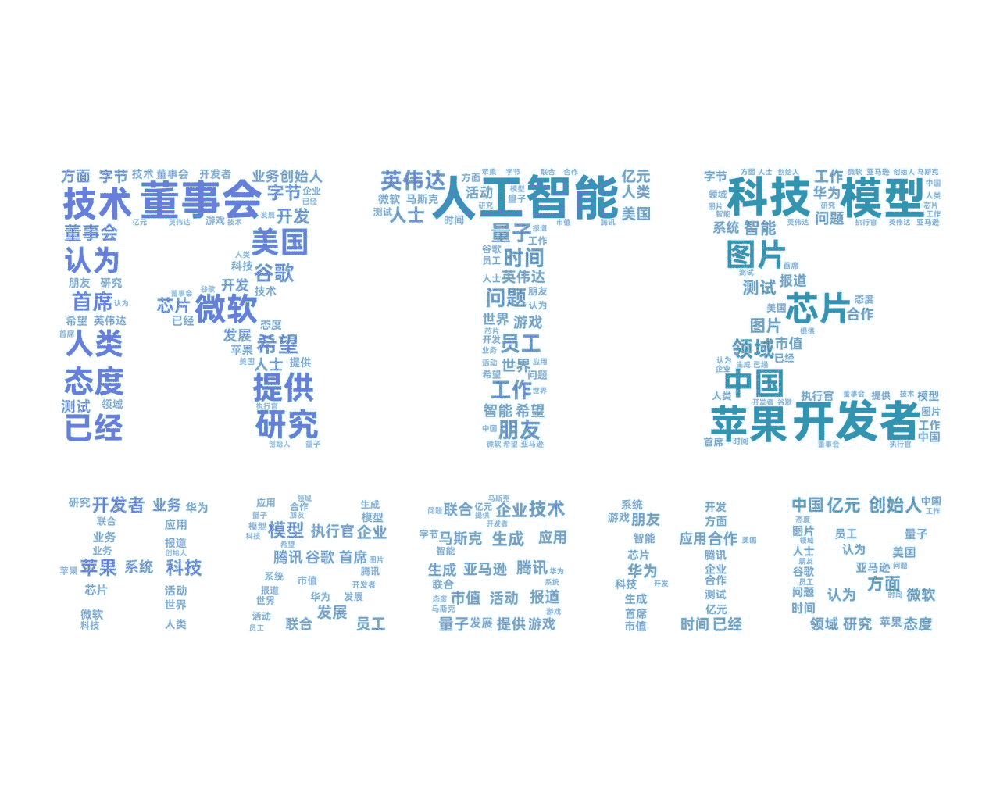

# 过去 100 天，发生了啥？丨 RTE 开发者日报 Vol.100

> 来源：[https://docs.feishu.cn/docx/Rt1YdmJ3dofiWbxaGh2co64inej](https://docs.feishu.cn/docx/Rt1YdmJ3dofiWbxaGh2co64inej)

开发者朋友们大家好：

这里是发布了 100 期**的「RTE 开发者日报**」，和大家一起看了 100 天的新闻、聊了 100 天的八卦。

老规矩，我们整理了一下过去 100 期发表的内容 —— 720 则新闻、340 个观点、119 篇文章以及若干条数据以及活动推荐。我们的小伙伴也将日报中的内容关键词整理成了词云，方便大家有个更直观的了解，过去的 100 天（期），通过这些热词看看发生了啥吧～

怎么说呢，还得是人工智能啊。照这个趋势发展下去，150 期的时候感觉就完全不需要我来编辑了，整个「日报大模型」就完事儿了。

值此 100 期之际，再次感谢我们的社区编辑团队以及参与过日报共建的特邀编辑们，是你们为行业的发展做了见证、为行业的从业者分享了新知、为我本人分担了工作量，希望大家再接再厉，我们一起把日报搞得更有价值。

也希望更多的小伙伴可以参与到日报（或者日报大模型）的共建当中来，或者提出宝贵的优化、迭代意见，毕竟社区是姆们的社区！

**

Ps：期待大家通过后台留言的形**式参与共建 or 提建议 or 送祝福，建议 & 祝福被采纳的前 5 名小伙伴将获得社区准备的周边礼物 1 份。搞起来吧！

本期编辑：@Asui，@CY

---

### **一、有话题的新闻**

1、Meta 和 IBM 等创建 AI 联盟，以共享技术和降低风险

Meta 和 IBM 正联手 40 多家公司和组织创建一个致力于开源人工智能 AI 工作的行业组织，旨在共享技术并降低风险。据周二的声明，这个名为“AI 联盟”的联合体将专注于负责任地开发 AI 技术，包括安全和安保工具。联盟还将寻求增加开源 AI 模型的数量——而不是一些公司青睐的专有系统，开发新硬件，并和学术研究人员合作。（@环球市场播报）

2、王慧文再次杀回 AI 创业赛道

原美团联合创始人王慧文最新动作为入股北京硅动科技有限公司，成为该公司新股东，持仓 5%。硅动科技由一流科技创始人袁进辉持有 95% 股份，为一家专注于软件和信息技术服务的公司。早前，王慧文因健康原因退出 AI 创业赛道，现重新回归。而此次的股权结构变化尚未带来新的项目或产品发布，但是两位创业者的合作引起了市场关注。（@融中财经）

**3、美图推出 AI 模型 MiracleVision **4.0 版，可生成矢量图形、支持文生视频

美图公司推出了 AI 模型 MiracleVision 4.0 版本，相比上一代新增了“AI 设计”与“AI 视频”能力。该版本计划将于 2024 年 1 月陆续应用于美图秀秀、美颜相机、Wink、美图设计室、WHEE 等美图旗下产品。在 AI 设计方面，MiracleVision 4.0 版本拥有“矢量图形”、“文字特效”、“智能分层”和“智能排版”四项功能，允许用户通过提示词生成矢量图形，为文字应用各种外观风格、智能为静帧分层，并可以直接生成不同版式的海报。在 AI 视频方面，MiracleVision 4.0 版本支持使用提示词及图片生成视频，也可以基于视频生成新风格，此外还能将静帧转换为视频。此外，美图公司表示 MiracleVision 正式开放商业 API，用户接入后，生产 10 万张以下图片，售价 0.1 元 / 张；10 万 - 100 万张，售价 0.08 元 / 张；100 万张以上，为 0.06 元 / 张。（@DoNews）

4、微软将推出必应深度搜索：整合 GPT-4

微软公司今日宣布，将推出必应深度搜索（Bing Deep Search）功能，旨在为用户的复杂查询提供更相关和更全面的答案。微软在一份声明中称，今年是人工智能走进人们日常生活中的一年。以必应聊天（Bing Chat）为例，它改变了人们在互联网上搜索、购物、编码、准备求职面试、提高游戏技能、创建漂亮的文档和图像的方式。接下来，微软将推出必应深度搜索，利用 GPT-4 的力量，为复杂的主题提供优化的搜索结果。微软同时指出，深度搜索并不是对必应现有网络搜索的替代，而是一种增强，提供了对网络进行更深层次和更丰富探索的选项。（@新浪财经）

5、研究称图片生成千次所耗能源，可以给手机充电 950 次

由卡内基梅隆大学和 Hugging Face 组成的科研团队发现，生成式 AI 的崛起不仅给各行各业都带来了重大变革，而且也会对地球环境产生重大影响。研究人员研究了包括聊天机器人、论文编辑器、图像分类器和图像生成器在内的各种 AI 模型的碳足迹，并测量这些模型在执行给定任务 1000 次后所消耗的能源和碳排放量。研究发现，例如聊天机器人和论文编辑器在内基于文本的模型相对节能，每千次聊天所需能源相当于主流智能手机充电所耗能源的 16%；不过使用图像分类器和图像生成器等图像类模型，效率最低的图像生成模型每千次消耗 11.49 kWh，相当于给主流手机充电 950 次所耗能源。（@IT之家）

---

### 二、有思考的文章

[**1、《陶哲轩：从**](https://mp.weixin.qq.com/s/X72WIF0qzPMMRKDoKJiDZw)复杂系统中，抓住奇妙的普适性》（@集智俱乐部）

探究宇宙中的秩序和混沌一直是科学研究的核心命题。陶哲轩教授的这篇洞察性文章引领我们进入普适的世界——一个展现了如何从错综复杂的微观动态系统中抽象出简明的宏观规律的奇妙领域。

从统计学的经典规律到物理学中的相变现象，从自然数序列的神秘规律到量子力学的精确预测，普适性作为一种被广泛记录和验证的模式在各种不同尺度和领域中展现了其惊人的一致性。然而，尽管这些规律已被实证学科反复确认，但对于普适性的严格数学基础仍存在着诸多未知之谜。

本文通过综合不同领域中的具体案例和研究成果，展示了当前科学界对这些宏观规律涌现机理的理解，并指出了这一研究领域所面临的挑战与前沿问题。

[**2、《我不认同“套壳**](https://mp.weixin.qq.com/s/6wJgCUg1Q9TF2THCuyCA4w) OpenAI 必死”的判断》（@MacTalk）

十一月，OpenAI 开发者大会之后，有个段子特别流行：投资人问创业者，你们的 AI 模型跟 OpenAI 有什么差别？创业者回答：“差异性就是比 OpenAI 差。”彼时，OpenAI 刚刚发布了 GPT 商店，它支持用户基于专有数据集创建自己的 ChatGPT。

人们疯狂给那个段子点赞，进一步坚信套壳 ChatGPT 必死的判断。现在一个月过去，终于可以冷静下来聊聊这话题了。有些话，虽然乍一听起来颇有道理，但在具体细节上却有很多值得推敲的余地。

---

**写在最后：**

我们欢迎更多的小伙伴参**与「RTE 开发者日报**」内容的共创，感兴趣的朋友请通过开发者社区或公众号留言联系，记得报暗号「共创」。

对于任何反馈（包括但不限于内容上、形式上）我们不胜感激、并有小惊喜回馈，例如你希望从日报中看到哪些内容；自己推荐的信源、话题、活动等；或者列举几个你喜欢看、平时常看的内容渠道；内容排版或呈现形式上有哪些可以改进的地方等。

---

