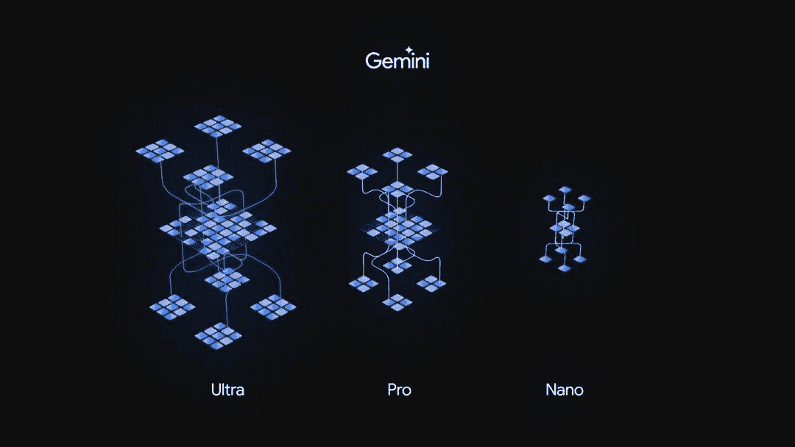
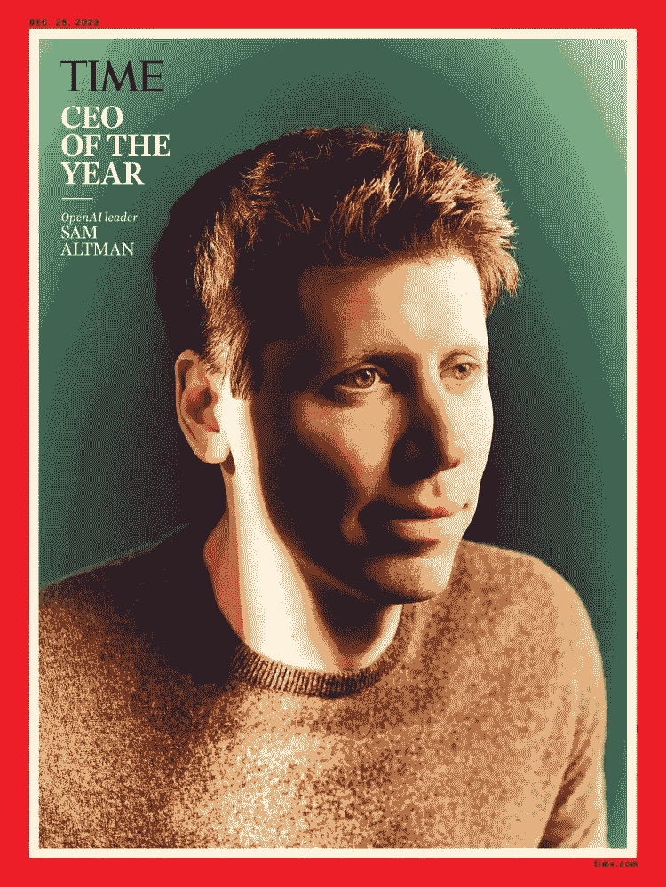

# 阿里巴巴宣布分红 25 亿美元；苹果故意降低 iPhone 性能被判赔偿丨 RTE 开发者日报 Vol.101

> 来源：[https://docs.feishu.cn/docx/FfnsdYZ1Ko9eVUxRqwHcwXYDnQe](https://docs.feishu.cn/docx/FfnsdYZ1Ko9eVUxRqwHcwXYDnQe)

开发者朋友们大家好：

这里**是「RTE 开发者日报**」，每天和大家一起**看新**闻、聊八卦。

**

我**们的社区编辑团**队会**整理分享 RT**E **（Real T**im**e Engagement） 领域内「有话题的新闻」、「有态度的观点」、「有意思的数据」、「有思考的文章」、「有看点的会议」，但内容仅代表编辑的个人观点，欢迎大家留言、跟帖、讨论。

本期编辑：@CY，@Asui

---

### **一、有话题的新闻**

1、谷歌推出其最强大的人工智能模型 Gemini

Gemini 有三种尺寸，用于三种不同的目的。｜图片来源：谷歌

12 月 6 日消息，谷歌宣布推出其认为规模最大、功能最强大的人工智能模型 Gemini。根据谷歌给出的基准测试结果，Gemini 在许多测试中都表现出了「最先进的性能」，甚至在大部分基准测试中完全击败了 OpenAI 的 GPT-4。

谷歌针对不同场景发布了三种不同版本：Gemini Ultra、Gemini Pro 和 Gemini Nano。这些不同的版本也将适用于不同的场景和案例：

+   Gemini Ultra - 用于处理高度复杂任务的最强、最大的模型。

+   Gemini Pro - 用于扩展各种任务的最佳模型。

+   Gemini Nano - 用于手机等设备的最高效模型。

从 12 月 13 日开始，开发者和企业客户将可以通过 Google AI Studio 或 Google Cloud Vertex AI 访问 Gemini Pro 的 Gemini API。

Gemini Ultra 目前只提供给被邀请的客户、开发者、合作伙伴以及安全专家进行早期实验和反馈，并计划于明年初向开发者和企业客户推出。（@IT之家）

> 昨天半夜测 pro 下来的感觉：

+   输出超快，别人按 token 出，这货按行出。可能是 TPU 发威了。

+   应该用了 MOE 同时能出好多结果让用户选。

+   自带的图片搜索能力，非常棒！

+   Agent / search 等功能都藏起来了。从产品的角度是不错的体验，但对开发者可能没有那么友好和透明。

+   demo 展示中的非常人性化。不知道开了多少“美颜”。期待 ultra（@网友评论）

2、苹果故意降低 iPhone 性能，被判向用户赔偿 7 万韩元

韩国首尔高等法院 12 月 6 日就 7 名韩国 iPhone 用户对苹果韩国公司提起的损害赔偿请求诉讼做出二审判决，判处苹果韩国公司侵害了 iPhone 用户的选择权而给用户造成了精神损失，向每名原告赔偿精神损失费 7 万韩元（约合人民币 385 元）。

原告提出，苹果公司在软件更新后故意降低设备性能。首尔高等法院 12 月 6 日在裁决中指出，“根据相关情况，很难断定相关更新引起的手机性能下降现象是永久的、不可逆的或者机械性受损。但苹果韩国公司作为运营商，发布更新是为了给用户提供更好的使用体验，对于系统更新后所产生的影响，苹果韩国公司和消费者之间存在着明显的信息不均衡、不对称性，苹果韩国公司有义务向用户告知更新后会产生的影响，让用户自行选择是否安装更新”。

此前，超过 6.2 万名韩国 iPhone 用户向苹果提起诉讼，指控苹果在软件更新后故意降低旧款手机的性能。首尔中央地方法院在今年 2 月的一审中判决原告败诉，理由是“很难判定 iPhone 的性能调节功能对用户产生负面影响”。

一审原告中有 7 人不服判决提出上诉，获得了二审的部分胜诉。（@央视财经）

3、小米 14 / Pro 手机内核已在 GitHub 开源

小米 14 / Pro 内核现已在 Github 开源（https://github.com/MiCode/Xiaomi_Kernel_OpenSource/tree/shennong-u-oss），AOSP 版本基于 Android U，标签为 KERNEL.PLATFORM.3.0.r1-03200-kernel.0-1。公开内核源码可以让第三方开发者进行修改，开发人员和愿意折腾的用户能够充分利用硬件的潜力，市场上也会很快出现该机型的第三方固件。（@IT之家）

4、知网 AI 生成文本检测新专利公布，提高论文代写判定效率

企查查 APP 显示，近日，同方知网数字出版技术股份有限公司申请的“一种 AI 生成文本的检测方法、装置、介质及设备”专利公布。

专利摘要显示，通过将待检测文本输入文本分类模型，得到文本为 AI 生成的第一概率值；基于待检测文本及目标损失函数，得到文本的偏离度特征；基于待检测文本、预测模型及预设字典，得到文本的扩散度特征值；基于待检测文本，得到文本的句子长度特征及字词分布特征；根据上述第一概率值、偏离度特征、扩散度特征值、句子长度特征及字词分布特征，判定待检测文本是否为 AI 生成文本。

该专利不仅检测效率高，且不受审核人员的主观影响，检测结果更加准确。（@C114通信网）

5、阿里巴巴宣布分红 25 亿美元

阿里巴巴发布公告称，将向截至 2023 年 12 月 21 日香港地区时间及纽约时间收市时登记在册的普通股持有人和美国存托股持有人，就 2023 财年首次派发年度股息，金额分别为每股普通股 0.125 美元或每股美国存托股 1.00 美元，以美元支付。根据财报披露，股息总额约为 25 亿美元。

6、外媒：谷歌宣布新的人工智能处理芯片和云「超级计算机」

12 月 6 日讯，据科技新闻网站 Engadget 报道，谷歌已经宣布创建其最强大的 TPU（正式名称为张量处理单元），Cloud TPU v5p，以及来自谷歌云的人工智能超级计算机。Cloud TPU v5p 是一个人工智能加速器，训练和服务模型。

Cloud TPU v5p 是在之前的版本（如 v5e 和 v4）基础上进行的改进。根据谷歌的说法，与 TPU v4 相比，TPU v5p 的浮点运算性能（FLOPs）提升了两倍，每个机架的 FLOPs 性能扩展性提高了四倍。此外，它训练 LLM 模型的速度比 TPU v4 快 2.8 倍，嵌入密集模型的速度比 TPU v4 快 1.9 倍。而新的人工智能超级计算机，包括一个集成系统，具有开放软件、性能优化硬件、机器学习框架和灵活的消费模型。其想法是，与单独看待每个部分相比，这种合并将提高生产力和效率。（@汇通财经 APP）

**7、特斯拉发布 Cybertruck 超**大充电宝：705KM 续航只需 11 万

特斯拉近日推出了一款适用于 Cybertruck 的里程拓展包，这款拓展包容量约为 47 千瓦时，重量大约在 250-272 千克，由 575 个 4680 电池构成。

根据官网数据显示，使用该拓展包后，Cybertruck 野兽版的续航里程将达到 705 公里，而全轮驱动版则可达 755 公里。据此前消息透露，这款「充电宝」的售价预计将达到 1.6 万美元（折合人民币约为 11.4 万）。每增加 1 公里所需成本为 570 元，但其是否划算仍需考虑用户需求。（@中关村在线）

**8、OpenAI 首席执行官 Sam Al**tman 被《时代》周刊评为年度 CEO

当地时间周三，OpenAI 首席执行官萨姆・阿尔特曼（Sam Altman）被《时代》周刊评为年度 CEO。除了阿尔特曼之外，泰勒・斯威夫特被评为「年度人物」；莱昂内尔・梅西被评为「年度最佳运动员」。（@IT之家）

---

### 二、有态度的观点

1、中国工程院院士邬贺铨：5.5G 呼之欲出，目标并不是取代 5G

2023 世界 5G 大会在郑州国际会展中心正式开幕。中国工程院院士邬贺铨表示，从 5G 到 6G 的中间会有一个 5.5G，中间还有 5G-A 的过程，它目标是 2025 年进入全部商用，它希望在峰值、连接密度、定位精度以及比特能效都比现在 5G 改进 10 倍。5G-A 需要在运营模式上有一些创新，可以说未来大众的应用在 5G，或者是使用那些只需要终端升级，并不需要网络硬件升级的 5G-A 就可以支持。当然，有比较高需求的用户可能需要使用 5G-A 的网络，就要建设新的基站，但并不是取代 5G，只是在热点的地区补充 5G，包括未来的 6G 也是如此。（@经济观察网）

2、Sam Altman：OpenAI 正在重新思考公司结构

据市场消息，OpenAI 创始人 Sam Altman 表示，OpenAI 正在重新思考公司结构。（@新浪财经）

3、英伟达 CEO 黄仁勋：将为中国市场提供符合美国规定的新产品

英伟达公司的首席执行官黄仁勋 12 月 6 日表示，在生产「最好的」人工智能芯片的竞赛中，华为是英伟达「非常强大」的竞争对手之一。他透露，英伟达正在与美国政府密切合作，确保面向中国市场的新芯片符合出口限制。

黄仁勋表示，中国市场占英伟达销售额的 20% 左右，该公司将继续「完美」遵守贸易法规，并为中国市场提供一套符合美国政府最新规定的新产品。他补充说，英伟达需要寻求市场的建议，这一过程正在进行中。（@澎湃新闻）

---

**写在最后：**

我们欢迎更多的小伙伴参**与「RTE 开发者日报**」内容的共创，感兴趣的朋友请通过开发者社区或👸号留言联系，记得报暗号「共创」。

对于任何反馈（包括但不限于内容上、形式上）我们不胜感激、并有小惊喜回馈，例如你希望从日报中看到哪些内容；自己推荐的信源、话题、活动等；或者列举几个你喜欢看、平时常看的内容渠道；内容排版或呈现形式上有哪些可以改进的地方等。

---

