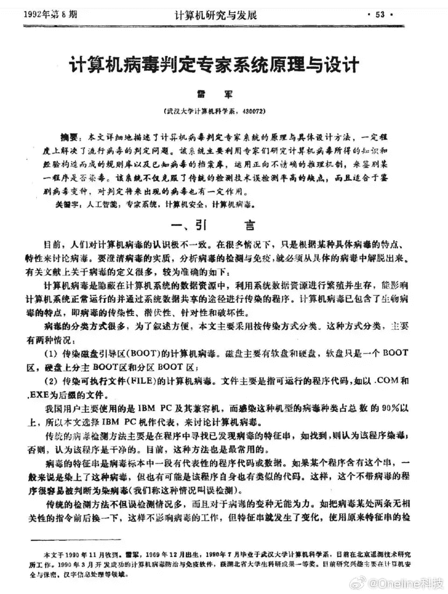

# 奥特曼被指爱权力胜过金钱；人类才是「幻觉问题」根本原因丨 RTE 开发者日报 Vol.103

> 来源：[https://docs.feishu.cn/docx/KCrVdV89zoqzrkxZR0WcBc0UnNg](https://docs.feishu.cn/docx/KCrVdV89zoqzrkxZR0WcBc0UnNg)

开发者朋友们大家好：

这里**是「RTE 开发者日报**」，每天和大家一起**看新**闻、聊八卦。

**

我**们的社区编辑团**队会**整理分享 RT**E **（Real T**im**e Engagement） 领域内「有话题的新闻」、「有态度的观点」、「有意思的数据」、「有思考的文章」、「有看点的会议」，但内容仅代表编辑的个人观点，欢迎大家留言、跟帖、讨论。

本期编辑：@Asui，@CY

---

### **一、有话题的新闻**

1、Google 承认 Gemini 大模型演示视频有剪辑成分

当地时间周三，Google 突然发布其重磅 AI 杀手锏 Gemini。随后，Google 还发布了一段六分钟的演示视频，展示了多模态模型（即它理解并混合语言和视觉理解）如何灵活地响应各种输入。据外媒报道，视频所展示的许多功能并不是独一无二的，完全可以通过 ChatGPT Plus 来复制 Gemini 的表现。Google 也承认，该视频经过了剪辑，它在视频描述中写道，“出于演示的目的，为了简洁起见，延迟已经减少，Gemini 的输出也已缩短”。另外，演示也不是实时或语音进行的。Google 发言人表示，该视频使用了静态图片和多段提示词拼凑，才能达成这样的效果。（@澎湃新闻）

2、脑机之父称马斯克的脑机接口公司无任何创新

最近，马斯克的脑机接口公司 Neuralink 屡次成为外界议论的焦点。从获得 4300 万美元的风险投资、被传实验导致猴子死亡到宣布将做人体试验，这个以实现“人脑意识上传”为长远目标的公司，却遭到了“脑机之父”、该领域学术奠基人米格尔·尼科莱利斯直接而犀利的批评。他认为，Neuralink 根本没有作出任何创新，称马斯克本人甚至不知道大脑的位置。作为一名神经学家，尼科莱利斯表示，即使他发明了“侵入式”脑机接口，也不会向每个人推荐，“脑机接口面临的挑战不仅是技术上的，更是医学和社会上的”。（@财联社）

**3、OpenAI 新内幕：奥特曼被指爱权**力胜过金钱，解雇之初承诺支持临时 CEO

虽然 OpenAI 的“逼宫”大戏已经尘埃落定，但有关这场剧变的内幕开始浮出水面。据称奥特曼被解雇之初曾承诺支持新的临时首席执行官，但几个小时后反悔。奥特曼曾故意挑拨董事会成员之间的关系，将与自己不合的董事赶出 OpenAI。据说苏茨凯弗曾告诉董事会成员他可能会辞职，此举被视为威胁董事会以罢免奥特曼。（@腾讯科技）

4、苹果新专利可拼接视频会话双方 3D 空间

日前，苹果公司申请的“通信会话期间的合并 3D 空间”专利公布，可在通信会话中让两名参与者在扩展现实 （XR） 环境中看到彼此的物理空间，并在虚拟空间交流，实现传送门效果。该专利与其即将推出的增强现实头显 Vision Pro 有关，可捕捉并合并两个物理空间，为远程协作、教育、娱乐带来新应用。（@IT之家）

**5、苹果 CEO 库克每天怎么过？四**点起床阅读数百封邮件，最后一个离开办公室

据外媒报道，苹果首席执行官蒂姆·库克通常会在黎明前起床，在去健身房之前阅读数百封来自客户的反馈邮件。库克每天还需要主持长达数小时的会议，通常是最后一个离开办公室的人。（@腾讯科技）

---

### 二、有思考的文章

1、雷军 30 年前写的论文：《计算机病毒判定专家系统原理与设计》

雷军 1992 年发表的《计算机病毒判定专家系统原理与设计》论文在网上曝光，引发热议。这份论文详细地描述了计算机病毒判定专家系统的原理与具体设计方法，一定程度上解决了流行病毒的判定问题。（🧣@Oneline 科技）

[**2、因果科学 x**](https://mp.weixin.qq.com/s/2X9H0cRwNM3O-jarmwLsWg) Agents：如何让 AI 更好地理解因果？（@集智俱乐部）

伴随着 ChatGPT 引发的 AI 浪潮，从年初的斯坦福小镇，再到最近 OpenAI 开放的 GPTs 商店，大语言模型驱动的智能体（Agents）展现出令人惊叹的智能水平和广阔的应用前景，引发各行各业的广泛关注。而在此之前，强化学习和机器人领域的学者已经在长期进行 Agents 相关的研究。

因果强化学习（Causal RL）这一新兴领域的核心，即是让 Agents 能更好地理解环境中的因果关系，做出更好的决策。

近日，集智俱乐部因果科学社区成员、悉尼科技大学博士生邓智鸿参与的一篇因果强化学习综述被 Transactions on Machine Learning Research （TMLR） 正式接收，本文从 Agents、因果、结构因果模型等基础概念讲起，介绍了这篇综述的主要内容，以及对因果强化学习的深入思考。作者认为，对于探讨 Agents 和人类的关系而言，除了多模态和具身，因果也是一个很好的切入点。

**3、大模型就是「造梦机」，Karpathy**[** 一语惊人！**](https://mp.weixin.qq.com/s/J3YWEyS3ZFlY0q4IMDHkOw)人类才是「幻觉问题」根本原因（@新智元）

幻觉，早已成为 LLM 老生常谈的问题。然而，OpenAI 科学家 Andrej Karpathy 关于大模型幻觉的解释，观点惊人，掀起非常激烈的讨论。

在 Karpathy 看来：“从某种意义上说，大语言模型的全部工作恰恰就是制造幻觉，大模型就是「造梦机」。”

另外，Karpathy 的另一句话，更是被许多人奉为经典。他认为，与大模型相对的另一个极端，便是搜索引擎。

「大模型 100%在做梦，因此存在幻觉问题。搜索引擎则是完全不做梦，因此存在创造力问题」。

总而言之，LLM 不存在「幻觉问题」。而且幻觉不是错误，而是 LLM 最大的特点。只有大模型助手存在幻觉问题。对此，英伟达高级科学家 Jim Fan 分享了自己的看法，「令人着迷的是，最好的 LLM 可以通过切换到『工具使用模式』来『决定』何时做梦，何时不做梦。网络搜索是一种工具。LLM 可以动态调整自己的『dream% 超参数』。GPT-4 试图做到这一点，但远非完美」。

---

**写在最后：**

我们欢迎更多的小伙伴参**与「RTE 开发者日报**」内容的共创，感兴趣的朋友请通过开发者社区或👸号留言联系，记得报暗号「共创」。

对于任何反馈（包括但不限于内容上、形式上）我们不胜感激、并有小惊喜回馈，例如你希望从日报中看到哪些内容；自己推荐的信源、话题、活动等；或者列举几个你喜欢看、平时常看的内容渠道；内容排版或呈现形式上有哪些可以改进的地方等。

---

