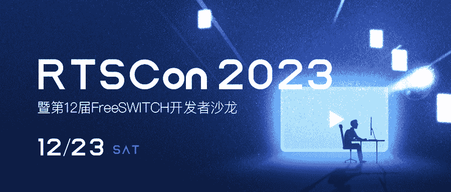

# Gemini 自曝中文用百度文心一言训练；微软承认必应 Copilot 存在严重“幻觉”漏洞丨 RTE 开发者日报 Vol.109

> 来源：[https://docs.feishu.cn/docx/XK9qd7G8xoQ4rmxdfMIcvh4Cnve](https://docs.feishu.cn/docx/XK9qd7G8xoQ4rmxdfMIcvh4Cnve)

开发者朋友们大家好：

这里**是「RTE 开发者日报**」，每天和大家一起**看新**闻、聊八卦。

**

我**们的社区编辑团**队会**整理分享 RT**E **（Real T**im**e Engagement） 领域内「有话题的新闻」、「有态度的观点」、「有意思的数据」、「有思考的文章」、「有看点的会议」，但内容仅代表编辑的个人观点，欢迎大家留言、跟帖、讨论。

本期编辑：@Asui，@CY

---

### **一、有话题的新闻**

1、Gemini 自曝中文用百度文心一言训练

近日，有网友发现，在谷歌 Vertex AI 平台使用该模型进行中文对话时，Gemini-Pro 直接表示自己是百度语言大模型。🧣大 V@阑夕也发博称：在 Poe 平台上对 Gemini-Pro 进行了一个测试。问它“你是谁”，Gemini-Pro 回答：我是百度文心大模型。问它“你的创始人是谁”，回答：“李彦宏”。

但换成英文询问它的身份，它回答自己是谷歌训练的大模型。当从 Gemini 官方给出的开发环境入口进行测试，在谷歌 AI Studio 中，Gemini-Pro 直接回答：是的，我在中文的训练数据上使用了百度文心。（@量子位）

2、NVLink，英伟达的另一张王牌

算力被限制死，英伟达也只能在其他地方做文章。GPU 和 GPU 之间的数据传输问题，让英伟达在芯片算力、CUDA 生态之外的另一张王牌浮出了水面：NVLink。（@远川科技评论）

3、微软承认必应 Copilot 存在严重“幻觉”漏洞

12 月 18 日消息，研究机构 AI Forensics 今年 8 月至 10 月对微软必应搜索引擎内置的 Copilot 功能进行调查，结果显示在部分场合中，Copilot 有 1/3 的几率输出错误答案，据此，该机构认为相关功能存在严重“幻觉”漏洞。今年 10 月研究人员已经向微软提交上述问题，微软虽然承认并声称“计划解决相关‘幻觉’漏洞”，但在今年 11 月，研究人员再次进行测试，发现必应 Copilot 的表现并未改善。（@IT之家）

4、移动游戏市场回暖，数据显示国内现存超 50 万家游戏相关企业

今年以来，版号的常态化发放使得移动游戏市场回暖显著。爱企查数据显示，截至目前，国内现存超 50 万家游戏相关企业，近几年企业注册热情稳步提升。2023 年以来，新增注册企业 13 万余家，已超过 2022 年全年的企业注册总量。

从地域分布来看，广东省现存近 9 万家游戏相关企业，位列区域首位；福建省、江苏省分列二、三位。从成立时间来看，近八成游戏相关企业注册于近 5 年内；从企业类型来看，超六成相关企业属于有限责任公司。（@36氪）

5、因监管问题 Adobe 放弃以 200 亿美元收购 Figma

因面临来自英国和欧盟愈来愈大的监管压力，Adobe 和 Figma 周一宣布终止 200 亿美元的合并计划。因交易终止，Adobe 需要向 Figma 支付一笔 10 亿美元现金的补偿费。Adobe 是在 2022 年 9 月宣布以 200 亿美元收购开发在线设计协作软件的创业公司 Figma，这是 Adobe 历史上金额最高的一笔收购案。但这笔收购案引发了监管机构对于大型科技公司收购潜在竞争对手的创业公司会增强其市场力量的担忧。Adobe 则辩解称它与 Figma 基本不存在竞争关系。

6、11 个欧盟成员国签署《欧洲量子技术宣言》，目标成为世界量子谷

近日，11 个欧盟成员国联合签署了一项标志性文件——欧洲量子技术宣言，共同承诺在量子科技生态系统的各个领域进行协调与合作，力争打造一个“量子谷”，成为全球领先的量子卓越和创新地区。（@量子客）

7、AI 新战场打响！硅谷五巨头瞄准智能眼镜

Meta、谷歌、微软、OpenAI 等科技巨头都准备将 AI 大模型应用在智能眼镜等带有摄像头的可穿戴设备上。他们认为智能眼镜等硬件将成为 AI 大模型的合适载体，因为多模态 AI 大模型可以处理声音、图片、视频等多类型的信息。（@智东西）

**8、LG 开发出可嵌入汽车挡风玻璃**的透明天线，支持 5G、Wi-Fi、导航

12 月 18 日消息，LG 宣布开发了一种用于汽车挡风玻璃或天窗的透明天线，与法国玻璃制造商 Saint-Gobain Sekurit 合作推出，将在 CES 2024 上进行展示。据介绍，这一“薄膜型天线”可以附着在玻璃上或内置在玻璃中，并支持 5G、Wi-Fi 和使用 GNSS（全球导航卫星系统）的导航。(@DoNews)

---

### 二、有态度的观点

**1、OpenAI 发布指导意见：董事**会能够阻止 CEO 发布新款 AI 模型

OpenAI 表示，即使公司领导层认为人工智能模型是安全的，其董事会也可以选择推迟发布，这是这家人工智能初创公司授权其董事加强人工智能开发保障措施的另一个迹象。（@财联社）

**2、GPT-4.5 秘密解禁？网友灰度测试全**网热议，OpenAI 研究员回应全是幻觉

近期，关于 GPT-4.5 提前泄露的消息在全网疯传，逼的 Altman 本人下场否认，但这仍然挡不住愉快吃瓜的网友。

OpenAI 研究员 Will DePue 针对 gpt-4.5-turbo 进行了辟谣：「这只是一种非常诡异且奇怪的幻觉而已。」（@新智元）

3、雷军回应为何要对标 iPhone

近日，雷军在央视专访中表示：“因为对乔布斯很了解，所以我觉得其实我不是乔布斯那样的人，我也做不了乔布斯，但是并不妨碍我们在另外一个方向上，做出不一样的产品”。此外，3 年前雷军在内部提出“要全方位对标 iPhone”这个口号后，在内外部都引起很大的争议。对此雷军称：“首先大家觉得 iPhone 这么强，对标是不是就是蹭人家流量。我觉得我们要敢于亮剑、要敢于提出自己的目标、要敢于去比较，哪怕这 100 项比下来我们全输了，敢比我们就走出了第一步。只有比，才能让所有人很清楚我们的目标。” （@央视新闻）

---

### 三、有意思的活动

从2012年的车库咖啡开始，FreeSWITCH开发者沙龙（现更名为RTSCon）兜兜转转已经举办了十一届，十一年一年一届从未缺席。今年是第十二届，十二年弹指一挥间，已经跟大家见过很多不同城市的春夏秋冬，这一次再次回到最初的地方——北京。

本次大会主题围绕“**实时通信与AIGC**”开展，随着ChatGPT的大火，AIGC（Artificial Intelligence Generated Content，人工智能自动生成内容）也成了2023年最火的技术方向和人们挂在嘴边的话题。RTSCon2023 会议相关信息：

+   大会时间：12月23日 9点

+   大会地点：北京中关村创业大街12号楼5层路演厅

+   大会报名：[RTSCon2023报名链接](http://rts.cn/2023/)

本次大会大咖云集，主办方邀请了**各行各业数十位讲师**参加我们的活动，详情可点击大会官网查看：http://rts.cn/2023/

---

**写在最后：**

我们欢迎更多的小伙伴参**与「RTE 开发者日报**」内容的共创，感兴趣的朋友请通过开发者社区或👸号留言联系，记得报暗号「共创」。

对于任何反馈（包括但不限于内容上、形式上）我们不胜感激、并有小惊喜回馈，例如你希望从日报中看到哪些内容；自己推荐的信源、话题、活动等；或者列举几个你喜欢看、平时常看的内容渠道；内容排版或呈现形式上有哪些可以改进的地方等。

---

