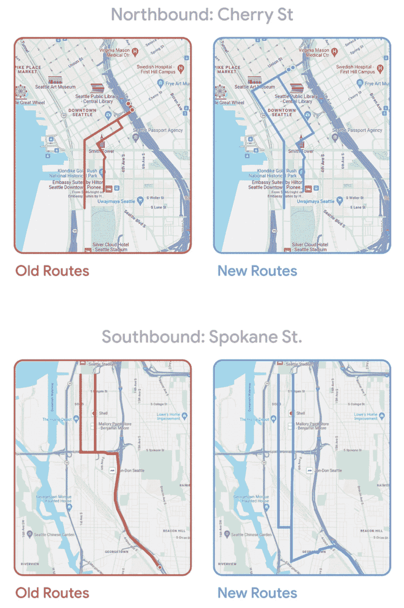

# 谷歌大裁员，3 万员工面临被 AI 取代；网易、暴雪疑似「复合」！丨 RTE 开发者日报 Vol.113

> 来源：[https://docs.feishu.cn/docx/C5BkdcauqowCFvxMORPcTy6ynvh](https://docs.feishu.cn/docx/C5BkdcauqowCFvxMORPcTy6ynvh)

开发者朋友们大家好：

这里**是「RTE 开发者日报**」，每天和大家一起**看新**闻、聊八卦。

**

我**们的社区编辑团**队会**整理分享 RT**E **（Real T**im**e Engagement） 领域内「有话题的新闻」、「有态度的观点」、「有意思的数据」、「有思考的文章」、「有看点的会议」，但内容仅代表编辑的个人观点，欢迎大家留言、跟帖、讨论。

本期编辑：@Asui，@CY

---

### **一、有话题的新闻**

**1、网易、暴雪疑似「复合」**

在与国内多家游戏厂商经过长时间的洽谈后，暴雪最终选择与网易重新建立合作关系。据悉，合作确定后，双方将重新搭建国服运营团队，并测试服务器和相关系统，因此，玩家们期待的游戏重新上线可能需等待半年或更长时间。目前，网易官方尚未回应此事。而暴雪中国对此回应称：「谢谢关注，我们这边目前没有可以分享的信息或者更新。」（@36氪）

2、谷歌被曝或再次大裁员，3 万员工面临被 AI 取代

据报道，继 1.2 万员工大裁员之后，谷歌又计划重组广告销售部门——这将导致 3 万名员工面临裁员的风险。而这次谷歌的部门重组计划，让打工人们发现，除了面临经济下行、就业艰难之外，还可能由于自己性价比不如 AI 而被取代。在不久前的一次部门会议上，负责美洲大客户广告销售的 Sean Downey 表示，谷歌计划重组广告销售团队。知情人士称，谷歌将对部门员工进行整合，可能包括裁员，以及重新分配大客户销售部门中，负责监督与主要广告商关系的员工。一些员工预计，谷歌将在下个月正式宣布调整方案。（@新智元）

3、抖音负责人回应测试 AI 搜功能：目前尚不成熟

12 月 25 日，一则“抖音测试‘AI 搜’功能，可从抖音 APP 智能搜索总结答案”的消息在网络引发热议。综合多家媒体报道，抖音近日在 APP 内测试了一项新的功能，名为“AI 搜”。这是一种基于人工智能的搜索问答服务，可以为用户提供回答。对此，抖音相关负责人表示，相关功能还在测试中，目前尚不成熟。行业人士称该功能可能在灰度测试中，没有全量上线。（@中国证券报）

4、马斯克回应 Grok 失控：都被网友带坏了

中立、敢于直言，是“马斯克版 ChatGPT” Grok 一直在宣传的卖点。但最近网友们发现它的回答越来越带有倾向性，忍不住发帖吐槽，还@上了马斯克本人。用吐槽者自己的话说，Grok 开始变得越来越“ChatGPT 化”了。

马斯克吐槽用于训练 Grok 的互联网信息过于繁杂，充斥着“带有唤醒色彩的垃圾信息”，相当于间接承认了网友们的说法。同时，马斯克也表示：现在的 Grok 只是个测试版，以后会变好的。（@快科技）

5、机器人掌勺：全球首家 AI 全自动餐厅即将开业

全球首家由机器人和人工智能处理订单和食物的餐厅即将在美国南加州开业，这家名为“CaliExpress by Flippy”的餐厅将由机器人厨师掌勺，颠覆传统餐饮模式。

Flippy 是 Miso Robotics 研发的全球首款人工智能煎炸机器人，专攻汉堡、芝士汉堡和薯条烹饪。公司宣称，Flippy 可与人类厨师并肩作战，提升菜品质量和一致性，同时为餐厅节省可观成本。（@IT之家）

**6、GTA 5 源代码泄露**

黑客试图毁掉著名游戏开发商 Rockstar Games 的圣诞假期。他们通过一个 Discord 服务器泄露了 Rockstar Games 至今仍然热销的游戏《GTA 5》源代码，披露 Rockstar 正在开发校园版 GTA《恶霸鲁尼（Bully）》的续篇，以及预计 2025 年发布的《GTA 6》的开发代号为 Project Americas。《GTA 5》是史上最畅销的游戏之一， 2013 年发布至今售出了逾 1.9 亿份拷贝。Rockstar 仍然在更新它的在线模式 GTA Online。因圣诞假期 Rockstar 尚未对此做出回应。(@Solidot)

**7、谷歌介绍「交通疏导」AI 模型研究成果：平均缩短 **7 分钟拥堵时间、提升 30% 交通效率

12 月 25 日消息，谷歌研究院日前发文，介绍了一项利用开源模拟软件 SUMO（Simulation of Urban Mobility）打造的「交通疏导」AI 模型应用成果。

据悉，谷歌研究人员使用 SUMO 软件建立了西雅图 T-Mobile Park 及 Lumen Field 地区的基础模型，并利用了谷歌地图提供的「拥堵量」、「红绿灯位置」、「道路平均行驶速度」等信息绘制了完整的热力地图。

此前，谷歌研究人员与美国西雅图交通部合作，在 2023 年 8 月及 11 月在多项大型活动中实际应用了这项交通疏导 AI 模型，配合「动态引导显示屏（Dynamic Message Signs）」，平均缩短了 7 分钟拥堵时间，成功提升 30% 交通效率。（@IT之家）

---

### 二、有态度的观点

1、陈天桥：追加 10 亿元投入「AI+脑科学」

12 月 25 日下午，据「天桥脑科学研究院」官方帐号消息，盛大集团创始人陈天桥创立的天桥脑科学研究院（Tianqiao and Chrissy Chen Institute，简称 TCCI）近日宣布，追加 10 亿元人民币投入「人工智能（AI）+脑科学」，旨在推动人类智慧和机器智慧的相互结合与促进。

据悉，TCCI 是由陈天桥、雒芊芊夫妇私人出资 10 亿美元创建的，旨在聚焦 AI＋脑科学，支持、推进全球范围内脑科学研究，造福全人类，目前已经成为知名的支持人类脑科学研究的科研机构。TCCI 已定下非常前沿技术战略：「All in AI for Brain Science」（一切尽在 AI 脑科学领域）。（@钛媒体）

2、郭明錤：2024 年 Vision Pro 出货预估约 50 万部

12 月 25 日电，天风国际分析师郭明錤最新表示，2024 年 Vision Pro 出货预估约 50 万部。目前 Vision Pro 已量产，预计在 2024 年 1 月首周开始大量出货。根据目前的大量出货时程，Apple 最有可能将在 1 月底或 2 月初发售 Vision Pro。（@财联社）

---

**写在最后：**

我们欢迎更多的小伙伴参**与「RTE 开发者日报**」内容的共创，感兴趣的朋友请通过开发者社区或公众号留言联系，记得报暗号「共创」。

对于任何反馈（包括但不限于内容上、形式上）我们不胜感激、并有小惊喜回馈，例如你希望从日报中看到哪些内容；自己推荐的信源、话题、活动等；或者列举几个你喜欢看、平时常看的内容渠道；内容排版或呈现形式上有哪些可以改进的地方等。

---

